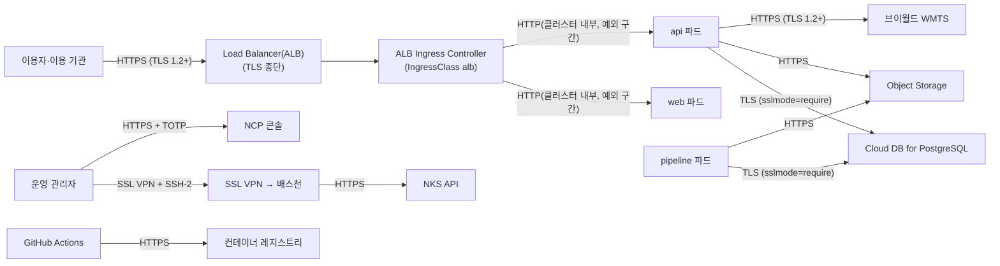

---
tags:
  - CSAP
  - 작성본
  - 하등급SaaS
  - 기술적보호조치
control: 11.1.4 네트워크 암호화
section: 11.1 네트워크 보안
doc_type: 작성본
evidence: 클라우드서비스 내에 암호화 통신 채널 사용 현황
문서 양식 번호: LS-11.1.4-02
문서 양식 버전: 0.0.1
문서번호: JAS-11.1.4-02
문서 버전: 1.0
상태: 대기중
대기 사유: 운영 Load Balancer(ALB) 리스너·TLS 정책·인증서, Cloud DB, Object Storage 운영 엔드포인트, SSL VPN·배스천이 없어 구간별 프로토콜·스위트·인증서를 확인할 수 없음
작성일: 2026-10-20
---

> [!note] 근거
> [해설서/하등급-SaaS/11.1.4 네트워크 암호화](../../../../../../projects/jeju-ai/docs/CSAP/해설서/하등급-SaaS/02.%20기술적%20보호%20조치/11.1.4%20네트워크%20암호화.md)

> [!warning] 대기
> 아래가 생기면 해당 칸을 채운다. `대기:` 로 시작하는 자리표시자 칸이 대상이다.
> - 운영 도메인 인증서 발급, ALB 리스너 TLS 정책 확정(ALB 인스턴스는 Ingress 를 만들 때 생긴다) → 2항 1행. 공공 Ingress 방식(ALB Ingress Controller)은 2026-10-21 NKS 구축으로 확인했다(1항 종단 위치)
> - Cloud DB for PostgreSQL 생성과 api 의 DB 연결 구현 → 2항 3행
> - Object Storage 운영 엔드포인트·역할별 접근키 발급 → 2항 4행
> - SSL VPN·배스천 구성 → 2항 6행, 8행 출발지 전환
> - NKS API 엔드포인트 TLS 확인(클러스터는 2026-10-21 생성) → 2항 8행
> - NCP 콘솔 TLS·MFA 확인(운영 계정은 개설됨) → 2항 7행, 인프라 API·state 저장소 TLS 확인 → 2항 11행, NCP CSAP 인증서·계약서 → 4항 확인 자료
> - 브이월드 서버 중계 구현 → 2항 5행
> - CISO 의 예외 승인(3항 1행) → 승인일
> - 2026-10-21 인프라 1차 구축(VPC·NAT·NKS) 반영

> [!note] 현 구현과 차이
> 2026-10-21 현재 운영 VPC·NAT·NKS 가 있으나 서비스 운영 구간(LB·DB·Object Storage 앱 버킷)은 없다. 동작하는 운영 관리 구간은 2항 8·11행이다. 지금 동작하는 구간은 외부 연계(GHCR·브이월드)뿐이며 2026-10-20 에 클라이언트 측 TLS 확인을 했다(2항 5·9행). 로컬·dev0 의 api ↔ 스토리지는 `S3_ENDPOINT=http://…`(SeaweedFS·MinIO) 평문이고, dev0 의 TLS 는 사내 Nginx Proxy Manager 가 종단한다(인증 대상 아님).

# 암호화 통신 채널 사용 현황

| 문서번호 | 버전 | 기준일 | 작성자 | 검토자 | 승인자 |
| --- | --- | --- | --- | --- | --- |
| JAS-11.1.4-02 | 1.0 | 2026-10-20 | {{운영(인프라) 담당자 성명}} | {{정보보호 관리자 성명}} | {{CISO 성명}} |

## 1. 통신 구성 요약

지반침하 스마트관리 시스템(제주 GEO-AI 지반침하 SaaS)에서 중요정보가 이동하는 구간과 적용된 암호화 통신 채널을 표시한다(운영 목표 구조).

- TLS 종단 위치: Load Balancer(ALB) 종단. 공공 NKS(KVM)는 ALB Ingress Controller 를 기본 포함하고 IngressClass `alb` 가 기본값이다(2026-10-21 `jeju-ai-prod-nks` 확인). Ingress 를 만들면 ALB 인스턴스가 LB 서브넷(Public `jeju-ai-prod-lb-pub-sn` `10.20.11.0/24`, Private `jeju-ai-prod-lb-pri-sn` `10.20.10.0/24`)에 생기며, 리스너·인증서는 그때 확정한다. Load Balancer ↔ 파드 구간은 2항 2행·3항 1행에 기록한다.
- TLS 종단 이후 ALB → web·api 파드 구간은 같은 VPC 안(LB 서브넷 → 노드 Private 서브넷 `jeju-ai-prod-node-sn` `10.20.1.0/24`)의 전달이며 평문이다. 이 구간으로 로그인 비밀번호·세션 쿠키가 지나가므로 3항에 예외로 기록하고 보완 통제를 둔다.

## 2. 암호화 통신 채널 현황

JAS-11.1.4-01 네트워크 암호화 지침 5항의 대상 구간을 빠짐없이 등재하고, 실제 설정과 일치하게 적는다. 알고리즘·키 길이는 보안강도 2^112 이상(예: AES 128bit 이상, RSA 2048bit 이상, SHA-256 이상)을 만족해야 한다.

| No | 통신 구간(출발지 → 목적지) | 용도·중요정보 | 암호화 방법(프로토콜·버전) | 알고리즘·키 길이(암호/키 교환/해시) | 인증서·키(발급기관, 만료일) | 설정 위치(시스템·설정 키) | 책임 | 지침 기준 충족 | 확인일 | 담당 | 비고 |
| --- | --- | --- | --- | --- | --- | --- | --- | --- | --- | --- | --- |
| 1 | 이용자 → Load Balancer·Ingress | 서비스 이용, 인증정보(로그인·세션 쿠키), 사고 기록·민감 레이어 | HTTPS, TLS 1.2/1.3, HSTS 1년 | {{대기: 운영 TLS 정책 확정 후 스위트 목록 — 목표 AES-GCM / ECDHE / SHA-256 이상}} | {{대기: 운영 도메인 인증서 발급기관·만료일}} | {{대기: LB 리스너 TLS 정책명}}(ALB, Ingress 어노테이션으로 지정), web `nginx.headers.conf`(HSTS) | 당사 | {{대기: 운영 TLS 스캔 후}} | | {{운영(인프라) 담당자 성명}} | HSTS 는 web(nginx)·api(helmet) 응답에 이미 적용 |
| 2 | Load Balancer(ALB, TLS 종단) → web·api 파드 | 위와 같은 요청의 내부 전달 | HTTP(평문) | 해당 없음 | 해당 없음 | 서비스 chart Ingress 백엔드(IngressClass `alb`) | 당사 | 미충족 — 3항 예외 | 2026-10-21 | {{운영(인프라) 담당자 성명}} | 출발지는 LB 서브넷 대역. NKS 가 ALB 생성 시 노드 ACG 에 LB 서브넷 대역 인바운드를 자동 추가한다. NetworkPolicy 출발지도 LB 서브넷 대역으로 한정 |
| 3 | api·pipeline → Cloud DB for PostgreSQL | 계정·권한·감사·사고 기록 조회·저장, DB 자격증명 | TLS 1.2 이상(`sslmode=require`, `require` 미만이면 기동 실패) | {{대기: Cloud DB 서버 TLS 설정 확인 — 목표 AES-GCM / ECDHE / SHA-256}} | NCP Cloud DB 서버 인증서({{대기: 발급기관·만료일}}) | api·pipeline DB 연결 설정(`sslmode`), Cloud DB SSL 강제 옵션 | 당사 | {{대기: DB 생성·api DB 연결 구현 후}} | | {{개발 책임자 성명}} | 서버 신원 확인(`verify-full`)은 CSAP 판정 후 결정 |
| 4 | api·pipeline → Object Storage | 레이어·번들·업로드·내보내기·백업 파일, 접근키 서명(SigV4) | HTTPS, TLS 1.2 이상 | {{대기: 운영 엔드포인트 TLS 확인}} | NCP Object Storage 인증서({{대기: 발급기관·만료일}}) | `S3_ENDPOINT`(https 사설 엔드포인트), 역할별 접근키(k8s Secret) | 당사 | {{대기: 운영 엔드포인트·접근키 발급 후}} | | {{개발 책임자 성명}} | 로컬·dev0 은 http(인증 대상 아님) |
| 5 | api → 브이월드 WMTS(`api.vworld.kr`) | 배경지도 타일 중계, 브이월드 키 | HTTPS, TLS 1.3(TLS 1.0·1.1 거부 확인) | TLS_AES_256_GCM_SHA384 / (TLS 1.3 ECDHE) / SHA-384, 서버 RSA 2048bit, 서명 sha256WithRSA | GlobalSign RSA OV SSL CA 2018, 2027-01-11 | {{대기: 서버 중계 구현 — 현재는 브라우저가 직접 호출}} | 당사(호출 측)·상대(서버) | 충족(상대 서버 측) | 2026-10-20 | {{개발 책임자 성명}} | 앱의 인증서 검증 생략 설정 없음 |
| 6 | 운영 관리자 → SSL VPN → 배스천 | 서버 원격 관리, 관리자 인증정보 | SSL VPN(TLS 1.2 이상) + SSH-2(키 인증) | {{대기: SSL VPN·sshd 알고리즘 확인}} | {{대기: VPN 인증서·SSH 키}} | NCP SSL VPN 설정, 배스천 `sshd_config` | 당사 | {{대기: 구축 후}} | | {{운영(인프라) 담당자 성명}} | |
| 7 | 운영 관리자 → NCP 콘솔 | 클라우드 자원 관리 | HTTPS + TOTP | 제공자 설정 | 제공자 인증서 | 제공자 | 제공자(채널)·당사(MFA) | {{대기: 공공 콘솔 계정 생성 후 확인}} | | {{운영(인프라) 담당자 성명}} | |
| 8 | 배스천 → NKS API(2026-10-21 현재 출발지는 사무실 고정 IP) | kubectl 관리 명령, NCP API 키 서명 토큰 | HTTPS, TLS 1.2 이상 | {{대기: NKS API 엔드포인트 확인}} | 클러스터 CA({{대기: 만료일}}) | kubeconfig(`ncp-iam-authenticator create-kubeconfig`), NKS API 접근 제한(기본 차단 + 사무실 고정 IP 1개 허용, `tofu/nks.tf` `ip_acl`) | 제공자(서버)·당사(접근) | {{대기: NKS API TLS 확인 후}} | | {{운영(인프라) 담당자 성명}} | 클러스터 `jeju-ai-prod-nks` 2026-10-21 생성. 배스천 구축 후 출발지를 배스천·VPN 출구로 바꾼다 |
| 9 | GitHub Actions → 컨테이너 레지스트리(현재 `ghcr.io`) | 이미지 push·pull, 레지스트리 토큰 | HTTPS, TLS 1.3(TLS 1.0·1.1 거부 확인) | TLS_AES_128_GCM_SHA256 / (TLS 1.3 ECDHE) / SHA-256, 서버 RSA 4096bit, 서명 sha256WithRSA | Sectigo Public Server Authentication CA DV R36, 2027-01-05 | `.github/workflows/ci.yml` build-push | 상대(서버) | 충족 | 2026-10-20 | {{개발 책임자 성명}} | NCP 공공 Container Registry 전환 예정(ADR D5) — 전환 시 행 갱신 |
| 10 | 운영 → Object Storage `backups/`(DB 백업 `pg_dump`) | DB 백업 전송 | HTTPS, TLS 1.2 이상 | 4행과 같음 | 4행과 같음 | 백업 CronJob 설정 | 당사 | {{대기: 백업 CronJob 구성 후}} | | {{운영(인프라) 담당자 성명}} | 데이터 이관 구간. 사내망 직접 이관은 SSL VPN 경유 |
| 11 | 운영 관리자 PC(OpenTofu) → NCP API Gateway(`ncloud.apigw.gov-ntruss.com`)·공공 Object Storage(state 버킷 `inp-gov-ncloud-tfstate`) | 인프라 생성·변경 요청, Sub Account `gov-ncloud-tofu` 인증키 서명, 인프라 state | HTTPS | {{대기: TLS 스캔 후}} | 제공자 인증서 | `inp-solution/gov-ncloud` `tofu/versions.tf`(provider `site = "gov"`, backend `s3` 엔드포인트 `https://kr.object.gov-ncloudstorage.com`) | 제공자(서버)·당사(호출 측) | {{대기: TLS 스캔 후}} | | {{운영(인프라) 담당자 성명}} | state 버킷은 비공개, NCP 관리형 키 서버측 암호화, 잠금 사용 |

- 구간이 추가·변경·폐지되면 행을 갱신하고 버전을 올린다.
- 인증서 만료일이 30일 이내로 남은 행은 비고에 갱신 계획을 적는다.

## 3. 미암호화 구간·예외 현황

JAS-11.1.4-01 지침 10항에 따라 예외 승인을 받은 구간만 기록한다. 예외 없이 미암호화 상태인 구간이 발견되면 즉시 조치하고 JAS-11.1.4-03 암호화 통신 채널 점검 결과서에 부적합으로 기록한다.

| No | 통신 구간 | 중요정보 이동 여부 | 예외 사유 | 예외 승인(승인자·일자) | 보완 통제 | 적용 기한 | 재검토 예정일 |
| --- | --- | --- | --- | --- | --- | --- | --- |
| 1 | TLS 종단 지점(Load Balancer(ALB)) → web·api 파드(2항 2행) | ○ | ALB 가 TLS 를 종단한 뒤 같은 VPC 의 노드 Private 서브넷(`10.20.1.0/24`) 파드로 전달하는 구조이며, 서비스 메시·파드 간 mTLS 는 도입 전이다 | {{CISO 성명}}, {{승인일}} | 종단 이후 구간은 인터넷에 노출되지 않는 VPC 내부(LB 서브넷 → 노드 Private 서브넷)에 한정, 노드 ACG 인바운드는 LB 서브넷 대역(NKS 자동 추가)·NetworkPolicy 로 출발지를 LB 서브넷 대역으로 한정, 파드 간 기타 통신 기본 거부, 워커 노드 접근은 배스천 경유로 한정 | 승인일부터 6개월 | 승인일부터 6개월 — CNI 투명 암호화(WireGuard 등) 또는 Ingress → 파드 재암호화 적용 여부를 그때 결정 |

## 4. 제공자 책임 구간 확인

책임공유모델에 따라 IaaS/PaaS 제공자가 책임지는 구간은 제공자의 인증·계약·공개 문서로 보호 수준을 확인하고 그 근거를 기록한다.

| 구간 | 제공자 | 확인 방법 | 확인 자료 | 확인일 | 담당 |
| --- | --- | --- | --- | --- | --- |
| 데이터센터 내 물리 네트워크 | NCP 공공기관용 | CSAP 인증서, 이용 계약, 공개 보안 백서 | {{대기: NCP 공공 CSAP 인증서·계약서 사본 — `30 증적/11.1.4/` 보관}} | {{대기: 확보일}} | {{정보보호 관리자 성명}} |
| 하이퍼바이저 내부 통신 | NCP 공공기관용 | CSAP 인증서, 책임공유 안내 문서 | {{대기: 위와 같음}} | {{대기: 확보일}} | {{정보보호 관리자 성명}} |
| 제공자 관리형 서비스 구간(NKS 제어 영역 내부, Cloud DB 복제·백업, Object Storage 내부 복제) | NCP 공공기관용 | 서비스 설명서·보안 백서 | {{대기: 공공 영역 서비스 설명서 확보}} | {{대기: 확보일}} | {{정보보호 관리자 성명}} |

## 5. 현행화 규칙

- 신규 구간 오픈, 구성 변경, 인증서 교체, 예외 승인·만료 시 5영업일 이내에 본 현황을 갱신하고 버전을 올린다.
- 반기 1회 이상 JAS-11.1.4-03 암호화 통신 채널 점검 결과서의 점검 결과를 반영하고, 반영한 점검 문서번호를 개정 이력에 적는다.
- 본 현황의 각 행을 뒷받침하는 설정 화면·인증서 사본 등 증적은 JAS-11.1.4-04 증적 수집 점검표에 따라 수집한다.

## 6. 승인

| 구분 | 직위 | 성명 | 서명 | 일자 |
| --- | --- | --- | --- | --- |
| 작성(인프라 운영 담당) | | | | |
| 검토(정보보호 관리자) | | | | |
| 승인(정보보호 최고책임자) | | | | |

- 서명본 보관 위치: 사내 문서 저장소 `CSAP/서명본/11.1.4/`

## 7. 개정 이력

| 버전 | 기준일 | 변경 내용 | 작성자 | 승인자 |
| --- | --- | --- | --- | --- |
| 1.0 | 2026-10-20 | 최초 작성(운영 구축 전, 점검 결과서 JAS-11.1.4-03-2026-01 반영) | {{운영(인프라) 담당자 성명}} | {{CISO 성명}} |
