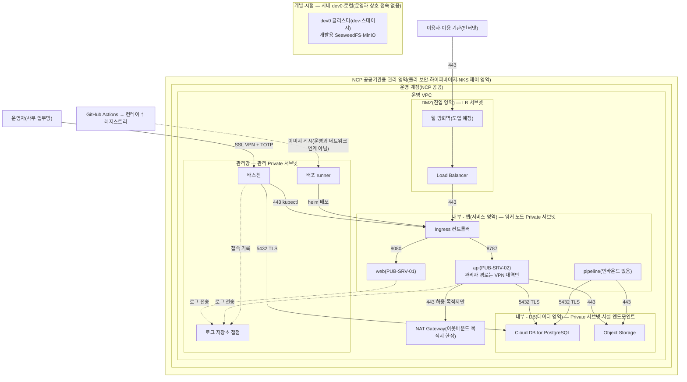

---
tags:
  - CSAP
  - 작성본
  - 하등급SaaS
  - 기술적보호조치
control: 11.1.5 네트워크 분리
section: 11.1 네트워크 보안
doc_type: 작성본
evidence: 네트워크 구성도 (네트워크 분리 및 연계 방법)
문서 양식 번호: LS-11.1.5-03
문서 양식 버전: 0.0.1
문서번호: JAS-11.1.5-03
문서 버전: 1.0
상태: 대기중
대기 사유: 운영 VPC·서브넷·NAT 는 2026-10-21 1차 구축했으나 관리망(VPN·배스천)·Cloud DB·사설 엔드포인트가 없어 관리 서브넷 CIDR·연계 구성 승인일과 격리 시험 결과를 채울 수 없음
작성일: 2026-10-20
---

> [!note] 근거
> [해설서/하등급-SaaS/11.1.5 네트워크 분리](../../../../../../projects/jeju-ai/docs/CSAP/해설서/하등급-SaaS/02.%20기술적%20보호%20조치/11.1.5%20네트워크%20분리.md)

> [!warning] 대기
> 아래가 생기면 해당 칸을 채운다. `대기:` 로 시작하는 자리표시자 칸이 대상이다.
> - 2026-10-21 인프라 1차 구축(VPC·NAT·NKS) 반영: 1항 계정·VPC·리전·존, 3항 DMZ·앱·DB 서브넷 대역과 NAT 영역, 3.1항 NAT 구성일을 채웠다.
> - 관리망 서브넷·SSL VPN·배스천 구축(미정) → 3항 관리망 CIDR
> - NCP 공공 CSAP 인증서 사본 확보 → 1항 인증번호
> - Object Storage·Container Registry 사설 엔드포인트, SSL VPN 구성 → 3.1항 연계 구성일
> - 응용 권한 구현과 이용 기관 격리 시험 → 5항 격리 검증
> - 운영 구성 후 첫 구조 변경 검토(JAS-11.1.5-04) → 6항 첫 검토 기록

> [!note] 현 구현과 차이
> 이 구성도는 운영 목표 구조다. 2026-10-20 현재 운영 VPC 는 없고 서비스는 사내 `dev0`(인증 대상 아님)에서만 돈다. 2026-10-21 운영 VPC·서브넷·NAT Gateway·NKS 클러스터를 OpenTofu 로 1차 구축했으나(`ops/gov-ncloud/tofu/`) 서비스 워크로드·NetworkPolicy·ALB·Cloud DB·관리망은 아직 없다. Network ACL 은 VPC 기본 ACL 이며 별도 규칙이 없다. dev0 의 jeju-ai-saas 리소스(fe·api·storage)에는 NetworkPolicy 가 없고, 접근 제한은 앞단 Nginx Proxy Manager 의 IP 허용 목록에 의존한다. LAN 에서 Cilium Ingress IP 로 바로 오면 그 제한을 거치지 않는다(`ops/dev0/apps/jeju-ai-saas/ingress.yaml` 주석).

# 네트워크 분리 구성도

| 문서번호 | 버전 | 기준일 | 작성자 | 검토자 | 승인자 |
| --- | --- | --- | --- | --- | --- |
| JAS-11.1.5-03 | 1.0 | 2026-10-20 | {{운영(인프라) 담당자 성명}} | {{정보보호 관리자 성명}} | {{CISO 성명}} |

## 1. 구성 개요

| 항목 | 내용 |
| --- | --- |
| 서비스 | 지반침하 스마트관리 시스템(제주 GEO-AI 지반침하 SaaS)(하등급 SaaS) |
| IaaS/PaaS 제공자 | 네이버클라우드플랫폼(NCP) 공공기관용, CSAP 인증 {{대기: NCP 공공 CSAP 인증번호 / 유효기간 — 인증서 사본 확보 후}} |
| 리전·가용영역 | NCP 공공기관용 `KR`(수도권, KR-CENTRAL) 리전, 존 `KR-1`(평촌) 단일 존(공공기관 데이터는 국내에 위치). 공공존은 리전마다 존이 하나뿐이라 Multi Zone 구성은 할 수 없다(2026-10-21 `getZoneList` 실측) |
| 운영 계정·VPC | NCP 공공기관용(gov-ncloud.com) 회사 계정(메인 계정 + 인프라 자동화 전용 Sub Account `gov-ncloud-tofu`), VPC `jeju-ai-prod-vpc` / `10.20.0.0/16`. 자원은 OpenTofu 코드(`inp-solution/gov-ncloud`)로만 관리한다 |
| 개발·시험 계정·VPC | 개발·시험은 NCP 계정 없음 — 사내 `dev0` 클러스터(사내망, Talos·Cilium, 네임스페이스 `dev`)와 개발자 로컬(compose·k3d). 운영과 물리적으로 분리 |
| 인터넷 진입점 | (웹 방화벽 — 도입 예정) → NCP Load Balancer → NKS Ingress 컨트롤러 → web·api |
| 관리자 진입점 | NCP SSL VPN → 배스천(TOTP 다중 인증) → NKS API·NCP 콘솔·DB 클라이언트. SSL VPN·배스천은 미구축이며, 2026-10-21 현재 클러스터 API 는 기본 차단 후 사무실 고정 IP 1개만 허용한다 |
| 구성도 원본 | 이 문서의 mermaid 원문. 클라우드 구성 내보내기는 `CSAP-인증준비/30 증적/11.1.5/03_구성/` 에 보관 |

- 서버·ACG 단위의 상세 구성과 공개서버 목록은 JAS-9.1.5-03 공개서버 네트워크 및 시스템 구성도를 따르고, 본 문서는 영역(존) 단위의 분리·연계를 기준으로 관리한다. 두 문서의 영역 명칭과 대역은 동일하게 유지한다.

## 2. 네트워크 분리 구성도

- 실선은 서비스·관리 통신, 점선은 로그 전송과 배포 산출물의 이동을 뜻한다. 화살표 방향은 통신을 개시하는 방향이다. 배스천·runner → kubectl 선은 NKS API 엔드포인트로 향하며 그림 단순화를 위해 서비스 영역으로 그렸다.
- 진입 영역에서 데이터 영역으로 직접 향하는 경로는 두지 않는다. 개발·시험 환경과 운영 계정 사이에는 피어링·라우팅·VPN 등 네트워크 연계가 없다. 배포는 레지스트리에 게시된 이미지를 관리망의 runner 가 가져가는 방식이다.
- 제공자 관리 영역(물리 시설, 하이퍼바이저, 계정 간 기반 격리, 공공기관용·민간 영역 분리)은 제공자 인증·계약으로 확인하며, 당사는 계정·VPC 내부의 분리 구성을 책임진다.

## 3. 네트워크 영역 정의 및 연계 방법

영역 명칭·대역은 JAS-9.1.5-03 공개서버 네트워크 및 시스템 구성도 3항과 동일하다.

| 영역 | 서브넷·CIDR | 인터넷 직접 노출 | 배치 자산 | 분리 수단 | 다른 영역과의 연계 방법 |
| --- | --- | --- | --- | --- | --- |
| DMZ(진입 영역) | Public LB 서브넷 `jeju-ai-prod-lb-pub-sn` `10.20.11.0/24`(Private LB 서브넷 `jeju-ai-prod-lb-pri-sn` `10.20.10.0/24` 은 내부 LB 전용, 인터넷 노출 없음) | 있음(인바운드는 Load Balancer 경유 443 만) | Load Balancer, (웹 방화벽) | Public LB 서브넷, ACG(acg-lb), Network ACL | 내부 - 앱의 Ingress 컨트롤러로만 전달, DB 직접 경로 없음 |
| 내부 - 앱(서비스 영역) | Private 서브넷 `jeju-ai-prod-node-sn` `10.20.1.0/24` | 없음 | Ingress 컨트롤러, web·api·pipeline 파드 | Private 서브넷, 노드 ACG(`nks-*-*`, NKS 생성·관리), 네임스페이스, NetworkPolicy 기본 거부 | DMZ(LB 서브넷) 수신, 데이터 영역으로 송신(api·pipeline 만), NAT 경유 아웃바운드(api 만, 허용 목적지) |
| 내부 - DB(데이터 영역) | Private 서브넷 `jeju-ai-prod-db-sn` `10.20.2.0/24`(Cloud DB 미구축) | 없음 | Cloud DB for PostgreSQL, Object Storage 사설 엔드포인트, 백업 | Private 서브넷, DB ACG(acg-db), 서버측 암호화, TLS `require` | 내부 - 앱(워커 노드 서브넷)·배스천 수신만, 아웃바운드 원칙 차단 |
| 관리망 | {{대기: 관리 Private 서브넷 CIDR}} | 없음(SSL VPN 경유) | 배스천, 배포 runner, 로그 저장소 접점 | Private 서브넷, ACG(acg-bastion), TOTP 다중 인증 | 배스천·runner 에서 NKS API(443)·DB(5432) 송신, 각 영역에서 로그 수신 |
| 게이트웨이(NAT 전용) | Public 서브넷 `jeju-ai-prod-nat-sn` `10.20.20.0/24` | 인바운드 없음(아웃바운드 출구만) | NAT Gateway `jeju-ai-prod-natgw`(공인 IP형) | Public NAT 전용 서브넷, 서버 배치 금지 | Private 서브넷 라우트 `0.0.0.0/0 → NAT` 로만 인터넷 아웃바운드 |
| 개발·시험 | 운영 VPC 밖 — 사내 `dev0`·로컬 | 없음 | 개발·스테이지 워크로드, 개발용 스토리지 | 물리·계정 분리 | 운영과 네트워크 연계 없음, 배포는 CI·이미지 레지스트리 경유 |

### 3.1 영역 간 연계 구성 목록

VPC 피어링, 전용 연결, 사설 엔드포인트 등 연계 구성을 모두 등재한다. 등재되지 않은 연계는 우회 경로로 보고 차단한다.

| No | 연계 구성 | 연결 대상(출발 ↔ 도착) | 목적 | 통신 범위 | 승인자·승인일 | 최근 필요성 검토일 |
| --- | --- | --- | --- | --- | --- | --- |
| 1 | Object Storage 사설 엔드포인트 | 운영 VPC(서비스 영역·관리망) ↔ Object Storage | 레이어·번들·업로드·내보내기·백업 | 443, 서비스 전용 버킷 | {{CISO 성명}} / {{대기: 구성일}} | {{대기: 첫 분기 검토}} |
| 2 | NCP SSL VPN | 사무 업무망 ↔ 관리망 | 운영자 진입 | 배스천 SSH(22)·HTTPS | {{CISO 성명}} / {{대기: 구성일}} | {{대기: 첫 분기 검토}} |
| 3 | NAT Gateway `jeju-ai-prod-natgw` | Private 서브넷(서비스·데이터 영역) → 인터넷 | 브이월드 WMTS 중계, 이미지 pull(GHCR pull 2026-10-21 확인) | 443, 허용 목적지(목적지 한정은 NetworkPolicy egress — chart 작성 전) | {{CISO 성명}} / {{승인일}}(구성 2026-10-21) | {{대기: 첫 분기 검토}} |
| 4 | Container Registry 사설 엔드포인트 | 서비스 영역 ↔ NCP 공공 Container Registry | 이미지 pull | 443 | {{CISO 성명}} / {{대기: ADR D5 전환 후}} | {{대기: 첫 분기 검토}} |
| 5 | VPC 피어링 | 해당 없음 — 두지 않는다 | | | | |

## 4. 영역 간 접근통제 요약

영역 단위의 허용·차단 원칙이다. 서버·ACG·NetworkPolicy 단위 상세 규칙은 JAS-9.1.5-03 공개서버 네트워크 및 시스템 구성도 5항의 통신 허용 매트릭스로 관리하며, 본 표와 어긋나지 않게 유지한다.

| No | 출발지 영역 | 목적지 영역 | 허용 여부 | 허용 범위·통제 수단 |
| --- | --- | --- | --- | --- |
| 1 | 인터넷 | DMZ | 제한 허용 | (웹 방화벽)·Load Balancer 경유 TCP 443만(80 은 리다이렉트) |
| 2 | 인터넷 | 내부 - 앱, 내부 - DB, 관리망, 개발·시험 | 차단 | 인터넷 게이트웨이 라우팅·공인 IP 없음, NodePort·LoadBalancer Service 금지 |
| 3 | DMZ | 내부 - 앱 | 제한 허용 | 출발지 LB 서브넷 → Ingress 컨트롤러, Ingress 컨트롤러 파드 → web 8080·api 8787(NetworkPolicy) |
| 4 | DMZ | 내부 - DB | 차단 | DB ACG 인바운드에 LB 서브넷 없음 |
| 5 | 내부 - 앱 | 내부 - DB | 제한 허용 | api·pipeline 파드만(NetworkPolicy egress), DB ACG 는 워커 노드 서브넷·5432 만, Object Storage 443 |
| 6 | 내부 - 앱, DMZ | 인터넷 | 제한 허용 | NAT Gateway 경유, 허용 목적지(브이월드 WMTS·이미지 레지스트리)만, 사설·루프백·링크로컬 대역 egress 차단 |
| 7 | 내부 - DB | 인터넷 | 차단 | 예외 시 사유·승인 기록: 해당 없음 — 예외 없음 |
| 8 | 관리망(배스천·runner) | DMZ, 내부 - 앱, 내부 - DB | 제한 허용 | SSL VPN·TOTP 후 배스천 경유, NKS API 443·DB 5432, 접속 기록 |
| 9 | DMZ, 내부 - 앱, 내부 - DB | 관리망 | 제한 허용 | 로그 전송만, 관리 포트 차단 |
| 10 | 개발·시험 | 운영 전 영역 | 차단 | 네트워크 연계 없음, 운영 ACG 에 사내 대역 없음(SSL VPN 경유 관리망 진입만) |
| 11 | 운영 전 영역 | 개발·시험 | 차단 | 자료 이동은 망간 자료전송 절차(JAS-11.1.5-01 지침 8항)로만 |

- 위 원칙에 없는 영역 간 통신은 모두 차단한다. 원칙 변경은 JAS-11.1.5-01 네트워크 분리 관리 지침 11항의 변경 절차를 따른다.

## 5. 이용자(테넌트) 간 분리 구성

| 항목 | 내용 |
| --- | --- |
| 분리 방식 | 이용 기관별 전용 배포 — 전용 네임스페이스·Ingress 호스트·세션 서명키, 전용 데이터베이스·DB 계정, 전용 버킷(JAS-11.1.5-02 네트워크 영역별 분리 기준 5항) |
| 적용 위치 | 서비스 Helm chart 의 릴리스 단위(이용 기관당 1 릴리스), api 권한 모듈(역할·레이어 권한), 스토리지 키 규칙(`orgs/{org}/…`, `safeFilePath`) |
| 격리 검증 | 최근 격리 시험일 {{대기: 응용 권한 구현·두 번째 이용 기관 배포 시 시험}}, 결과 {{대기: 시험 후}} |
| 강화 분리 제공 이용 기관 | 없음 — 현재 이용 기관은 제주특별자치도 1곳 |

## 6. 현행화 및 검토

- 영역·서브넷·연계 구성·접근통제 원칙이 변경되면 5영업일 이내에 본 문서를 갱신하고 버전을 올린다.
- 분기 1회 이상, 그리고 네트워크 구조 변경 시 JAS-11.1.5-04 네트워크 분리 정책 준수 검토서로 실제 구성(서브넷·라우팅·ACG·NetworkPolicy·연계 내보내기)과 대조하고 결과를 아래에 기록한다.

| 검토일 | 검토 구분 | 대조 자료(기준일) | 결과 | 검토서 문서번호 |
| --- | --- | --- | --- | --- |
| {{대기: 운영 구성 후 첫 검토일}} | 구조 변경(최초 구성) | VPC·서브넷·ACG 내보내기, `kubectl get networkpolicy -A -o yaml` | {{대기: 첫 대조 결과}} | JAS-11.1.5-04-2026-01 이후 회차 |

## 7. 승인

| 구분 | 직위 | 성명 | 서명 | 일자 |
| --- | --- | --- | --- | --- |
| 작성(네트워크 관리자) | | | | |
| 검토(정보보호 관리자) | | | | |
| 승인(정보보호 최고책임자) | | | | |

- 서명본 보관 위치: 사내 문서 저장소 `CSAP/서명본/11.1.5/`

## 8. 개정 이력

| 버전 | 기준일 | 변경 내용 | 작성자 | 승인자 |
| --- | --- | --- | --- | --- |
| 1.0 | 2026-10-20 | 최초 작성(목표 구조, 운영 구축 전) | {{운영(인프라) 담당자 성명}} | {{CISO 성명}} |
