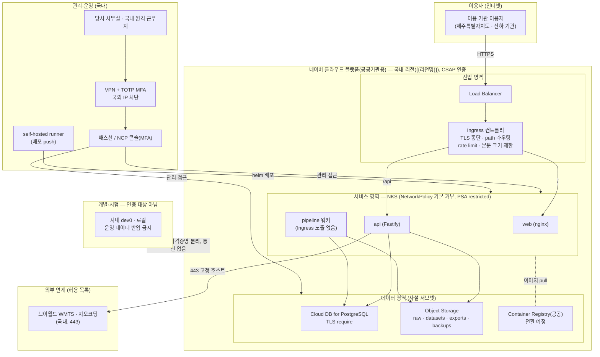

---
tags:
  - CSAP
  - 양식
  - 하등급SaaS
  - 공공기관보호조치
control: 14.2.1 물리적 위치 및 영역분리
section: 14.2 물리적 보호조치
doc_type: 작성본
evidence: 네트워크 구성도
문서 양식 번호: LS-14.2.1-02
문서 양식 버전: 0.0.1
문서번호: JAS-14.2.1-02
문서 버전: 1.0
상태: 대기중
작성일: 2026-10-20
대기 사유: NCP 공공기관용 운영 인프라 구축 전 — 리전·계정·VPC·서브넷·보안 그룹·도메인·VPN 설정값 실측 불가
---

> [!note] 근거
> [해설서/하등급-SaaS/14.2.1 물리적 위치 및 영역분리](../../../../../../projects/jeju-ai/docs/CSAP/해설서/하등급-SaaS/03.%20공공기관%20보호%20조치/14.2.1%20물리적%20위치%20및%20영역분리.md)

> [!warning] 대기
> 구성도는 목표 구조(공통 기준 §1.2)로 그렸다. 운영 자원이 아직 없어 다음 칸은 비워 둔다.
> - **NCP 공공 콘솔에 계정·VPC·서브넷 생성** → 2항 구성도의 리전명, 3항 "계정", "네트워크", "데이터" 행 설정 위치·값
> - **NKS NetworkPolicy 운영 값 확정(LB 서브넷·관리형 DB 서브넷 `ipBlock`)과 ACG(보안 그룹) 규칙 생성** → 3항 "트래픽 통제" 행
> - **운영 도메인 확정** → 3항 "응용" 행
> - **VPN · 배스천 · 콘솔 접근 허용 IP 구성** → 4항 국외 접속 차단 방법의 설정값
> - 위가 갖춰지면 05 점검표 No 4·5 증적을 수집해 3항 확인 증적 열과 5항 최근 확인일을 채운다.

# 네트워크 구성도

| 문서번호 | 버전 | 작성일 | 작성자 | 검토자 | 승인자 | 시행일 |
| --- | --- | --- | --- | --- | --- | --- |
| JAS-14.2.1-02 | 1.0 | 2026-10-20 | {{운영(인프라) 담당자 성명}} | {{정보보호 관리자 성명}} | {{CISO 성명}} | {{승인일}} |

## 1. 목적과 표현 범위

- 국가기관용 클라우드컴퓨팅서비스 영역과 일반 이용자용(민간) 서비스 영역이 물리적 또는 논리적으로 분리되어 있고, 모든 자원이 국내 리전에 위치하며, 관리자 접근이 국내에서 통제된 경로로만 이루어짐을 네트워크 관점에서 보여준다.
- 구성도에는 리전(국내), 영역(계정·VPC) 분리, 인터넷 경계, 관리자 접근 경로, 국외 접속 차단 지점을 표기한다.
- 구성도는 실제 클라우드 설정(계정, VPC, 보안 그룹)과 일치해야 하며, 일치 확인 증적은 [05. 증적 수집 점검표](05.%20증적%20수집%20점검표.md)로 수집한다.
- 당사는 이 시스템으로 민간용 서비스를 제공하지 않는다. 따라서 민간 영역은 구성도에서 뺐고, 분리 대상은 (1) 같은 IaaS 의 민간용(일반 리전) 영역, (2) 당사 개발·시험 환경(사내 `dev0`, 로컬)이다.

## 2. 전체 네트워크 구성도

## 3. 영역분리 방식

하등급은 물리적 또는 논리적 분리를 선택할 수 있다. 당사가 적용한 방식과 분리를 구현하는 설정을 기록한다.

| 항목 | 내용 |
| --- | --- |
| 민간용 서비스 제공 여부 | 미제공(전체가 공공기관용). 민간 고객과 운영 인스턴스(클러스터·DB·버킷)를 공유하지 않는다(gis-sass ADR 2026-09-26.02 결과 "운영 원칙") |
| 분리 방식 | 논리적 — 인증받은 IaaS 의 공공기관용 영역 이용 + 공공 전용 계정·VPC·클러스터 |
| 선정 사유 | 하등급은 논리적 분리를 허용한다. 공공기관용 영역 IaaS 가 공공·민간 분리를 1차로 충족하고, 당사는 공공 서비스를 민간 서비스와 섞지 않는 운영 원칙으로 보완한다 |

| 분리 계층 | 적용 설정 | 설정 위치·값 | 확인 증적(05 점검표 No) |
| --- | --- | --- | --- |
| 인프라 영역 | 공공기관용 영역(gov-ncloud) 이용. 일반 리전 미사용 | 네이버 클라우드 플랫폼(공공기관용) | No 1 |
| 계정 | 공공기관용 계정을 이 서비스 운영 전용으로 사용. 개발·시험(`dev0`)은 사내 인프라로 계정 자체가 다름 | {{공공 계정(서브 계정) 식별자}} | No 4 |
| 네트워크 | 운영 전용 VPC. 다른 VPC·사내망과 피어링·라우팅 없음. 서브넷: 진입(공인 LB) · 서비스(NKS 워커, 사설) · 데이터(DB, 사설) | {{VPC 이름·CIDR, 서브넷 이름·CIDR}} | No 4 |
| 트래픽 통제 | ACG(보안 그룹) + NKS NetworkPolicy 인·아웃 기본 거부. 허용: Ingress → web·api 8080, api·pipeline → DB · Object Storage, DNS, 브이월드 443. 사설·루프백·링크로컬 대역 egress 차단 | {{ACG 규칙 요약, NetworkPolicy `ingressControllerFrom` · `databaseTo` 값}} | No 4 |
| 데이터 | DB 인스턴스·버킷 운영 전용. 역할별 스토리지 자격증명 3개(api · pipeline · 백업), 접두사 제한 | {{DB 인스턴스명, 버킷명}} | No 3·4 |
| 응용 | 운영 전용 도메인, 운영 전용 세션 서명키·DB 자격증명(k8s Secret, SealedSecrets 봉인) | {{운영 도메인}} | No 4 |

- 영역 간에 불가피한 공용 구성요소: (1) 소스 저장소·CI(GitHub, 사내 `dev0` ARC 러너) — 같은 커밋 SHA 이미지를 개발·운영에 쓰지만 운영 자격증명은 운영 배포 러너에만 둔다. (2) 컨테이너 레지스트리 — 전환 후 운영 레지스트리는 공공 영역에 두고 운영 클러스터는 거기서만 pull 한다. 개발·운영이 데이터·자격증명·네트워크를 공유하지 않으므로 데이터·프로세스 간섭이 없다.

> [!note] 현 구현과 차이
> 운영 VPC·NKS·DB·버킷은 아직 없다. NetworkPolicy 구조(기본 거부·허용 목록)는 gis-sass chart 에서 로컬 k3d 로 검증된 설계를 따르며, 이 제품의 운영 chart 값은 구축 시 정한다. 현재 이미지는 GHCR, 배경지도 타일은 브라우저가 브이월드에서 직접 받는다.

## 4. 관리자 접근 경로와 국외 접속 차단

| 접근 구분 | 출발지 | 경로·통제 | 국외 접속 차단 방법 |
| --- | --- | --- | --- |
| 운영 콘솔(NCP 공공 콘솔) | 당사 사무실·국내 원격 근무지 | VPN 접속 후 허용 IP 에서만 접근, TOTP MFA, 콘솔 감사 기록 1년 보존 | 콘솔 접근 허용 IP 를 사내 VPN 대역으로 한정: {{콘솔 접근 허용 IP 설정}} |
| 서버 원격 접속(kubectl · DB 접속) | 위와 같음 | 배스천 경유, NKS API 서버·DB 는 사설 접근, MFA, 접근기록 | 배스천 ACG 인바운드를 VPN 대역으로 한정: {{배스천 ACG 규칙}} |
| 서비스 관리자 기능(`admin` · `service` 역할) | 위와 같음 | 관리자 화면·관리자 라우트에 Ingress IP 허용 목록 + TOTP MFA | Ingress 허용 목록에 사내 VPN 대역만: {{Ingress 허용 목록 값}} |
| 배포(self-hosted runner) | 사내 `dev0` 러너 | `vX.Y.Z` 태그 + 수동 승인 뒤 helm push 배포 | 러너 출발지 IP 를 NKS API 접근 허용 목록에 등록 |

- 국외에서의 운영·관리 접속은 허용하지 않는다. 차단 설정과 접속 기록의 국내 IP 확인은 양식 04. 관리 운영 인력 국내 위치 확인서(비기술 — 별도 작성)와 [05. 증적 수집 점검표](05.%20증적%20수집%20점검표.md)를 따른다.

> [!note] 현 구현과 차이
> 관리자 인증·MFA·RBAC 는 api 에 아직 구현되지 않았다(공통 기준 §1.3). VPN · 배스천도 운영 구축 시 구성한다.

## 5. 구성도 관리 규칙

- 네트워크 구성(계정, VPC, 서브넷, 보안 그룹, 연동)이 변경되면 5영업일 이내에 구성도를 갱신하고 버전을 올린다.
- 반기 1회 이상 실제 클라우드 설정과 구성도의 일치 여부를 확인하고 확인일을 기록한다: 최근 확인일 {{YYYY-MM-DD}}, 확인자 {{운영(인프라) 담당자 성명}}
- 구성도에는 실제 IP 대역·자격증명 등 민감 정보를 필요 이상으로 적지 않으며, 심사 제출본과 내부 상세본을 구분해 관리할 수 있다.

## 6. 승인

| 구분 | 직위 | 성명 | 서명 | 일자 |
| --- | --- | --- | --- | --- |
| 작성(인프라 담당) | | {{운영(인프라) 담당자 성명}} | | |
| 검토(정보보호 관리자) | | {{정보보호 관리자 성명}} | | |
| 승인(정보보호 최고책임자) | | {{CISO 성명}} | | |

서명본 보관 위치: 사내 문서 저장소 `CSAP/서명본/14.2.1/`

## 7. 개정 이력

| 버전 | 일자 | 변경 내용 | 작성자 | 승인자 |
| --- | --- | --- | --- | --- |
| 1.0 | 2026-10-20 | 최초 작성(목표 구조) | {{운영(인프라) 담당자 성명}} | {{CISO 성명}} |
