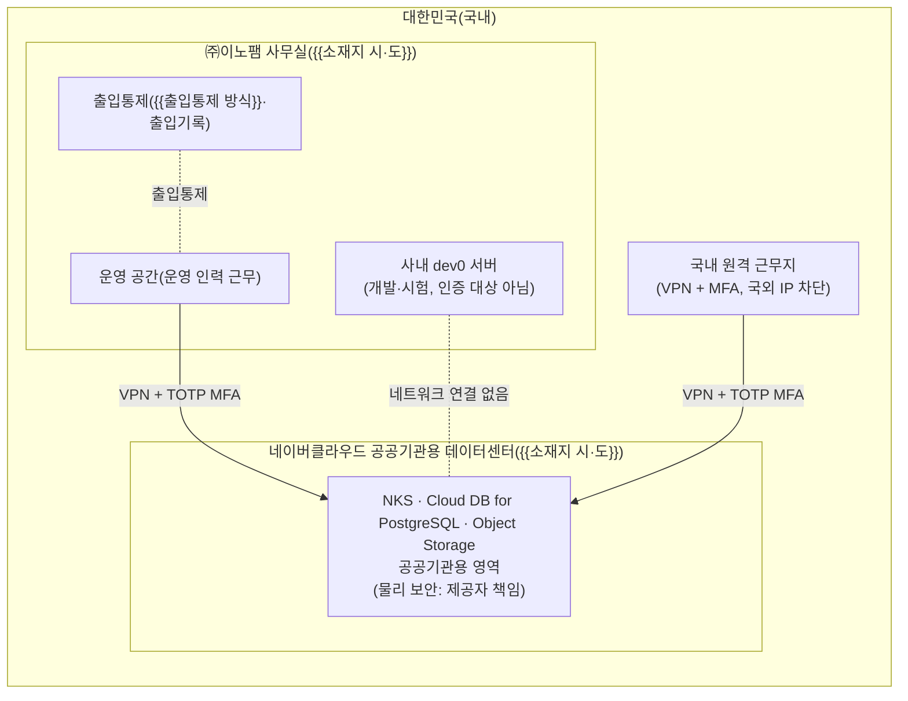
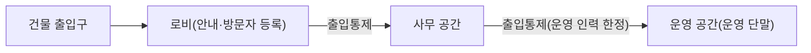

---
tags:
  - CSAP
  - 양식
  - 하등급SaaS
  - 공공기관보호조치
control: 14.2.1 물리적 위치 및 영역분리
section: 14.2 물리적 보호조치
doc_type: 작성본
evidence: 시설구성도
문서 양식 번호: LS-14.2.1-03
문서 양식 버전: 0.0.1
문서번호: JAS-14.2.1-03
문서 버전: 1.0
상태: 대기중
작성일: 2026-10-20
대기 사유: 공공기관용 데이터센터 소재지(시·도)와 제공자 인증서 사본(인증번호·유효기간) 미확보(이용 리전 · 존은 2026-10-21 확인)
---

> [!note] 근거
> [해설서/하등급-SaaS/14.2.1 물리적 위치 및 영역분리](../../../../../../projects/jeju-ai/docs/CSAP/해설서/하등급-SaaS/03.%20공공기관%20보호%20조치/14.2.1%20물리적%20위치%20및%20영역분리.md)

> [!warning] 대기
> - **제공자 CSAP 인증서 사본 확보** → 3항 인증번호·유효기간, 확인 근거 문서, 확인일
> - 2026-10-21 인프라 1차 구축(VPC · NAT · NKS) 반영 — 이용 리전 · 존(`KR` / `KR-1`)을 3항에 채웠다.
> - **제공자 데이터센터 소재지 확인서 수령** → 2항 구성도와 3항의 데이터센터 소재지(시·도)
> - 당사 사무실 주소·출입통제 방식·출입기록 보관 기간, 원격 근무 허용 여부는 총무·시설 담당이 정하는 값이다(비기술). 대기 사유가 아니며 `{{...}}` 로 남겨 둔다.

# 시설구성도

| 문서번호 | 버전 | 작성일 | 작성자 | 검토자 | 승인자 | 시행일 |
| --- | --- | --- | --- | --- | --- | --- |
| JAS-14.2.1-03 | 1.0 | 2026-10-20 | {{정보보호 담당자 성명}} | {{정보보호 관리자 성명}} | {{CISO 성명}} | {{승인일}} |

## 1. 목적과 책임 범위

- 국가기관용 클라우드컴퓨팅서비스에 관련된 물리적 시설(시스템이 설치된 데이터센터, 운영 인력이 근무하는 당사 시설)의 국내 위치와 출입통제 현황을 확인한다.
- 당사는 CSAP 인증을 받은 IaaS(네이버 클라우드 플랫폼 공공기관용)를 이용하는 SaaS 제공자로서 데이터센터를 직접 운영하지 않는다. 책임공유모델에 따라 데이터센터의 물리 보안·출입통제는 제공자 책임이며 제공자 인증·계약으로 확인하고, 당사는 운영 측면(당사 운영 시설의 위치·출입통제, 운영 인력의 국내 근무)을 관리한다.
- 사내 개발 클러스터 `dev0` 의 서버(Proxmox 호스트)는 당사 시설에 있으나 인증 대상이 아니며 운영 데이터를 두지 않는다.

## 2. 시설 전체 구성

- 시설이 여럿이면 노드를 추가하고, 실제 소재지에 맞게 수정한다. 국외 시설은 존재하지 않는다.

## 3. 데이터센터(제공자 책임 영역)

| 항목 | 내용 |
| --- | --- |
| 제공자명 | 네이버클라우드 — 네이버 클라우드 플랫폼(공공기관용) |
| 데이터센터·리전 소재지 | NCP 공공기관용 리전 `KR`(수도권, KR-CENTRAL), 존 `KR-1`(평촌) — 국내. 데이터센터 시·도 {{소재지 시·도 — 제공자 확인서 수령 후}} |
| CSAP 인증 확인 | 인증번호 {{인증번호}}, 유효기간 {{YYYY-MM-DD}}까지, 인증 범위 "네이버 클라우드 플랫폼(공공기관용)"에 이용 리전·공공기관용 영역 포함 확인(인증 범위 공개 자료 2026-09-26 확인) |
| 물리적 출입통제·출입기록 | 제공자 책임. CSAP 인증(물리적 보호조치 심사)과 이용 계약으로 확인 |
| 확인 근거 문서 | 제공자 CSAP 인증서 사본, 공공기관용 이용 약관·계약, gov-ncloud 인증 현황 공개 자료 |
| 확인일·확인자 | {{YYYY-MM-DD}}, {{정보보호 담당자 성명}} |

- 백업(관리형 DB 자동 백업, `pg_dump` 결과의 Object Storage `backups/postgres/`)은 운영과 같은 공공기관용 리전에 둔다. 별도 리전·시설을 쓰지 않으므로 행을 추가하지 않는다. 별도 리전을 쓰게 되면 같은 방식으로 확인하고 국내로 한정한다.

## 4. 당사 운영 시설

운영·관리 업무(사고·장애 대응, 계정 권한 부여·변경·삭제 등)를 수행하는 당사 시설의 위치와 출입통제를 기록한다.

| No | 시설명 | 주소(국내) | 용도 | 출입통제 방식 | 출입기록 유지 | 출입 가능자 | 비고 |
| --- | --- | --- | --- | --- | --- | --- | --- |
| 1 | {{본사 사무실}} | {{주소}} | 서비스 운영·관리 | {{카드키 / 지문 / 안내데스크 확인}} | {{출입 시스템 자동 기록, 보관 기간}} | 임직원, 등록 방문자 | |
| 2 | {{운영 공간(사무실 내 구역)}} | {{동일 건물 층}} | 운영 단말 설치 구역 | {{별도 카드키 권한}} | {{○ / X}} | 운영 인력 한정 | |
| 3 | 사내 서버 설치 공간(`dev0` Proxmox 호스트 `pve-1`–`pve-3`) | {{주소}} | 개발·시험 서버(인증 대상 아님) | {{출입통제 방식}} | {{○ / X}} | {{출입 가능자}} | 운영 데이터 반입 금지 |

- 당사가 직접 운영하는 운영용 서버실·전산 장비실은 해당 없음 — 운영 시스템은 전부 제공자 공공기관용 데이터센터에 있다. 개발·시험 서버(No 3)는 인증 대상이 아니지만 출입통제 현황을 함께 기록한다.
- 방문자는 사전 등록과 동행을 원칙으로 하고, 방문자 출입기록을 남긴다.

### 4.1 시설 배치도

운영 공간의 배치(출입구, 출입통제 지점, 운영 단말 위치)를 아래 다이어그램으로 표현한다. 상세 도면은 별도 파일로 보관한다: 사내 문서 저장소 `CSAP/서명본/14.2.1/시설 배치도`

## 5. 원격 근무 환경

| 항목 | 내용 |
| --- | --- |
| 원격 근무 허용 여부 | {{허용 / 미허용}} |
| 허용 위치 | 국내로 한정(국외 원격 운영·관리 금지) |
| 접근 통제 | VPN + TOTP MFA, 콘솔·배스천·관리자 화면 접근 IP 를 VPN 대역으로 한정(국외 IP 차단), 회사 지급 단말 |
| 근거·연계 문서 | 양식 04. 관리 운영 인력 국내 위치 확인서(비기술 — 별도 작성), [02. 네트워크 구성도](02.%20네트워크%20구성도.md) 4항 |

## 6. 확인 결과

| 확인 항목 | 결과 | 비고 |
| --- | --- | --- |
| 시스템·데이터가 위치한 데이터센터가 모두 국내에 있다 | {{적합 / 부적합}} | 운영 자원 생성·리전 확인 후 판정 |
| 제공자 CSAP 인증으로 데이터센터 물리 보안·출입통제를 확인했다 | {{적합 / 부적합}} | 인증서 사본 확보 후 판정 |
| 당사 운영 시설이 모두 국내에 있고 출입통제·출입기록을 유지한다 | {{적합 / 부적합}} | 총무·시설 확인 |
| 국외 시설·국외 근무지에서 수행되는 운영·관리 업무가 없다 | {{적합 / 부적합}} | 04 확인서 결과 연동 |

## 7. 현행화 규칙

- 사무실 이전·증설, 이용 리전·데이터센터 변경, 제공자 변경 시 5영업일 이내에 본 문서를 갱신하고 버전을 올린다.
- 제공자 CSAP 인증 유효기간 만료 전에 갱신 여부를 확인하고 3항의 확인일을 갱신한다.
- 연 1회 이상 출입통제 장치와 출입기록 보관 상태를 점검한다: 최근 점검일 {{YYYY-MM-DD}}

## 8. 승인

| 구분 | 직위 | 성명 | 서명 | 일자 |
| --- | --- | --- | --- | --- |
| 작성(총무·시설 담당) | | {{총무·시설 담당자 성명}} | | |
| 검토(정보보호 관리자) | | {{정보보호 관리자 성명}} | | |
| 승인(정보보호 최고책임자) | | {{CISO 성명}} | | |

서명본 보관 위치: 사내 문서 저장소 `CSAP/서명본/14.2.1/`

## 9. 개정 이력

| 버전 | 일자 | 변경 내용 | 작성자 | 승인자 |
| --- | --- | --- | --- | --- |
| 1.0 | 2026-10-20 | 최초 작성 | {{정보보호 담당자 성명}} | {{CISO 성명}} |
