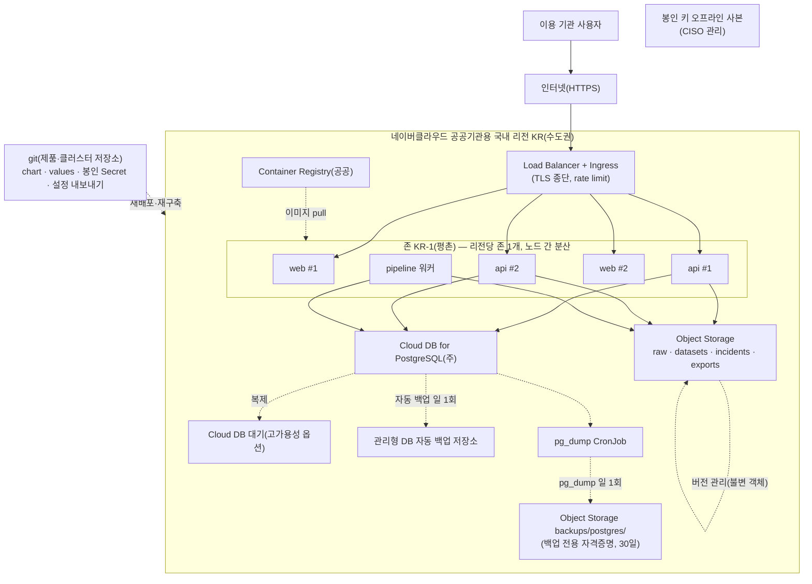

---
tags:
  - CSAP
  - 양식
  - 하등급SaaS
  - 공공기관보호조치
control: 14.2.2 중요장비 이중화 및 백업체계 구축
section: 14.2 물리적 보호조치
doc_type: 작성본
evidence: 네트워크 구성도
문서 양식 번호: LS-14.2.2-03
문서 양식 버전: 0.0.1
문서번호: JAS-14.2.2-03
문서 버전: 1.0
상태: 대기중
작성일: 2026-10-20
대기 사유: Cloud DB 고가용성 옵션 미확인, 제공자 인증서·SLA 확인과 구성도 대조일 미기입(리전 · 존은 2026-10-21 확인, 공공존 리전당 존 1개)
---

> [!note] 근거
> [해설서/하등급-SaaS/14.2.2 중요장비 이중화 및 백업체계 구축](../../../../../../projects/jeju-ai/docs/CSAP/해설서/하등급-SaaS/03.%20공공기관%20보호%20조치/14.2.2%20중요장비%20이중화%20및%20백업체계%20구축.md)

> [!warning] 대기
> 구성도는 목표 구조로 그렸다. 다음이 생기면 해당 칸을 채운다.
> - 2026-10-21 인프라 1차 구축(VPC · NAT · NKS) 반영 — 1항 리전 · 존, 2항 위치 열을 채웠다. 공공존은 리전마다 존이 하나뿐이라(KR 리전 `KR-1`, `getZoneList` 실측) Multi Zone 은 구성할 수 없다. 구성도를 단일 존 내 노드 분산으로 고쳐 그렸다.
> - **KRS(남부권) 리전 백업·복구 절차 수립** → 1항 재해 대비 흐름
> - **Cloud DB for PostgreSQL 고가용성(주-대기) 구성 옵션 확인** → 2항 No 5 가용성 확보 방식
> - **제공자 CSAP 인증서·SLA 확보** → 4항 확인 결과·확인일

# 네트워크 구성도

| 문서번호 | 버전 | 기준일 | 작성자 | 검토자 | 승인자 |
| --- | --- | --- | --- | --- | --- |
| JAS-14.2.2-03 | 1.0 | 2026-10-20 | {{운영(인프라) 담당자 성명}} | {{정보보호 관리자 성명}} | {{CISO 성명}} |

## 1. 서비스 네트워크 구성도

지반침하 스마트관리 시스템의 목표 구성과 백업 흐름을 그린다. 실선은 서비스 트래픽, 점선은 복제·백업 흐름이다.

- 관리용 접근 경로(VPN, 배스천, NCP 콘솔 MFA)와 영역분리 상세는 [14.2.1 02. 네트워크 구성도](../14.2.1%20물리적%20위치%20및%20영역분리/02.%20네트워크%20구성도.md)에 두고, 본 구성도에는 복구·백업과 관련된 요소를 표기한다.
- 공공존은 리전마다 존이 하나뿐이라(2026-10-21 `getZoneList` 실측: KR 리전 `KR-1`, KRS 리전 `KRS-1`) 동일 리전 다중 zone 구성은 할 수 없다. 가용성은 같은 존 안 여러 노드에 파드를 분산해 확보하고, 재해 대비는 KRS(남부권) 리전 백업·복구 절차로 한다. CSAP 14.2.2 하등급 SaaS 는 존 이중화가 아니라 가용성 백업체계를 요구한다. KRS 리전 백업은 아직 구성하지 않았다. DR 서비스 계약 검토는 양식 05(비기술).

## 2. 구성요소 목록

구성도의 모든 구성요소를 등재하고 [02. 정보자산 및 백업 대상 목록](02.%20정보자산%20및%20백업%20대상%20목록.md)의 No 와 연결한다. 복구 시 구성요소가 누락되지 않도록 본 표를 [04. 복구 시스템 상세 복구절차서](04.%20복구%20시스템%20상세%20복구절차서.md)의 복구 범위와 대조한다.

| No | 구성요소 | 역할 | 위치(리전·가용영역) | 가용성 확보 방식 | 장애 시 동작 | 02 목록 No | 04 절차서 절 |
| --- | --- | --- | --- | --- | --- | --- | --- |
| 1 | Load Balancer + Ingress 컨트롤러 | 유일한 공개 진입점, TLS 종단, 트래픽 분산 | `KR / KR-1`(LB 서브넷 Private · Public, ALB 는 Ingress 생성 시 생성) | 제공자 관리형 LB + Ingress 컨트롤러 복수 파드 | 정상 Service 엔드포인트로 자동 전환 | 10 | 6.4 |
| 2 | web (nginx-unprivileged) | 정적 화면, `/api/` 프록시 | `KR / KR-1` | 2 replica, podAntiAffinity, RollingUpdate maxUnavailable 0 | 남은 파드가 처리, 삭제된 파드는 자동 재생성 | 1, 7 | 6.1 |
| 3 | api (Fastify) | API 진입점, 스토리지 중계 | `KR / KR-1` | 2 replica, PDB minAvailable 1, readiness/liveness 분리 | DB 단절 시 readiness 만 빠지고 재시작하지 않음 | 1, 7 | 6.1 |
| 4 | pipeline 워커 | 데이터셋 번들 빌드(`jobs` 표 폴링) | `KR / KR-1` | 1 replica, 재생성 | 진행 중 작업은 `jobs` 상태로 재시도 | 1, 7 | 6.1 |
| 5 | Cloud DB for PostgreSQL | 계정·권한·감사·사고 기록·버전·작업 | `KR / KR-1`(예정) | 관리형 + {{고가용성(주-대기) 옵션 적용 여부}} | 고가용성 적용 시 제공자 자동 전환, 미적용 시 백업으로 복원 | 2 | 6.2 |
| 6 | Object Storage(서비스 데이터) | 원본·번들·업로드·내보내기 | `KR` | 제공자 관리형 내구성 + 버킷 버전 관리 | 제공자 내부 복제로 지속, 객체 손상 시 이전 버전 복원 | 3, 4, 5, 6 | 6.3 |
| 7 | 백업 저장소(`backups/postgres/`, 관리형 백업) | DB 백업 보관 | `KR` | 원본 DB 와 다른 저장 서비스. 리전당 존 1개라 다른 zone 은 없고, KRS 리전 사본을 대안으로 둔다(미구성) | 백업본 유지(원본 장애와 독립) | 2 | 6.2 |
| 8 | Container Registry(공공) | 이미지 보관 | `KR` | 제공자 관리형, 소스로 재빌드 가능 | 장애 시 노드 캐시 이미지로 기동 지속, 필요 시 재빌드·재푸시 | 7 | 6.5 |
| 9 | 웹 방화벽·로그 수집·모니터링 | 공공 WAF(적용 예정), 로그·지표 수집 | `KR` | 제공자 관리형 | 장애 중에도 서비스 지속, 설정은 git 으로 복원 | 16, 17, 18 | 6.6 |
| 10 | NKS 클러스터·워커 노드 | 실행 기반 | `KR / KR-1` | 관리형 컨트롤 플레인, 노드 그룹 다중 노드(현재 시험 기간 1대, CSAP 신청 전 2–3대로 증설) | 노드 장애 시 파드 재스케줄, 클러스터 유실 시 재생성 후 chart 재배포 | 1, 8, 9, 11, 14, 15 | 6.1, 6.4 |

## 3. 백업 데이터 흐름

| No | 원본 | 백업 방식 | 백업 저장 위치 | 국내 저장 | 암호화 | 주기 |
| --- | --- | --- | --- | --- | --- | --- |
| 1 | 운영 DB | 관리형 자동 백업 + `pg_dump` CronJob | 관리형 백업 저장소 + Object Storage `backups/postgres/`(같은 공공 리전) | ○ | ○ | 일 1회 + 일 1회 |
| 2 | web · api · pipeline | 컨테이너 이미지(상태 없음) + chart | Container Registry(공공) + git | ○(레지스트리 전환 후) | ○ | 빌드·변경 시 |
| 3 | Object Storage 서비스 데이터 | 불변 객체 + 버킷 버전 관리 | 같은 버킷(버전) | ○ | ○ | 상시 |
| 4 | 인프라·보안 설정 | 설정 내보내기 + chart·values(git), 봉인 Secret | git(클러스터 저장소) + 사내 미러 | 해당 없음 — 이용자 데이터 없음 | ○(Secret 봉인) | 변경 시 |
| 5 | SealedSecrets 봉인 키 | 개인키 내보내기 | 암호화 오프라인 매체 2부 | ○ | ○ | 생성·회전 시 |
| 6 | 접근기록·감사 로그 | 로그 서비스 보관 또는 로그 버킷 아카이브 | 원본과 분리된 로그 저장소(공공 리전) | ○ | ○ | 일 1회 |

> [!note] 현 구현과 차이
> 2026-10-21 현재 VPC · NAT · NKS(노드 1대)만 있고 DB · 앱 버킷 · 레지스트리 · 백업 흐름은 아직 없다. Private 노드는 NAT 를 거쳐 GHCR 이미지를 받는다(2026-10-21 시험). 현재 이미지는 GHCR(국외)에 있고 공공 레지스트리로 전환 예정이다(ADR D5).

## 4. 물리 계층 확인(제공자 책임)

데이터센터의 네트워크 스위치, 스토리지 등 물리 중요장비의 이중화는 IaaS 제공자(네이버클라우드 공공기관용)의 책임 범위이며 다음으로 확인한다.

| 확인 항목 | 확인 방법 | 확인 결과 | 확인일 |
| --- | --- | --- | --- |
| 제공자의 물리 인프라 이중화·가용성 확보 | 제공자 CSAP 인증서(인증 범위 "네이버 클라우드 플랫폼(공공기관용)"), SLA, 서비스 명세 | {{확인}} | {{YYYY-MM-DD}} |
| 이용 리전·가용영역의 국내 위치 | 제공자 리전 정보, 계약서, 14.2.1 01 목록 | 국내 — 리전 `KR`(수도권, KR-CENTRAL), 존 `KR-1`(평촌)(`getZoneList` 실측). 계약서 대조는 계약 후 | 2026-10-21 |

## 5. 현행화 규칙

- 인프라 구성 변경(자원 추가·삭제, 네트워크 변경, 백업 경로 변경) 시 변경관리 절차에 따라 5영업일 이내에 본 구성도를 갱신한다.
- 반기 1회 이상 클라우드 콘솔의 실제 구성과 대조하여 구성도가 현행과 일치하는지 확인하고 확인일을 기록한다: {{YYYY-MM-DD}}
- 구성도 갱신 시 양식 02 목록, 양식 04 절차서의 복구 범위와 함께 대조하여 복구 대상에서 빠지는 구성요소가 없게 한다.

## 6. 승인

| 구분 | 직위 | 성명 | 서명 | 일자 |
| --- | --- | --- | --- | --- |
| 작성(인프라 담당) | | {{운영(인프라) 담당자 성명}} | | |
| 검토(정보보호 관리자) | | {{정보보호 관리자 성명}} | | |
| 승인(정보보호 최고책임자) | | {{CISO 성명}} | | |

서명본 보관 위치: 사내 문서 저장소 `CSAP/서명본/14.2.2/`

## 7. 개정 이력

| 버전 | 기준일 | 변경 내용 | 작성자 | 승인자 |
| --- | --- | --- | --- | --- |
| 1.0 | 2026-10-20 | 최초 작성(목표 구성 기준) | {{운영(인프라) 담당자 성명}} | {{CISO 성명}} |
