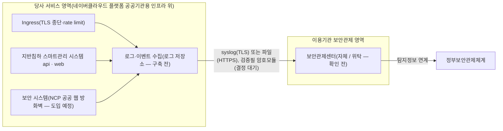

---
tags:
  - CSAP
  - 양식
  - 하등급SaaS
  - 공공기관보호조치
control: 14.3.2 보안관제 제반환경 지원
section: 14.3 기술적 보호조치
doc_type: 작성본
evidence: 보안관제 수행을 위해 제공되는 환경
문서 양식 번호: LS-14.3.2-02
문서 양식 버전: 0.0.1
문서번호: JAS-14.3.2-02
문서 버전: 1.0
상태: 대기중
대기 사유: 운영 환경·로그 수집 경로(감사 로그, 로그 저장소)가 구축 전이고 이용기관 보안관제 주체·연계 방식이 확인 전이라 구성 내역·시험 결과를 채울 수 없다
작성일: 2026-10-20
---

> [!note] 근거
> [해설서/하등급-SaaS/14.3.2 보안관제 제반환경 지원](../../../../../../projects/jeju-ai/docs/CSAP/해설서/하등급-SaaS/03.%20공공기관%20보호%20조치/14.3.2%20보안관제%20제반환경%20지원.md)

> [!warning] 대기
> 아래가 생기면 해당 칸을 채운다.
> - **이용기관 보안관제 주체·연계 요구 확인**(제주특별자치도 정보보호 담당 부서, 14.1.1 협약 협의) → 1항 보안관제 주체·연락처·정부보안관제체계 연계, 2항 요구사항 행, 7항 기관 확인
> - **감사 로그(`audit_events`)·인증 로그 구현**(api, 공통 기준 §1.3) → 3항 ENV-01 제공 로그 종류 확정
> - **로그 수집·보관 경로 구축**(NCP Cloud Log Analytics 또는 Object Storage 별도 버킷, 공통 기준 §3.2) → 3항 ENV-01·ENV-02·ENV-03 구성 내용, 4항 구성도의 로그 수집 노드
> - **NCP 공공 웹 방화벽 도입**(공통 기준 §3.4) → 3항 ENV-02 대상 보안 시스템
> - **검증필 암호모듈 적용 방안 결정**(14.3.1, 공통 기준 §3.3) → 3항 ENV-05 전송 구간 보호
> - **운영 환경에서 연계 구성 완료** → 3항 제공 시작일, 4.1항 관제용 계정, 5항 연계 시험 결과

# 보안관제 연계 환경 구성 내역서

> [!warning] 적용 조건
> 국가기관등 이용기관·계약 단위로 사본을 만들어 작성한다. 하나의 위탁 보안관제센터가 여러 기관을 관제하면 연계 구성이 같은 기관을 묶어 작성할 수 있으며, 이 경우 1항에 대상 기관을 모두 적는다. 본 사본은 제주특별자치도(발주처) 계약분이다. 사본 문서번호는 `JAS-14.3.2-02-<기관 약칭>` 으로 한다(본 사본: `JAS-14.3.2-02-JEJU`).

| 문서번호 | 버전 | 기준일 | 작성자 | 검토자 | 승인자 |
| --- | --- | --- | --- | --- | --- |
| JAS-14.3.2-02-JEJU | 1.0 | 2026-10-20 | {{정보보호 담당자 성명}} | {{정보보호 관리자 성명}} | {{CISO 성명}} |

## 1. 이용기관 및 보안관제 체계 현황

| 항목 | 내용 |
| --- | --- |
| 이용기관 | 제주특별자치도(발주처) 및 산하 공공기관 — 공식 명칭·계약번호·계약 기간은 계약서 기준 {{계약번호, 계약 기간}} |
| 이용 서비스 | 지반침하 스마트관리 시스템(제주 GEO-AI 지반침하 SaaS, 하등급 SaaS) |
| 보안관제 주체 | {{자체 보안관제센터 / 다른 기관 보안관제센터 위탁: 기관명 — 발주처 확인 전}} |
| 보안관제센터 담당 연락처 | {{이용 기관 정보보호 담당자}} |
| 정부보안관제체계 연계 | {{이용기관 보안관제 영역에서 탐지정보를 정부보안관제체계와 연계 함 / 예정: YYYY-MM-DD — 발주처 확인 전}} |
| 계약 전 사전 검토 | 양식 01 7항 체크리스트 수행일 {{YYYY-MM-DD — 발주처 보안관제 주체 확인 후 수행}}, 지원 불가 판정 {{없음 / 있음(2항에 대안 기록)}} |
| 협약 근거 | 14.1.1 보안서비스 수준 협약서 JAS-14.1.1-02 의 보안관제 연계 조항, 기술 지원 조항 — 조항 번호는 14.1.1 협약서 확정 후 {{조항 번호}} |

## 2. 기관 요구사항 및 협의 내역

이용기관(또는 위탁 관제센터)이 요구한 보안관제 지원 요구사항과 협의·이행 결과를 기록한다. 상태가 "지원 불가"로 남는 요구가 없도록 대안 협의까지 기록한다.

| No | 요구 일자 | 요구 주체 | 요구사항 | 협의 결과·지원 방법(항목 코드) | 이행 완료일 | 상태 | 비고 |
| --- | --- | --- | --- | --- | --- | --- | --- |
| 1 | {{YYYY-MM-DD}} | {{기관 / 관제센터}} | {{기관 요구사항 — 발주처 협의 전}} | {{ENV 코드, 지원 방법}} | | {{이행 완료 / 이행 중 / 대안 합의}} | 2026-10-20 현재 접수된 요구 없음 |
| 2 | | | | | | | |
| 3 | | | | | | | |

## 3. 제공 제반환경 구성 내역

양식 01 5항의 항목 코드 기준으로 이 기관에 제공하는 구성을 기록한다. 실제 설정·화면 증적은 양식 04. 증적 수집 점검표에 따라 수집한다.

| 항목 코드 | 항목 | 제공 여부 | 구성 내용(시스템·전송 방식·형식) | 전송 구간 보호 | 제공 시작일 | 비고 |
| --- | --- | --- | --- | --- | --- | --- |
| ENV-01 | 서비스 로그 제공 | ○(예정) | {{로그 저장소에서 추출하는 Ingress 접근 로그·api 접근기록·인증·관리자 행위 로그, syslog over TLS 또는 JSON Lines 파일 전송, 전송 주기 — 로그 수집 경로 구축 후}} | {{TLS 1.2 이상 — 검증필 모듈 결정 후}} | {{YYYY-MM-DD}} | 현재 api 로그는 stdout 뿐이고 감사 로그 미구현 |
| ENV-02 | 보안이벤트·탐지정보 제공 | ○(예정) | {{대상: NCP 공공 웹 방화벽, Ingress 차단, api 로그인 잠금·인가 거부 이벤트, 전송 방식 — 웹 방화벽 도입·로그 경로 구축 후}} | ENV-01 과 같음 | {{YYYY-MM-DD}} | |
| ENV-03 | 보안관제용 접근 수단 | {{○ / X — 기관 요구 확인 후}} | {{로그 저장소 조회 전용 하위 계정 수, 조회 화면 주소, TOTP 다중 인증}} | HTTPS | | 계정 목록은 4.1항에 기록 |
| ENV-04 | 정부보안관제체계 연계 기반 | ○(예정) | {{기관 요구 연계 형식·전송 구성 — 기관 협의 후}} | ENV-01 과 같음 | | 부적합 사례 1·2 예방 |
| ENV-05 | 연계 구간 구성 | ○(예정) | {{출발지(로그 저장소 전송 노드)·목적지(기관 수집 서버 주소)·프로토콜·포트 — 기관 협의·운영 환경 구축 후}} | {{검증필 암호모듈 탑재 제품명·검증번호 — 14.3.1 결정 후}} | | 14.3.1 연계 |
| ENV-06 | 연계 시험 지원 | ○ | 5항 시험 결과 참조 | | | |
| ENV-07 | 침해사고 협조 | ○ | 협조 창구 정보보호 관리자({{정보보호 관리자 성명}}, 연락처는 5.1.1 03 비상연락망), 사고 통지 절차는 14.1.4를 따름 | | 2026-10-20 | |

## 4. 연계 구성도

목표 구성이다. 로그 수집 노드와 기관 측 수신 구성은 운영 환경 구축·기관 협의 후 이 기관 기준으로 확정한다.

- 실제 구성(전송 구간, IP·포트, 중계 장비)이 다르면 구성도를 이 기관 기준으로 수정한다.
- 관제용 접근 수단(ENV-03)을 제공하면 관제 요원의 접근 경로(인터넷 → 로그 저장소 조회 화면, 다중 인증)도 구성도에 표기한다.

### 4.1 관제용 계정 현황(ENV-03 제공 시)

| No | 계정 ID | 사용 주체(소속·성명) | 권한 | 다중 인증 | 발급일 | 만료일 | 최근 접근기록 검토일 |
| --- | --- | --- | --- | --- | --- | --- | --- |
| 1 | | {{관제센터명, 성명 — ENV-03 제공 확정 후}} | 조회 전용 | ○(TOTP) | | | |
| 2 | | | | | | | |

## 5. 연계 시험 결과

연계 구성 완료 시와 구성 변경 시 이용기관(또는 위탁 관제센터)과 상호 확인한다. 2026-10-20 현재 연계 구성 전이라 시험하지 않았다.

| No | 시험 항목 | 시험 방법 | 시험일 | 결과 | 당사 확인자 | 기관 확인자 |
| --- | --- | --- | --- | --- | --- | --- |
| 1 | 로그·이벤트 수신 확인 | 시험용 로그인 실패·인가 거부 이벤트를 발생시키고 관제센터 수신 화면에서 request_id 로 대조 | {{YYYY-MM-DD}} | {{정상 / 보완 필요}} | | |
| 2 | 탐지정보 정부보안관제체계 연계 확인 | 기관 보안관제 영역에서 연계 전송 확인(기관 회신) | {{YYYY-MM-DD}} | {{정상 / 보완 필요}} | | |
| 3 | 전송 구간 암호화 적용 확인 | 전송 구간의 TLS 버전·암호 스위트 확인(`openssl s_client`), 인증서 유효기간 확인 | {{YYYY-MM-DD}} | {{정상 / 보완 필요}} | | |
| 4 | 관제용 계정 접근·권한 확인(해당 시) | 조회 전용 계정으로 수정·삭제 시도 시 거부, TOTP 미입력 시 로그인 거부 확인 | {{YYYY-MM-DD}} | {{정상 / 보완 필요}} | | |

- 보완 필요 항목은 조치 후 재시험하고 결과를 갱신한다: 조치 내역 — 시험 전이라 해당 없음

## 6. 운영·변경 이력

연계 구성 변경, 전송 중단·장애, 기관 통보 내역을 기록한다.

| No | 일자 | 구분 | 내용 | 기관 통보(일시·방법) | 조치 결과 | 담당 |
| --- | --- | --- | --- | --- | --- | --- |
| 1 | 2026-10-20 | 구성 변경 | 내역서 최초 작성(연계 구성 전) | 해당 없음 | 해당 없음 | 정보보호 관리자 |
| 2 | | | | | | |

## 7. 이용기관 확인

이용기관(또는 위탁 관제센터)은 본 내역서의 제반환경 구성이 보안관제 수행과 정부보안관제체계 연계 요구에 부합함을 확인한다. 연계 시험(5항) 완료 후 받는다.

| 구분 | 소속 | 직위 | 성명 | 서명 | 일자 |
| --- | --- | --- | --- | --- | --- |
| 이용기관 담당자 | 제주특별자치도 | | {{이용 기관 정보보호 담당자}} | | |
| 보안관제센터 담당자(위탁 시) | | | | | |

- 서명본 보관 위치: 사내 문서 저장소 `CSAP/서명본/14.3.2/`. 공문·전자 확인으로 갈음하면 접수 번호를 적는다: 확인 전

## 8. 승인

| 구분 | 직위 | 성명 | 서명 | 일자 |
| --- | --- | --- | --- | --- |
| 작성(정보보호 담당자) | | | | |
| 검토(정보보호 관리자) | | | | |
| 승인(정보보호 최고책임자) | | | | |

## 9. 개정 이력

| 버전 | 일자 | 변경 내용 | 작성자 | 승인자 |
| --- | --- | --- | --- | --- |
| 1.0 | 2026-10-20 | 최초 작성(연계 구성 전, 대기 항목 포함) | {{정보보호 담당자 성명}} | {{CISO 성명}} |
