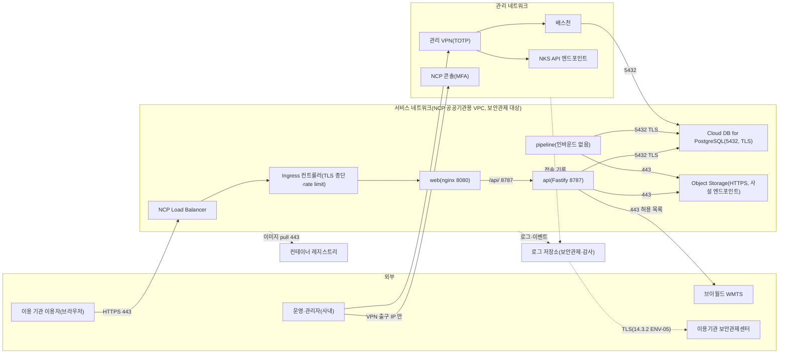

---
tags:
  - CSAP
  - 양식
  - 하등급SaaS
  - 공공기관보호조치
control: 14.3.4 시스템 격리
section: 14.3 기술적 보호조치
doc_type: 작성본
evidence: 비정상 통신경로 점검 결과 및 검토 결과(보조)
문서 양식 번호: LS-14.3.4-02
문서 양식 버전: 0.0.1
문서번호: JAS-14.3.4-02
문서 버전: 1.0
상태: 대기중
대기 사유: 운영 VPC·NAT·NKS 는 2026-10-21 1차 구축했으나 ALB·Cloud DB·관리 VPN·배스천이 없고 제품 Helm chart(NetworkPolicy)가 없어 규칙명·일부 대역·포트·확인일을 채울 수 없다
작성일: 2026-10-20
---

> [!note] 근거
> [해설서/하등급-SaaS/14.3.4 시스템 격리](../../../../../../projects/jeju-ai/docs/CSAP/해설서/하등급-SaaS/03.%20공공기관%20보호%20조치/14.3.4%20시스템%20격리.md)

> [!warning] 대기
> 이 목록은 목표 설계(공통 기준 §1.2, gis-sass 설계서 04 §4.7)로 경로와 용도를 확정해 두었다. 아래가 생기면 해당 칸을 채운다.
> - 2026-10-21 인프라 1차 구축(VPC·NAT·NKS) 반영: 2항 No 2 의 LB 서브넷 대역·노드 ACG, No 5 의 DB 서브넷 대역, No 12 의 클러스터 API 접근 제한, No 15 의 NAT 경유, No 19 의 노드 ACG 관리 주체를 채웠다.
> - **ALB·Cloud DB·배스천 생성에 따른 ACG 구성** → 2항의 LB·DB·배스천 ACG 이름, 3항의 허용 대역
> - **제품 Helm chart 와 NetworkPolicy 작성**(gis-sass chart 구조 이식) → 2항 통제 수단의 정책 이름 확정, `ingressControllerFrom` · `databaseTo` · 스토리지 egress 대역 값
> - **ALB Ingress 생성**(Ingress 방식은 NKS 기본 포함 ALB Ingress Controller, IngressClass `alb` 로 확정) → 2항 No 2 의 포트
> - **관리 VPN·배스천 구축** → 2항 No 11–13, 3항 원격관리 경로 상세
> - **컨테이너 레지스트리 전환**(ADR D5) → 2항 No 15
> - **로그 수집 경로·모니터링 도구 구축**(공통 기준 §3.2 · §3.5) → 2항 No 16–18
> - **배포 runner 위치 결정**(self-hosted runner, ADR 2026-09-08.01) → 2항 No 14
> - **운영 환경 구축 뒤 첫 대조** → 3–5항 확인일·확인자, 승인 문서번호

# 정상 통신경로 목록

| 문서번호 | 버전 | 기준일 | 작성자 | 검토자 | 승인자 |
| --- | --- | --- | --- | --- | --- |
| JAS-14.3.4-02 | 1.0 | 2026-10-20 | {{정보보호 관리자 성명}} | {{개발 책임자 성명}} | {{CISO 성명}} |

본 목록은 지반침하 스마트관리 시스템의 승인된 통신경로 기준선이다. 양식 03. 비정상 통신경로 점검 및 검토 결과서는 본 목록과 대조하여 비정상 통신경로를 판정하며, 목록에 없는 경로는 모두 비정상 통신경로로 본다. 경로의 추가·변경·삭제는 양식 01. 시스템 격리 및 통신경로 관리 지침 6.3항의 절차를 따른다. 대상은 운영 환경(NCP 공공기관용)이며, 인증 대상이 아닌 사내 `dev0`·로컬은 포함하지 않는다.

## 1. 네트워크 구성 개요

- 서비스 구성도는 14.2.1 양식 02. 네트워크 구성도, 11.1.5 네트워크 분리 구성도와 일치하게 유지한다.
- 무선망은 서비스 네트워크·관리 네트워크와 분리되어 있으며, 운영 자원 접근은 관리 VPN 경유만 허용한다.
- pipeline 은 어떤 인바운드 허용 규칙의 대상도 아니다. 지수 레이어 산출 컨테이너는 네트워크 없이(격리 실행) 동작한다.

## 2. 정상 통신경로 목록

| No | 구간(출발지 → 목적지) | 프로토콜/포트 | 용도 | 통제 수단(ACG·네트워크 ACL·NetworkPolicy 규칙명) | 보안관제 경유 | 승인 근거 | 등록일 | 종료일 |
| --- | --- | --- | --- | --- | --- | --- | --- | --- |
| 1 | 인터넷 → NCP Load Balancer | TCP/443 (TCP/80 은 443 리다이렉트만) | 서비스 제공(HTTPS) | {{LB ACG 이름 — VPC 구성 후}} | ○ | JAS-14.3.4-02 v1.0 승인 | 2026-10-20 | 상시 |
| 2 | Load Balancer → Ingress 컨트롤러 | {{TCP/포트 — ALB Ingress 생성 후 대상 포트 확인}} | 서비스 트래픽 전달 | 노드 ACG(`nks-*-*`, NKS 생성·관리) — ALB 생성 시 NKS 가 LB 서브넷 대역(Public `10.20.11.0/24` · Private `10.20.10.0/24`) 인바운드를 자동 추가 | ○ | 같음 | 2026-10-20 | 상시 |
| 3 | Ingress 컨트롤러 → web | TCP/8080 | 정적 화면 제공 | NetworkPolicy `default-deny` + `allow-from-ingress-controller` (출발지 {{Ingress 컨트롤러 네임스페이스·라벨}}) | ○ | 같음 | 2026-10-20 | 상시 |
| 4 | web → api | TCP/8787 | `/api/` 중계(nginx 프록시) | NetworkPolicy `allow-web-to-api` | ○ | 같음 | 2026-10-20 | 상시 |
| 5 | api → Cloud DB for PostgreSQL | TCP/5432 (TLS `sslmode=require`) | 계정·권한·감사·데이터셋 조회·기록 | NetworkPolicy `allow-db-egress` (목적지 DB 서브넷 `jeju-ai-prod-db-sn` `10.20.2.0/24`), {{DB ACG 이름}} | ○ | 같음 | 2026-10-20 | 상시 |
| 6 | pipeline → Cloud DB for PostgreSQL | TCP/5432 (TLS) | `jobs` 폴링, 번들 메타 기록 | 같음(`allow-db-egress` 대상에 pipeline 포함) | ○ | 같음 | 2026-10-20 | 상시 |
| 7 | api → Object Storage | TCP/443 (HTTPS) | 레이어·번들 파일 중계, 내보내기, 업로드 | NetworkPolicy `allow-storage-egress` (목적지 {{Object Storage 사설 엔드포인트 대역}}), 역할별 접근 키 | ○ | 같음 | 2026-10-20 | 상시 |
| 8 | pipeline → Object Storage | TCP/443 (HTTPS) | 원본 읽기, 데이터셋 번들 쓰기 | 같음, pipeline 전용 접근 키 | ○ | 같음 | 2026-10-20 | 상시 |
| 9 | 모든 워크로드 → 클러스터 DNS(kube-system `kube-dns`) | UDP·TCP/53 | 이름 해석 | NetworkPolicy `allow-dns-egress` | ○ | 같음 | 2026-10-20 | 상시 |
| 10 | api → 브이월드 WMTS | TCP/443 | 배경지도 서버 중계(외부 API 연동, 대상: 브이월드 고정 호스트) | NetworkPolicy `allow-vworld-egress` (0.0.0.0/0 에서 사설·루프백·링크로컬 대역 제외) + 앱의 고정 호스트 허용 목록 | ○ | 같음 | 2026-10-20 | 상시 |
| 11 | 운영·관리자 → 관리 VPN 게이트웨이 | {{프로토콜/포트 — VPN 구축 후}} | 관리 네트워크 진입(TOTP) | {{VPN 정책명}} | ○ | 같음 | 2026-10-20 | 상시 |
| 12 | 관리 VPN → NKS API 엔드포인트 | TCP/443 | kubectl 운영(개인별 인증) | NKS 클러스터 API IP ACL(기본 차단, 허용 목록만). 관리 VPN 미구축으로 2026-10-21 현재 허용 출발지는 사무실 고정 IP 1개 — VPN 구축 후 {{관리 VPN 출구 IP}} | ○ | 같음 | 2026-10-20 | 상시 |
| 13 | 관리 VPN → 배스천 → Cloud DB | TCP/22(배스천)·TCP/5432 | 승인된 DB 운영 작업(개인 계정) | {{배스천 ACG 이름, DB ACG 의 배스천 출발지 규칙}} | ○ | 같음 | 2026-10-20 | 상시 |
| 14 | 배포 runner → NKS API 엔드포인트 | TCP/443 | `vX.Y.Z` 태그 수동 승인 배포(helm) | {{runner 위치·출구 IP, 엔드포인트 허용 대역}} | ○ | 같음 | 2026-10-20 | 상시 |
| 15 | 워커 노드 → 컨테이너 레지스트리 | TCP/443 | 이미지 pull | NAT Gateway `jeju-ai-prod-natgw` 경유(Private 라우트 `0.0.0.0/0 → NAT`, 현재 GHCR pull 2026-10-21 확인). {{NCP Container Registry 공공 전환 후 목적지·pull Secret — ADR D5 결정 대기}} | ○ | 같음 | 2026-10-20 | 상시 |
| 16 | 워크로드·Ingress·노드 → 로그 저장소 | {{TCP/포트 — 로그 경로 구축 후}} | 로그·이벤트 전송(보안관제·감사) | {{수집 에이전트·전송 규칙}} | ○ | 같음 | 2026-10-20 | 상시 |
| 17 | 로그 저장소 → 이용기관 보안관제센터 | {{syslog TLS 6514 / HTTPS 443 — 기관 협의 후}} | 보안관제 로그 제공(14.3.2 ENV-05) | {{전송 구성 — 14.3.2 02 3항}} | ○ | 같음 | 2026-10-20 | 상시 |
| 18 | 노드 → 모니터링 서비스 | {{TCP/포트 — 모니터링 도구 구축 후}} | 자원·가용성 모니터링(NCP Cloud Insight) | {{모니터링 에이전트 규칙}} | ○ | 같음 | 2026-10-20 | 상시 |
| 19 | NKS 컨트롤 플레인 ↔ 워커 노드 | 제공자 관리 | 클러스터 운영(제공자 책임 영역) | 제공자 관리(NKS) — 노드 ACG(`nks-*-*`)는 NKS 가 생성·관리하며 당사는 직접 수정하지 않는다(직접 수정 시 SLA·기술지원 제외, 공공 가이드) | ○ | 제공자 CSAP 인증 | 2026-10-20 | 상시 |

- 아웃바운드(내부 → 외부) 통신도 목적지·포트를 제한하여 등재한다. 전체 허용(any) 규칙은 두지 않는다. No 10 의 외부 대역 허용은 NetworkPolicy 가 FQDN 을 지원하지 않아 대역으로 두되, 앱의 고정 호스트 허용 목록과 사설 대역 차단으로 보완한다.
- 한시 경로는 종료일을 지정하고, 종료일이 지나면 규칙 삭제를 확인한 뒤 목록에서 제거한다. 비상 노드 SSH(양식 01 6.1항)는 한시 경로로 등재한다.
- `kubectl port-forward` 를 이용한 스토리지·DB 직접 접근(사내 `dev0` 에서 자료 올리기에 쓰는 방식)은 운영 환경의 정상 경로가 아니다. 운영 자료 반입은 api 업로드 또는 승인된 배스천 작업으로만 한다.

## 3. 원격관리 경로 상세

원격관리 설정은 양식 01. 시스템 격리 및 통신경로 관리 지침 6.1항의 기준을 따르며, 현재 적용 값을 기록한다.

> [!note] 현 구현과 차이
> 2026-10-21 현재 관리 VPN·배스천이 없다. NKS API(No 2)는 기본 차단 후 사무실 고정 IP 1개만 허용하고, 인증은 IAM 액세스 항목 방식(`ncp-iam-authenticator` 로 NCP API 키 서명 토큰 사용)이며 클러스터 관리자(`NKSClusterAdminPolicy`)는 Sub Account `gov-ncloud-tofu` 하나다. 이 경로에는 TOTP 다중 인증이 아직 없다. 워커 노드(No 1) 로그인 키 `jeju-ai-prod-nks` 의 개인키는 운영자 PC 의 권한 600 파일과 gpg(AES-256) 암호화 사본으로만 보관하며 OpenTofu state·저장소에 없다. 아래 표는 목표 값이며, 확인일은 목표 구성 후 기록한다.

| No | 대상 시스템 | 접근 경로 | 허용 IP 대역 | 인증 방식 | 루트 직접 로그인 | 다중 인증 | 설정 확인일 | 확인자 |
| --- | --- | --- | --- | --- | --- | --- | --- | --- |
| 1 | NKS 워커 노드(비상 SSH) | 배스천 경유, 한시 개방만 | {{관리 VPN 대역 CIDR}} | 키 기반(패스워드 비활성) | 금지 | VPN 진입 시 적용 | {{YYYY-MM-DD}} | |
| 2 | NKS API 엔드포인트(kubectl) | 관리 VPN 경유 | {{관리 VPN 출구 IP}} | 개인별 인증 정보(NCP IAM 연동) | 해당 없음 | VPN·콘솔 TOTP | {{YYYY-MM-DD}} | |
| 3 | Cloud DB for PostgreSQL | 배스천 경유 | {{배스천 사설 IP}} | 개인 DB 계정(조회 전용 기본) | 해당 없음 | VPN 진입 시 적용 | {{YYYY-MM-DD}} | |
| 4 | NCP 콘솔 | 인터넷(콘솔), 접근 IP 제한 | {{관리 VPN 출구 IP}} | 하위 계정 개인별 | 해당 없음(메인 계정 일상 사용 금지) | TOTP | {{YYYY-MM-DD}} | |

## 4. 무선망 분리 현황

| 확인 항목 | 현황 | 확인일 | 확인자 |
| --- | --- | --- | --- |
| 서비스 네트워크·관리 네트워크에 무선 접점(무선 AP 연결)이 없다 | 설계상 없음(NCP 공공기관용 VPC, 물리 무선 접점 없음) — 운영 VPC 구축 후 확인 | {{YYYY-MM-DD}} | |
| 사무실 무선망에서 운영 자원으로 직접 접속이 차단되어 있다 | 운영 관리 접점(NCP 콘솔·NKS API·배스천)이 관리 VPN 출구 IP 만 허용 — 차단 규칙: {{허용 IP 설정 이름 — 구축 후}} | {{YYYY-MM-DD}} | |
| 무선망 이용자의 운영 자원 접근은 VPN·다중 인증 경유만 허용한다 | 관리 VPN(TOTP) 경유만 허용 | {{YYYY-MM-DD}} | |

## 5. 테넌트 간 격리 통제 현황

이용자(이용 기관)가 본인에게 할당된 자원 이외의 자원과 통신할 수 없도록 적용한 통제를 기록한다. 2026-10-20 현재 이용 기관은 제주특별자치도(계약 1건)다.

| No | 격리 계층 | 통제 내용 | 적용 대상·설정 | 확인일 | 확인자 |
| --- | --- | --- | --- | --- | --- |
| 1 | 네트워크(네임스페이스 간) | 계약 네임스페이스 간 통신 기본 차단(default deny) 후 필요 통신만 허용 | NetworkPolicy `default-deny` 외 2항 No 3–10, 적용 네임스페이스 {{운영 네임스페이스 이름 — chart 배포 후}} | {{YYYY-MM-DD}} | |
| 2 | 워크로드(컨테이너) | 이용 기관(계약)별 운영 인스턴스 분리, 다른 계약의 워크로드와 혼용하지 않음 | 계약별 전용 네임스페이스(현재 1개), PSA `restricted` | {{YYYY-MM-DD}} | |
| 3 | 응용(테넌트 식별) | 세션 인증과 역할(`admin` · `service` · `user`)·레이어 권한(`role_permissions`) 서버 집행으로 권한 밖 자료 접근 차단 | api 인증·권한 미들웨어 — **미구현**(공통 기준 §1.3) | {{YYYY-MM-DD — 구현 후}} | |
| 4 | 데이터 | 계약별 database·버킷(또는 접근 키) 분리 | 관리형 PostgreSQL 별도 database·계정, Object Storage 버킷·역할별 접근 키 | {{YYYY-MM-DD}} | |
| 5 | 관리자 접근 | 관리자의 이용 기관 자원·데이터 임의 접근 차단(승인 기반 접근, 접근 기록) | 관리 VPN·배스천 경유, 개인 DB 계정 조회 전용 기본, 감사 로그·배스천 접속 기록 | {{YYYY-MM-DD}} | |

- 격리를 새 테넌트(계약)에 적용하는 작업은 자동화로 수행한다: 계약별 values 파일로 같은 chart 를 배포하면 NetworkPolicy·보안 컨텍스트가 함께 렌더되고, `networkPolicy.enabled` 를 끄는 값은 운영 values 에서 허용하지 않는다. 누락 여부는 양식 03. 점검 및 검토 결과서에서 확인한다.

## 6. 현행화 규칙

- 통신경로 변경이 승인되면 3영업일 이내에 본 목록을 갱신하고 버전을 올린다.
- 분기 1회 이상 실제 ACG·네트워크 ACL·NetworkPolicy 설정을 내려받아 본 목록과 대조하고, 결과를 양식 03. 점검 및 검토 결과서에 기록한다.
- 본 목록의 모든 버전은 3년 이상 보관하여 특정 시점의 승인된 통신경로를 확인할 수 있게 한다.

## 7. 승인

서명본 보관 위치: 사내 문서 저장소 `CSAP/서명본/14.3.4/`

| 구분 | 직위 | 성명 | 서명 | 일자 |
| --- | --- | --- | --- | --- |
| 작성(정보보호 관리자) | | | | |
| 검토(운영(인프라) 담당) | | | | |
| 승인(정보보호 최고책임자) | | | | |

## 8. 개정 이력

| 버전 | 기준일 | 변경 내용(추가/변경/삭제 경로) | 작성자 | 승인자 |
| --- | --- | --- | --- | --- |
| 1.0 | 2026-10-20 | 최초 작성(목표 설계 기준 19개 경로, 운영 환경 값 대기) | {{정보보호 관리자 성명}} | {{CISO 성명}} |
