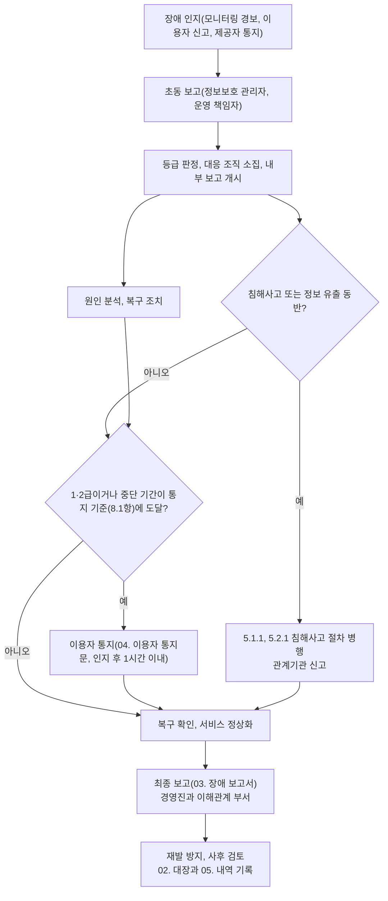

---
tags:
  - CSAP
  - 양식
  - 하등급SaaS
  - 관리적보호조치
control: 6.1.2 장애 보고
section: 6.1 서비스 연속성 관리
doc_type: 작성본
evidence: 장애대응 매뉴얼 및 절차, 정보보호 정책서·서비스연속성관리지침(장애 보고 절)
문서 양식 번호: LS-6.1.2-01
문서 양식 버전: 0.0.1
문서번호: JAS-6.1.2-01
문서 버전: 1.0
상태: 대기중
대기 사유: NCP 공공기관용 운영 서비스 개시·계약 전이라 제공자 상태 페이지·장애 알림 구독 채널·기술 지원 창구·제공자 SLA 확인 결과를 채울 수 없음
작성일: 2026-10-20
---

> [!note] 근거
> [해설서/하등급-SaaS/6.1.2 장애 보고](../../../../../../projects/jeju-ai/docs/CSAP/해설서/하등급-SaaS/01.%20관리적%20보호%20조치/6.1.2%20장애%20보고.md)

> [!warning] 대기
> 다음이 생기면 해당 칸을 채운다.
> - NCP 공공기관용 계정 개설·계약 체결 → 10항 "인지 경로"의 제공자 상태 페이지 주소와 장애 알림 구독 채널, 10항 "계약 확인" 결과(장애 통지 채널·시한·보상 기준), 5.2항 외부 행의 상태 페이지
> - 2026-10-21 인프라 1차 구축(VPC · NAT · NKS) 반영 — 10항 "당사 조치"의 zone 전환 가능 여부를 채웠다. 공공존은 리전마다 존이 하나뿐이라(KR 리전 `KR-1`, 2026-10-21 `getZoneList` 실측) 다른 zone 전환은 할 수 없다.

> [!note] 현 구현과 차이
> 2026-10-21 현재 운영 환경은 VPC · NAT · NKS(`jeju-ai-prod-nks`, 노드 1대)만 구축했고 서비스는 배포하지 않았으며 실제 이용 기관에 서비스를 제공하지 않으므로 장애 이력은 없다. 장애 인지에 쓰는 모니터링(NCP Cloud Insight, 클러스터 metrics-server/Prometheus)과 경보는 미구축이며, api 에 상태 확인 경로(`/api/health`)만 있다. 서비스 접속화면 공지 기능도 미구현이므로 구현 전 이용자 통지는 전자우편·전화로 한다. 매일 03:00 야간 부하 시험(k6, api p95 < 300 ms)은 시험 스택에서만 돌고 운영 감시가 아니다.

# 장애 대응 및 보고 절차

| 문서번호 | 버전 | 작성일 | 작성자 | 검토자 | 승인자 | 시행일 |
| --- | --- | --- | --- | --- | --- | --- |
| JAS-6.1.2-01 | 1.0 | 2026-10-20 | {{정보보호 관리자 성명}} | {{운영 책임자 성명}} | {{CISO 성명}} | {{승인일}} |

> [!info] 법령 기준
> 클라우드컴퓨팅 발전 및 이용자 보호에 관한 법률 제25조(법률 제21066호, 2025. 10. 1. 시행)와 같은 법 시행령 제16조·제17조(대통령령 제35947호, 2026. 1. 2. 시행)를 기준으로 작성했다. 장애에 침해사고·정보 유출이 동반될 때의 신고는 정보통신망법 제48조의3(법률 제21305호, 2026. 7. 7. 시행)·같은 법 시행령 제58조의2(대통령령 제36502호, 2026. 7. 7. 시행), 개인정보 보호법 제34조(법률 제20897호, 2025. 10. 2. 시행)·같은 법 시행령 제39조·제40조(대통령령 제36121호, 2026. 8. 20. 시행)를 따른다. 법령이 개정되면 국가법령정보센터에서 조문을 다시 확인한다.

## 1. 목적

㈜이노팸(이하 "당사")은 클라우드컴퓨팅서비스 지반침하 스마트관리 시스템(제주 GEO-AI 지반침하 SaaS, 이하 "서비스")의 중단이나 피해가 발생했을 때 장애를 신속히 복구하고, 경영진과 이해관계 부서에 보고하며, 법령과 계약이 정한 이용자 통지·관계기관 신고 의무를 빠짐없이 이행하기 위하여 본 절차를 정한다. 본 절차는 당사 정보보호 정책과 서비스연속성관리지침 중 장애 보고에 관한 절에 해당한다.

## 2. 적용 범위

- 서비스(하등급 SaaS) 인증 범위의 모든 서비스 기능(web · api · pipeline, Cloud DB for PostgreSQL, Object Storage), 운영 시스템(NCP 공공기관용 NKS, Load Balancer·Ingress), 운영 인력에 적용한다. 사내 `dev0` 클러스터와 로컬 환경의 장애는 인증 대상이 아니므로 적용하지 않는다.
- 장애 원인이 당사 애플리케이션·운영에 있는 경우와 IaaS/PaaS 제공자(네이버클라우드), 외부 연계 서비스(브이월드 WMTS, 컨테이너 레지스트리)에 있는 경우를 모두 포함한다. 이용자에 대한 통지 의무는 원인이 어디에 있든 클라우드컴퓨팅서비스 제공자인 당사가 부담한다.
- 침해사고(해킹, 악성코드, 서비스거부 공격 등)가 원인인 장애는 본 절차의 보고·통지와 함께 5.1.1 침해사고 대응 절차와 5.2.1 침해사고 보고 절차를 적용한다.
- 물리 시설, 하이퍼바이저, 관리형 서비스(NKS 컨트롤 플레인, Cloud DB, Object Storage) 등 IaaS/PaaS 제공자 책임 영역의 장애 복구는 제공자 인증·계약(SLA)으로 확인하고, 당사는 제공자 통지의 접수, 이용자 전파, 대체 조치를 수행한다.

## 3. 용어 정의

| 용어 | 정의 |
| --- | --- |
| 장애 | 서비스의 전부 또는 일부가 정상적으로 제공되지 않거나 성능이 현저히 저하되어 이용자가 서비스를 이용할 수 없는 상태와 그 원인이 되는 사건 |
| 서비스 중단 | 이용자가 서비스의 핵심 기능(로그인, 지도·위험도(CSI) 조회와 레이어 표시, 사고 기록 조회·등록)을 이용할 수 없는 상태. 일부 이용 기관 또는 일부 핵심 기능만 중단된 경우도 해당 이용자에게는 중단으로 본다. 데이터셋 올리기·빌드·활성화와 내보내기의 중단은 부가 기능 장애로 보되, 이용 기관 업무에 지장이 있으면 2급으로 판정한다 |
| 중단 기간 | 서비스 중단이 시작된 시각부터 핵심 기능이 복구되어 이용 가능함을 확인한 시각까지의 시간. 모니터링 시스템의 최초 실패 감지 시각(외부 상태 확인 `/api/health` 및 화면 응답 실패)과 이용자 신고 시각 중 앞선 시각을 시작 시각으로 한다 |
| 사전 예고 | 서비스 중단 시작 7일 전까지 서비스 접속화면 공지와 이용 기관 담당자 전자우편으로 중단 일시·범위를 알린 것(접속화면 공지 기능 구현 전에는 전자우편으로 한다). 사전 예고된 계획 점검은 법 제25조제1항제3호의 통지 대상이 아니지만 7항의 내부 보고와 02. 장애 관리대장 기록은 수행한다 |
| 이용자 | 서비스 이용 계약을 체결한 이용 기관(제주특별자치도 및 산하 공공기관)과 그 소속 사용자 |
| 이용자 정보 | 이용자의 개인정보를 포함하여 서비스에서 생산·저장·관리되는 이용자의 정보 |
| 침해사고 | 정보통신망법 제2조제7호의 침해사고. 해킹, 컴퓨터바이러스, 논리폭탄, 메일폭탄, 서비스거부, 고출력 전자기파 등의 공격으로 발생한 사태 |
| 경영진 | 최고경영자와 정보보호 최고책임자 |
| 이해관계 부서 | 장애로 업무에 영향을 받거나 대응에 참여해야 하는 부서. 고객지원, 영업(발주처 담당), 개발, 운영(인프라), 개인정보 보호 담당 |

## 4. 장애 등급

장애를 인지하면 정보보호 관리자(부재 시 운영 책임자)가 다음 기준으로 등급을 정하고, 상황이 바뀌면 재판정한다. 판정이 어려우면 높은 등급으로 우선 대응한다. 등급 구분과 보고 시한은 당사 내부 기준(공통 기준 §3.7)이다.

| 등급 | 판정 기준 | 목표 복구 시간 | 이용자 통지 | 내부 보고(7항) |
| --- | --- | --- | --- | --- |
| 1급(중대) | 서비스 전면 중단(전체 이용 기관의 핵심 기능 중단), 이용자 정보 유출·훼손 동반, 침해사고 동반 | 4시간(RTO, 공통 기준 §3.5) | 대상. 인지 후 1시간 이내 1차 통지(8항) | 정보보호 최고책임자·최고경영자 즉시(30분 이내 1차), 이해관계 부서 즉시 |
| 2급(주요) | 주요 기능 중단(일부 이용 기관 또는 일부 핵심 기능 중단), 중단 기간이 8.1항 기준에 이를 가능성이 있는 경우 | 8시간 | 대상. 인지 후 1시간 이내 1차 통지(8항) | 정보보호 최고책임자·최고경영자 2시간 이내, 이해관계 부서 즉시 |
| 3급(경미) | 일부 저하(부가 기능 저하·지연으로 핵심 기능은 이용 가능, 응답 시간 p95 가 목표의 2배 초과 등) | 24시간 | 8.1항 법정 기준·9항 계약 기준 충족 시 대상 | 정보보호 최고책임자 24시간 이내, 이해관계 부서 필요 시 |

- 중단 기간이 8.1항의 기준에 이르면 등급과 무관하게 이용자 통지를 진행하고, 영향 범위가 확대되면 등급을 올린다.
- 등급 판정 결과와 근거는 03. 장애 보고서 1항에 기록한다.

## 5. 장애 대응 조직과 비상연락망

### 5.1 역할

| 역할 | 담당 | 책임 |
| --- | --- | --- |
| 장애 총괄(정보보호 최고책임자) | {{CISO 성명}} | 1급 장애 대응 지휘, 이용자 통지·관계기관 신고 승인, 최고경영자 보고 |
| 장애 관리자(정보보호 관리자) | {{정보보호 관리자 성명}} | 등급 판정, 내부 보고 발신, 통지 대상 판정, 02. 장애 관리대장과 03. 장애 보고서 작성 총괄 |
| 기술 대응(운영·개발 담당) | {{운영(인프라) 담당자 성명}}, {{개발 책임자 성명}} | 원인 분석, 복구 조치(롤백·재배포·스케일 조정), IaaS/PaaS 제공자 지원 요청, 대응 경과 기록 |
| 이용자 소통(고객지원 담당) | {{고객지원 담당 성명}} | 04. 이용자 통지문 발송·게시, 이용 기관 문의 대응, 05. 신고 및 통지 내역 관리대장 기록 |
| 개인정보 보호책임자 | {{CPO 성명}} | 개인정보 유출 동반 여부 판단, 개인정보 보호법에 따른 통지·신고 |
| 최고경영자 | {{최고경영자 성명}} | 1급 장애 보고 접수, 대외 공표·보상 등 경영 판단 |

### 5.2 비상연락망

연락처는 5.1.1 양식 03. 침해사고 대응조직 및 비상연락망(비기술)과 같은 값을 쓴다. 본 표의 연락처 칸은 그 문서 확정 후 채운다.

| 구분 | 소속·역할 | 성명 | 휴대전화 | 전자우편 | 대체 연락자·채널 |
| --- | --- | --- | --- | --- | --- |
| 내부 | 정보보호 최고책임자 | {{CISO 성명}} | {{비상연락망 연락처}} | {{비상연락망 연락처}} | 정보보호 관리자 |
| 내부 | 정보보호 관리자 | {{정보보호 관리자 성명}} | {{비상연락망 연락처}} | {{비상연락망 연락처}} | 운영 책임자 |
| 내부 | 운영 책임자 | {{운영 책임자 성명}} | {{비상연락망 연락처}} | {{비상연락망 연락처}} | 개발 책임자 |
| 내부 | 개발 책임자 | {{개발 책임자 성명}} | {{비상연락망 연락처}} | {{비상연락망 연락처}} | 운영 책임자 |
| 내부 | 고객지원 책임자 | {{고객지원 담당 성명}} | {{비상연락망 연락처}} | {{비상연락망 연락처}} | 정보보호 담당자 |
| 내부 | 개인정보 보호책임자 | {{CPO 성명}} | {{비상연락망 연락처}} | {{비상연락망 연락처}} | 정보보호 최고책임자 |
| 외부 | IaaS/PaaS 제공자 기술 지원 | 네이버클라우드(NCP 공공기관용) | {{NCP 공공 기술 지원 창구}} | | 상태 페이지 {{NCP 공공기관용 상태 페이지 URL}} |
| 외부 | 외부 연계 서비스(브이월드 WMTS, 컨테이너 레지스트리(NCP Container Registry 공공 전환 전 GHCR), DNS) | 각 서비스 운영 기관 | 각 서비스 공지 채널 | | 브이월드 장애 시 배경지도만 영향, 위험도 레이어는 유지 |
| 관계기관 | 한국인터넷진흥원(침해사고 신고, 개인정보 유출 신고) | | 118 | | 보호나라, 개인정보 포털 |
| 관계기관 | 과학기술정보통신부(이용자 정보 유출 통지, 신문 공고 통보) | 담당 부서는 통지 시점에 공식 안내로 확인 | | | |
| 관계기관 | 개인정보보호위원회(개인정보 유출 신고) | | | | 개인정보 유출 신고 시스템 |
| 이용 기관 | 공공기관 정보보안담당관 | 9항의 이용 기관별 연락처 | | | |

- 비상연락망은 분기마다 현행화하고, 인사 변동이 있으면 즉시 갱신한다.

## 6. 장애 대응 절차

| 단계 | 시한 | 담당 | 활동 | 기록 |
| --- | --- | --- | --- | --- |
| 1. 인지 | 즉시 | 운영 담당, 고객지원 담당 | 모니터링 경보(6.2.1 임계치 초과 포함: CPU·메모리 85 %, 오류율 1 %, p95 응답 2배), 이용자 신고, IaaS/PaaS 제공자 장애 통지·상태 페이지로 장애를 인지하고 인지 시각을 기록한다 | 02. 대장(발생·인지일시) |
| 2. 초동 보고 | 인지 후 15분 이내 | 인지자 → 정보보호 관리자 | 발생 시각, 영향 범위, 초기 증상을 비상연락망으로 보고한다 | 03. 보고서(초동) |
| 3. 등급 판정·소집 | 인지 후 30분 이내 | 정보보호 관리자 | 4항 등급 판정, 대응 조직 소집, 7항 내부 보고 개시, 중단 기간 계측 시작 | 03. 보고서 1항 |
| 4. 대응·복구 | 등급별 목표 복구 시간 | 기술 대응 | 원인 분석, 우회·복구 조치(이전 이미지 태그로 롤백, 파드 재시작·증설, 제공자 지원 요청), 시각별 경과 기록 | 03. 보고서 4항 |
| 5. 통지 대상 판정 | 등급 판정 시점, 중단 10분 경과 시점, 복구 시점 | 정보보호 관리자 | 1·2급 여부, 8.1항 기준(법정·계약) 충족 여부 판정, 침해사고·유출 동반 여부 확인 | 02. 대장(판정), 03. 보고서 6항 |
| 6. 이용자 통지·관계기관 신고 | 8.3항·8.5항의 시한 | 이용자 소통, 정보보호 최고책임자 승인 | 04. 이용자 통지문 작성·승인·발송·게시, 필요 시 관계기관 신고 | 05. 신고 및 통지 내역 관리대장 |
| 7. 복구 확인·정상화 | 복구 즉시 | 기술 대응, 고객지원 담당 | 핵심 기능 정상 동작 확인, 복구 시각 확정, 이용자 복구 안내 | 02. 대장(복구일시) |
| 8. 최종 보고 | 복구 후 5영업일 이내 | 정보보호 관리자 → 경영진·이해관계 부서 | 원인, 경과, 조치, 통지·신고 이행, 재발 방지 대책을 03. 장애 보고서(최종)로 보고한다 | 03. 보고서(최종) |
| 9. 사후 검토 | 최종 보고 후 2주 이내 | 정보보호 최고책임자 | 재발 방지 대책 이행 확인, 원인 확인 지연 건의 추가 통지 완료 확인, 절차 개선 사항 반영 | 03. 보고서 9항, 본 절차 개정 |

## 7. 내부 보고 체계

장애를 인지한 부서가 자체 조치로 복구했더라도 다음 보고를 생략할 수 없다. 보고는 비상연락망의 수단으로 하고, 보고 일시와 수신자를 03. 장애 보고서 7항에 기록한다.

| 보고 | 대상 | 시점·시한 | 수단 | 내용 | 기록 |
| --- | --- | --- | --- | --- | --- |
| 초동 보고 | 정보보호 관리자, 운영 책임자 | 인지 후 15분 이내 | 전화, 메신저 | 발생 시각, 증상, 영향 범위 | 03. 보고서(초동) |
| 경영진 보고(1급) | 정보보호 최고책임자, 최고경영자 | 등급 판정 즉시(인지 후 30분 이내 1차) | 전화 + 전자우편 | 개요, 영향, 초동 조치, 통지·신고 의무 예상 | 03. 보고서 7항 |
| 경영진 보고(2급) | 정보보호 최고책임자, 최고경영자 | 인지 후 2시간 이내 | 전화 또는 메신저 + 전자우편 | 개요, 영향, 복구 전망 | 03. 보고서 7항 |
| 경영진 보고(3급) | 정보보호 최고책임자 | 인지 후 24시간 이내 | 메신저 또는 전자우편 | 개요, 조치 결과 | 03. 보고서 7항 |
| 이해관계 부서 통보 | 고객지원, 영업, 개발·운영, 개인정보 보호책임자 | 등급 판정 즉시(1·2급), 필요 시(3급) | 메신저, 전자우편 | 영향 기능, 예상 복구 시간, 이용자 문의 대응 문안 | 03. 보고서 7항 |
| 진행 보고 | 경영진, 이해관계 부서 | 1급은 1시간마다, 2급은 2시간마다 복구까지 | 메신저, 전자우편 | 경과, 복구 전망 | 03. 보고서 4항 |
| 최종 보고 | 최고경영자, 정보보호 최고책임자, 이해관계 부서장 | 복구 후 5영업일 이내 | 03. 장애 보고서(최종) 결재 | 원인, 경과, 조치, 통지·신고 이행, 재발 방지 | 03. 보고서 |
| 월간 보고 | 정보보호 최고책임자 | 매월 | 02. 장애 관리대장 요약 | 장애 건수·등급, 통지·보고 이행 현황 | 02. 대장 1항 |

## 8. 법적 통지 및 신고 의무

### 8.1 이용자 통지 기준(서비스 중단 기간)

사전 예고 없이 다음 어느 하나에 해당하는 서비스 중단이 발생하면 클라우드컴퓨팅법 제25조제1항제3호에 따라 이용자에게 통지한다.

| 구분 | 기준 | 근거 |
| --- | --- | --- |
| 법정 기준 1 | 서비스 중단 기간이 연속해서 10분 이상인 경우 | 시행령 제16조제1호 |
| 법정 기준 2 | 중단 사고가 발생한 때부터 24시간 이내에 서비스가 2회 이상 중단된 경우로서 중단 기간 합계가 15분 이상인 경우 | 시행령 제16조제2호 |
| 계약 기준 | 이용 기관과 계약(서비스 수준 협약)으로 통지 기준 기간을 정한 경우 그 기간. 9항의 이용 기관별 기준을 적용한다 | 법 제25조제1항제3호 괄호 |

- 당사는 계약으로 정한 기간이 법정 기준보다 길더라도 법정 기준에 이르면 통지한다(보수적 적용). 계약 기간이 더 짧으면 그 계약 기간을 적용한다.
- 당사 내부 기준으로 1·2급 장애는 중단 기간과 무관하게 인지 후 1시간 이내에 이용 기관에 통지한다(공통 기준 §3.7).
- 24시간 이내 반복 중단은 최초 중단 시각을 기준으로 누적 계산하며, 02. 장애 관리대장 3항의 보조표로 판정한다.
- 일부 이용 기관 또는 일부 핵심 기능만 중단된 경우에도 해당 이용 기관에게는 통지 기준을 적용한다.
- 침해사고 발생, 이용자 정보 유출은 중단 기간과 무관하게 통지 대상이다(법 제25조제1항제1호·제2호, 8.5항).

### 8.2 통지 항목

통지에는 다음 다섯 항목을 모두 포함한다(시행령 제17조제1항).

| No | 통지 항목 | 작성 요령 |
| --- | --- | --- |
| 1 | 발생 내용 | 중단·피해 발생 일시, 영향받은 기능·범위, 복구 일시(복구 전이면 예상 복구 시각) |
| 2 | 발생 원인 | 확인된 원인. 바로 알기 어려우면 "원인 확인 중"으로 표기하고 나머지 항목을 먼저 통지한 뒤, 원인이 확인되면 지체 없이 추가 통지한다(시행령 제17조제1항 단서) |
| 3 | 당사의 피해 확산 방지 조치 현황 | 수행한 차단·우회·복구 조치와 진행 중인 조치 |
| 4 | 이용자의 피해 예방 또는 확산 방지 방법 | 이용자가 할 수 있는 조치(재접속, 데이터 재확인, 비밀번호 변경 등)와 서비스 재이용 시 유의 사항 |
| 5 | 담당부서 및 연락처 | 담당 부서명, 전화, 전자우편, 문의 가능 시간 |

### 8.3 통지 방법과 시기

| 항목 | 기준 |
| --- | --- |
| 시기 | 지체 없이. 당사 내부 기준: 1·2급 장애는 인지 후 1시간 이내, 그 밖의 통지 대상은 판정 후 1시간 이내에 1차 통지. 복구 후 24시간 이내에 결과(원인 포함)를 보고하고, 그때까지 원인이 확인되지 않으면 원인 확인 후 24시간 이내에 추가 통지(공통 기준 §3.7) |
| 방법 | 전화, 휴대전화, 우편, 전자우편, 문자메시지, 서비스 접속화면 게시 또는 이와 유사한 방법 중 하나 이상(시행령 제17조제2항). 당사 기본 채널: 이용 기관 담당자 전자우편 + 1·2급은 전화 병행. 서비스 접속화면 게시는 공지 기능 구현 후 추가한다 |
| 접속화면 게시 | 접속화면 게시로 알리는 경우 15일 이상 게시하고, 게시 시작일·종료일을 05. 신고 및 통지 내역 관리대장에 기록한다 |
| 서식 | 04. 이용자 통지문. 발송 전 정보보호 최고책임자(부재 시 정보보호 관리자)가 승인한다 |
| 대상 | 영향받은 모든 이용 기관의 계약 담당자와 관리자. 공공기관 이용 기관은 정보보안담당관을 포함한다(8.6항) |
| 기록 | 통지 일시, 방법, 대상, 문안, 발송 증빙(발송 로그, 화면 캡처)을 05. 대장에 기록하고 3년 보관한다 |

### 8.4 통지가 곤란한 경우의 예외

천재지변이나 그 밖의 불가피한 사유로 8.3항의 방법으로 통지할 수 없으면 다음 절차로 갈음한다(시행령 제17조제3항·제4항).

1. 정보보호 최고책임자가 통지 곤란 사유를 확인하고 최고경영자에게 보고한다.
2. 전국을 보급지역으로 하는 둘 이상의 일반일간신문에 8.2항의 항목을 1회 이상 공고한다.
3. 공고 후 지체 없이 그 사유와 공고 내용을 문서(전자문서 포함)로 과학기술정보통신부장관에게 통보한다.
4. 공고 신문·일자·지면과 통보 문서를 05. 신고 및 통지 내역 관리대장 3항에 기록하고 사본을 보관한다.

### 8.5 침해사고·정보 유출을 동반한 장애의 신고·통지

장애의 원인이나 결과에 침해사고 또는 이용자 정보(개인정보 포함) 유출이 포함되면 5.2.1 침해사고 보고 절차에 따라 다음을 함께 이행한다.

| 상황 | 의무 | 대상 | 시기 | 근거 |
| --- | --- | --- | --- | --- |
| 침해사고 발생 | 이용자 통지 | 이용자 | 지체 없이(내부 기준 인지 즉시, 1시간 이내 1차) | 클라우드컴퓨팅법 제25조제1항제1호 |
| 침해사고 발생 | 신고 | 과학기술정보통신부장관 또는 한국인터넷진흥원 | 인지 후 24시간 이내(추가 확인 사실은 확인 후 24시간 이내) | 정보통신망법 제48조의3, 같은 법 시행령 제58조의2 |
| 이용자 정보 유출 | 이용자 통지 | 이용자 | 지체 없이 | 클라우드컴퓨팅법 제25조제1항제2호 |
| 이용자 정보 유출 | 통지(유출 정보 개요, 유출 시점·경위, 확산 방지 조치 현황) | 과학기술정보통신부장관 | 즉시 | 클라우드컴퓨팅법 제25조제2항, 같은 법 시행령 제17조제5항 |
| 개인정보 유출등 | 정보주체 통지 | 정보주체 | 72시간 이내 | 개인정보 보호법 제34조제1항, 같은 법 시행령 제39조 |
| 개인정보 유출등(1천명 이상, 민감정보·고유식별정보, 외부 불법 접근) | 신고 | 개인정보보호위원회 또는 한국인터넷진흥원 | 72시간 이내 | 개인정보 보호법 제34조제3항, 같은 법 시행령 제40조 |

- 관계기관 신고와 이용자 통지는 어느 한쪽만 이행하면 부적합이다. 03. 장애 보고서 6항에서 두 의무를 각각 판정하고 05. 대장에 각각 기록한다.

### 8.6 공공기관 이용 기관

- 서비스 이용 기관은 모두 국가기관등(공공기관)이므로, 8.3항의 통지와 함께 해당 기관 정보보안담당관에게 전화, 전자우편 등으로 지체 없이 통보하고, 14.1.4 사고 및 장애 대응 절차에 따라 사고조사·예방활동에 협조한다.
- 통보 내용은 8.2항의 항목에 사고 발생일시, 보고자·보고일시, 대응 경과, 대응 소요시간, 관계자, 조치 내용을 더하여 03. 장애 보고서에서 옮겨 14.1.4 양식 04. 사고 및 장애 발생 보고서로 제공한다.

### 8.7 집적정보통신시설 관련 보고(해당 시)

당사는 IaaS/PaaS 제공자의 시설을 이용하므로 원칙적으로 정보통신망법 제46조의 집적정보통신시설 사업자등에 해당하지 않는다. 다만 임차 시설을 배타적으로 운영·관리하는 등 같은 조 제6항·제7항의 적용 대상이 되면 재난 등으로 인한 서비스 중단 시 과학기술정보통신부장관 보고와 시설 임대 사업자 통지를 이행한다(같은 법 시행령 제41조, 중단 기간 기준은 시행령 제40조제1항).

| 확인 항목 | 결과 |
| --- | --- |
| 집적정보통신시설 사업자등 해당 여부 | 비해당 |
| 판단 근거 | 운영 환경은 NCP 공공기관용 관리형 서비스(NKS, Cloud DB for PostgreSQL, Object Storage)를 이용하며, 당사는 서버·시설을 임차하거나 배타적으로 운영·관리하지 않는다(공통 기준 §1.1). 개발용 사내 `dev0` 클러스터는 인증 대상이 아니고 타인에게 시설을 제공하지 않는다 |
| 판단일·판단자 | 2026-10-20, {{정보보호 관리자 성명}} |

## 9. 이용 기관별 계약상 통지 기준

| No | 이용 기관 | 공공기관 여부 | 계약·SLA 문서 | 계약상 통지 기준 기간 | 적용 기준(8.1항) | 통지 채널·담당자 연락처 | 정보보안담당관 연락처 | 확인일 |
| --- | --- | --- | --- | --- | --- | --- | --- | --- |
| 1 | 제주특별자치도(발주처) | ○ | {{계약번호, SLA 조항}} | {{계약상 통지 기준 기간}} | 계약 확인 전까지 법정 기준(연속 10분, 24시간 내 2회 합계 15분) | {{이용 기관 담당자 연락처}} | {{이용 기관 정보보호 담당자}} | {{계약 확인일}} |
| 2 | 제주특별자치도 산하 공공기관(이용 시) | ○ | 해당 없음 — 기준일 현재 개별 계약 없음 | 해당 없음 | 법정 기준 | 해당 없음 | 해당 없음 | 2026-10-20 |
| 3 | 해당 없음 — 기준일 현재 다른 이용 기관 없음 | | | | | | | 2026-10-20 |

- 계약 체결·변경 시 영업(발주처 담당)이 본 표를 갱신하고 정보보호 관리자에게 통보한다. 14.1.1 보안서비스 수준 협약의 SLA 내용과 일치해야 한다.

## 10. IaaS/PaaS 제공자 장애 대응(책임공유모델)

| 항목 | 내용 |
| --- | --- |
| 인지 경로 | 제공자 상태 페이지 {{NCP 공공기관용 상태 페이지 URL}}, 장애 알림 구독({{NCP 장애 알림 구독 채널}}), 당사 모니터링 경보(Cloud Insight, 목표) |
| 당사 조치 | 영향 범위 확인, 같은 존 안 다른 노드로의 파드 재배치(공공존은 리전당 존 1개 — KR 리전 `KR-1` — 라 다른 zone 전환은 할 수 없다, 2026-10-21 실측), 제공자 기술 지원 요청과 사례 번호 기록. 리전 전체 장애에는 KRS(남부권) 리전 백업·복구 절차(14.2.2, 수립 대기)를 따른다 |
| 이용자 통지 | 제공자 장애로 인한 당사 서비스 중단도 8.1항 기준을 적용하여 당사가 통지한다. 발생 원인에는 "이용 중인 클라우드 인프라 제공자(네이버클라우드)의 장애"로 적고 제공자 공지 내용을 인용한다 |
| 증빙 | 제공자의 장애 공지와 사후 보고서(RCA) 사본을 03. 장애 보고서에 첨부한다 |
| 계약 확인 | 제공자와의 계약·SLA에서 장애 통지 채널, 통지 시한, 보상 기준을 확인하고 연 1회 검토한다. 확인 결과: {{NCP 공공기관용 계약·SLA 확인 결과}} |

## 11. 기록 및 보관

| 기록 | 양식 | 작성 시점 | 보관 기간 | 보관 위치 |
| --- | --- | --- | --- | --- |
| 장애 관리대장 | 02 | 장애 인지 시 등재, 복구·통지 후 갱신 | 3년 | 사내 문서 저장소 `CSAP/장애기록/관리대장/` (서명본은 `CSAP/서명본/6.1.2/`) |
| 장애 보고서(초동·최종) | 03 | 인지 후 15분 이내(초동), 복구 후 5영업일 이내(최종) | 3년 | 사내 문서 저장소 `CSAP/장애기록/<장애번호>/` |
| 이용자 통지문과 발송·게시 증빙 | 04 | 통지 시 | 3년 | 사내 문서 저장소 `CSAP/장애기록/<장애번호>/` |
| 신고 및 통지 내역 관리대장 | 05 | 통지·신고 시 | 3년 | 사내 문서 저장소 `CSAP/장애기록/관리대장/` |
| 관계기관 신고 접수증, 신문 공고·통보 문서 | 첨부 | 신고·공고 시 | 3년 | 사내 문서 저장소 `CSAP/장애기록/<장애번호>/` |

## 12. 훈련 및 검토

- 연 1회 이상 서비스 중단 시나리오(IaaS/PaaS 제공자 장애 포함)로 모의훈련을 실시하고, 통지 기준 판정, 통지문 작성, 경영진 보고, 공공기관 정보보안담당관 통보까지 수행한 뒤 결과를 03 보고서 형식으로 기록한다. 침해사고 대응 훈련(5.1.1 양식 05)과 같은 날 이어서 실시할 수 있다.
- 본 절차는 연 1회 이상, 그리고 관련 법령 개정, 조직 변경, 운영 환경 구축·변경, 1급 장애 발생 후에 검토·개정한다. 법령 개정 여부는 7.1.1 법적요구사항 준수 점검과 함께 확인한다.
- 장애 대응 조직 구성원과 고객지원 인력에게 연 1회 이상 본 절차와 통지 의무를 교육한다(2.3.2 교육 시행).

## 13. 관련 문서

- 양식 02. 장애 관리대장
- 양식 03. 장애 보고서
- 양식 04. 이용자 통지문
- 양식 05. 신고 및 통지 내역 관리대장
- 5.1.1 침해사고 대응 절차(침해사고 대응지침), 5.2.1 침해사고 보고 절차
- 6.2.1 성능·용량 모니터링 절차서(모니터링 임계치)
- 14.1.1 보안서비스 수준 협약, 14.1.4 사고 및 장애 대응 절차
- 14.2.2 중요장비 이중화 및 백업체계 구축(RPO 24시간 · RTO 4시간)
- 정보보호 정책, 서비스연속성관리지침, IaaS/PaaS 제공자 계약·SLA

## 14. 승인

서명본 보관 위치: 사내 문서 저장소 `CSAP/서명본/6.1.2/`

| 구분 | 직위 | 성명 | 서명 | 일자 |
| --- | --- | --- | --- | --- |
| 작성(정보보호 관리자) | 정보보호 관리자 | {{정보보호 관리자 성명}} | | |
| 검토(운영 책임자) | 운영 책임자 | {{운영 책임자 성명}} | | |
| 검토(개인정보 보호책임자) | 개인정보 보호책임자 | {{CPO 성명}} | | |
| 승인(정보보호 최고책임자) | 정보보호 최고책임자 | {{CISO 성명}} | | {{승인일}} |

## 15. 개정 이력

| 버전 | 일자 | 변경 내용 | 작성자 | 승인자 |
| --- | --- | --- | --- | --- |
| 1.0 | 2026-10-20 | 최초 제정 | {{정보보호 관리자 성명}} | {{CISO 성명}} |
