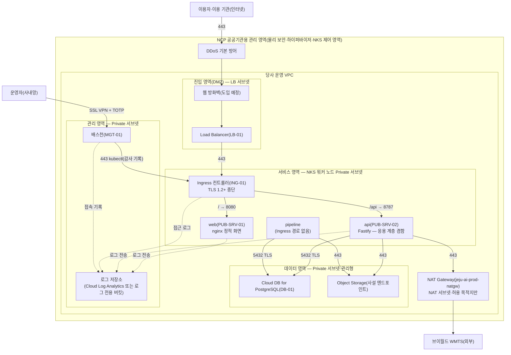

---
tags:
  - CSAP
  - 작성본
  - 하등급SaaS
  - 기술적보호조치
control: 9.1.5 공개서버 보안
section: 9.1 공개서버 보안
doc_type: 작성본
evidence: 네트워크 및 시스템 구성도
문서 양식 번호: LS-9.1.5-03
문서 양식 버전: 0.0.1
문서번호: JAS-9.1.5-03
문서 버전: 1.0
상태: 대기중
대기 사유: 운영 VPC·서브넷·NAT·NKS 는 2026-10-21 1차 구축했으나 Cloud DB·관리 영역(VPN·배스천)·운영 도메인·ALB·로그 수집이 없어 DB·관리 서브넷 정보·공인 IP·도메인·LB 규칙 ID·로그 칸을 채울 수 없음
작성일: 2026-10-20
---

> [!note] 근거
> [해설서/하등급-SaaS/9.1.5 공개서버 보안](../../../../../../projects/jeju-ai/docs/CSAP/해설서/하등급-SaaS/02.%20기술적%20보호%20조치/9.1.5%20공개서버%20보안.md)

> [!warning] 대기
> 아래가 생기면 해당 칸을 채운다. `대기:` 로 시작하는 자리표시자 칸이 대상이다.
> - 2026-10-21 인프라 1차 구축(VPC·NAT·NKS) 반영: 1항 계정·VPC·리전·존, 3항 LB·노드·DB 서브넷 대역, 5항 NAT·클러스터 API 접근 제한을 채웠다.
> - 관리 영역 서브넷·SSL VPN·배스천 구축(미정) → 3항 관리 서브넷 CIDR, 5항 7행 출발지, 7항 MGT-01
> - Cloud DB for PostgreSQL 구축 → 7항 DB-01 사설 IP·로그 연동, 5항 5·12행 DB ACG
> - 파드 대역 확인 → 3항 파드 CIDR
> - NCP 공공 CSAP 인증서 사본 확보 → 1항 인증번호·유효기간
> - 운영 도메인·Load Balancer·인증서 발급 → 4항 공인 IP·도메인
> - 서비스 Helm chart 의 NetworkPolicy 와 운영 values, ACG·Network ACL 실제 규칙 → 5항 통제 수단 ID·등록일
> - 중앙 로그 수집(T079)·SSL VPN·배스천·웹 방화벽 도입 → 4항 접속이력 저장, 6항·7항 해당 칸
> - 운영 공개서버 신설 전 점검(JAS-9.1.5-02 4항)·첫 정기 취약점 점검 → 4항 최근 점검일, 8항 첫 대조 기록

> [!note] 현 구현과 차이
> 이 구성도는 운영 목표 구조다. 2026-10-20 현재 서비스는 사내 `dev0`(인증 대상 아님)에서만 돈다. dev0 에서는 인터넷 → 공유기 → Nginx Proxy Manager(TLS 종단·IP 허용 목록) → Cilium Ingress → web(nginx) 로 들어오고, `/api/` 는 Ingress 가 아니라 web 의 nginx 가 api 로 중계한다(`ops/dev0/apps/jeju-ai-saas/ingress.yaml`). dev0 의 jeju-ai-saas 네임스페이스 리소스에는 NetworkPolicy 가 없다. 서비스 Helm chart 는 아직 없다(gis-sass chart 구조를 따를 예정).
>
> 2026-10-21 운영 VPC·서브넷·NAT Gateway·NKS 클러스터(`jeju-ai-prod-nks`, 노드 1대)를 OpenTofu 로 1차 구축했다(`ops/gov-ncloud/tofu/`). VPC 기본 ACG 는 인바운드 규칙이 없고(생성 시 들어가는 22·3389 `0.0.0.0/0` 을 코드로 제거) 아웃바운드는 TCP·UDP·ICMP 전체다. Network ACL 은 VPC 기본 ACL 이며 별도 규칙이 없다. 서비스 워크로드·ALB·Cloud DB·WAF·SSL VPN·배스천·로그 저장소는 아직 없다.

# 공개서버 네트워크 및 시스템 구성도

| 문서번호 | 버전 | 기준일 | 작성자 | 검토자 | 승인자 |
| --- | --- | --- | --- | --- | --- |
| JAS-9.1.5-03 | 1.0 | 2026-10-20 | {{운영(인프라) 담당자 성명}} | {{정보보호 관리자 성명}} | {{CISO 성명}} |

## 1. 구성 개요

| 항목 | 내용 |
| --- | --- |
| 서비스 | 지반침하 스마트관리 시스템(제주 GEO-AI 지반침하 SaaS)(하등급 SaaS) |
| IaaS/PaaS 제공자 | 네이버클라우드플랫폼(NCP) 공공기관용, CSAP 인증 {{대기: NCP 공공 CSAP 인증번호 / 유효기간 — 인증서 사본 확보 후}} |
| 리전·가용영역 | NCP 공공기관용 `KR`(수도권, KR-CENTRAL) 리전, 존 `KR-1`(평촌) 단일 존(공공기관 데이터는 국내에 위치). 공공존은 리전마다 존이 하나뿐이라 Multi Zone 구성은 할 수 없다(2026-10-21 `getZoneList` 실측). 가용성은 같은 존 안 노드 분산과 KRS(남부권) 리전 백업·복구 절차로 확보한다 |
| 계정·프로젝트 | 운영 NCP 공공기관용(gov-ncloud.com) 회사 계정(메인 계정 + 인프라 자동화 전용 Sub Account `gov-ncloud-tofu`, 콘솔 접근 없음·API 접근만). 운영 자원은 OpenTofu 코드(`inp-solution/gov-ncloud`)로만 만들고 고친다. 개발·시험은 사내 `dev0` 클러스터·로컬(운영 계정과 물리적으로 분리, NCP 계정 없음) |
| VPC | `jeju-ai-prod-vpc` / `10.20.0.0/16`(`KR-1`) |
| 인터넷 진입점 | (웹 방화벽 — NCP 공공 WAF 도입 예정) → NCP Load Balancer(공인 IP) → NKS Ingress 컨트롤러(TLS 종단·경로 라우팅·rate limit·본문 크기 제한) → web·api |
| 관리자 진입점 | NCP SSL VPN → 배스천(관리 영역, TOTP 다중 인증) → NKS API(kubectl)·NCP 콘솔. SSL VPN·배스천은 미구축이며, 2026-10-21 현재 클러스터 API 는 기본 차단 후 사무실 고정 IP 1개만 허용한다 |
| 구성도 원본 | 이 문서의 mermaid 원문. 클라우드 구성 내보내기는 `CSAP-인증준비/30 증적/9.1.5/03_구성/` 에 보관 |

## 2. 네트워크 구성도

- 실선은 서비스·관리 통신, 점선은 로그 전송을 뜻한다. 화살표 방향은 통신을 개시하는 방향이다. 배스천 → kubectl 선은 NKS API 엔드포인트(사설 접근)로 향하며 그림 단순화를 위해 서비스 영역으로 그렸다.
- 진입 영역에서 데이터 영역으로 직접 향하는 경로는 두지 않는다. api 는 공개 API 이자 응용 계층(WAS 역할)을 겸하므로 데이터 영역에 접속하며, 사유와 보완 통제는 5항 매트릭스에 기록한다.
- 제공자 관리 영역(물리 시설, 하이퍼바이저, NKS 제어 영역, DDoS 기본 방어)은 제공자 인증·계약으로 확인하며, 당사는 VPC 내부 구성을 책임진다.
- 공인 IP 는 Load Balancer 에만 있다. 워커 노드·DB·배스천은 공인 IP 가 없다.

## 3. 네트워크 영역 정의

| 영역 | 서브넷·CIDR | 인터넷 직접 노출 | 배치 자산 | 보호 수단 | 비고 |
| --- | --- | --- | --- | --- | --- |
| DMZ(진입 영역) | Public LB 서브넷 `jeju-ai-prod-lb-pub-sn` `10.20.11.0/24`(Private LB 서브넷 `jeju-ai-prod-lb-pri-sn` `10.20.10.0/24` 은 내부 LB 전용, 인터넷 노출 없음) | 있음(인바운드는 Load Balancer 경유 443 만) | Load Balancer, (웹 방화벽) | Load Balancer 리스너 443(80 은 리다이렉트), ACG, Network ACL, 웹 방화벽(도입 예정) | 개인정보·고유식별정보 저장 금지 |
| 서비스 영역(내부 - 앱) | Private 서브넷 `jeju-ai-prod-node-sn` `10.20.1.0/24`, 파드 대역 {{대기: 파드 CIDR}} | 없음 | Ingress 컨트롤러, web·api·pipeline 파드 | 네임스페이스 분리, NetworkPolicy 기본 거부, PSA `restricted`, 노드 ACG(`nks-*-*`, NKS 생성·관리) | web·api 는 공개서버이나 Ingress 경유로만 도달 |
| 데이터 영역(내부 - DB) | Private 서브넷 `jeju-ai-prod-db-sn` `10.20.2.0/24`(Cloud DB 미구축) | 없음 | Cloud DB for PostgreSQL, Object Storage 사설 엔드포인트, 백업 | DB ACG(워커 노드 서브넷·5432 만), TLS `require`, 서버측 암호화(AES-256) | |
| 관리 영역 | {{대기: 관리 Private 서브넷 CIDR}} | 없음(SSL VPN 경유) | 배스천, 로그 저장소 접점, 배포용 self-hosted runner | TOTP 다중 인증, 접속 기록, SSL VPN 허용 계정 제한 | |
| 게이트웨이(NAT 전용) | Public 서브넷 `jeju-ai-prod-nat-sn` `10.20.20.0/24` | 인바운드 없음(아웃바운드 출구만) | NAT Gateway `jeju-ai-prod-natgw`(공인 IP형) | Private 서브넷 라우트 `0.0.0.0/0 → NAT` 만 사용, 서버 배치 금지 | Private 서브넷의 아웃바운드는 NAT 로만 나간다 |
| 개발·시험 | 운영 VPC 밖 — 사내 `dev0`(Talos·Cilium, 네임스페이스 `dev`), 로컬 | 없음(dev0 은 사내 프록시 IP 허용 목록 뒤) | 개발·스테이지 워크로드 | 운영과 물리·계정 분리, 운영 데이터 반입 금지 | 인증 대상 아님 |

## 4. 공개서버 목록

| ID | 명칭 | 유형 | 실행 형태 | 제공 서비스 | 전용 여부 | 공인 IP·도메인 | 노출 포트 | 위치 영역 | 운영 담당 | 접속이력 저장 | 최근 설정 점검(02) | 최근 취약점 점검(05) |
| --- | --- | --- | --- | --- | --- | --- | --- | --- | --- | --- | --- | --- |
| PUB-SRV-01 | web(`jeju-ai-saas-fe`, nginx-unprivileged 1.30-alpine) | 웹 | CT | 지도·목록·상세·관리자 화면(정적 파일) | ○ | {{대기: 운영 도메인}} (공인 IP 는 LB-01) | 443(Ingress `/`) — 컨테이너 8080 은 ClusterIP | 서비스 영역(Ingress 경유) | {{운영(인프라) 담당자 성명}} | {{대기: 중앙 로그 수집 구성 후}} | 2026-10-20(사전 검토) | 2026-10-20(ZAP 기준 검사·trivy, 로컬 스택) |
| PUB-SRV-02 | api(`jeju-ai-saas-api`, node 24.22.0-alpine) | API | CT | 조회·내보내기·업로드·파일 중계·인증 | ○ | {{대기: 운영 도메인}}`/api` (공인 IP 는 LB-01) | 443(Ingress `/api`) — 컨테이너 8787 은 ClusterIP | 서비스 영역(Ingress 경유) | {{운영(인프라) 담당자 성명}} | {{대기: 중앙 로그 수집 구성 후}} | 2026-10-20(사전 검토) | 2026-10-20(ZAP API 검사·trivy, 로컬 스택) |
| PUB-SRV-03 | 이용 기관 포털 | 포털 | 해당 없음 | 해당 없음 — 별도 포털이 없고 이용 기관도 PUB-SRV-01 을 쓴다 | | | | | | | | |
| 배포 서버 | 배포 서버 | 배포 | 해당 없음 | 해당 없음 — 앱·에이전트 등 설치형 배포물이 없다. 컨테이너 이미지 레지스트리는 비공개(pull 자격 필요) | | | | | | | | |
| LB-01 | NCP Load Balancer | 관리형 | 관리형 | 인터넷 진입점 | 해당 없음 | {{대기: LB 공인 IP}} | 443(80 → 443 리다이렉트) | DMZ | {{운영(인프라) 담당자 성명}} | {{대기: LB 접근 로그 설정 후}} | 해당 없음 | {{대기: 운영 TLS 스캔 후}} |
| ING-01 | NKS ALB Ingress Controller(NKS 기본 포함, IngressClass `alb` 기본값) | 관리형/CT | CT | TLS 종단·경로 라우팅·rate limit | 해당 없음 | LB-01 뒤 | 443 | 서비스 영역(진입 계층) | {{운영(인프라) 담당자 성명}} | {{대기: Ingress 접근 로그 수집 후}} | {{대기: 공공 Ingress 방식 확정 후}} | {{대기: 운영 TLS 스캔 후}} |

- Load Balancer·웹 방화벽 등 인터넷에 노출된 관리형 구성요소도 목록에 포함하고 실행 형태를 "관리형"으로 적는다.
- 분기 1회 NCP 콘솔의 공인 IP·Load Balancer·DNS 레코드를 조회하여 목록에 없는 공개서버가 없는지 대조하고 대조 결과를 8항에 기록한다.

## 5. 영역 간 통신 허용 매트릭스

| No | 출발지 | 목적지 | 프로토콜·포트 | 업무 목적 | 통제 수단(ACG·ACL·정책 ID) | 등록일 | 승인 근거 | 최근 검토일 |
| --- | --- | --- | --- | --- | --- | --- | --- | --- |
| 1 | 인터넷(0.0.0.0/0) | (웹 방화벽)·LB-01 | TCP 443 (80 은 리다이렉트만) | 이용자 서비스 접속 | {{대기: LB 리스너·ACG 규칙 ID}} | {{대기: 구축일}} | JAS-9.1.5-01 7항 | |
| 2 | LB-01 | ING-01 | TCP {{대기: ALB Ingress 생성 후 대상 포트(NodePort 또는 파드 포트) 확인}} | 진입 트래픽 전달 | 노드 ACG(`nks-*-*`) — ALB 생성 시 NKS 가 LB 서브넷 대역 인바운드를 자동 추가(출발지 LB 서브넷 한정) | {{대기: 구축일}} | JAS-9.1.5-01 7항 | |
| 3 | ING-01 | PUB-SRV-01(web) | TCP 8080 | 정적 화면 | NetworkPolicy `allow-from-ingress-controller`(출발지 Ingress 컨트롤러 파드 한정) | {{대기: chart 반영일}} | JAS-9.1.5-01 7항 | |
| 4 | ING-01 | PUB-SRV-02(api) | TCP 8787 | API | NetworkPolicy `allow-from-ingress-controller` | {{대기: chart 반영일}} | JAS-9.1.5-01 7항 | |
| 5 | PUB-SRV-02(api), pipeline | DB-01 | TCP 5432(TLS `require`) | 계정·권한·감사·데이터셋·작업 | NetworkPolicy egress `allow-db-egress`(api·pipeline 파드만) + DB ACG(워커 노드 서브넷만) | {{대기: 구축일}} | 아래 "직접 연결" 기록 | |
| 6 | PUB-SRV-02(api), pipeline | Object Storage | TCP 443 | 레이어·번들·업로드·내보내기 파일 | NetworkPolicy egress(api·pipeline 파드만), 역할별 접근키 | {{대기: 구축일}} | JAS-9.1.5-01 7항 | |
| 7 | 배스천(MGT-01) | NKS API 엔드포인트 | TCP 443 | 관리자 kubectl(감사 기록) | NKS 클러스터 API IP ACL(기본 차단, 허용 1건). 배스천 미구축으로 현재 허용 출발지는 사무실 고정 IP 1개 | 2026-10-21 | JAS-9.1.5-01 8항 | |
| 8 | 서비스 영역 노드 에이전트 | 로그 저장소 | TCP 443 | 로그 전송 | {{대기: 로그 수집 구성 후}} | {{대기: 구축일}} | JAS-9.1.5-01 9항 | |
| 9 | PUB-SRV-02(api) | 인터넷(브이월드 WMTS 고정 호스트) | TCP 443 | 배경지도 중계(선택 기능) | NetworkPolicy egress(외부 대역, 사설·루프백·링크로컬 제외) + NAT Gateway, 앱 허용 목록 고정 호스트 | {{대기: 구축일}} | JAS-9.1.5-01 7항 | |
| 10 | 서비스 영역 노드 | 인터넷(이미지 레지스트리) | TCP 443 | 이미지 pull | NAT Gateway `jeju-ai-prod-natgw`(Private 라우트 `0.0.0.0/0 → NAT`, GHCR pull 2026-10-21 확인), {{대기: NCP 공공 Container Registry 전환 후 사설 엔드포인트 — ADR D5 결정 대기}} | 2026-10-21 | ADR D5 | |
| 11 | chart 파드 전부 | kube-dns | UDP·TCP 53 | 이름 해석 | NetworkPolicy `allow-dns-egress` | {{대기: chart 반영일}} | JAS-9.1.5-01 7항 | |
| 12 | DMZ 전체·PUB-SRV-01(web) | 데이터 영역 | 전체 | 차단(기본 거부) | DB ACG 인바운드에 LB 서브넷 없음, web 파드에 DB·스토리지 egress 없음 | {{대기: 구축일}} | JAS-9.1.5-01 7항 | |

- 위 표에 없는 통신은 모두 차단한다. 매트릭스와 실제 ACG·ACL·NetworkPolicy 규칙의 일치 여부는 JAS-9.1.5-04 공개서버 보안시스템 운영 현황의 정책 검토 시 확인한다.
- 현재 dev0 에서만 쓰는 web → api(TCP 8787, nginx `/api/` 중계)는 목표 구조에서는 쓰지 않는다(Ingress 가 `/api` 를 api 로 직접 보낸다). 운영에서 이 경로를 유지하게 되면 매트릭스에 행을 추가하고 NetworkPolicy 로 web 파드 → api 8787 만 허용한다.
- DMZ에서 DB로 직접 연결이 불가피한 경우: 사유 — api 가 공개 API 이자 응용 계층(WAS 역할)을 겸하는 2계층 구조라 별도 WAS 경유가 없다(진입 영역의 LB·Ingress 는 DB 에 접속하지 않는다), 보완 통제 — DB 계정 최소 권한(`audit_events` 는 INSERT·SELECT 만), NetworkPolicy egress 를 api·pipeline 파드와 5432 로 한정, DB ACG 는 워커 노드 서브넷만 허용, TLS `require`, 쿼리·접속 로그 점검, 승인자 {{CISO 성명}}, 승인일 {{승인일}}

## 6. 보안시스템 배치

| 보안시스템 | 배치 위치 | 보호 대상 | 상세 |
| --- | --- | --- | --- |
| 웹 방화벽 | DMZ 앞단(Load Balancer 연동) — NCP 공공 WAF 도입 예정 | PUB-SRV-01, PUB-SRV-02 | 04 양식 3항 |
| ACG·Network ACL | 각 서브넷·인스턴스(LB, 워커 노드, DB, 배스천) | 전체 | 04 양식 2항 |
| NetworkPolicy·Pod 보안 표준 | 서비스 네임스페이스 | web·api·pipeline | 02 양식 3.3항 |
| 악성코드 방지 | 워커 노드·배스천({{대기: 공공 영역 제공 백신 또는 당사 도입 제품 확정}}), 컨테이너는 이미지 스캔으로 보완 | 전체 | 04 양식 4항 |
| 접근통제솔루션(SSL VPN·배스천) | 관리 영역 | 전체 관리자 접속 | 04 양식 5항 |
| 로그 저장소 | 관리형 로그 서비스 또는 Object Storage 로그 전용 버킷 | 전체 | 04 양식 6항 |
| DDoS 방어 | 제공자 경계 | 전체 | 제공자 제공 범위 확인 |

## 7. 시스템 구성 정보

| ID | 호스트명 | 실행 형태 | OS·베이스 이미지 | 웹서버·런타임 | 사설 IP | 관리 접근 경로 | 백신·EDR | 로그 전송 |
| --- | --- | --- | --- | --- | --- | --- | --- | --- |
| PUB-SRV-01 | Deployment `web`(복제 2) | CT | `nginxinc/nginx-unprivileged:1.30-alpine`(alpine 3.24) | nginx 1.30, 컨테이너 포트 8080 | 파드 대역에서 동적 할당 | SSL VPN → 배스천 → kubectl(exec 는 감사 기록) | 노드 수준 {{대기: 제품 확정}}, 이미지 trivy | stdout → {{대기: 노드 로그 에이전트}} |
| PUB-SRV-02 | Deployment `api`(복제 2) | CT | `node:24.22.0-alpine` + `apk upgrade`, npm·corepack 제거, `USER node` | Node.js 24 + Fastify, 컨테이너 포트 8787 | 파드 대역에서 동적 할당 | 위와 같음 | 위와 같음 | stdout → {{대기: 노드 로그 에이전트}} |
| APP-01 | 해당 없음 — 별도 WAS 없음(api 가 겸함). 내부 워커 pipeline(Deployment 1, Python 3.12, Ingress 경로 없음)이 응용 계층에 있다 | CT | {{대기: pipeline 워커 이미지 — 현재 로컬 CLI(`build_data.py`·`run_index.py`)로만 실행}} | Python 3.12 | 파드 대역 | 위와 같음 | 위와 같음 | 위와 같음 |
| DB-01 | Cloud DB for PostgreSQL | 관리형 | 제공자 관리(Rocky Linux + PostgreSQL 14 이상, PostGIS — 공공 영역 지원 실측 대기) | PostgreSQL | {{대기: DB 사설 IP·엔드포인트}} | 배스천 경유 DB 클라이언트(TLS) | 제공자 | {{대기: DB 로그 연동}} |
| MGT-01 | 배스천 | VM | {{대기: 배스천 OS 이미지 확정}} | — | {{대기: 관리 서브넷 IP}} | SSL VPN + TOTP | {{대기: 제품 확정}} | {{대기: 로그 에이전트}} |

## 8. 현행화 및 검토

- 공개서버·서브넷·통신 규칙이 변경되면 5영업일 이내에 본 문서를 갱신하고 버전을 올린다.
- 분기 1회 실제 구성(콘솔 조회, 규칙 내보내기)과 대조하여 일치 여부를 확인하고 아래에 기록한다.

| 검토일 | 검토 범위 | 대조 자료(기준일) | 결과 | 검토자 | 확인자 |
| --- | --- | --- | --- | --- | --- |
| {{대기: 운영 구축 후 첫 대조일}} | 공개서버 목록, 통신 매트릭스 | 공인 IP 목록, ACG·Network ACL 내보내기, `kubectl get networkpolicy -A -o yaml` | {{대기: 첫 대조 결과}} | {{정보보호 관리자 성명}} | {{CISO 성명}} |

## 9. 승인

| 구분 | 직위 | 성명 | 서명 | 일자 |
| --- | --- | --- | --- | --- |
| 작성(인프라 운영 담당자) | | | | |
| 검토(정보보호 관리자) | | | | |
| 승인(정보보호 최고책임자) | | | | |

- 서명본 보관 위치: 사내 문서 저장소 `CSAP/서명본/9.1.5/`

## 10. 개정 이력

| 버전 | 기준일 | 변경 내용 | 작성자 | 승인자 |
| --- | --- | --- | --- | --- |
| 1.0 | 2026-10-20 | 최초 작성(목표 구조, 운영 구축 전) | {{운영(인프라) 담당자 성명}} | {{CISO 성명}} |
