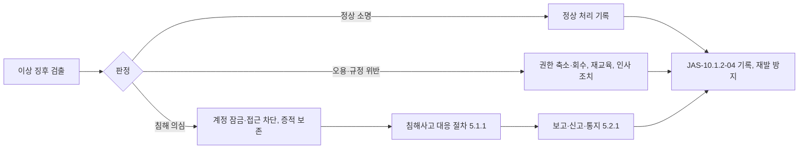

---
tags:
  - CSAP
  - 양식
  - 하등급SaaS
  - 기술적보호조치
control: 10.1.2 접근기록 관리
section: 10.1 접근기록 관리
doc_type: 작성본
evidence: 접근통제관리지침
문서 양식 번호: LS-10.1.2-02
문서 양식 버전: 0.0.1
문서번호: JAS-10.1.2-02
문서 버전: 1.0
상태: 작성완료
작성일: 2026-10-20
---

> [!note] 근거
> [해설서/하등급-SaaS/10.1.2 접근기록 관리](../../../../../../projects/jeju-ai/docs/CSAP/해설서/하등급-SaaS/02.%20기술적%20보호%20조치/10.1.2%20접근기록%20관리.md)

> [!note] 현 구현과 차이 (2026-10-20)
> 본 절차는 목표 상태(NCP 공공 운영 환경)를 기준으로 쓴 것이다. 현재 `jeju-ai-saas-be` 의 api 에는 인증·권한·감사 기록(`audit_events`)·DB 가 없고, 로그는 Fastify 요청 로그(요청 ID·메서드·URL·원격 주소·상태 코드)가 stdout 으로만 나간다. 로그 수집·별도 보관·보존 정책·무결성 검증도 없다. 운영 환경(NKS · Cloud DB · Object Storage · 로그 저장소)은 구축 전이다. 이 절차의 통제는 해당 구성이 갖춰지는 시점부터 적용하며, 실제 생성 위치와 설정값은 JAS-10.1.2-03 에 실측하여 기록한다.

# 접근기록 관리 절차

| 문서번호 | 버전 | 작성일 | 작성자 | 검토자 | 승인자 | 시행일 |
| --- | --- | --- | --- | --- | --- | --- |
| JAS-10.1.2-02 | 1.0 | 2026-10-20 | {{정보보호 관리자 성명}} | {{정보보호 담당자 성명}} | {{CISO 성명}} | {{승인일}} |

> [!info] 법령 기준
> 개인정보 보호법 제29조(법률 제20897호, 2025. 10. 2. 시행), 같은 법 시행령 제30조제1항제5호(대통령령 제36121호, 2026. 8. 20. 시행), 개인정보의 안전성 확보조치 기준 제2조제3호·제4조·제5조제3항·제8조(개인정보보호위원회고시 제2026-9호, 2026. 7. 1. 시행)를 기준으로 작성했다. 법령·고시가 개정되면 국가법령정보센터에서 조문을 다시 확인한다.

본 문서는 ㈜이노팸 접근통제관리지침 중 접근기록 관리에 해당하는 절이다. 개인정보처리시스템에 관한 사항은 개인정보 내부 관리계획의 접속기록 보관·점검 사항과 일치하게 유지한다.

## 1. 목적

JAS-10.1.2-01 정보보호 정책서 접근기록 관리 조항에 따라, 접근기록 생성 대상의 정의, 기록 항목, 보관·보호, 검토, 이상 발견 시 조치의 세부 절차를 정한다.

## 2. 적용 범위

- 지반침하 스마트관리 시스템(하등급 SaaS) 인증 범위 내 시스템과 그 접근기록
- 접근기록 생성·전송·보관·검토·조치에 관여하는 정보보호 조직, 시스템 담당자(운영(인프라) 담당자·개발 책임자), 접근기록 저장소 관리자, 외부인력 감독자
- 제공자 책임 영역(물리 시설, 하이퍼바이저, NKS 컨트롤 플레인 내부, 관리형 DB 내부 관리 계층)은 제외하며, 제공자 인증·계약으로 확인한다.
- 사내 개발 클러스터 `dev0`·로컬 환경은 인증 범위가 아니므로 제외한다.

## 3. 접근기록 생성 대상 정의

### 3.1 대상 선정 기준

서비스와 업무 중요도를 고려하여 다음 유형에 해당하는 시스템은 접근기록 생성 대상으로 정의한다. 시스템에 로그인한 접속 기록과 접속 후 수행한 행위 기록을 모두 생성하는 시스템을 포함한다.

| 시스템 유형 | 대상 포함 기준 | 대상(당사) | 생성해야 하는 접근기록 |
| --- | --- | --- | --- |
| 운영 서버 | 서비스를 구성하는 가상 서버·컨테이너 노드 전부 | NKS 워커 노드, web·api·pipeline 파드 | 워커 노드 직접 접속은 금지(접속 시도 자체를 예외로 기록), 파드 `exec`·`attach`·`port-forward` 는 k8s API 감사 로그로 기록 |
| 관리 서버 | 운영 서버·DB에 접근하는 경유 서버 | 배스천(운영자 VPN 뒤 관리 경유 서버) | 로그인, 세션 기록, 실행 명령, 접속 대상 |
| DBMS | 개인정보·이용 기관 데이터를 저장하는 모든 DB | NCP Cloud DB for PostgreSQL(계정·권한·감사·사고 기록·데이터셋 버전·작업·내보내기) | DB 계정 접속, 실행 문장(사고 기록 표 조회·변경·삭제, 대량 조회), 계정·권한 변경 |
| 응용 서비스 | 이용자·이용 기관 관리자가 접속하는 기능 중 개인정보·이용 기관 데이터를 처리하는 기능 | 서비스 web·api | 로그인 성공·실패, 사고 기록 조회·입력·변경·삭제, 내보내기 생성·다운로드(민감 레이어 열람 플래그), 데이터셋 업로드·빌드·활성화 |
| API·클라우드 콘솔 | 당사 클라우드 계정의 콘솔·CLI·API 호출 | NCP 콘솔(메인 계정·Sub Account), NCP API(인증키), NKS 클러스터 API(kubectl) | 콘솔 로그인, 메인 계정 사용, Sub Account·권한·인증키 변경, 자원 생성·변경·삭제, 로그 설정 변경, 클러스터 자원 변경 |
| 클라우드 관리 포털 | 당사가 이용 기관·이용자를 관리하는 포털 | 서비스의 관리자 기능(`admin` · `service` 역할 전용 라우트: 사용자·권한 관리, 감사 조회, 데이터셋 관리) | 관리자 로그인, 관리 기능 사용(계정 발급·초기화, 권한 설정, 감사 조회, 데이터셋 활성화) |
| 정보보호시스템 | 보안 정책·로그를 관리하는 시스템 | 접근기록 저장소(NCP Cloud Log Analytics 또는 Object Storage 별도 버킷), 웹 방화벽(도입 예정) | 관리자 로그인, 정책 변경, 로그 삭제·보존 설정 변경 |
| 개발·배포 환경 | 운영 배포에 영향을 주는 시스템 | GitHub 조직 `innopam`(저장소·Actions·조직 설정), self-hosted runner, NCP Container Registry | 관리자 로그인, 권한 변경, 저장소·브랜치 보호 설정 변경, 운영 배포 실행·승인, 이미지 push |
| 백업 시스템 | 개인정보·이용 기관 데이터의 백업 저장소 | Cloud DB 자동 백업, Object Storage `backups/` | 접근, 복원, 삭제 |

### 3.2 중요도 판단

| 중요도 | 기준 | 접근기록 생성 범위 | 검토 기본 주기 |
| --- | --- | --- | --- |
| 상 | 개인정보처리시스템(준용 포함), 이용 기관 데이터 저장·처리, 클라우드 콘솔·IAM, 서비스 관리자 기능, 접근기록 저장소 | 필수(접속 기록 + 행위 기록) | 월 1회 이상, 고위험 이벤트는 실시간 알림 |
| 중 | 운영에 필요하나 개인정보·이용 기관 데이터를 직접 저장하지 않는 서버·도구 | 필수(접속 기록 + 관리자 행위 기록) | 월 1회 이상 |
| 하 | 인증 범위 내이지만 중요 정보에 접근할 수 없는 시스템 | 접속 기록 | 분기 1회 이상 |

- 중요도 판단 근거는 정보자산 목록의 기밀성·무결성·가용성 등급과 위험평가 결과를 따르고, JAS-10.1.2-03 에 기록한다.
- 중요도 하로 판단하여 행위 기록을 생략하는 시스템은 사유와 승인자를 JAS-10.1.2-03 의 제외·완화 항에 기록한다.

### 3.3 목록 관리

1. 시스템 담당자는 신규 시스템 도입, 시스템 변경(개인정보 처리 시작, 관리 기능 추가 등), 폐기 시 정보보호 관리자에게 통보한다.
2. 정보보호 관리자는 3.1·3.2의 기준으로 대상 여부와 중요도를 판단하고 JAS-10.1.2-03 에 등재·변경·삭제한다.
3. 반기 1회 이상 정보자산 목록, 클라우드 자원 목록(NCP 콘솔 내보내기), 개인정보처리시스템 현황(2.1.2 개인정보취급자 목록 1항)과 대조하여 누락된 시스템이 없는지 확인한다.
4. 목록의 각 시스템은 접속 기록과 행위 기록의 정확한 생성 위치(로그 서비스명, 로그 그룹, 감사 테이블명 등)를 함께 기록한다.

### 3.4 생성 위치 파악

상용 프로그램·관리형 서비스의 접근기록은 프로그램별로 생성 위치와 기본 설정이 다르므로, 시스템 담당자는 다음을 기준으로 실제 위치를 확인하고 필요한 로그 생성 설정을 활성화한다. 관리형 서비스의 로그 제공 범위는 구축 시 실측하여 JAS-10.1.2-03 에 기록한다.

| 구분 | 접속 기록 위치 | 행위 기록 위치 | 활성화가 필요한 설정 |
| --- | --- | --- | --- |
| Linux 운영체제 | NKS 워커 노드의 인증 로그(노드 직접 접속 금지 원칙으로 평시 기록 없음이 정상) | k8s API 감사 로그의 `pods/exec` · `pods/attach` · `pods/portforward` 이벤트 | NKS 감사 로그 수집 옵션 활성화, 접근기록 저장소 전달. 배스천은 OS 인증 로그·세션 기록을 저장소로 전송 |
| Windows 운영체제 | 해당 없음 — 인증 범위에 Windows 서버가 없다 | 해당 없음 | 해당 없음 |
| 관계형 DBMS(직접 운영) | 해당 없음 — DB 는 관리형(Cloud DB for PostgreSQL)만 쓴다 | 해당 없음 | 해당 없음 |
| 관리형 DB(PaaS) | Cloud DB for PostgreSQL 의 DB 로그(접속·인증 이벤트) | 같은 로그의 실행 문장(DDL·권한 변경, 사고 기록 표 대상 문장) | 접속 로그·문장 로그 설정 활성화, 로그 내보내기(접근기록 저장소). 앱 DB 역할의 `audit_events` 권한은 `INSERT`·`SELECT` 만 |
| 웹·응용 서버 | Ingress 접근 로그(원 IP·시각·URI·상태), api 요청 로그(request_id) | api 감사 기록 `audit_events`(4.1항 필수 항목) | api 감사 기록 구현, 요청 로그에 사용자 식별자와 request_id 포함, Ingress 의 원 IP 전달(`X-Forwarded-For` 신뢰 대역 고정) |
| 클라우드 콘솔·API | NCP 계정 활동 로그(Cloud Activity Tracer)의 콘솔 로그인 이벤트 | 같은 서비스의 관리 이벤트(자원·Sub Account·정책·인증키 변경) | 활동 로그 수집 활성화, 접근기록 저장소 전달, 보관 기간 설정 |
| 서비스 관리 기능 | api 감사 기록의 `auth.login`(관리자 역할) | api 감사 기록의 관리 액션(`perms.save`, 사용자 관리, `dataset.activate` 등) | 관리 기능별 감사 액션 구현 |
| 정보보호시스템 | NCP 콘솔 로그인(접근기록 저장소·WAF 는 콘솔 권한으로 접근) | Cloud Activity Tracer 의 해당 서비스 설정 변경 이벤트, 저장소 접근 로그 | 저장소 버킷 접근 로그 활성화, 보존 정책 변경 이벤트 알림 |
| 개발·배포 환경 | GitHub 조직 감사 로그(로그인·조직 설정·권한 변경) | GitHub 조직 감사 로그(저장소 설정·브랜치 보호·Actions 비밀 변경), Actions 실행 기록, Container Registry 이벤트 | 조직 감사 로그를 월 1회 내보내어 접근기록 저장소에 보관(제공자 보존 기간이 당사 기준보다 짧음) |

## 4. 접근기록 항목

### 4.1 필수 기록 항목

| 항목 | 기록 내용 | 기록 기준 |
| --- | --- | --- |
| 접근 주체 | 계정 ID(`users.id`·`login`, 개인별 식별 가능), 역할(`admin`·`service`·`user`), 소속, 외부인력·이용 기관 구분 | 공용 계정을 사용하지 않는다. 로그인 식별자(`login`)에는 실명·이메일을 쓰지 않는다 |
| 접근 시간 | 접속·행위 발생 일시(밀리초 단위), 시간대 | 모든 시스템을 클라우드 제공자 시각원에 동기화하고 저장은 UTC, 표시·검토는 KST 로 통일한다 |
| 접근 IP 또는 MAC | 접속 원 IP(로드밸런서·Ingress 경유 시 원 IP 헤더 포함) | 신뢰 프록시 대역을 고정하여 위조된 `X-Forwarded-For` 로 IP 가 바뀌지 않게 한다 |
| 수행업무 | 액션 키(`auth.login`, `export.download`, 사고 기록 변경 액션 등), 대상(`target`: 데이터셋 버전·사고 번호·내보내기 ID·레이어 키), 상세(`detail`), 결과(`result`: 성공·실패), request_id | 민감 레이어(`pipes`·`excavation`) 열람·내보내기와 사고 기록 대량 조회는 별도 액션·플래그로 표시한다. 실패도 기록한다 |
| 처리한 정보주체 정보 | 사고 기록 식별자(`incidents.id`·`sago_no`) 또는 검색 조건과 대상 건수 | 정보주체 정보(주소 등) 자체를 로그에 복제하지 않고 식별자·조건으로 기록한다 |

- 접속자의 계정·일시·IP만 남기고 수행업무나 처리한 정보주체 정보를 남기지 않는 것은 부적합이다. api 는 사고 기록·내보내기 기능마다 위 다섯 항목을 남기는 감사 기록을 구현한다.
- 관리형 서비스가 다섯 항목을 모두 남기지 못하면 배스천 세션 기록, api 감사 기록을 조합하여 보완하고, 보완 방법을 JAS-10.1.2-03 의 기록 항목 충족 현황에 적는다.

### 4.2 행위 기록 필수 범위

| 대상 | 반드시 기록하는 행위 |
| --- | --- |
| 운영 서버·관리 서버 | 배스천 로그인 성공·실패, 실행 명령, 파드 `exec`·`attach`·`port-forward`, 워커 노드 접속 시도, 계정·권한 변경, 로그 설정 변경 |
| DBMS | 접속 성공·실패, 사고 기록 표(`incidents`·`incident_revisions`·`incident_uploads`)에 대한 조회·변경·삭제 문장, 대량 조회(임계치 1,000건 이상), 계정·권한 변경, 스키마 변경, 백업·복원 |
| 응용 서비스·관리 기능 | 로그인 성공·실패·잠금, 로그아웃, 사고 기록 조회·입력·변경·삭제·엑셀 가져오기, 내보내기 생성·다운로드, 민감 레이어 열람, 데이터셋 업로드·빌드·활성화, 관리자 기능 사용(계정 발급·초기화, 권한 설정 `perms.save`), 설정 변경, 감사 기록 조회 |
| 클라우드 콘솔·API | 콘솔 로그인, 메인 계정 사용, Sub Account·권한·인증키 변경, 자원 생성·변경·삭제, ACG(보안 그룹) 변경, 로그·감사 설정 변경, 저장소 정책 변경, 클러스터 자원 생성·변경·삭제, Secret 조회 |
| 접근기록 저장소 | 저장소 접근, 검색·내보내기, 보존 정책·삭제 설정 변경, 삭제 시도 |
| 개발·배포 환경 | 조직 관리자 로그인, 저장소 권한 변경, 브랜치 보호 변경, Actions 비밀 변경, 운영 배포 승인·실행, 이미지 push |

### 4.3 시각 동기화

- 모든 대상 시스템은 클라우드 제공자 NTP(NCP 제공 시각원)에 동기화하고, 접근기록 저장소는 수신 시각과 원본 발생 시각을 함께 보관한다.
- 시각 동기화 상태는 월별 검토 시 확인하고, 오차가 1초를 넘는 시스템은 조치한다.

## 5. 접근기록 보관 및 보호

### 5.1 보관 기간

| 대상 | 최소 보관 기간 | 근거 | 당사 적용 기간 |
| --- | --- | --- | --- |
| 개인정보처리시스템 접속기록 | 1년 이상 | 개인정보의 안전성 확보조치 기준 제8조제1항 본문 | 3년(서비스 접속·감사 기록 당사 기준) |
| 5만명 이상 정보주체 또는 고유식별정보·민감정보를 처리하는 개인정보처리시스템 접속기록 | 2년 이상 | 같은 기준 제8조제1항 각 호 | 3년 |
| 개인정보처리시스템 접근권한 부여·변경·말소 기록 | 3년 이상 | 같은 기준 제5조제3항 | 3년 |
| 그 밖의 대상 시스템 접근기록(클라우드 콘솔·API, 클러스터 API 감사, 로드밸런서, 배스천, 정보보호시스템, 개발·배포 환경) | 1년 이상 | JAS-10.1.2-01 6항(당사 기준) | 1년 |
| 이용 기관 계약·협약 요구 | 계약에서 정한 기간 | 이용 기관 계약, 14.1.1 보안서비스 수준 협약 | 계약별(위 기간보다 길면 계약 기간) |

- 시스템마다 적용되는 기준 중 가장 긴 기간을 적용하고 JAS-10.1.2-03 에 기록한다.
- 로그 순환(rotation)·자동 삭제·수명 주기 정책은 위 보관 기간보다 짧게 설정하지 않는다. 장기 보관분을 저비용 저장 계층으로 옮기더라도 보관 기간 내에는 조회·복원할 수 있어야 한다.
- 제공자 서비스의 기본 보존 기간이 위 기간보다 짧으면(예: GitHub 조직 감사 로그) 보존 기간 안에 정기 내보내기로 접근기록 저장소에 옮긴다.
- 정보주체 수, 처리 항목(고유식별정보·민감정보) 변동을 반기 1회 확인하여 보관 기간을 재판단한다.

### 5.2 별도 보관

1. 대상 시스템에서 생성된 접근기록은 생성 후 5분 이내에 접근기록 저장소로 전송하여 원본 시스템과 분리 보관한다. 정기 내보내기 방식 시스템(GitHub 조직 감사 로그)은 월 1회 내보낸다.
2. 원본 시스템 관리자(운영(인프라) 담당자·개발 책임자)는 접근기록 저장소의 기록을 수정·삭제할 수 있는 권한을 갖지 않는다.
3. 전송이 중단되면 15분 이내에 접근기록 저장소 관리자와 정보보호 담당자에게 알림이 가도록 설정하고, 전송 중단 구간(로그 공백)은 월별 검토에서 확인한다.
4. 접근기록 저장소와 백업은 국내 리전·위치(NCP 공공 영역)에 둔다.

### 5.3 위·변조 및 삭제 방지

| 통제 | 내용 | 확인 방법 |
| --- | --- | --- |
| 권한 분리 | 접근기록 저장소 관리자, 원본 시스템 관리자, 검토 수행자를 분리한다. 인력 부족으로 겸하면 보완 통제(2인 승인, 제3자 검토)를 두고 2.1.2 주요 직무 기술서의 직무 분리 현황에 기록한다 | 저장소 접근 권한 목록, 주요 직무자 목록 대조 |
| 삭제·수정 제한 | 보관 기간 내 삭제·덮어쓰기를 막는 보존 정책(Object Storage 객체 잠금, 로그 서비스 보존 기간 설정)을 적용하고, 삭제 권한은 정보보호 최고책임자 승인 시에만 한시 부여한다. `audit_events` 는 앱 DB 역할에 `UPDATE`·`DELETE` 권한을 주지 않는다 | 보존 정책 설정 화면, 삭제 권한 보유자 목록, DB 역할 권한 조회 결과 |
| 무결성 검증 | 저장 객체의 SHA-256 해시 목록을 별도 보관하고 월 1회 대조한다. 제공자 무결성 검증 기능이 있으면 활성화한다 | 무결성 검증 결과 |
| 저장소 자체 기록 | 접근기록 저장소에 대한 접근, 검색·내보내기, 설정 변경, 삭제 시도를 기록하고 실시간 알림을 설정한다 | 저장소 감사 로그, 알림 수신 기록 |
| 전송·저장 암호화 | 전송 구간 암호화(TLS 1.2 이상)와 저장 시 서버측 암호화(AES-256)를 적용한다 | 전송·저장 설정 화면 |
| 로그 설정 변경 통제 | 원본 시스템·클라우드 감사 로그 설정 변경은 변경 관리 절차(PR 리뷰·승인)를 거치고, 변경 이벤트에 실시간 알림을 설정한다 | 변경 요청 기록, 알림 설정 |

### 5.4 백업

- 접근기록 저장소를 일 1회 이상 별도 위치(다른 버킷·다른 Sub Account 권한)에 백업하고, 백업 보관 기간은 5.1의 보관 기간 이상으로 한다.
- 백업 성공 여부를 매일 확인하고, 반기 1회 이상 복원 시험으로 조회 가능함을 확인한다.
- 백업본에도 5.3의 삭제 제한과 접근 통제를 적용한다.

### 5.5 용량 관리

1. 시스템별 일 평균 접근기록 생성량을 측정하고, 필요 용량을 "일 평균 생성량 × 보관 일수 × 여유율 1.5"로 산정하여 JAS-10.1.2-03 에 기록한다.
2. 저장소 사용률 임계치를 70 %(주의), 85 %(경고)로 정하고 6.2.1 성능 및 용량 관리의 모니터링 대상에 포함한다. 경고 도달 시 5영업일 이내에 용량을 증설한다.
3. 월별 검토 시 시스템별로 저장소에 남아 있는 가장 오래된 접근기록의 일자를 확인하여 실측 보관 기간이 5.1의 기준을 충족하는지 기록한다. 용량 부족으로 기준보다 짧은 기간만 남아 있으면 즉시 용량을 증설하고 원인과 조치를 JAS-10.1.2-04 에 기록한다.
4. 대상 시스템 추가, 행위 기록 범위 확대, 보관 기간 상향 시 필요 용량을 재산정한다.

### 5.6 접근기록 내 개인정보 보호

- 접근기록 저장소의 열람·검색 권한은 검토 수행자, 확인자, 접근기록 저장소 관리자, 사고 조사 담당자로 제한하고 권한자를 JAS-10.1.2-03 에 기록한다.
- 접근기록에 개인정보(사고 기록 식별자, 이용자 계정 정보)가 포함될 수 있으므로 저장소 접근(NCP 콘솔)에 다중 인증을 적용하고, 심사·조사 목적으로 제출할 때는 필요 최소한으로 마스킹한다.

## 6. 접근기록 검토

### 6.1 검토 절차(주기·대상·방법·수행자·확인자)

| 검토 대상 | 주기 | 방법 | 검토 수행자 | 확인자 | 기록 |
| --- | --- | --- | --- | --- | --- |
| 서비스 접속·감사 기록(사고 기록 접근)과 다운로드(내보내기) | 월 1회 이상(내부 관리계획에서 정한 주기) | `GET /api/audit` 조회·엑셀 내보내기, 6.3 점검 항목 조회, 다운로드 건별 검토 | 정보보호 담당자(모니터링·사고 대응) | 정보보호 관리자, 개인정보 보호책임자 | JAS-10.1.2-04 |
| 운영 서버·관리 서버 접속·명령 실행 기록 | 월 1회 이상 | 배스천 세션 기록, k8s 감사 로그의 `exec`·`port-forward` 전수 검토 | 정보보호 담당자 | 정보보호 관리자 | JAS-10.1.2-04 |
| DBMS 접근기록 | 월 1회 이상 | Cloud DB 로그 조회(관리자 계정 접속, 대량 조회, 권한 변경) | 정보보호 담당자 | 정보보호 관리자 | JAS-10.1.2-04 |
| 클라우드 콘솔·API·클러스터 감사 로그 | 월 1회 이상, 메인 계정 사용·권한 변경·로그 설정 변경은 실시간 알림 | Cloud Activity Tracer·k8s 감사 로그 조회, 알림 건 확인 | 정보보호 담당자 | 정보보호 관리자 | JAS-10.1.2-04 |
| 서비스 관리자 기능 사용 기록 | 월 1회 이상 | 관리 액션 사용 내역 전수 검토 | 정보보호 담당자 | 정보보호 관리자 | JAS-10.1.2-04 |
| 접근권한 부여·변경·말소 기록 | 월 1회 이상 | 서비스 `perms.save`·사용자 역할 변경, NCP Sub Account 권한 변경, GitHub 조직 권한 변경을 2.1.2 주요 직무자 지정 신청서·개인정보취급자 목록과 대조 | 정보보호 담당자 | 정보보호 관리자 | JAS-10.1.2-04 |
| 접근기록 저장소 자체 접근·설정 변경 기록 | 월 1회 이상, 삭제 시도·보존 정책 변경은 실시간 알림 | 저장소 감사 로그 전수 검토 | 정보보호 담당자(저장소 관리자와 다른 사람) | 정보보호 관리자 | JAS-10.1.2-04 |
| 정보보호시스템·개발·배포 환경 관리자 접근 기록 | 월 1회 이상 | GitHub 조직 감사 로그 내보내기, 배포 이력 검토 | 정보보호 담당자 | 정보보호 관리자 | JAS-10.1.2-04 |
| 외부인력 계정 접근기록 | 월 1회 이상 | 계정별 접속·행위 전수 검토 | 외부인력 감독자(당사 담당자) | 정보보호 관리자 | JAS-10.1.2-04, 2.1.2 주요 직무자 지정 신청서 3항 |
| 보관 기간 실측·백업·무결성·시각 동기화 상태 | 월 1회 이상 | 저장소의 가장 오래된 로그 일자, 백업 결과, 무결성 검증 결과, 시각 오차 확인 | 접근기록 저장소 관리자 | 정보보호 관리자 | JAS-10.1.2-04 7항 |

- 검토 수행자와 확인자는 다른 사람이어야 하며, 검토 수행자는 자기 자신의 접근기록을 단독으로 검토하지 않는다. 검토 수행자 본인의 접근은 확인자가 검토한다.
- 검토 수행자·확인자가 부재하면 정보보호 최고책임자가 대행자를 지정하고 JAS-10.1.2-04 에 기록한다.

### 6.2 위험기반 주기 조정

| 위험 요인 | 주기·방법 조정 |
| --- | --- |
| 고유식별정보·민감정보 처리 또는 정보주체 5만명 이상 | 다운로드·대량 조회는 주 1회 이상 검토 또는 자동 탐지·알림 |
| 침해사고 발생, 중대한 취약점 공개, 대규모 인사 변동 | 관련 시스템은 일 1회 검토를 2주간 수행 |
| 이용 기관(공공기관)의 요구 | 협약에서 정한 주기·범위로 검토·제공 |
| 메인 계정 사용, Sub Account·ACG·로그 설정 변경, 저장소 삭제 시도 | 실시간 알림과 즉시 확인 |
| 중요도 하 시스템 | 분기 1회 접속 기록 검토 |

### 6.3 점검 항목

| No | 점검 항목 | 판단 기준 | 이상 시 조치 |
| --- | --- | --- | --- |
| 1 | 미등재 계정의 접근 | 2.1.2 주요 직무자 목록·개인정보취급자 목록·서비스 사용자 목록·NCP Sub Account 목록·GitHub 조직 구성원 목록에 없는 계정 | 계정 소유자 확인, 미승인 계정 잠금, 지정 신청서 사후 처리 또는 삭제 |
| 2 | 퇴직·인사이동·계약 종료자 계정의 접근 | 해제일 이후 접속 기록 존재 | 즉시 계정 말소, 접근 내용 조사 |
| 3 | 비업무 시간·휴일 접근 | 평일 09:00–18:00 외 관리자 접근 중 사전 승인·작업 요청이 없는 건 | 소명 요청 |
| 4 | 비인가 IP·국외 IP·미등록 단말 접근 | 관리자 기능·운영 콘솔에 대한 사내 VPN 대역 외 접근, 국외 IP 접근 | 소명 요청, 차단 |
| 5 | 로그인 실패 반복·계정 잠금 | 5회 이상 연속 실패(계정 잠금), 여러 계정 대상 실패 | 공격 여부 판단, 차단, 비밀번호 변경 |
| 6 | 관리자 권한 사용 | `admin` 역할 행위, DB 관리자 계정, NCP 메인 계정·관리자 Sub Account, 클러스터 관리자 권한 사용 건 | 작업 요청·변경 승인 기록과 대조 |
| 7 | 접근권한 부여·변경·말소 | 승인 근거(지정 신청서, 권한 변경 승인) 없는 권한 변경 | 권한 회수, 승인 절차 사후 이행 |
| 8 | 대량 조회·다운로드·출력 | 사고 기록 1,000건 이상 조회·내보내기, 민감 레이어 내보내기, 평소 대비 급증 | 6.4 다운로드 검토 |
| 9 | 다운로드 사유·적정성 | 6.4 기준 | 6.4 사후조치 |
| 10 | 이용 기관 데이터 접근 | 지원 요청·동의 없이 당사 인원이 이용 기관 데이터를 열람·다운로드 | 소명 요청, 이용 기관 통지 판단 |
| 11 | 로그 공백·전송 중단 | 시스템별 수신 간격 15분 초과, 특정 시스템 로그 미수신 | 원인 조사, 전송 복구, 공백 구간 기록 |
| 12 | 로그 설정 변경·삭제 시도 | 감사 로그 비활성화, 보존 정책 변경, 삭제 API 호출 | 변경 승인 대조, 사고 여부 판단 |
| 13 | 시각 동기화·무결성 검증 실패 | 시각 오차 1초 초과, 무결성 검증 실패 | 원인 조사, 조치 |
| 14 | 보관 기간 실측 | 시스템별 가장 오래된 로그 일자가 5.1 기준 미달 | 용량 증설, 원인 기록 |

### 6.4 다운로드 검토 기준

서비스는 설계상 개인정보를 수집하지 않으나, 사고 기록에 주소·피해 내용이 들어올 수 있고 관로·굴착 레이어는 민감 레이어다. 따라서 사고 기록 내보내기와 민감 레이어 내보내기를 개인정보 다운로드에 준해 검토한다. 내부 관리계획에 기준이 없으면 아래 기준을 내부 관리계획에 반영한 뒤 적용한다.

| 항목 | 기준 |
| --- | --- |
| 허용 업무 | 이용 기관의 지반침하 위험 분석·보고, 이용 기관 요청 자료 제공, 법령에 따른 제출. 허용 업무 외 다운로드는 사전 승인이 필요하다 |
| 사전 승인 | 내보내기 권한(`role_permissions` 의 `export`)은 역할별로 사전 허용한다. 사고 기록 1,000건 이상 또는 당사 인원이 이용 기관 데이터를 내보내는 경우는 정보보호 관리자와 개인정보 보호책임자의 사전 승인 |
| 검토 대상 | 검토 기간 내 사고 기록·민감 레이어 내보내기 전건, 그 밖의 내보내기는 표본 10 % 이상 |
| 사유 확인 방법 | 내보내기 시 입력한 사유, 작업 요청·티켓, 취급자 소명(JAS-10.1.2-04 5항) |
| 적정성 판단 | 업무 관련성, 허용 업무 해당 여부, 건수·항목의 최소성, 사전 승인 유무, 다운로드 파일의 보관·파기 여부 |
| 사후조치 | 부적정 건은 파일 회수·파기 확인, 권한 축소·회수, 개인정보 보호책임자 보고, 재교육, 필요 시 인사 조치와 침해사고 대응 절차 연계 |

> [!note] 현 구현과 차이
> 제품 설계(`exports` 표)에는 내보내기 사유 입력 칸이 없다. 사유 입력과 기록(`exports` 또는 `audit_events.detail`)은 인증·감사 구현 시 함께 반영해야 하는 개발 요구사항이다.

### 6.5 감사기록 및 모니터링과의 연계

접근기록 검토는 7.2.2 감사기록 및 모니터링의 점검항목(감사기록 대상·항목, 모니터링, 이상징후 대응)과 함께 수행한다. 보안 이벤트·이상징후 모니터링에서 탐지된 건은 접근기록으로 상세 행위를 확인하고, 접근기록 검토에서 발견한 이상은 모니터링 규칙에 반영한다.

### 6.6 검토 기록

- 검토 결과는 JAS-10.1.2-04 접근기록 검토 기록에 기록하고 검토 수행자·확인자가 서명한다. 검토에 사용한 리포트·조회 결과 원본은 JAS-10.1.2-05 에 따라 함께 보관한다.
- 검토 기록과 원본은 3년 이상 보관한다.
- 정보보호 관리자는 검토 결과를 분기마다 정보보호 최고책임자에게 보고하고, 중대한 이상은 즉시 보고한다.

## 7. 이상 징후 발견 시 조치

| 단계 | 담당 | 내용 | 시한 |
| --- | --- | --- | --- |
| 1. 확인·소명 요청 | 검토 수행자 | 해당 계정 소유자·부서장에게 접근 사유와 작업 근거를 요청하고, 관련 접근기록을 보존한다 | 검출 후 1영업일 이내 |
| 2. 긴급 조치 | 정보보호 관리자 | 침해 의심, 퇴직자 계정 접근, 미등재 계정 접근은 소명과 병행하여 계정 잠금·권한 회수·접근 차단을 한다 | 즉시 |
| 3. 판정 | 정보보호 관리자(개인정보 관련은 개인정보 보호책임자 참여) | 정상·오용(규정 위반)·침해 의심으로 판정하고 근거를 기록한다 | 소명 접수 후 2영업일 이내 |
| 4. 침해사고 연계 | 정보보호 최고책임자 | 침해 의심 건은 5.1.1 침해사고 대응 절차로 전환하고, 정보 유출이 의심되면 5.2.1 침해사고 보고 절차에 따라 신고·통지를 판단한다(인지 즉시 이용 기관 통지, 24시간 내 KISA 신고) | 판정 즉시 |
| 5. 이용 기관 통지 | 정보보호 최고책임자 | 이용 기관 데이터·계정에 영향이 있으면 해당 기관에 통지한다 | 판정 후 지체 없이 |
| 6. 재발 방지 | 정보보호 관리자 | 권한 정비, 모니터링 규칙 추가, 절차·교육 보완 | 5영업일 이내 |
| 7. 기록 | 검토 수행자 | JAS-10.1.2-04 6항에 건별 조치 결과를 기록하고 확인자 확인을 받는다 | 조치 완료 시 |

## 8. 이용 기관 접근기록 제공

1. 이용 기관(공공기관)이 자기 기관 이용자·관리자의 접근기록을 요청하면 이용 기관 공문(전자문서)으로 접수하고(접수 담당: 정보보호 관리자) 요청자의 권한(이용 기관 관리자 또는 공문)을 확인한다.
2. 제공 범위는 해당 기관의 계정·데이터와 관련된 기록으로 한정하고, 다른 기관·다른 정보주체의 정보는 제외하거나 마스킹한다.
3. 제공 내역(요청일, 요청자, 범위, 제공일, 제공 방법, 담당자)을 기록하고 3년 보관한다. 서비스의 감사 조회 기능(`GET /api/audit`, 관리자 전용)은 당사 관리자용이며, 이용 기관 관리자가 직접 조회하는 기능은 제공하지 않는다(JAS-10.1.2-03 비고).
4. 14.3.2 보안관제 제반환경 지원에 따라 이용 기관 보안관제와 접근기록 연계가 필요하면 협약에 따른 범위·방법으로 제공한다.

## 9. 책임공유모델에 따른 책임 구분

| 접근기록 | 제공자 책임 | 당사 책임 | 확인 방법 |
| --- | --- | --- | --- |
| 물리 시설 출입, 하이퍼바이저·제공자 내부 관리 콘솔 접근 | 생성·보관·검토 | 없음 | 제공자 CSAP 인증서, 계약서 보안 조항 |
| 당사 클라우드 계정의 콘솔·API·Sub Account | 활동 로그 서비스 제공 | 활성화, 저장소 전달, 보관, 검토 | 활동 로그 설정 화면 |
| 관리형 DB·관리형 서비스(Cloud DB, NKS, Object Storage) | 로그·감사 기능 제공 | 기능 활성화, 내보내기, 보관, 검토 | 서비스 로그 옵션 화면 |
| 운영체제(IaaS 이용 시) | 없음 | 배스천 OS 로그 생성 설정, 전송, 보관, 검토 | 배스천 로그 설정 |
| 운영체제·미들웨어(PaaS 이용 시) | NKS 컨트롤 플레인 계층 접근기록 | k8s API 감사 로그, 응용 계층 접근기록 | 제공자 인증·계약, 감사 로그 설정 |
| 응용 서비스·관리 기능·개발·배포 환경 | 없음(GitHub 는 조직 감사 로그 기능 제공) | 감사 기록 구현, 내보내기, 보관, 검토 | 응용 감사 기록 화면, GitHub 감사 로그 내보내기 파일 |

## 10. 역할과 책임

| 역할 | 책임 |
| --- | --- |
| 정보보호 최고책임자 | 본 절차·대상 목록 승인, 접근기록 삭제 권한 한시 부여 승인, 침해사고 전환·이용 기관 통지 결정, 검토 결과 보고 접수 |
| 개인정보 보호책임자 | 사고 기록 접속기록·다운로드 검토 결과 확인, 다운로드 사전 승인, 내부 관리계획 정합성 관리와 연 1회 이행 실태 점검 |
| 정보보호 관리자 | 본 절차·대상 목록 관리, 확인자, 이상 접근 판정·조치 지휘, 분기 보고, 연간 적정성 검토, 이용 기관 요청 접수 |
| 정보보호 담당자(모니터링·사고 대응) | 검토 수행자, JAS-10.1.2-04 작성, 이상 징후 소명 요청·보고 |
| 접근기록 저장소 관리자 | 저장소·수집·보존 정책·백업·무결성 운영, 전송 중단 대응, 저장소 접근 권한 관리, 보관 기간·용량 실측 |
| 시스템 담당자(운영(인프라) 담당자) | NCP·NKS·Cloud DB·배스천 로그 생성 설정·전송, 생성 위치 파악, 시스템 변경 통보 |
| 개발 책임자 | api 감사 기록(4.1 필수 항목) 구현·유지, GitHub 조직 감사 로그 월 1회 내보내기 |
| 부서장 | 소속 인원의 소명 협조, 이상 접근 조치 협조 |
| 외부인력 감독자 | 외부인력 계정 접근기록 월 1회 이상 검토 |

## 11. 관련 문서

- JAS-10.1.2-01 정보보호 정책서 접근기록 관리 조항
- JAS-10.1.2-03 접근기록 생성 대상 목록
- JAS-10.1.2-04 접근기록 검토 기록
- JAS-10.1.2-05 증적 수집 점검표
- 개인정보 내부 관리계획(접속기록 보관 및 점검, 다운로드 기준)
- 2.1.2 주요 직무 기준, 주요 직무 기술서, 주요 직무자 목록, 개인정보취급자 목록, 주요 직무자 지정 신청서
- 5.1.1 침해사고 대응 산출물, 5.2.1 침해사고 보고 산출물
- 6.2.1 성능 및 용량 관리 산출물(모니터링 대상 및 임계치 현황)
- 7.2.2 감사기록 및 모니터링 관련 절차
- 제품 설계 `docs/design/jeju-subsidence-ai/04.data-and-storage.md` §5(`audit_events`)·§8(감사·인증)

## 12. 승인

서명본 보관 위치: 사내 문서 저장소 `CSAP/서명본/10.1.2/`

| 구분 | 직위 | 성명 | 서명 | 일자 |
| --- | --- | --- | --- | --- |
| 작성(정보보호 관리자) | | | | |
| 검토(개인정보 보호책임자) | | | | |
| 승인(정보보호 최고책임자) | | | | |

## 13. 개정 이력

| 버전 | 일자 | 변경 내용 | 작성자 | 승인자 |
| --- | --- | --- | --- | --- |
| 1.0 | 2026-10-20 | 최초 제정 | {{정보보호 관리자 성명}} | {{CISO 성명}} |
