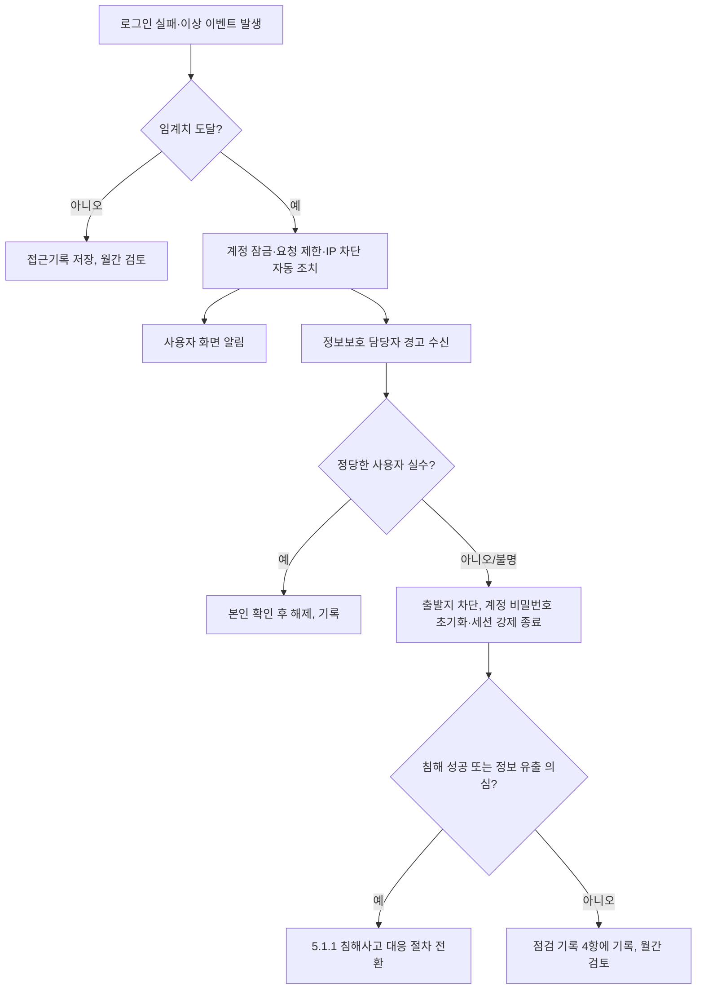

---
tags:
  - CSAP
  - 양식
  - 하등급SaaS
  - 기술적보호조치
control: 10.3.2 사용자 인증
section: 10.3 사용자 인증
doc_type: 작성본
evidence: 접근통제관리지침
문서 양식 번호: LS-10.3.2-02
문서 양식 버전: 0.0.1
문서번호: JAS-10.3.2-02
문서 버전: 1.0
상태: 작성완료
작성일: 2026-10-20
---

> [!note] 근거
> [해설서/하등급-SaaS/10.3.2 사용자 인증](../../../../../../projects/jeju-ai/docs/CSAP/해설서/하등급-SaaS/02.%20기술적%20보호%20조치/10.3.2%20사용자%20인증.md)

> [!note] 현 구현과 차이 (2026-10-20)
> 본 절차는 목표 상태를 기준으로 쓴 것이다. 현재 `jeju-ai-saas-be` api 에는 인증·세션·권한이 없어 모든 `/api` 라우트가 인증 없이 열려 있고, 관리자 기능도 없다. 제품 설계(`docs/design/jeju-subsidence-ai/04.data-and-storage.md` §8)는 자체 계정 + Argon2id + 세션 쿠키 + CSRF 토큰 + 로그인 실패 제한을 1차로, OIDC 를 2차로 정했으나 다중 인증(TOTP), 동시 접속 제한, 유휴·최대 세션 시간, 불법 로그인 경고는 설계에 아직 없다 — 인증 구현 시 본 절차를 요구사항으로 반영한다. NCP 운영 환경(콘솔 Sub Account, NKS, Cloud DB, VPN·배스천)은 구축 전이다. GitHub 조직 `innopam` 은 2026-10-20 현재 조직 2단계 인증 필수 설정이 꺼져 있다(구성원 17명 중 7명 미설정).

# 사용자 인증 관리 절차

| 문서번호 | 버전 | 작성일 | 작성자 | 검토자 | 승인자 | 시행일 |
| --- | --- | --- | --- | --- | --- | --- |
| JAS-10.3.2-02 | 1.0 | 2026-10-20 | {{정보보호 관리자 성명}} | {{개발 책임자 성명}} | {{CISO 성명}} | {{승인일}} |

> [!info] 법령 기준
> 개인정보의 안전성 확보조치 기준 제5조제5항·제6항, 제6조제1항·제2항·제4항(개인정보보호위원회고시 제2026-9호, 2026. 7. 1. 시행)을 기준으로 작성했다. 이 고시는 개인정보 보호법 제29조(법률 제20897호, 2025. 10. 2. 시행)에 근거한다. 법령·고시가 개정되면 국가법령정보센터에서 조문을 다시 확인한다. 본 문서의 횟수·시간 등 수치는 고시가 정하지 않은 당사 내부 기준이다.

본 문서는 ㈜이노팸 접근통제관리지침 중 사용자 인증에 해당하는 절이다.

## 1. 목적

㈜이노팸이 클라우드컴퓨팅서비스 지반침하 스마트관리 시스템(이하 "서비스")을 제공하기 위해 운영하는 클라우드 시스템에 대한 접근을 사용자 인증, 로그인 횟수 제한, 세션 관리, 불법 로그인 시도 경고 등 안전한 사용자 인증절차로 통제하고, 싱글사인온 등 계정 연동 방식의 인증에 별도 보호대책을 적용하는 기준과 절차를 정한다.

## 2. 적용 범위

### 2.1 대상 클라우드 시스템

인증 범위 내에서 당사가 운영하거나 계정을 보유하는 다음 시스템 전체에 적용한다. 개별 시스템의 등재와 설정값은 JAS-10.3.2-03 시스템별 사용자 인증 설정 현황에서 관리한다.

| 유형 코드 | 시스템 유형 | 당사 대상 | 주요 사용자 | 당사 책임 |
| --- | --- | --- | --- | --- |
| S-01 | 이용자 포털(서비스) | 서비스 web·api 의 일반 사용자(`user`) 기능 | 이용자(이용 기관 소속) | 인증 기능 설계·구현·설정 |
| S-02 | 관리자 포털(관리시스템) | 서비스의 관리자 기능 — `admin`(시스템 관리자: 사용자·권한·데이터셋·감사 조회), `service`(서비스 관리자: 사고 기록 관리·내보내기) | 당사 운영 인력, 이용 기관이 지정한 서비스 관리자 | 인증 기능 설계·구현·설정 |
| S-03 | IaaS/PaaS 콘솔·API | NCP 콘솔(메인 계정, Sub Account), NCP API 인증키(Access Key) | 운영(인프라) 담당자, 정보보호 담당자 | 계정별 인증 설정(다중 인증, 비밀번호 정책, 접근 IP, 인증키 관리), 메인 계정 봉인 |
| S-04 | 운영 서버 OS | NKS 클러스터 API(kubectl), 배스천, NKS 워커 노드 | 운영(인프라) 담당자, 개발 책임자 | 접속 방식·인증 설정. 워커 노드 직접 SSH 는 금지 |
| S-05 | DBMS | NCP Cloud DB for PostgreSQL 계정(운영자 개인 계정, api·pipeline 서비스 계정) | 운영(인프라) 담당자 | DB 계정 인증 설정 |
| S-06 | 네트워크 | VPN, ACG·Load Balancer 관리(NCP 콘솔) | 운영(인프라) 담당자 | VPN 인증, 콘솔 계정 인증 설정 |
| S-07 | 정보보호시스템 | 접근기록 저장소, 웹 방화벽(도입 예정) — NCP 콘솔 권한으로 접근 | 정보보호 담당자 | 콘솔 계정 인증 설정(S-03 기준 적용) |
| S-08 | 개발·배포 도구 | GitHub 조직 `innopam`(저장소·Actions·조직 설정), self-hosted runner, NCP Container Registry | 개발 책임자, 운영(인프라) 담당자 | 계정 인증 설정, 조직 2단계 인증 필수화 |
| S-09 | 운영 지원 도구 | NCP Cloud Insight(모니터링·알림, 도입 예정) | 운영(인프라) 담당자 | 콘솔 계정 인증 설정(S-03 기준 적용) |
| S-10 | 인증·계정 연동 시스템 | NKS 의 NCP IAM 연동 인증, 발주처 SSO(OIDC) 연동(도입 검토 중) | 운영 인력, 이용자 | JAS-10.3.2-04 SSO 및 계정 연동 보호대책서 |

### 2.2 대상 사용자

| 사용자 구분 | 정의 | 계정 발급·관리 주체 |
| --- | --- | --- |
| 내부 사용자 | 당사 임직원과 인증 범위 내 시스템에 접근하는 외부인력(파견·용역·위탁) | 당사(2.1.2 주요 직무자 지정 절차) |
| 특수권한 사용자 | 서비스 `admin` 역할, NCP 메인 계정·관리자 Sub Account, 클러스터 관리자, DB 관리자, GitHub 조직 소유자 | 당사(2.1.2 주요 직무자 목록) |
| 이용 기관 관리자 | 이용 기관이 지정하여 `service` 역할로 서비스를 관리하는 사용자 | 당사가 발급, 이용 기관이 관리 |
| 이용자 | 이용 기관 소속으로 서비스를 이용하는 `user` 역할 사용자 | 이용 기관 관리자 요청에 따라 당사(`admin`)가 발급 |

### 2.3 제공자 책임 영역

물리 시설, 하이퍼바이저, NKS 컨트롤 플레인, 관리형 DB 내부 관리 시스템에 대한 인증 통제는 NCP 의 책임이며, NCP 의 CSAP 인증서와 계약서 보안 조항으로 확인한다. 당사는 NCP 가 제공하는 인증 기능(2차 인증, 비밀번호 정책, 접근 가능 IP 설정)을 당사 계정에 실제로 설정할 책임을 진다. GitHub 의 계정 인증 기능(2단계 인증, 세션)은 GitHub 가 제공하고 당사는 조직 설정으로 강제한다.

## 3. 용어 정의

| 용어 | 정의 |
| --- | --- |
| 사용자 인증 | 시스템에 접근을 요청하는 자가 정당한 계정의 소유자임을 인증정보로 검증하는 절차 |
| 인증정보 | 비밀번호, 일회용 비밀번호(OTP), 인증서, 보안토큰, 액세스 키 등 신원 검증에 사용되는 정보 |
| 다중 인증(MFA) | 지식(비밀번호), 소유(OTP 앱·하드웨어 토큰·인증서), 속성(생체) 중 서로 다른 두 가지 이상의 요소를 결합한 인증 |
| 강화된 인증수단 | 아이디·비밀번호 외에 추가로 적용하는 인증수단(TOTP 앱, 하드웨어 토큰 등)과 접속 조건 통제(IP 제한 등) |
| 로그인 횟수 제한 | 일정 횟수 이상 인증에 실패하면 계정 잠금, 요청 빈도 제한 등으로 추가 시도를 제한하는 통제 |
| 세션 | 인증 성공 후 재인증 없이 시스템을 사용할 수 있는 상태. 유휴 시간 제한과 최대 유지 시간으로 관리한다. 서비스는 서버 세션(`sessions` 표)과 세션 쿠키로 구현한다. |
| 재인증 | 유효한 세션이 있어도 중요 기능 접근 전이나 일정 시간 경과 후 인증을 다시 요구하는 것 |
| 불법 로그인 시도 | 정당한 사용자가 아닌 자가 시도한 것으로 의심되는 로그인 실패·성공 이벤트(반복 실패, 비정상 위치, 다수 계정 대상 시도 등) |
| 싱글사인온(SSO) | 한 번의 인증으로 여러 시스템에 접근할 수 있게 하는 인증 방식. IdP와 SAML·OIDC·OAuth 등 프로토콜로 구성한다. |

## 4. 기본 원칙

1. 클라우드 시스템의 모든 접근 경로(웹 UI, API, CLI, 원격 접속)는 인증을 거쳐야 하며, 인증 없이 접근 가능한 기능은 `/api/auth/login`, `/health`, `/ready` 와 정적 화면 자원으로 한정한다.
2. 계정은 개인별로 발급하고 공용 계정 사용을 금지한다. 시스템 기본 계정(NCP 메인 계정, DB 마스터 계정, 첫 관리자 계정)은 직접 로그인을 하지 않고 봉인·2인 관리한다. api·pipeline 의 DB·스토리지 자격증명은 사람이 쓰지 않는 서비스 계정으로 Secret 으로만 주입한다.
3. 시스템 유형과 위험도에 따라 6항의 최소 기준 이상으로 인증 방식, 로그인 실패 제한, 세션 관리, 경고를 설정한다. 제공자·제품 기본값이 기준보다 약하면 기준에 맞게 변경하고, 변경할 수 없으면 14항 예외로 관리한다.
4. 인증 실패 시 실패 사유(계정 존재 여부, 비밀번호 오류, 잠금 상태 등)를 화면·응답에 상세히 노출하지 않는다.
5. 위험도가 높은 접근에는 다중 인증을 적용하고, 개인정보처리시스템(준용 포함)에 대한 외부 접속에는 법정 안전한 인증수단을 적용한다.
6. 인증 통제 기준을 충족하지 못하는 시스템은 14항의 예외 절차로 승인·보완하지 않는 한 운영하지 않는다.
7. 인증 통제 설정과 불법 로그인 시도 경고는 정기적으로 점검·검토하고 결과를 기록한다.

## 5. 책임공유모델에 따른 책임 구분

| 인증 통제 영역 | IaaS/PaaS 제공자 | 당사(SaaS 제공자) | 이용 기관 |
| --- | --- | --- | --- |
| 물리 시설·하이퍼바이저 접근 인증 | 책임 | 제공자 인증·계약으로 확인 | 해당 없음 |
| 제공자 콘솔·API 인증 기능 | 기능 제공(2차 인증, 비밀번호 정책, 접근 가능 IP) | 당사 계정에 기능 설정·유지, 메인 계정 봉인 | 해당 없음 |
| 운영 서버·DB·네트워크·정보보호시스템 계정 인증 | 관리형 서비스(NKS·Cloud DB)는 기능 제공 | 설정·운영 | 해당 없음 |
| 이용자·관리자 포털 인증 기능 | 해당 없음 | 설계·구현·설정, 강화된 인증수단 제공 | 강화된 인증 선택·적용, 이용자 계정 관리 요청 |
| 이용 기관 IdP 연동 | 해당 없음 | 연동 기준·검증, 권한 매핑 최소화(JAS-10.3.2-04) | 기관 IdP 보호, 이용자 인증 정책 |
| 불법 로그인 시도 경고·대응 | 인프라 계층 이상 통지 | 서비스·관리 계층 탐지·경고·대응 | 이용자 알림 확인·신고 |

## 6. 시스템 유형별 인증 통제 최소 기준

아래 값은 당사 내부 기준이다. 각 시스템의 실제 설정값은 JAS-10.3.2-03 에 기록하고 본 기준 이상인지 대조한다. 제품 기능상 구현할 수 없는 항목은 14항 예외로 관리한다.

| 유형 | 최소 인증 방식 | 다중 인증 | 로그인 실패 제한 | 유휴 시간 제한 | 최대 세션 유지·재인증 | 동시 접속 | 접속 원천 제한 | 불법 로그인 시도 경고 |
| --- | --- | --- | --- | --- | --- | --- | --- | --- |
| S-01 이용자 포털 | 아이디·비밀번호(7항 기준) | TOTP 기본 제공, 이용 기관 선택 | 5회 실패 시 30분 잠금, IP+계정 분당 20회 rate limit | 30분 | 12시간 이내 재인증 | 동일 계정 1세션(이용 기관 요청 시 완화) | 이용 기관 요청 시 IP 허용 목록 | 실패 누적·잠금·새 접속지 로그인 시 다음 로그인 화면 알림 |
| S-02 관리자 포털 | 아이디·비밀번호 + TOTP | 필수(`admin`·`service`) | 5회 실패 시 잠금, 관리자 해제 | 30분 | 12시간 이내 재인증(24시간 세션 금지), 중요 기능 재인증 | 동일 계정 1세션(신규 로그인 시 기존 세션 종료) | 관리 라우트는 Ingress IP 허용 목록(사내 VPN 대역, 이용 기관 지정 대역) | 실패 누적·허용 목록 외 접속 시 관리자 경고 |
| S-03 IaaS/PaaS 콘솔·API | 콘솔: Sub Account 비밀번호 + 2차 인증. API: 인증키(개인별) | 필수(메인 계정·모든 Sub Account) | 제공자 기능 최대치 적용, 실패 알림 | 제공자 설정 범위 내 30분 이하 | 제공자 설정 범위 내 12시간 이하 | 해당 없음(계정별 활동 감사) | Sub Account 접근 가능 IP(사내 VPN 대역) | 메인 계정 로그인·2차 인증 없는 로그인·콘솔 실패 경고 |
| S-04 운영 서버 OS | VPN → 배스천(키 기반 SSH + TOTP) → kubectl(NCP IAM 연동). 비밀번호 SSH 금지, 워커 노드 SSH 금지 | VPN·배스천 단계 필수 | 5회 실패 시 10분 IP 차단(fail2ban 등) | 10분 | 배스천 세션 12시간 이내 | 필요 시 계정별 세션 수 제한 | VPN 대역만 배스천 허용, 클러스터 API 는 배스천 IP 만 허용 | 실패 반복·비정상 시간대 접속 경고 |
| S-05 DBMS | 개인별 DB 계정(운영자), 서비스 계정(api·pipeline)은 Secret 주입 | 배스천 단계 필수 | 5회 실패 시 잠금(DB 기능 미지원 시 14항 예외·네트워크 제한 보완) | 30분 | 작업 세션 12시간 이내 | DB 관리자 계정 1세션 | ACG 로 api·pipeline 파드 대역·배스천 IP 만 허용 | 실패 반복·대량 조회 경고 |
| S-06 네트워크(VPN·콘솔) | VPN: 계정 비밀번호 + OTP. 콘솔: S-03 | 필수 | 5회 실패 시 잠금 | VPN 30분 | 12시간 이내 | VPN 계정 1세션 | 국외 접속 차단 | 실패 반복·국외 접속 경고 |
| S-07 정보보호시스템 콘솔 | S-03 과 같음(NCP 콘솔 권한) | 필수 | S-03 | S-03 | S-03 | S-03 | S-03 | 정책 변경 경고 추가 |
| S-08 개발·배포 도구 | GitHub 계정 비밀번호 또는 패스키 + 2단계 인증 | 필수(조직 구성원 전원) | 제공자 기능 | 제공자 기능 | 제공자 기능(민감 작업 시 sudo 재인증) | 해당 없음 | 제공자 플랜 범위 내 | 조직 감사 로그 월 1회 검토 |
| S-09 운영 지원 도구 | S-03 과 같음(NCP 콘솔 권한) | 필수 | S-03 | S-03 | S-03 | S-03 | S-03 | S-03 |
| S-10 SSO·IdP | NKS: NCP IAM(Sub Account 인증키). 발주처 OIDC: 기관 IdP 인증 + 당사 TOTP | 필수 | 5회 실패 시 잠금(IdP 정책) | 30분 | 12시간 이내, 중요 기능 재인증 | 관리자 1세션 | 관리 콘솔 허용 목록 | JAS-10.3.2-04 4항 탐지 규칙 |

- 이용자 포털의 값은 이용 기관 계약·보안 요구사항이 더 엄격하면 그 값을 따른다. 공공기관 이용 기관에는 `service` 역할 다중 인증 필수를 기본값으로 제공한다.
- 관리자 기능과 관리 콘솔의 유휴 시간 제한은 타당한 사유 없이 해제하지 않는다. 사유가 있으면 14항 예외 승인과 보완 통제(조회 전용 계정, 물리 통제 구역 단말) 조건으로만 허용한다.
- 제공자 기능 범위(S-03·S-08)가 기준에 못 미치는 항목은 JAS-10.3.2-03 4항 예외 목록에 등록하고 보완 통제를 둔다.

## 7. 인증정보 강도 기준

세부 생성 규칙, 초기 비밀번호 변경, 변경 주기, 관리자 비밀번호 보관은 10.3.4 패스워드 관리 절차를 따르며, 본 절차에서는 인증 통제 관점의 최소 기준만 정한다.

| 항목 | 이용자 | 내부 사용자 | 특수권한 사용자·클라우드 콘솔 |
| --- | --- | --- | --- |
| 최소 길이 | 10자 | 10자 | 10자 |
| 복잡도 | 영문 대·소문자, 숫자, 특수문자 중 3종 이상 조합(10.3.4 생성 규칙과 동일) | 동일 | 동일 |
| 변경 주기 | 180일 권고(유출 의심 시 강제) | 90일 | 90일 |
| 재사용 제한 | 최근 3개 재사용 금지 | 동일 | 동일 |
| 초기·임시 비밀번호 | 최초 로그인 시 강제 변경, 유효기간 24시간 | 동일 | 동일 |
| 금지 문자열 | 아이디 포함, 연속·반복 문자, 노출된 비밀번호 목록 차단 | 동일 | 동일 |
| 저장·전송 | Argon2id 단방향 해시 저장, TLS 1.2 이상 전송, 입력 시 마스킹 | 동일 | 동일 |
| 액세스 키·API 토큰 | 해당 없음 — 이용자에게 API 키를 발급하지 않는다 | 개인별 발급, 90일 이내 교체, 소스코드·이미지 저장 금지(gitleaks 차단) | 동일, 메인 계정 인증키 발급 금지 |
| 다중 인증 요소 | TOTP 앱(연락처를 수집하지 않으므로 문자·이메일 인증코드는 제공하지 않는다) | TOTP 앱 또는 하드웨어 토큰 | TOTP 앱 또는 하드웨어 토큰(문자 인증 단독 금지) |

## 8. 로그인 실패 처리 및 오류 메시지 기준

### 8.1 로그인 실패 제한

| 단계 | 조건(내부 기준) | 조치 | 해제 |
| --- | --- | --- | --- |
| 1단계 | IP+계정 기준 분당 20회 초과 | 요청 거부(HTTP 429), CAPTCHA 는 도입하지 않는다 | 1분 경과 |
| 2단계 | 연속 5회 실패 | 계정 잠금 30분(자동 해제). `admin`·`service` 역할은 관리자 해제 | 시간 경과 또는 본인 확인 후 `admin` 해제 |
| 3단계 | 잠금 반복 3회 이상 또는 단일 IP 에서 5개 이상 계정 대상 시도 | 출발지 IP 차단(Ingress·WAF), 정보보호 담당자 경고, 사용자 다음 로그인 시 화면 알림 | 정보보호 담당자 확인 후 해제 |

- 실패 횟수는 계정 단위로 집계하고, 출발지 IP 단위 집계를 병행하여 다수 계정을 대상으로 한 시도(무차별 대입·크리덴셜 스터핑)를 탐지한다. 출발지 IP 는 신뢰 프록시 대역을 고정해 위조된 `X-Forwarded-For` 로 바뀌지 않게 한다.
- 관리자 기능의 잠금은 관리자 확인 해제를 적용한다. 일반 이용자의 자동 해제 시간(30분)과 실패 임계치(5회)를 JAS-10.3.2-03 에 기록한다.
- 잠금 해제 요청은 본인 확인(이용 기관 관리자 확인, 소속 부서장 확인 등)을 거치고 처리 기록(감사 액션)을 남긴다.
- 개인정보처리시스템은 일정 횟수 이상 인증 실패 시 접근을 제한하는 조치가 법정 의무이므로(안전성 확보조치 기준 제5조제6항) 예외를 허용하지 않는다. 서비스는 개인정보처리시스템 해당 여부 확정 전이므로 이에 준해 예외를 두지 않는다.

### 8.2 오류 메시지 기준

| 상황 | 허용 메시지(예) | 금지 메시지(예) |
| --- | --- | --- |
| 존재하지 않는 아이디 | "아이디 또는 비밀번호가 올바르지 않습니다." | "존재하지 않는 아이디입니다." |
| 비밀번호 불일치 | "아이디 또는 비밀번호가 올바르지 않습니다." | "비밀번호가 틀렸습니다. 남은 시도 2회" |
| 계정 잠금 상태 | "로그인할 수 없습니다. 관리자에게 문의하세요." | "계정이 잠겼습니다(비밀번호 5회 오류)." |
| 다중 인증 실패 | "인증에 실패했습니다. 다시 시도하세요." | 어떤 요소가 틀렸는지 상세 표시 |
| 비활성·만료 계정 | 일반 실패 메시지와 동일 | "퇴직 처리된 계정입니다." |

- 존재하는 아이디와 존재하지 않는 아이디의 응답 내용·응답 시간·HTTP 상태 코드가 달라 계정 존재 여부를 추정할 수 있게 하지 않는다. 존재하지 않는 아이디에도 같은 비용의 해시 검증을 수행한다.
- 비밀번호 재설정은 셀프 서비스로 제공하지 않고 관리자가 본인 확인 후 임시 비밀번호를 발급한다. 아이디 찾기 기능은 제공하지 않는다.

## 9. 세션 관리 기준

| 통제 | 기준 | 대상 |
| --- | --- | --- |
| 유휴 시간 제한 | 6항 유형별 값(서비스 30분) 이상 조작이 없으면 세션을 종료하고 재인증을 요구한다. 개인정보처리시스템은 법정 의무(안전성 확보조치 기준 제6조제4항). | 전 시스템 |
| 최대 세션 유지 시간 | 유휴 여부와 관계없이 6항 값(서비스 12시간)을 넘으면 세션을 만료하고 재인증을 요구한다. 24시간 이상 세션 유지는 금지한다. | 전 시스템 |
| 중요 기능 재인증 | 권한 변경(`perms.save`), 사용자 계정 발급·초기화, 사고 기록 대량 내보내기·민감 레이어 내보내기, 데이터셋 활성화 전에 비밀번호 또는 TOTP 를 다시 요구한다. | 관리자 기능, 이용자 내보내기 |
| 동시 접속 제한 | 관리자·특수권한 계정은 동일 계정 동시 세션을 1개로 제한하고, 신규 로그인 시 기존 세션을 종료하며 사용자에게 알린다. 이용자도 기본 1세션이며 이용 기관 요청 시 완화한다. | 관리시스템 전체, 이용자 포털 |
| 세션 식별자 보호 | 인증 성공 시 세션 식별자를 재발급하고, 쿠키에 `Secure`·`HttpOnly`·`SameSite=Lax` 속성을 적용하며, URL 에 세션 식별자를 포함하지 않는다. 상태 변경 요청은 CSRF 토큰(`X-CSRF-Token`)을 검증한다. 로그아웃 시 서버에서 세션을 폐기한다. | 웹 기반 시스템 |
| 세션 로그 | 세션 생성·만료·강제 종료 이벤트를 접근기록에 남긴다(10.1.2). | 전 시스템 |

## 10. 강화된 인증(다중 인증) 적용 기준

| 접근 유형 | 위험도 | 다중 인증 | 근거 |
| --- | --- | --- | --- |
| 특수권한 계정(`admin`, NCP 메인 계정·관리자 Sub Account, 클러스터·DB 관리자, GitHub 조직 소유자) 로그인 | 높음 | 필수 | 해설서 점검항목 1 |
| 원격접속(VPN, 배스천, 사외에서 관리시스템 접속) | 높음 | 필수 | 해설서 점검항목 1 |
| 외부업체(위탁·유지보수) 접속 | 높음 | 필수 + 접속 기간·IP 제한 | 해설서 점검항목 1 |
| 개인정보취급자의 정보통신망 경유 외부 개인정보처리시스템 접속 | 높음 | 필수(TOTP 등 안전한 인증수단) — 사고 기록을 관리하는 `service` 역할에 적용 | 안전성 확보조치 기준 제6조제2항 |
| 공개 인터넷망으로 접속하는 관리자 기능 | 높음 | 필수 | 해설서 점검항목 1, 10.3.3 부적합 사례 1 |
| NCP 콘솔·API 인증키 발급 | 높음 | 콘솔 2차 인증 필수, 인증키는 개인별·최소 권한 | 해설서 점검항목 1 |
| 이용 기관 관리자(`service`) | 높음 | 필수 | 10.3.3, 공통 기준 §3.1 |
| 이용자(`user`) | 중간 | 기본 제공, 이용 기관 선택 | 10.3.3 |

- 다중 인증 등록·분실·재발급, 이용자 제공 방식은 10.3.3 강화된 인증 수단 제공 산출물을 따른다.
- 첫 번째 인증과 같은 요소를 반복하는 방식(아이디·비밀번호 인증 후 다시 아이디·비밀번호 입력)은 다중 인증으로 인정하지 않는다.
- 접속 조건 통제(IP 제한)는 다중 인증을 보완하는 수단으로 적용하고, 다중 인증을 대체하지 않는다.

## 11. 불법 로그인 시도 경고 및 대응

### 11.1 탐지 규칙

| 규칙 코드 | 조건(내부 기준) | 심각도 | 사용자 알림 | 관리자 경고 |
| --- | --- | --- | --- | --- |
| A-01 | 단일 계정 연속 5회 실패(잠금 발생) | 중 | 다음 로그인 시 화면 알림(최근 실패·잠금 이력) | 관리 역할 계정이면 즉시 |
| A-02 | 단일 IP에서 10분 내 20회 이상 실패 또는 5개 이상 계정 대상 시도 | 상 | 해당 없음 | 즉시 |
| A-03 | 직전과 다른 국가·IP 대역에서 로그인 성공 | 중 | 다음 로그인 시 화면 알림(최근 접속 이력) | 관리 역할 계정이면 즉시 |
| A-04 | 잠금 해제 직후 재실패, 비활성·퇴직 계정 로그인 시도 | 상 | 해당 없음 | 즉시 |
| A-05 | 관리 라우트·운영 콘솔에 허용 목록 외 IP·국외에서 접속 시도 | 상 | 해당 없음 | 즉시 |
| A-06 | 다중 인증 연속 5회 실패 | 상 | 다음 로그인 시 화면 알림 | 즉시 |
| A-07 | NCP 메인 계정 로그인, 2차 인증 없는 콘솔 로그인 | 상 | 해당 없음 | 즉시 |
| A-08 | 비업무 시간대(평일 09:00–18:00 외) 특수권한 계정 로그인 | 중 | 해당 없음 | 일 1회 요약 + 임계치 초과 시 즉시 |

- 서비스는 이용자 연락처(이메일·전화)를 수집하지 않으므로 사용자 알림은 로그인 화면 안의 알림으로 한다. 연락처를 수집하게 되면 이메일 알림을 추가한다.

### 11.2 대응 절차

1. 자동 조치: 8.1항의 임계치에 따라 시스템이 잠금·요청 제한·차단을 자동 수행한다.
2. 알림: 사용자에게는 다음 로그인 시 화면 알림을 보이고, 관리자 경고는 운영 알림 채널(NCP Cloud Insight 이벤트 알림 → 정보보호 담당자 메일·사내 메신저)로 정보보호 담당자에게 전달한다.
3. 확인: 정보보호 담당자는 경고 수신 후 1시간 이내(업무 시간 외 다음 업무일 시작 후 1시간 이내)에 접근기록을 확인하고, 사용자 또는 이용 기관 관리자·부서장에게 사실을 확인한다.
4. 조치: 불법 시도로 판단하면 출발지 차단, 해당 계정 비밀번호 초기화와 세션 강제 종료, 다중 인증 재등록을 수행하고 이용 기관 계정이면 이용 기관 관리자에게 통지한다.
5. 전환: 로그인 성공 흔적, 권한 변경, 데이터 접근이 확인되면 침해사고 대응 절차(5.1.1)로 전환하고 보고한다(인지 즉시 이용 기관 통지, 24시간 내 KISA 신고).
6. 기록: 모든 경고와 조치는 JAS-10.3.2-05 사용자 인증 통제 점검 기록 4항에 월별로 집계하고, 원본 이벤트는 접근기록(10.1.2)으로 보관한다.

## 12. 설계·도입·변경 시 인증 통제 검토

새 클라우드 시스템을 도입하거나 서비스 인증 기능을 개발·변경할 때 시스템 담당자 또는 개발 책임자는 아래 항목을 검토하여 결과를 변경 요청(PR) 문서에 첨부하고, 정보보호 관리자 검토를 거친 뒤 운영에 반영한다. 반영 후 5영업일 이내에 JAS-10.3.2-03 현황에 등재한다.

| No | 검토 항목 | 확인 |
| --- | --- | --- |
| 1 | 모든 접근 경로(UI, API, CLI, 원격)에 인증이 적용되고 인증 없이 접근 가능한 기능이 승인된 범위(4항 1)인가 | 변경 건마다 ○ / X 기록 |
| 2 | 계정을 개인별로 발급하고 기본 계정을 비활성화·봉인했는가 | 변경 건마다 기록 |
| 3 | 6항의 시스템 유형 기준 이상으로 로그인 실패 제한을 설정할 수 있고 설정했는가 | 변경 건마다 기록 |
| 4 | 오류 메시지가 8.2항 기준을 따르고 응답 차이로 계정 존재 여부가 노출되지 않는가 | 변경 건마다 기록 |
| 5 | 유휴 시간 제한, 최대 세션 유지 시간, 중요 기능 재인증을 설정했는가 | 변경 건마다 기록 |
| 6 | 관리자·특수권한 계정의 동시 접속을 제한했는가 | 변경 건마다 기록 |
| 7 | 고위험 접근에 다중 인증을 적용했고, 이용자에게 강화된 인증수단을 제공하는가 | 변경 건마다 기록 |
| 8 | 인증정보가 7항 기준으로 저장·전송되고 비밀번호가 평문·가역 암호화로 저장되지 않는가 | 변경 건마다 기록 |
| 9 | 로그인 성공·실패·잠금·세션 이벤트가 접근기록(`audit_events`)으로 남고 접근기록 저장소로 전송되는가 | 변경 건마다 기록 |
| 10 | 불법 로그인 시도 경고(11.1항 규칙)가 설정되어 사용자 알림·관리자 경고가 발송되는가 | 변경 건마다 기록 |
| 11 | SSO·계정 연동을 사용하면 JAS-10.3.2-04 보호대책을 적용했는가 | 변경 건마다 기록 |
| 12 | 개인정보처리시스템(준용 포함)이면 안전성 확보조치 기준 제5조제6항·제6조제2항·제4항 요구사항을 충족하는가 | 변경 건마다 기록 |
| 13 | 시험 결과(실패 잠금, 메시지, 세션 만료, 동시 접속, 다중 인증 우회 불가)를 13.2.1 구현 및 시험 산출물에 남겼는가(api 통합 테스트·E2E) | 변경 건마다 기록 |

## 13. SSO 및 계정 연동

- 싱글사인온, IdP·디렉터리 연동, 이용 기관 IdP 연동, 소셜 로그인을 운영하거나 제공하는 경우 JAS-10.3.2-04 SSO 및 계정 연동 보호대책서를 작성·이행한다.
- 2026-10-20 기준: 서비스 로그인은 자체 계정이며 SSO 를 쓰지 않는다. 운영 환경의 NKS 클러스터 인증은 NCP IAM(Sub Account) 연동을 쓰고, 발주처 SSO(OIDC) 연동은 도입 검토 중이다. 따라서 보호대책서를 작성한다: JAS-10.3.2-04

## 14. 예외 관리

| 단계 | 담당 | 내용 |
| --- | --- | --- |
| 1. 신청 | 시스템 담당자 | 미충족 항목, 기술적·업무적 사유, 영향 범위, 보완 통제, 예외 기간을 JAS-10.3.2-03 4항 예외 승인 목록에 작성 |
| 2. 검토 | 정보보호 관리자 | 사유 타당성, 보완 통제 적정성, 법정 의무 항목(8.1항 개인정보처리시스템 실패 제한, 9항 유휴 시간 제한, 10항 외부 접속 안전한 인증수단) 여부 검토. 법정 의무 항목은 예외 불가 |
| 3. 승인 | 정보보호 최고책임자 | 승인 또는 반려. 승인 시 만료일(최대 1년) 지정 |
| 4. 이행 | 시스템 담당자 | 보완 통제 적용, JAS-10.3.2-03 현황에 예외 번호 기재 |
| 5. 재검토 | 정보보호 관리자 | 만료 전 재검토, 정기 점검(JAS-10.3.2-05) 시 이행 확인 |

- 예외 사유 예: 제품 기능 미지원(관리형 DB 의 실패 잠금 미지원, GitHub 세션 시간 설정 불가), 자동화 서비스 계정. "운영 편의"는 사유로 인정하지 않는다.
- 보완 통제 예: 조회 전용 계정, 네트워크 접근 제한(ACG), 상위 단계(VPN·배스천) 잠금·다중 인증, 접근기록 강화 검토, 자동화 계정의 키 교체·IP 제한.

## 15. 법적·계약적 요구사항

| 요구사항 | 근거 | 적용 |
| --- | --- | --- |
| 인증수단의 안전한 적용·관리 | 안전성 확보조치 기준 제5조제5항 | 7항 인증정보 강도 기준, 10항 다중 인증 |
| 일정 횟수 이상 인증 실패 시 개인정보처리시스템 접근 제한 | 안전성 확보조치 기준 제5조제6항 | 8.1항 로그인 실패 제한(예외 불가) |
| 개인정보처리시스템 접속 권한 IP 제한, 접속 IP 분석으로 유출 시도 탐지·대응 | 안전성 확보조치 기준 제6조제1항 | 6항 접속 원천 제한, 11항 탐지·대응 |
| 정보통신망 경유 외부 접속 시 인증서·보안토큰·OTP 등 안전한 인증수단 | 안전성 확보조치 기준 제6조제2항 | 10항 다중 인증(예외 불가) |
| 일정시간 미사용 시 자동 접속 차단 | 안전성 확보조치 기준 제6조제4항 | 9항 유휴 시간 제한(예외 불가) |
| 이용 기관 보안 요구사항(공공기관 등) | 이용 기관 계약, 14.1.1 보안서비스 수준 협약 | 6항 이용자 포털 기준 상향, `service` 역할 다중 인증 |
| 이용 기관 인증 정책 안내 | 10.3.4 이용자 계정 및 패스워드 관리 공지 | 잠금 기준(5회·30분), 강화된 인증 선택 방법 공지 |

## 16. 점검 및 모니터링

| 활동 | 주기 | 담당 | 기록 |
| --- | --- | --- | --- |
| 시스템별 인증 설정 대조(6항 기준 대비 실제 설정) | 반기 1회 이상, 시스템 도입·변경 시 | 정보보호 관리자 | JAS-10.3.2-05 2항 |
| 동작 시험(실패 잠금, 오류 메시지, 세션 만료, 동시 접속, 다중 인증) | 반기 1회 이상, 인증 기능 변경 시 | 정보보호 담당자, 개발 책임자 | JAS-10.3.2-05 3항 |
| 불법 로그인 시도 경고 검토 | 경고 발생 시 즉시, 월 1회 집계 | 정보보호 담당자 | JAS-10.3.2-05 4항 |
| 예외 승인 항목 유효성·보완 통제 이행 확인 | 반기 1회, 만료 전 | 정보보호 관리자 | JAS-10.3.2-03 4항, JAS-10.3.2-05 5항 |
| 제공자 인증 기능 변경 확인(NCP 콘솔 정책, GitHub 인증 방식 변경 등) | 제공자 공지 시 | 운영(인프라) 담당자 | JAS-10.3.2-03 개정 이력 |
| 증적 수집 | 반기 1회, 변경 시 | 정보보호 담당자 | JAS-10.3.2-06 증적 수집 점검표 |

## 17. 역할과 책임

| 역할 | 책임 |
| --- | --- |
| 정보보호 최고책임자 | 본 절차 승인, 예외 승인, 점검 결과 승인, 침해사고 전환 결정 |
| 개인정보 보호책임자 | 사고 기록을 다루는 기능의 인증 통제가 법정 요구사항을 충족하는지 확인 |
| 정보보호 관리자 | 본 절차와 JAS-10.3.2-03 현황 관리, 설계·변경 시 인증 통제 검토, 예외 검토, 정기 점검 수행 |
| 정보보호 담당자 | 경고 모니터링·대응, 동작 시험, 증적 수집, 잠금 해제 기록 관리 |
| 시스템 담당자(운영(인프라) 담당자) | NCP 콘솔·VPN·배스천·NKS·Cloud DB 인증 설정 적용·유지, 변경 통보, 예외 신청 |
| 개발 책임자 | 서비스 인증 기능의 설계·구현·시험, 오류 메시지·세션·다중 인증 요구사항 반영, GitHub 조직 인증 설정 |
| 사용자(임직원·외부인력) | 개인별 계정 사용, 인증수단 보호, 알림 수신 시 신고 |
| 이용 기관 관리자 | 이용 기관 인증 정책 요청(강화된 인증, IP 제한), 이용자 이상 징후 신고 |

## 18. 관련 문서

- JAS-10.3.2-01 정보보호 정책서 사용자 인증 조항
- JAS-10.3.2-03 시스템별 사용자 인증 설정 현황
- JAS-10.3.2-04 SSO 및 계정 연동 보호대책서
- JAS-10.3.2-05 사용자 인증 통제 점검 기록
- JAS-10.3.2-06 증적 수집 점검표
- 10.3.3 강화된 인증 수단 제공, 10.3.4 패스워드 관리, 10.1.2 접근기록 관리, 2.1.2 주요 직무자 지정 및 감독, 5.1.1 침해사고 대응 절차 수립, 13.2.1 구현 및 시험 산출물
- 제품 설계 `docs/design/jeju-subsidence-ai/04.data-and-storage.md` §5(`users`·`sessions`)·§8(인증)·§11(보안 체크리스트)

## 19. 승인

서명본 보관 위치: 사내 문서 저장소 `CSAP/서명본/10.3.2/`

| 구분 | 직위 | 성명 | 서명 | 일자 |
| --- | --- | --- | --- | --- |
| 작성(정보보호 관리자) | | | | |
| 검토(개인정보 보호책임자) | | | | |
| 검토(개발 책임자, 운영(인프라) 담당자) | | | | |
| 승인(정보보호 최고책임자) | | | | |

## 20. 개정 이력

| 버전 | 일자 | 변경 내용 | 작성자 | 승인자 |
| --- | --- | --- | --- | --- |
| 1.0 | 2026-10-20 | 최초 제정 | {{정보보호 관리자 성명}} | {{CISO 성명}} |
