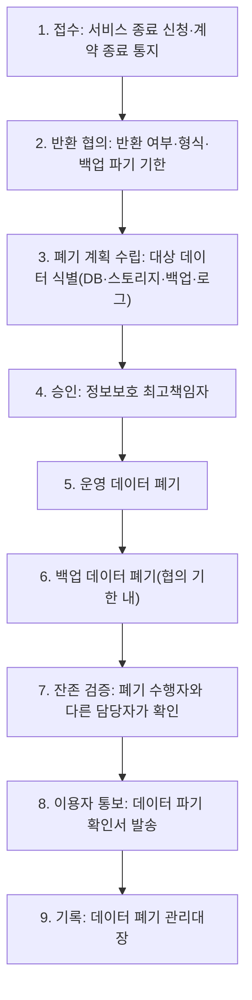

---
tags:
  - CSAP
  - 양식
  - 하등급SaaS
  - 기술적보호조치
control: 12.1.6 데이터 폐기
section: 12.1 데이터 보호
doc_type: 작성본
evidence: 데이터 폐기 관련 기법/기술
문서 양식 번호: LS-12.1.6-01
문서 양식 버전: 0.0.1
문서번호: JAS-12.1.6-01
문서 버전: 1.0
상태: 작성완료
작성일: 2026-10-20
---

> [!note] 근거
> [해설서/하등급-SaaS/12.1.6 데이터 폐기](../../../../../../projects/jeju-ai/docs/CSAP/해설서/하등급-SaaS/02.%20기술적%20보호%20조치/12.1.6%20데이터%20폐기.md)

> [!note] 현 구현과 차이
> 본 절차는 목표 구조(NCP 공공기관용 NKS + Cloud DB for PostgreSQL + Object Storage, 설계안 `docs/design/jeju-subsidence-ai/04.data-and-storage.md` §1·§5) 기준이다. 기준일(2026-10-20) 현재 차이는 다음과 같다.
> - 운영 환경·DB 가 없고, 현재 코드(`jeju-ai-saas-be` `api/src/storage.ts` · `sync.ts`)는 버킷 `jeju-ai-saas` 의 `orgs/` 접두사 읽기·올리기만 한다. **삭제 기능은 의도적으로 없다**(`sync.ts`: "지우지는 않는다 … 사람이 확인하고 따로 한다"). 이용 기관 단위 완전삭제 기능·도구는 구현 전이다.
> - 설계안의 사고 기록 삭제는 `deleted_at` 소프트 삭제이고 `incident_revisions` 가 전후 값을 보관한다. 본 절차 6항에 따라 계약 종료·삭제 요청 시 실삭제 경로가 추가로 필요하다.
> - 수명주기 규칙(`exports/` 30일, `backups/` 30일)과 DB 파기 배치(9.3항)는 설계만 있고 구현 전이다.

# 데이터 폐기 절차

| 문서번호 | 버전 | 작성일 | 작성자 | 검토자 | 승인자 | 시행일 |
| --- | --- | --- | --- | --- | --- | --- |
| JAS-12.1.6-01 | 1.0 | 2026-10-20 | {{정보보호 관리자 성명}} | {{개인정보 보호책임자 성명}} | {{CISO 성명}} | {{승인일}} |

> [!info] 법령 기준
> 클라우드컴퓨팅 발전 및 이용자 보호에 관한 법률 제27조(법률 제21066호, 2025. 10. 1. 시행), 개인정보 보호법 제21조(법률 제20897호, 2025. 10. 2. 시행), 개인정보의 안전성 확보조치 기준 제13조(개인정보보호위원회고시 제2026-9호, 2026. 7. 1. 시행)를 기준으로 작성했다. 법령·고시가 개정되면 국가법령정보센터에서 조문을 다시 확인한다.

## 1. 목적

㈜이노팸은 클라우드컴퓨팅서비스 지반침하 스마트관리 시스템(이하 "서비스")의 이용 종료, 이전, 계정 삭제, 보존기한 경과 등으로 더 이상 필요하지 않게 된 이용자 데이터를 복구·재생되지 않는 방법으로 폐기하고, 폐기 담당자와 상세 절차를 정하여 폐기 이후 정보가 노출되지 않도록 한다.

## 2. 적용 범위

### 2.1 대상 데이터

| 구분 | 예시 |
| --- | --- |
| 운영 데이터 | Cloud DB for PostgreSQL 의 이용 기관 데이터(`dataset_versions` · `jobs` · `risk_areas` · `area_scores` · `risk_cells` · `pipes` · `incidents` · `incident_revisions` · `incident_uploads` · `exports` · `role_permissions`), Object Storage 의 `raw/`(업로드 원본) · `datasets/`(데이터셋 번들, 관로·굴착 민감 레이어 포함) · `exports/`(내보내기 파일) · `incidents/uploads/`(사고 기록 업로드). 현재 구조에서는 `orgs/{기관}/` 접두사 |
| 개인정보 | 계정 정보(`users` 의 `login` · `name` · `dept` · `password_hash` · MFA 시크릿), 세션(`sessions`), 사고 기록의 주소·피해 항목(개인 식별 정보가 들어올 수 있음). 설계상 고유식별정보·연락처는 수집하지 않는다 |
| 백업 데이터 | Cloud DB 자동 백업·시점 복구 로그, `pg_dump` 백업(`backups/postgres/{yyyy-mm-dd}.dump`, 30일), Object Storage 객체 버전(버전 관리 사용 시) |
| 파생 데이터 | 감사 기록(`audit_events`)과 애플리케이션·접근 로그(관리형 로그 저장소), pipeline 작업 임시 공간(`/work`, 파드 emptyDir), 이용 기관 브라우저 캐시(번들 응답 `Cache-Control: immutable`), 개발·분석용 복제본(운영 데이터 반입 금지 원칙상 없어야 한다) |

### 2.2 책임공유모델에 따른 책임 구분

| 영역 | 책임 | 이행·확인 방법 |
| --- | --- | --- |
| 물리 매체 폐기(디스크 파쇄·소각·소자) | IaaS/PaaS 제공자(네이버클라우드 NCP 공공기관용 영역) | 제공자의 CSAP 인증과 계약·매체 폐기 정책으로 확인하고, 확인 결과를 [05. 증적 수집 점검표](../../11%20%EB%8C%80%EA%B8%B0%EC%A4%91/12.1.6%20%EB%8D%B0%EC%9D%B4%ED%84%B0%20%ED%8F%90%EA%B8%B0/05.%20%EC%A6%9D%EC%A0%81%20%EC%88%98%EC%A7%91%20%EC%A0%90%EA%B2%80%ED%91%9C.md)에 기록한다. |
| 논리적 완전삭제, 백업 데이터 폐기, 개인정보 파기, 폐기 검증·통보 | 당사(SaaS 제공자) | 본 절차를 따른다. |
| 반환 데이터의 수령·자체 보관, 이용 기관 내부 사본(내보내기로 받은 파일, 브라우저 캐시) 관리 | 이용 기관(이용자) | 계약 조항(양식 02)에 따라 안내한다. |

## 3. 용어 정의

| 용어 | 정의 |
| --- | --- |
| 이용자 데이터 | 이용자(이용 기관 포함)가 서비스에 저장·생산한 데이터(업로드 원본, 데이터셋 번들, 사고 기록, 내보내기, 감사 기록)와 이용자에 관한 개인정보 |
| 완전삭제 | 표준화된 방법 또는 덮어쓰기 등으로 데이터를 복구·재생할 수 없게 삭제하는 것 |
| 논리 삭제(삭제 플래그) | 실제 값을 남긴 채 삭제 표시만 하는 방식(예: `incidents.deleted_at`). 본 절차에서 폐기 완료로 인정하지 않는다. |
| 암호화 삭제(crypto-erase) | 암호화된 데이터의 암호키를 파기하여 데이터를 복구할 수 없게 만드는 방법 |
| 보존기한 | 법령 또는 내부 기준에 따라 데이터를 보관해야 하는 기간(감사·접근 기록 3년, 애플리케이션·인프라 로그 1년, `exports/` 30일, `backups/` 30일) |

## 4. 폐기 사유와 처리 기한

| 폐기 사유 | 반환 협의 | 운영 데이터 폐기 기한 | 백업 데이터 폐기 기한 | 이용자 통보 |
| --- | --- | --- | --- | --- |
| 계약 종료·해지 | ○ (5항) | 반환 완료 또는 파기 협의 후 14일 이내 | 이용자와 협의한 기한 이내(기본 30일) | ○ (양식 04) |
| 서비스 이전(타 서비스로 이전) | ○ (5항) | 이전 완료 확인 후 14일 이내 | 이용자와 협의한 기한 이내(기본 30일) | ○ (양식 04) |
| 계정 삭제(회원 탈퇴에 해당 — 퇴직·이용 종료) | 해당 없음 | 지체 없이(당사 기준 5일 이내, 9항) | 백업 보존 주기 경과 시(최대 30일) | 계정 삭제 안내로 갈음(10항) |
| 보존기한 경과 | 해당 없음 | 자동 파기(9.3항) | 백업 보존 주기 경과 시 | 해당 없음 |
| 이용자 삭제 요청 | 해당 없음 | 10일 이내 | 백업 보존 주기 경과 시 | 처리 결과 회신 |
| 사업 종료 | ○ (사업 종료일 전까지 반환) | 사업 종료일까지 | 사업 종료일까지 | ○ (사업 종료 사실 사전 통지 포함) |

- 법령 또는 내부 기준상 보존 의무가 있는 데이터(감사·접근 기록)는 폐기하지 않고 9.2항에 따라 분리 보관한 뒤 보존기한이 지나면 파기한다.
- 서비스는 자가 가입이 없고 계정은 관리자(`admin` 역할)가 발급·삭제한다. 따라서 해설서의 "회원 탈퇴"는 본 절차에서 "계정 삭제"로 읽는다.

## 5. 데이터 반환

1. 계약이 해제·해지·종료되면 이용자에게 이용자 데이터를 반환한다(클라우드컴퓨팅법 제27조제3항). 반환 형식은 업로드 원본(올린 형식 그대로), 데이터셋 번들(JSON·GeoJSON), 사고 기록·감사 기록(XLSX 또는 CSV)으로 하고, 반환 방법과 기한은 계약 조항(양식 02)을 따른다.
2. 이용자가 반환을 받지 않거나 원하지 않는 등 사실상 반환이 불가능한 경우에는 이용자와 협의하여 파기하고, 협의 내용(파기 범위, 백업 파기 기한, 통보 방법)을 [03. 데이터 폐기 관리대장](../../11%20%EB%8C%80%EA%B8%B0%EC%A4%91/12.1.6%20%EB%8D%B0%EC%9D%B4%ED%84%B0%20%ED%8F%90%EA%B8%B0/03.%20%EB%8D%B0%EC%9D%B4%ED%84%B0%20%ED%8F%90%EA%B8%B0%20%EA%B4%80%EB%A6%AC%EB%8C%80%EC%9E%A5.md)에 기록한다.
3. 사업을 종료하려는 경우에는 이용자에게 사업 종료 사실을 알리고 사업 종료일 전까지 반환한 뒤 보유 데이터를 파기한다(같은 조 제4항).
4. 반환을 완료한 뒤에도 당사가 보유한 원본·백업·파생 데이터는 본 절차에 따라 폐기한다.

## 6. 폐기 방법 기준

폐기는 정보가 복구·재생되지 않는 방법으로 수행한다(개인정보 보호법 제21조제2항, 개인정보의 안전성 확보조치 기준 제13조). 클라우드 환경에서는 물리 매체에 직접 접근할 수 없으므로 논리적 완전삭제와 암호화 삭제를 조합하고, 물리 매체 폐기는 IaaS/PaaS 제공자의 정책·인증으로 확인한다.

| 데이터 위치 | 폐기 방법 | 적용 표준·기법 | 검증 방법 |
| --- | --- | --- | --- |
| 운영 DB 레코드 | 대상 이용 기관 행을 `DELETE` 로 실삭제한 뒤 잔존 확인. 데이터 표는 `version_id` 단위 `DELETE`. 서비스 전체 종료 시 Cloud DB 인스턴스(또는 데이터베이스) 삭제. 삭제 플래그(`deleted_at`)만 변경하는 방식은 폐기로 인정하지 않는다 | NIST SP 800-88r2 Clear 수준의 논리적 삭제 | 대상 키로 조회하여 0건 확인 |
| 개인정보 필드(`users` 의 `login` · `name` · `dept` · 비밀번호 해시 · MFA 시크릿, 사고 기록의 주소·피해) | 계정 행 실삭제 또는 복원 불가능한 값으로 덮어쓰기(익명화). 사고 기록은 계약 종료·삭제 요청 시 `incidents` · `incident_revisions` · `incident_uploads` 와 원본 객체를 함께 실삭제 | 무의미한 데이터·0·1 등 덮어쓰기 | 삭제 계정 조회 시 실제 값 부재 확인 |
| 파일·오브젝트 스토리지 | 대상 접두사(`raw/` · `datasets/` · `exports/` · `incidents/uploads/`, 현재 `orgs/{기관}/`)의 객체와 모든 버전 삭제, 수명주기 규칙에 따른 만료. 서비스 전체 종료 시 버킷 비우기 후 버킷 삭제 | 저장 시 암호화(서버 측 암호화) 적용. crypto-erase 는 이용 기관 전용 키가 없어(KMS 미도입) 현재 적용하지 않으며, KMS 도입 시 병행 | 객체 목록·버전 목록 조회 0건 |
| 백업·스냅샷 | `backups/postgres/` 객체 삭제 또는 수명주기(30일) 경과에 따른 자동 소멸 확인. Cloud DB 자동 백업은 보존 기간 경과 소멸 또는 인스턴스 삭제 시 처리(제공자 동작 확인 후 05 점검표에 기록) | 8항의 백업 폐기 절차 | 백업 목록 조회, 소멸 완료일 기록 |
| 로그·캐시·임시 공간 | 관리형 로그 저장소의 보존기한 기반 자동 삭제. pipeline `/work` 는 파드 종료 시 소멸(emptyDir). 이용 기관 브라우저 캐시는 이용 기관에 삭제 안내 | 보존 정책 설정, 파드 수명 | 설정값과 삭제 결과 확인 |
| 블록 스토리지·물리 매체 | NKS 노드·Cloud DB·Object Storage 하부 매체는 제공자의 매체 위생 처리(sanitization) | 제공자 책임(NIST SP 800-88r2, HMG IAS No.5, GOST R 50739-95, VSITR 등 표준 준수 여부 확인) | 제공자 인증·계약·정책 문서 확인 |

- 시스템을 설계·변경할 때 이용자 데이터 완전삭제 기능을 반영하고, 설계서(제품 설계안 04)에 삭제 흐름(실삭제·익명화·전파 범위: DB 표, 스토리지 접두사, 백업, 로그)을 기술한다. 반영 여부는 [05. 증적 수집 점검표](../../11%20%EB%8C%80%EA%B8%B0%EC%A4%91/12.1.6%20%EB%8D%B0%EC%9D%B4%ED%84%B0%20%ED%8F%90%EA%B8%B0/05.%20%EC%A6%9D%EC%A0%81%20%EC%88%98%EC%A7%91%20%EC%A0%90%EA%B2%80%ED%91%9C.md)로 확인한다.
- 새로운 저장소(DB, 스토리지, 검색 엔진 등)를 도입하면 본 표에 폐기 방법을 추가한 뒤 사용한다.
- 개발·스테이지(`dev0`)와 로컬 환경에는 운영 데이터를 반입하지 않는다. 반입이 확인되면 즉시 본 표의 방법으로 삭제하고 3항 정기 점검에 기록한다.

## 7. 폐기 절차와 담당

### 7.1 절차 흐름

### 7.2 단계별 담당과 기한

| 단계 | 내용 | 담당 부서·담당자 | 기한 | 기록 |
| --- | --- | --- | --- | --- |
| 1. 접수 | 서비스 종료 신청·계약 종료 통지를 접수하고 폐기 절차를 시작 | 정보보호 관리자(이용 기관 창구) | 접수 당일 | 03. 관리대장 1항 |
| 2. 반환 협의 | 반환 여부·형식·기한, 백업 파기 기한을 이용자와 협의 | 정보보호 관리자, 개발 책임자(반환 자료 준비) | 접수 후 7일 이내 | 협의 기록, 03. 관리대장 |
| 3. 폐기 계획 수립 | 2.1항의 대상 데이터 전체(DB 표, 스토리지 접두사, 백업, 로그·파생)를 식별하고 방법·일정 수립 | 운영(인프라) 담당자 | 협의 완료 후 3일 이내 | 폐기 계획(03. 관리대장 비고) |
| 4. 승인 | 폐기 계획 승인 | 정보보호 최고책임자(위임 시 정보보호 관리자) | 계획 수립 후 3일 이내 | 03. 관리대장 승인란 |
| 5. 운영 데이터 폐기 | 6항의 방법으로 운영 데이터 폐기 | 운영(인프라) 담당자 | 4항의 기한 | 폐기 실행 기록(명령·콘솔 이력) |
| 6. 백업 데이터 폐기 | 8항에 따라 `pg_dump` 백업·Cloud DB 백업·객체 버전 폐기 또는 소멸 확인 | 운영(인프라) 담당자 | 협의 기한 이내 | 03. 관리대장 |
| 7. 잔존 검증 | 폐기 대상 데이터의 잔존 여부를 조회·확인 | 폐기 수행자와 다른 담당자(정보보호 담당자) | 폐기 후 3일 이내 | 검증 결과(양식 05) |
| 8. 이용자 통보 | 양식 04. 데이터 파기 확인서 발송 | 정보보호 관리자 | 폐기 완료 후 5영업일 이내 | 04. 확인서, 03. 관리대장 |
| 9. 기록 | 전 과정을 03. 데이터 폐기 관리대장에 기록 | 정보보호 담당자 | 통보 후 3일 이내 | 03. 관리대장 |

- 담당자가 공석이거나 변경되면 본 표를 즉시 개정한다. 담당자를 정하지 않은 채 폐기 요청을 접수하지 않는다. 담당자 성명은 1.2.1 조직 구성에서 정한다.

## 8. 백업 데이터 폐기

1. 폐기 계획 수립 시 백업 데이터를 유형별로 빠짐없이 식별한다: Cloud DB 자동 백업·시점 복구 로그, `pg_dump` 백업(`backups/postgres/`), Object Storage 객체 버전, 백업·중간 테이블(설계상 없음 — 생기면 등재), 개발·분석용 복제본(반입 금지), 재해복구용 사본(별도 DR 리전 없음).
2. 즉시 삭제할 수 있는 백업(`pg_dump` 객체, 객체 버전, 백업·중간 테이블)은 운영 데이터 폐기와 함께 삭제한다. 특히 서비스를 이전·해지한 이용자의 데이터가 백업 테이블에 남지 않도록 백업 테이블을 폐기 대상 식별 목록에 반드시 포함한다.
3. 순환(rotation) 방식이라 개별 삭제가 어려운 백업(Cloud DB 자동 백업, `pg_dump` 일별 백업에 섞인 다른 데이터)은 보존 주기 경과로 완전히 소멸되는 시점을 계산하여 이용자와 협의한 기한 이내인지 확인하고, 소멸 완료 예정일과 실제 확인일을 [03. 데이터 폐기 관리대장](../../11%20%EB%8C%80%EA%B8%B0%EC%A4%91/12.1.6%20%EB%8D%B0%EC%9D%B4%ED%84%B0%20%ED%8F%90%EA%B8%B0/03.%20%EB%8D%B0%EC%9D%B4%ED%84%B0%20%ED%8F%90%EA%B8%B0%20%EA%B4%80%EB%A6%AC%EB%8C%80%EC%9E%A5.md)에 기록한다.
4. 백업 보존 주기는 이용자와 협의한 폐기 기한(기본 30일)을 넘지 않도록 설정하고(`backups/` 수명주기 30일, Cloud DB 자동 백업 보존 기간 30일 이하), 설정값을 [05. 증적 수집 점검표](../../11%20%EB%8C%80%EA%B8%B0%EC%A4%91/12.1.6%20%EB%8D%B0%EC%9D%B4%ED%84%B0%20%ED%8F%90%EA%B8%B0/05.%20%EC%A6%9D%EC%A0%81%20%EC%88%98%EC%A7%91%20%EC%A0%90%EA%B2%80%ED%91%9C.md)로 관리한다.
5. 폐기 완료 후 백업을 복원할 때는 폐기 대상 데이터가 재유입되지 않도록 복원 후 1일 이내에 해당 데이터를 재삭제하고 기록한다.

## 9. 회원 탈퇴와 개인정보 파기

### 9.1 탈퇴 시 파기

1. 계정을 삭제하면(퇴직·이용 종료·이용 기관 요청) 개인정보를 지체 없이 파기한다(개인정보 보호법 제21조제1항). 오입력 취소 등 목적의 유예를 두더라도 당사 기준 최대 5일을 넘지 않으며, 유예 기간에는 계정을 비활성화(`users.disabled`)하고 세션을 폐기하여 접근을 차단한다.
2. 파기는 실제 값의 삭제 또는 복원 불가능한 익명화로 수행한다. 사용자 테이블의 삭제 플래그(`disabled`)만 true로 변경하고 성명·부서·로그인 식별자 등 실제 개인정보를 남겨 두는 방식은 파기로 인정하지 않는다.
3. 계정 삭제 처리 흐름(비활성화 → 실삭제 배치 등 지연 삭제 구조 포함)은 시스템 설계서(제품 설계안 04 §8)에 기술하고, 실삭제까지의 기간이 1항의 기준을 넘지 않게 한다.
4. 세션(`sessions`), 사고 기록 작성자 표시(`created_by` · `updated_by`), 내보내기 이력(`exports.user_id`) 등 파생 저장소에도 삭제·익명화를 전파한다. 감사 기록은 9.2항에 따른다.

### 9.2 법령 보존 의무 데이터

- 법령 또는 내부 기준에 따라 보존해야 하는 데이터(감사 기록 `audit_events` 의 행위자 성명·부서·IP — 접근기록 3년, 공통 기준 §3.2)는 파기하지 않고 다른 개인정보와 분리하여 저장·관리하며(개인정보 보호법 제21조제3항), 보존 근거·기한을 내부 관리계획(10.1.2 접근기록 관리 산출물)에 명시하고 기한이 지나면 자동 파기 대상에 포함한다. 앱 DB 역할은 `audit_events` 에 `INSERT` · `SELECT` 권한만 가지므로, 보존기한 경과 파기는 별도 파기 전용 DB 역할로 수행한다.

### 9.3 보존기한 경과 데이터 자동 파기

| 항목 | 내용 |
| --- | --- |
| 대상 추출 조건 | 비활성화 후 5일 경과 계정의 개인정보, 만료된 세션, `exports/` 생성 후 30일 경과 객체, `backups/postgres/` 30일 경과 객체, 보존기한(3년) 경과 감사 기록, 보존기한(1년) 경과 애플리케이션·인프라 로그 |
| 실행 주기 | 일 1회 (Object Storage 수명주기 규칙, 관리형 로그 저장소 보존 설정, DB 파기 CronJob) |
| 실행 결과 기록 | 실행일, 대상 건수, 성공·실패 건수를 03. 데이터 폐기 관리대장 2항에 기록 |
| 실패 처리 | 실패 시 운영 알림 채널(NCP Cloud Insight 알림, 목표 구성)로 운영(인프라) 담당자에게 통지하고 3일 이내 수동 파기 |

## 10. 폐기 사실 통보

1. 계약 종료·이전에 따른 폐기는 백업 데이터 폐기까지 완료한 후 5영업일 이내에 양식 04. 데이터 파기 확인서로 이용자에게 통보한다. 계약서에 통보 조항(양식 02)이 있는 경우 반드시 이행하고, 통보일과 확인서 번호를 [03. 데이터 폐기 관리대장](../../11%20%EB%8C%80%EA%B8%B0%EC%A4%91/12.1.6%20%EB%8D%B0%EC%9D%B4%ED%84%B0%20%ED%8F%90%EA%B8%B0/03.%20%EB%8D%B0%EC%9D%B4%ED%84%B0%20%ED%8F%90%EA%B8%B0%20%EA%B4%80%EB%A6%AC%EB%8C%80%EC%9E%A5.md)에 기록한다.
2. 이용자가 파기 결과 확인을 요청하면 검증 결과(잔존 확인 내역)를 제공한다.
3. 계정 삭제에 따른 파기는 관리자 화면의 삭제 완료 안내와 요청한 이용 기관 관리자에게 보내는 처리 결과 회신으로 통보를 갈음할 수 있다. 안내 문구에 파기 시점과 분리 보관 항목(감사 기록, 3년)을 명시한다.

## 11. 정기 점검

| 점검 항목 | 주기 | 담당 | 기록 |
| --- | --- | --- | --- |
| 계정 삭제 후 5일 경과 계정의 개인정보 잔존 여부(잔존 0건 확인) | 월 1회 | 정보보호 담당자 | 03. 관리대장 3항 |
| 계약 종료·이전 이용자의 데이터·백업 잔존 여부(DB 표, 스토리지 접두사, `backups/`) | 월 1회 | 정보보호 담당자 | 03. 관리대장 3항 |
| 자동 파기 배치 정상 동작(실행 이력·실패 건 처리) | 월 1회 | 운영(인프라) 담당자 | 03. 관리대장 2·3항 |
| 백업 보존 주기 설정이 협의 기한 이내인지 | 분기 1회 | 운영(인프라) 담당자 | 양식 05. 증적 수집 점검표 |
| 폐기 통보 이행 여부(계약 조항 대비 통보 이력 대조) | 반기 1회 | 정보보호 관리자 | 양식 02. 5항, 03. 관리대장 |
| 개발·스테이지(`dev0`)·로컬에 운영 데이터 반입 여부 | 분기 1회 | 정보보호 담당자 | 03. 관리대장 3항 |

- 잔존 데이터가 발견되면 즉시 파기하고 원인(절차 누락, 배치 오류 등)을 분석하여 본 절차 또는 시스템을 개선한다.

## 12. 역할과 책임

| 역할 | 책임 |
| --- | --- |
| 정보보호 최고책임자 | 본 절차 승인, 폐기 계획 승인, 정기 점검 결과 보고 접수 |
| 정보보호 관리자 | 본 절차 관리·개정, 종료 신청 접수·반환 협의·이용자 통보, 폐기 통보 이행 점검, 잔존 발견 시 개선 조치 총괄 |
| 정보보호 담당자 | 잔존 검증, 정기 점검 수행, 관리대장 관리 |
| 운영(인프라) 담당자 | 운영·백업 데이터 폐기 실행, 수명주기 규칙·자동 파기 배치 운영, 백업 보존 주기 관리 |
| 개발 책임자 | 완전삭제 기능(이용 기관 단위 삭제, 계정 실삭제·익명화, 사고 기록 실삭제)의 설계·구현 반영, 반환 자료 준비, 설계서 현행화 |

## 13. 기록 관리

- 양식 03. 데이터 폐기 관리대장과 04. 데이터 파기 확인서, 검증·점검 기록은 3년 이상 보관한다.
- 폐기 실행 기록(명령 이력, 배치 로그)은 1년 이상 보관하고 보관 위치를 [05. 증적 수집 점검표](../../11%20%EB%8C%80%EA%B8%B0%EC%A4%91/12.1.6%20%EB%8D%B0%EC%9D%B4%ED%84%B0%20%ED%8F%90%EA%B8%B0/05.%20%EC%A6%9D%EC%A0%81%20%EC%88%98%EC%A7%91%20%EC%A0%90%EA%B2%80%ED%91%9C.md)에 적는다.

## 14. 관련 문서

- [02. 계약서 데이터 반환 및 파기 조항](../../../../../../projects/jeju-ai/docs/CSAP/양식/하등급-SaaS/12.1.6%20데이터%20폐기/02.%20계약서%20데이터%20반환%20및%20파기%20조항-양식_v0.0.1.md) (비기술 — 별도 작성)
- [03. 데이터 폐기 관리대장](../../11%20%EB%8C%80%EA%B8%B0%EC%A4%91/12.1.6%20%EB%8D%B0%EC%9D%B4%ED%84%B0%20%ED%8F%90%EA%B8%B0/03.%20%EB%8D%B0%EC%9D%B4%ED%84%B0%20%ED%8F%90%EA%B8%B0%20%EA%B4%80%EB%A6%AC%EB%8C%80%EC%9E%A5.md)
- [04. 데이터 파기 확인서](../../../../../../projects/jeju-ai/docs/CSAP/양식/하등급-SaaS/12.1.6%20데이터%20폐기/04.%20데이터%20파기%20확인서-양식_v0.0.1.md) (비기술 — 별도 작성)
- [05. 증적 수집 점검표](../../11%20%EB%8C%80%EA%B8%B0%EC%A4%91/12.1.6%20%EB%8D%B0%EC%9D%B4%ED%84%B0%20%ED%8F%90%EA%B8%B0/05.%20%EC%A6%9D%EC%A0%81%20%EC%88%98%EC%A7%91%20%EC%A0%90%EA%B2%80%ED%91%9C.md)
- 12.3.1 암호 정책(데이터보호 및 암호화 지침, 암호키 관리대장), 10.1.2 접근기록 관리, 14.2.2 백업체계, 제품 설계안 `docs/design/jeju-subsidence-ai/04.data-and-storage.md`

## 15. 승인

서명본 보관 위치: 사내 문서 저장소 `CSAP/서명본/12.1.6/`

| 구분 | 직위 | 성명 | 서명 | 일자 |
| --- | --- | --- | --- | --- |
| 작성(정보보호 관리자) | 정보보호 관리자 | {{정보보호 관리자 성명}} | | |
| 검토(개인정보 보호책임자) | CPO | {{개인정보 보호책임자 성명}} | | |
| 승인(정보보호 최고책임자) | CISO | {{CISO 성명}} | | |

## 16. 개정 이력

| 버전 | 일자 | 변경 내용 | 작성자 | 승인자 |
| --- | --- | --- | --- | --- |
| 1.0 | 2026-10-20 | 최초 제정 | {{정보보호 관리자 성명}} | {{CISO 성명}} |
