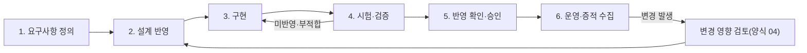

---
tags:
  - CSAP
  - 양식
  - 하등급SaaS
  - 기술적보호조치
control: 13.1.2 인증 및 암호화 기능
section: 13.1 시스템 개발 보안
doc_type: 작성본
evidence: 보안요구사항 정의/반영 절차
문서 양식 번호: LS-13.1.2-02
문서 양식 버전: 0.0.1
문서번호: JAS-13.1.2-02
문서 버전: 1.0
상태: 작성완료
작성일: 2026-10-20
---

> [!note] 근거
> [해설서/하등급-SaaS/13.1.2 인증 및 암호화 기능](../../../../../../projects/jeju-ai/docs/CSAP/해설서/하등급-SaaS/02.%20기술적%20보호%20조치/13.1.2%20인증%20및%20암호화%20기능.md)

# 보안요구사항 정의 및 반영 절차

| 문서번호 | 버전 | 작성일 | 작성자 | 검토자 | 승인자 | 시행일 |
| --- | --- | --- | --- | --- | --- | --- |
| JAS-13.1.2-02 | 1.0 | 2026-10-20 | {{정보보호 관리자 성명}} | {{개발 책임자 성명}} | {{CISO 성명}} | {{승인일}} |

## 1. 목적

지반침하 스마트관리 시스템(이하 "서비스")의 신규 개발과 변경 시 사용자 인증·암호화 보안 요구사항을 정의하고, 설계·구현·시험 단계에서 빠짐없이 반영·검증하는 절차를 정한다. 요구사항이 문서에만 정의되고 실제 시스템에 반영되지 않는 상황(예: 접속 시도 횟수 제한 미구현)을 예방하는 것이 핵심이다.

## 2. 적용 범위

- 서비스 인증 범위 내 응용 프로그램(web · api · pipeline)과 운영 구성(Helm chart · 클러스터 values · Ingress · NCP 설정)의 신규 개발, 기능 추가, 구조 변경
- 인증·암호화·세션·권한에 영향을 주는 모든 변경(경미한 UI 변경 등 영향이 없는 변경은 양식 04의 영향 검토에서 "영향 없음"으로 판정하고 종료)
- 변경 단위는 저장소의 PR(풀 리퀘스트) 1건이다. 하나의 기능이 두 저장소(`jeju-ai-saas-be` · `jeju-ai-saas-fe`)에 걸치면 변경 내역서 1건에 두 PR 을 함께 적는다.

## 3. 절차 개요

## 4. 단계별 절차

| 단계 | 담당 | 활동 | 산출물·기록 |
| --- | --- | --- | --- |
| 1. 요구사항 정의 | 개발 책임자, 정보보호 관리자 | 양식 01의 요구사항(AUTH, ENC-S, ENC-T, SEC-C)을 기준으로 대상 시스템에 적용할 요구사항을 선정하고, 법적 요구사항(개인정보 보호법 제29조, 안전성 확보조치 기준 제6조·제7조)과 이용 기관 보안 요구사항(14.1.1 보안서비스 수준 협약)을 추가로 식별한다. | 요구사항 선정 결과(양식 03의 6항 반영 확인표 초안) |
| 2. 설계 반영 | 개발자, 개발 책임자 | 인증 시점·수단, 패스워드·잠금·세션 처리, 저장·전송 암호화 방식, API 인증 방식을 설계서(제품 설계안 `docs/design/jeju-subsidence-ai/`, gis-sass 인프라 설계서)에 명세하고 양식 03을 작성한다. | 시스템 설계서, 양식 03 |
| 3. 구현 | 개발자 | 설계서와 요구사항에 따라 구현하고, PR 코드 리뷰(작성자 외 1인 이상)에서 SEC-C 항목(입력값 검증, 매개변수화된 쿼리)을 확인한다. 커밋 훅(gitleaks · 린트)과 push 게이트 CI(`ci.yml`: 타입 · 단위 · 통합 · OpenAPI 계약 · npm/pip audit · semgrep)를 통과해야 병합한다. | PR 리뷰 기록, CI 실행 기록 |
| 4. 시험·검증 | 개발자, 정보보호 담당자 | 6항의 필수 시험 항목을 포함한 보안 시험을 수행한다. 자동 시험(단위·통합·E2E)으로 확인할 수 있는 항목은 시험 코드로 고정해 CI 에서 반복하고, 야간 검사(`nightly.yml`: ZAP · trivy · k6)와 수동 시험으로 나머지를 확인한다. 시험 계획·결과 양식은 13.2.1 시험 계획 및 결과 산출물을 따른다. | 시험 결과서(13.2.1 양식 04) |
| 5. 반영 확인·승인 | 정보보호 관리자 | 양식 03의 반영 확인표에 요구사항별 반영 여부·시험 결과를 기록하고, 미반영 항목은 5항에 따라 처리한 뒤 운영 배포(`vX.Y.Z` 태그 + 수동 승인)를 승인한다. | 양식 03(확정본), 배포 승인 기록 |
| 6. 운영·증적 수집 | 운영(인프라) 담당자, 정보보호 담당자 | 구현된 인증·암호화 기능의 화면·설정 증적을 양식 05로 수집·보관한다. | 양식 05 |
| 변경 | 변경 요청자, 정보보호 관리자 | 인증·암호화 영향이 있는 변경은 양식 04로 영향을 검토하고 2–5단계를 다시 수행한다. | 양식 04 |

## 5. 미반영·부적합 처리

1. 시험·검증 단계에서 요구사항 미반영이 확인되면 조치 완료 전에는 운영 환경에 배포하지 않는다. CI 게이트가 실패한 커밋은 이미지가 만들어지지 않으므로 배포 대상이 될 수 없다.
2. 기술적 제약으로 반영할 수 없는 항목은 양식 01의 10항(예외 관리)에 따라 대체 통제와 기한을 정해 정보보호 최고책임자의 승인을 받는다.
3. 운영 중 미반영이 발견되면(점검·심사·사고) 양식 04로 조치 변경을 등록하고 조치 기한을 정한다. 고위험은 14일, 긴급 취약점은 72시간 안에 조치한다.

## 6. 필수 시험 항목

시험·검증 단계에서 다음 항목은 생략하지 않는다.

| No | 시험 항목 | 관련 요구사항 | 확인 방법 |
| --- | --- | --- | --- |
| 1 | 로그인 실패 임계치(5회) 초과 시 계정 잠금(30분) 동작 | AUTH-06 | 임계치 초과 로그인 시도 후 잠금 응답·화면 확인, API 통합 테스트로 고정 |
| 2 | 인증 없이 중요 기능·관리자 기능 접근 불가 | AUTH-01–03 | 비인증·일반 이용자 상태로 관리자 경로·API 직접 호출, `/api` 라우트 전수 순회 통합 테스트 |
| 3 | 세션 타임아웃과 동시 접근 제한 동작 | AUTH-10, AUTH-12 | 유휴 시간 경과·관리자 중복 로그인 시험 |
| 4 | 취약 프로토콜(SSL, TLS 1.0/1.1) 접속 거부 | ENC-T-01·02 | 운영 도메인 TLS 프로토콜 스캔(`testssl.sh` 등), 취약 버전 접속 시도 |
| 5 | 패스워드 일방향 저장과 저장 암호화 적용 | AUTH-07, ENC-S-01·03 | DB 저장값(Argon2id 형식) 확인, Cloud DB · Object Storage 암호화 설정 화면 |
| 6 | SQL Injection 등 입력값 검증 우회 불가 | SEC-C-01·02 | 야간 ZAP API 능동 검사(High 0), semgrep, 경로 공격 거부 테스트 |
| 7 | API 인증 없는 호출 거부와 인증키 평문 저장 여부 | AUTH-14·15 | 무인증 API 호출, gitleaks 이력 전체 검사, 이미지·번들 비밀값 검사(trivy secret) |

## 7. 역할과 책임

| 역할 | 책임 |
| --- | --- |
| 정보보호 최고책임자 | 본 절차 승인, 예외·배포 관련 최종 의사결정 |
| 정보보호 관리자 | 절차 운영, 반영 확인표 검토, 배포 전 보안 확인 |
| 개발 책임자 | 요구사항 정의 참여, 설계·구현 단계 반영 책임, 코드 리뷰 시행 |
| 개발자 | 설계·구현·단위 시험, 반영 결과 기록 |
| 정보보호 담당자 | 보안 시험 수행·입회, 증적 수집 |

## 8. 관련 문서

- 양식 01. 시스템 개발 보안 지침 인증 및 암호화 조항
- 양식 03. 시스템 설계서 보안 요구사항 반영표
- 양식 04. 시스템 변경 내역서
- 양식 05. 증적 수집 점검표
- 13.2.1 시험 계획 및 결과 산출물

## 9. 승인

서명본 보관 위치: 사내 문서 저장소 `CSAP/서명본/13.1.2/`

| 구분 | 직위 | 성명 | 서명 | 일자 |
| --- | --- | --- | --- | --- |
| 작성(정보보호 관리자) | 정보보호 관리자 | {{정보보호 관리자 성명}} | | |
| 검토(개발 책임자) | 개발 책임자 | {{개발 책임자 성명}} | | |
| 승인(정보보호 최고책임자) | CISO | {{CISO 성명}} | | |

## 10. 개정 이력

| 버전 | 일자 | 변경 내용 | 작성자 | 승인자 |
| --- | --- | --- | --- | --- |
| 1.0 | 2026-10-20 | 최초 제정 | {{정보보호 관리자 성명}} | {{CISO 성명}} |
