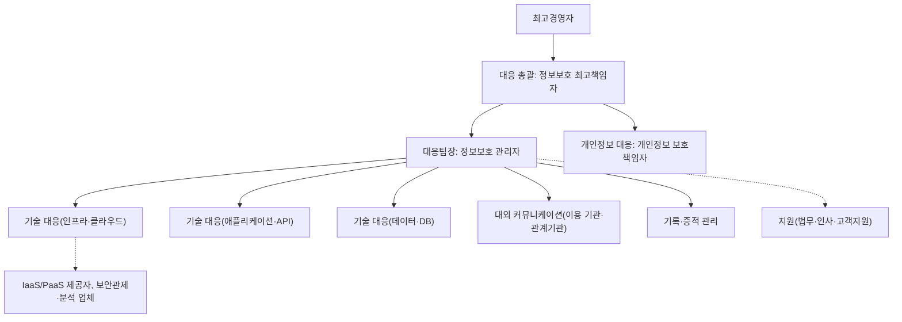
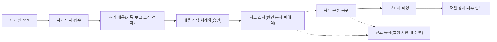

---
tags:
  - CSAP
  - 양식
  - 하등급SaaS
  - 관리적보호조치
control: 5.1.1 침해사고 대응 절차 수립
section: 5.1 침해사고 대응 절차 및 체계
doc_type: 작성본
evidence: 침해사고 대응지침
문서 양식 번호: LS-5.1.1-02
문서 양식 버전: 0.0.1
문서번호: JAS-5.1.1-02
문서 버전: 1.0
상태: 작성완료
작성일: 2026-10-20
---

> [!note] 근거
> [해설서/하등급-SaaS/5.1.1 침해사고 대응 절차 수립](../../../../../../projects/jeju-ai/docs/CSAP/해설서/하등급-SaaS/01.%20관리적%20보호%20조치/5.1.1%20침해사고%20대응%20절차%20수립.md)

> [!note] 현 구현과 차이
> 본 지침은 목표 운영 환경(NCP 공공기관용 NKS · Cloud DB for PostgreSQL · Object Storage, 공통 기준 §1.1–§1.2)을 기준으로 한다. 기준일(2026-10-20) 현재 운영 환경은 구축 전이며, 애플리케이션의 인증·권한·감사 로그, DB, 로그 수집·보존, 실시간 모니터링·알림, 웹 방화벽, 백업은 미구현이다(공통 기준 §1.3). 현재 운영 중인 탐지 수단은 커밋 훅·CI 의 비밀값 검사(gitleaks), push 시 SAST(semgrep)·의존성 취약점 검사(npm audit · pip-audit), 매일 야간 이미지·잠금파일 취약점 검사(trivy)와 DAST(OWASP ZAP)이다. 7항 표의 각 행에 현재 상태를 함께 적었다. 운영 환경 구축 전에는 실제 이용 기관 데이터를 운영하지 않는다.

# 침해사고 대응지침

| 문서번호 | 버전 | 작성일 | 작성자 | 검토자 | 승인자 | 시행일 |
| --- | --- | --- | --- | --- | --- | --- |
| JAS-5.1.1-02 | 1.0 | 2026-10-20 | {{정보보호 관리자 성명}} | {{CPO 성명}} | {{CISO 성명}} | {{승인일}} |

> [!info] 법령 기준
> 정보통신망법 제2조제7호·제48조의3(법률 제21305호, 2026. 7. 7. 시행), 같은 법 시행령 제58조의2(대통령령 제36502호, 2026. 7. 7. 시행), 클라우드컴퓨팅법 제25조(법률 제21066호, 2025. 10. 1. 시행), 같은 법 시행령 제16조·제17조(대통령령 제35947호, 2026. 1. 2. 시행), 개인정보 보호법 제34조(법률 제20897호, 2025. 10. 2. 시행), 같은 법 시행령 제39조·제40조(대통령령 제36121호, 2026. 8. 20. 시행)를 기준으로 작성했다. 법령이 개정되면 국가법령정보센터에서 조문을 다시 확인한다.

본 지침은 5.2.1 양식 01. 침해사고 보고 및 신고 통지 절차와 함께 침해사고 대응지침을 구성한다. 유형·등급별 보고 시한, 보고서 작성, 법령별 신고·통지 요건과 수행 절차는 그 문서에 두고, 본 지침에서는 반복하지 않고 연결만 한다. 등급별 보고 시한과 이용 기관 통지 시한은 당사 내부 기준(공통 기준 §3.7)으로 두 문서가 같은 값을 쓴다.

## 1. 목적

본 지침은 ㈜이노팸(이하 "당사")이 클라우드컴퓨팅서비스 지반침하 스마트관리 시스템(제주 GEO-AI 지반침하 SaaS, 이하 "서비스")을 제공하면서 발생할 수 있는 침해사고를 예방하고, 침해사고 발생 시 정의된 조직과 절차에 따라 신속하게 탐지·보고·대응·복구하여 이용 기관과 이용자의 피해를 최소화하며, 관계 법령에 따른 신고·통지 의무를 이행하기 위한 세부 절차를 정한다.

## 2. 적용 범위

- 서비스(하등급 SaaS) 인증 범위 내 애플리케이션(web · api · pipeline), API, 데이터베이스(Cloud DB for PostgreSQL), 스토리지(Object Storage), 클라우드 계정·콘솔(NCP 콘솔, NKS 클러스터), 운영·개발 환경(사내 `dev0` 클러스터와 로컬은 인증 대상이 아니나 운영 환경에 영향을 주는 경로로서 포함), 정보보호시스템, 컨테이너 이미지 레지스트리, 배포 파이프라인(GitHub Actions self-hosted runner)과 이용자 정보
- 당사의 임직원 전원과 인증 범위 내 정보자산에 접근하는 외부인력
- 이용 기관(제주특별자치도 및 산하 공공기관)과의 관계에서 당사가 클라우드컴퓨팅서비스 제공자로서 수행하는 신고·통지·협조 절차

책임공유모델에 따른 적용 범위는 다음과 같다.

| 계층 | 책임 주체 | 본 지침 적용 |
| --- | --- | --- |
| 물리 시설, 네트워크 인프라, 하이퍼바이저, NKS 컨트롤 플레인, Cloud DB for PostgreSQL 엔진 운영, Object Storage 서비스 운영 | IaaS/PaaS 제공자(네이버클라우드, NCP 공공기관용) | 제공자의 인증·계약으로 대응 체계를 확인한다. 제공자로부터 인프라 침해사고 통지를 받으면 본 지침의 서비스 영향 분석·이용 기관 통지 절차를 적용한다. |
| 클라우드 계정·IAM, 보안 그룹·ACG 설정, NKS 워커 노드 풀 설정, 쿠버네티스 리소스(네임스페이스·NetworkPolicy·Secret), 컨테이너 이미지, 애플리케이션, 데이터, 이용 기관 관리자 계정 발급 | 당사 | 본 지침을 전면 적용한다. |
| 이용 기관 계정·권한 관리, 이용자 행위, 이용 기관 단말 | 이용 기관 | 6항의 이용 기관 책임과 양식 04. 이용 기관 침해사고 대응 안내를 적용한다. |

## 3. 용어 정의

| 용어 | 정의 |
| --- | --- |
| 침해사고 | 해킹, 컴퓨터바이러스, 논리폭탄, 메일폭탄, 서비스거부 또는 고출력 전자기파 등의 방법이나 정보통신망의 정상적인 보호·인증 절차를 우회하여 접근할 수 있도록 하는 프로그램·기술적 장치를 설치하는 방법으로 정보통신망 또는 이와 관련된 정보시스템을 공격하는 행위로 인하여 발생한 사태(정보통신망법 제2조제7호). 당사는 4.1항의 확장 범위를 포함하여 관리한다. |
| 침해사고 징후 | 침해 시도 탐지, 비정상 접근·트래픽, 심각한 취약점 공개 등 침해사고로 발전할 수 있는 상황 |
| 이용자 정보 | 이용자의 개인정보를 포함하여 클라우드컴퓨팅서비스에서 생산·저장·관리되는 이용자의 정보(이용 기관 데이터 포함). 서비스에서는 이용 기관이 올린 원본 자료, 데이터셋 번들, 사고 기록, 내보내기 파일, 계정·권한·감사 기록이 해당하며, 관로(`pipes`)·굴착(`excavation`) 레이어는 민감 레이어로 관리한다 |
| 이용자(이용 기관) | 서비스를 이용하는 공공기관·법인과 그 소속 사용자(역할 `admin` · `service` · `user`) |
| 침해사고 대응조직 | 침해사고 대응을 위하여 5항에 따라 구성된 조직. 명단과 연락처는 양식 03. 침해사고 대응조직 및 비상연락망을 따른다. |
| 개인정보 유출등 | 개인정보의 분실·도난·유출(개인정보 보호법 제34조). 서비스는 설계상 개인정보를 수집하지 않으나, 사고 기록에 주소·피해 내용이 들어올 수 있으므로 해당 여부를 사고마다 판단한다 |
| 증적 | 로그, 시스템 이미지, 메모리 덤프, 네트워크 캡처, 화면 캡처, 대응 기록 등 사고 조사와 법적 대응에 사용하는 자료 |

## 4. 침해사고의 정의 및 범위

### 4.1 범위

법정 정의에 해당하는 사태와 다음의 사태를 침해사고로 관리한다.

- 이용자 정보(이용 기관 데이터, 개인정보)의 외부 유출·노출(Object Storage 버킷·객체 공개 설정 오류, 권한 없는 사용자에 대한 민감 레이어 노출 포함)
- 임직원·이용 기관 관리자 계정, API 키, 인증서, 비밀정보(세션 서명키, DB 비밀번호, 스토리지 접근키, 브이월드 키, 레지스트리·배포 자격증명) 등 계정·인증정보의 탈취·노출(소스 저장소·이미지·로그에 커밋·기록된 경우 포함)
- 이용자 데이터, 시스템 설정, 로그(감사 로그 `audit_events` 포함)의 무단 위·변조·삭제
- 임직원·외부인력의 권한 오남용, 정보 무단 반출 등 내부자 부정행위
- IaaS/PaaS 제공자, 외부 연동 서비스(브이월드 WMTS, 컨테이너 레지스트리, GitHub), 사용 중인 오픈소스·상용 구성요소의 침해로 인한 당사 서비스 영향

### 4.2 유형 분류

유형 코드와 명칭은 5.2.1 양식 01. 침해사고 보고 및 신고 통지 절차 4.1항과 같게 유지한다.

| 유형 코드 | 유형 | 설명·예시 | 법정 침해사고 해당 여부 |
| --- | --- | --- | --- |
| T-01 | 비인가 접근·해킹 | 관리자 콘솔(NCP 콘솔, `kubectl`), 파드, DB, API 에 대한 비인가 접근, 권한 상승, 웹 취약점 악용(경로 탐색, 인증 우회 등), 클라우드 콘솔·API 키 노출을 통한 침입 | ○ |
| T-02 | 악성코드 감염 | 컨테이너·노드·배포 러너·업무 PC 의 랜섬웨어, 웹셸, 백도어, 크립토마이너 감염, 악성 의존성 패키지 유입 | ○ |
| T-03 | 서비스거부 공격 | DDoS 등으로 인한 서비스 지연·중단 | ○ |
| T-04 | 이용자 정보 유출 | 이용 기관 데이터·설정 정보의 외부 유출, 다른 이용 기관이나 권한 없는 역할에 노출, 저장소 공개 설정에 의한 노출 | 공격에 의한 경우 ○. 그 외에도 클라우드컴퓨팅법 통지 대상 |
| T-05 | 개인정보 유출등 | 개인정보의 분실·도난·유출(민감정보·고유식별정보 포함 여부 확인) | 공격에 의한 경우 ○. 그 외에도 개인정보 보호법 통지·신고 대상 |
| T-06 | 데이터 위·변조·파괴 | 이용자 데이터, 데이터셋 번들, 시스템 설정, 로그의 무단 변경·삭제 | ○ |
| T-07 | 내부자·외부인력 부정행위 | 권한 오남용에 의한 정보 열람·반출, 보호 절차 우회 | 공격 행위에 해당하면 ○ |
| T-08 | 공급망·IaaS/PaaS 제공자 사고 | 제공자 인프라 침해, 외부 연동 서비스·구성요소(npm·PyPI 패키지, 기본 이미지, GitHub Actions 액션) 침해로 당사 서비스 영향 | 영향 범위 확인 후 판단 |
| T-09 | 침해 징후 | 차단된 공격 시도, 비정상 트래픽·로그인, 취약점 스캔, 심각한 취약점 공개 | 징후로 관리 |

### 4.3 중요도 등급

등급 기준과 등급별 보고 시한·보고 범위는 5.2.1 양식 01 4.2항과 같게 유지한다. 최초 보고 시한(정보보호 최고책임자까지)은 1등급 즉시(30분 이내 1차), 2등급 2시간 이내, 3등급 24시간 이내, 4등급 당일 확인이다(공통 기준 §3.7). 본 지침에서는 등급별 대응조직 소집과 초동 조치 목표만 정한다. 등급은 정보보호 관리자가 잠정 판정하고 정보보호 최고책임자가 확정하며, 조사 중 영향이 확대되면 상향한다. 시한은 당사 내부 기준이다.

| 등급 | 명칭 | 판단 기준(하나 이상 해당) | 대응조직 소집 | 초동 조치 목표 |
| --- | --- | --- | --- | --- |
| 1 | 심각 | 이용자 정보 또는 개인정보의 유출이 확인되거나 유력함, 다수 이용 기관 또는 공공기관 데이터 영향, 서비스 전면 중단, 관리자 권한 탈취 | 전원 즉시 | 1시간 이내 |
| 2 | 중대 | 단일 이용 기관 영향, 일부 기능 중단, 유출 가능성이 있어 조사 중, 악성코드 실행 확인 | 필수 인원 | 4시간 이내 |
| 3 | 보통 | 피해 없이 차단·격리된 공격, 취약점 악용 시도, 유출 가능성 없음 | 대응팀장 판단 | 24시간 이내 분석 완료 |
| 4 | 징후 | 확인이 필요한 이상 징후 | 해당 없음 | 당일 확인 |

- 이용자 정보 또는 개인정보의 유출 가능성이 있는 사고는 규모가 작아도 2등급 이상으로 분류한다.
- 서비스 이용 기관은 모두 공공기관(국가기관등)이므로, 이용 기관 데이터에 영향이 확인되거나 유력한 사고는 1등급으로 분류한다(14.1.4 양식 01 6항).
- 민감 레이어(관로·굴착)의 권한 없는 열람·내보내기가 확인되면 이용자 정보 유출(T-04)로 보고 1등급으로 분류한다.
- 법정 신고·통지 대상 여부는 등급과 별개로 11항에 따라 판단한다.

## 5. 침해사고 대응조직 구성 및 역할·책임

| 역할 | 담당(직위) | 책임 | 권한 |
| --- | --- | --- | --- |
| 대응 총괄 | 정보보호 최고책임자 | 대응 전략 승인, 등급 확정, 관계기관 신고·이용 기관 통지 결정, 수사기관 공조 결정, 대외 공개 승인, 최고경영자 보고 | 서비스 중단·접근 차단·계정 잠금 등 긴급 조치 결정, 전사 인력·자원 동원 |
| 대응팀장 | 정보보호 관리자 | 사고 접수·잠정 등급 판정, 대응조직 소집, 초동 대응 지휘, 진행 상황 보고, 대응 기록과 침해사고 보고서 작성 총괄, 지침·연락망 관리 | 대응 인원 업무 지시, 시스템·자료 접근 요청, 외부 협력사 지원 요청 |
| 개인정보 대응 | 개인정보 보호책임자 | 개인정보 유출 여부·규모 판단, 정보주체 통지와 개인정보보호위원회·한국인터넷진흥원 신고, 이용 기관(위탁자) 신고·통지 협조 | 개인정보 처리 중단·접근 차단 요청 |
| 기술 대응(인프라·클라우드) | 운영(인프라) 담당자 | NCP 계정·IAM·ACG 점검, NKS 자원 격리(NetworkPolicy·스케일 0·노드 격리), 인프라 로그 확보, IaaS/PaaS 제공자 협조 요청, 복구 | ACG·NetworkPolicy·계정 긴급 변경(대응팀장 승인) |
| 기술 대응(애플리케이션·API) | 개발 책임자 | 애플리케이션 로그 분석, 취약점 확인·긴급 패치, 악성 코드·백도어 제거, 기능 차단(라우트 비활성화, 이전 이미지 태그로 되돌림) | 긴급 배포(대응팀장 승인, 변경 관리 사후 기록) |
| 기술 대응(데이터·DB) | 개발 책임자(DB 관리 겸임, 대행자: 운영(인프라) 담당자) | 데이터 유출·변조 범위 확인, DB 접속기록·감사 로그 분석, 백업 무결성 확인, 데이터 복구 | DB 계정 잠금, 스토리지 자격증명 폐기 |
| 대외 커뮤니케이션 | 정보보호 담당자(고객 창구 겸임) | 이용 기관 통지문 작성·발송, 이용 기관 문의 대응, 관계기관 신고서 제출 실무, 공공기관 정보보안담당관 통보 | 정보보호 최고책임자 승인 범위 내 대외 연락 |
| 기록·증적 관리 | 정보보호 담당자(대외 커뮤니케이션과 겸임 시 대행자 지정) | 사고 접수부터 종결까지 시간순 기록, 증적 수집·봉인·보관, 보관 대장 관리 | 증적 접근 통제 |
| 지원 | 법무·인사·고객지원 부서 | 법적 검토, 내부자 관련 인사 조치, 이용 기관 응대 지원 | |

- 대응조직 명단, 대행자, 연락처와 호출 순서는 양식 03. 침해사고 대응조직 및 비상연락망에 정하고 분기 1회 이상 현행화한다.
- 조직 규모가 작아 한 사람이 여러 역할을 맡는 경우 역할별 대행자를 반드시 지정한다. 대응 총괄과 기록·증적 관리는 같은 사람이 겸하지 않는다.

## 6. 제공자·이용자·인프라 제공자의 책임과 절차

| 활동 | 당사(클라우드컴퓨팅서비스 제공자) | 이용 기관(이용자) | IaaS/PaaS 제공자 |
| --- | --- | --- | --- |
| 대응절차 수립·유지 | 본 지침 수립·개정, 이용 기관에 양식 04 안내 제공 | 기관 자체 사고 대응 절차 운영, 당사 안내 준수 | 자체 절차 운영(제공자 인증·계약으로 확인) |
| 탐지·모니터링 | 애플리케이션·API·데이터·계정·클라우드 설정·컨테이너 계층 | 이용 기관 계정·사용자 행위, 기관 단말·네트워크 | 인프라·하이퍼바이저·물리 계층, 관리형 서비스(NKS 컨트롤 플레인, Cloud DB, Object Storage) |
| 사고·징후 신고 | 이용 기관·제공자 신고 접수 창구 운영(양식 04 4항) | 징후 발견 시 당사 신고 창구로 즉시 신고 | 인프라 침해사고를 계약 채널로 당사에 통지 |
| 초동 조치 | 계정 차단, 세션 폐기, 접근 차단, 파드·자원 격리, 취약 기능 중단 | 자체 계정 비밀번호 변경·다중 인증 재설정, 당사 요청 조치 이행 | 인프라 계층 봉쇄·복구 |
| 원인 분석·증적 | 서비스 로그·감사 로그·애플리케이션·DB 분석, 제공자에 인프라 로그 요청 | 기관 단말·계정 사용 이력 제공 협조 | 인프라 로그·분석 정보 제공(계약 범위) |
| 관계기관 신고 | 정보통신망법·클라우드컴퓨팅법·개인정보 보호법에 따른 신고(11항) | 공공기관 소관 규정에 따른 자체 보고, 이용 기관이 개인정보처리자인 개인정보의 신고 | 자체 법정 의무 이행 |
| 이용자·정보주체 통지 | 이용 기관에 인지 즉시 통지(11항), 당사가 개인정보처리자인 정보주체 통지 | 기관 내 사용자·정보주체 통지(이용 기관이 개인정보처리자인 경우) | 당사에 통지 |
| 복구 | 서비스·데이터 복구, 복구 완료 통지 | 자체 데이터 검증, 재접속 확인 | 인프라 복구 |
| 재발방지 | 취약점 조치, 지침·정책 개정, 이용 기관 보안 권고 | 기관 보안 설정·교육 개선 | 인프라 개선 |
| 사고조사 협조 | 이용 기관·국가정보원 등 관계기관의 사고조사·예방활동 협조 | 당사 조사 협조 | 당사·관계기관 조사 협조(계약) |

- 이용 기관이 공공기관이면 이용 기관의 사고 대응 절차와 협조 체계는 14.1.4 사고 및 장애 대응 산출물에 따라 추가로 반영한다. 서비스 이용 기관은 모두 공공기관이므로 14.1.4 산출물을 항상 함께 적용한다.

## 7. 침해사고 탐지 방안

| 탐지 경로 | 탐지 대상·방법 | 확인 주기 | 담당 |
| --- | --- | --- | --- |
| 애플리케이션·API 로그 | 인증 실패 급증(계정 잠금 발생), 비정상 API 호출, 권한 오류, 민감 레이어 대량 조회·내보내기. 감사 이벤트(`audit_events`)와 요청 로그(request_id 포함)를 관리형 로그 서비스로 수집해 알림 규칙을 둔다. **현재**: Fastify 요청 로그를 표준 출력(JSON)으로만 남기며 수집·보존·알림 없음, 인증·감사 미구현 | 실시간 알림 + 월 1회 정기 검토(공통 기준 §3.2) | 기술 대응(애플리케이션) |
| 클라우드 계정·콘솔 감사 로그 | NCP 콘솔 관리자 로그인(MFA), IAM 변경, ACG·Object Storage 공개 설정 변경, 쿠버네티스 API 감사 로그(Secret 조회, RBAC 변경), 허용 IP 밖 접속. **현재**: 운영 환경 구축 전으로 해당 로그 없음 | 실시간 알림 + 월 1회 정기 검토 | 기술 대응(인프라) |
| 웹 방화벽·네트워크 | 웹 공격 패턴(NCP 공공 WAF), Ingress rate limit·본문 크기 제한 차단, NetworkPolicy 차단 이벤트, 트래픽 급증. **현재**: 미구축(WAF 적용 예정, 공통 기준 §3.4) | 실시간 알림 | 기술 대응(인프라) |
| 백신·EDR | 업무 PC: 사내 PC 보안 정책의 백신. 서버: 컨테이너는 비루트·읽기 전용 루트 파일시스템·권한 제거로 실행하고 이미지 취약점은 trivy 로 검사한다. 컨테이너 런타임 이상 행위 탐지(EDR)는 도입하지 않았으며 도입 여부는 연 1회 지침 검토 때 판단한다 | 업무 PC 실시간, 이미지 매일 | 정보보호 담당자 |
| DB 접속기록 | 비인가 계정 접속, 대량 조회, 업무 시간 외 접속(Cloud DB for PostgreSQL 접속 로그, 앱 DB 역할 외 접속). **현재**: DB 미구성 | 월 1회 정기 검토, 이상 알림 시 즉시 | 기술 대응(데이터) |
| 무결성·설정 점검 | 배포 설정은 git(Helm chart · 클러스터 저장소 values) 이력과 실제 리소스 차이 확인, Object Storage 공개 여부 점검, 감사 로그 해시 검증(월 1회, 공통 기준 §3.2), 비밀값의 소스 저장소 유입 검사. **현재 운영 중**: gitleaks(커밋 훅 + CI 에서 전체 이력 검사) | 비밀값 검사는 커밋·push 마다, 설정 점검 월 1회 | 기술 대응(인프라) |
| IaaS/PaaS 제공자 통지 | 제공자 보안 알림, 인프라 침해사고·장애 공지(계정 담당자 전자우편, 콘솔 공지) | 수신 즉시 | 기술 대응(인프라) |
| 이용 기관·이용자 신고 | 양식 04 4항의 신고 창구(전화, 전자우편) | 접수 즉시 | 대외 커뮤니케이션 |
| 외부 기관 통보 | 한국인터넷진흥원, 국가정보원, 이용 기관 정보보안담당관, 보안 연구자 제보 | 수신 즉시 | 정보보호 관리자 |
| 취약점 정보 | 사용 중인 구성요소의 취약점 공개, 제공자 보안 권고. **현재 운영 중**: push 마다 npm audit(운영 의존성 high 이상 차단)·pip-audit·semgrep, 매일 03:00 야간 trivy(이미지·잠금파일)와 OWASP ZAP(API·기준 검사). 야간 결과는 실행 요약과 아티팩트(30일 보관)로만 남고 알림은 없으므로 담당자가 확인한다 | 자동 검사 매일, 결과 확인 주 1회 | 정보보호 담당자 |

- 탐지 알림의 수신자와 근무 외 시간 당직 체계는 양식 03 3항에 정한다.
- 탐지된 이벤트는 대응팀장이 1시간 이내에 징후·사고 여부를 1차 판단하고, 판단 결과를 기록한다.
- 운영 환경 구축 전까지는 "현재"로 적은 수단만 운영되며, 실시간 알림 행은 운영 환경(관리형 로그 서비스·Cloud Insight·WAF) 구축과 함께 적용한다.

## 8. 침해사고 대응 절차

| 단계 | 주요 활동 | 담당 | 기록 |
| --- | --- | --- | --- |
| 1. 사고 전 준비 | 대응조직·연락망 유지, 탐지 체계 운영, 증적 수집 도구·백업 준비, 훈련 실시, 이용 기관 안내 제공 | 정보보호 관리자 | 양식 03, 05 |
| 2. 사고 탐지·접수 | 7항의 경로로 이벤트 탐지 또는 신고 접수, 접수 번호 부여, 1차 판단 | 대응팀장 | 사고 접수 기록(8.1항) |
| 3. 초기 대응 | 정황 기록, 9항에 따른 보고, 잠정 등급 판정, 대응조직 소집, 관련 부서 전파, 추가 피해 방지를 위한 즉시 조치(계정 잠금·세션 폐기·접근 차단), 증적 보존 착수 | 대응팀장, 기술 대응 | 초동 조치 기록 |
| 4. 대응 전략 체계화 | 영향 범위·서비스 영향·법정 신고 대상 여부를 바탕으로 대응 전략(격리 범위, 서비스 중단 여부, 조사 범위, 외부 전문가·수사기관 공조 여부) 수립과 정보보호 최고책임자 승인 | 정보보호 최고책임자, 대응팀장 | 대응 전략 승인 기록 |
| 5. 사고 조사 | 증적 수집·분석으로 언제, 누가, 어떻게 침해했는지와 피해 범위(영향 이용 기관, 유출 정보, 변조 데이터) 확정(10항) | 기술 대응, 기록·증적 관리 | 조사 기록, 증적 목록 |
| 6. 봉쇄·근절·복구 | 공격 경로 차단, 악성 요소 제거, 자격증명 교체, 취약점 조치 후 서비스·데이터 복구(13항) | 기술 대응 | 복구 기록 |
| 7. 보고서 작성 | 발생 일시, 보고자·보고 일시, 사고 내용, 대응 경과, 소요 시간, 원인, 피해, 조치를 담은 침해사고 보고서 작성(최초·중간·최종) | 대응팀장 | 5.2.1 양식 02. 침해사고 보고서 |
| 8. 재발 방지·사후 검토 | 재발방지 대책 수립·이행 추적, 정책·지침·기술 개정, 사후 검토 회의, 훈련 시나리오 반영 | 정보보호 관리자 | 재발방지 대책, 양식 06 |

신고·통지(11항)는 단계와 관계없이 법정 시한 내에 병행하며, 조사 완료를 기다리지 않는다.

### 8.1 기록 항목

사고 접수부터 종결까지 다음 항목을 시간순으로 기록한다. 기록은 기록·증적 관리 담당이 작성하고 대응팀장이 확인한다. 보고서 서식은 5.2.1 양식 02. 침해사고 보고서를 사용하고, 신고·통지 기록은 5.2.1 양식 03·04 관리대장에 남긴다.

| 항목 | 내용 |
| --- | --- |
| 접수 정보 | 접수 번호(사고 번호 `INC-RPT-YYYY-NNN`), 인지 일시, 인지 경로(탐지 시스템·신고자), 최초 보고자·보고 일시 |
| 사고 개요 | 유형 코드, 잠정·확정 등급, 영향 시스템·자원, 영향 이용 기관, 관련 정보 유형(민감 레이어 포함 여부) |
| 대응 경과 | 각 조치의 일시, 조치 내용, 담당자, 승인자 |
| 보고·전파 | 보고 일시·대상·방법, 전파 대상·일시 |
| 신고·통지 | 관계기관 신고 일시·접수 번호, 이용 기관 통지 일시·방법, 정보주체 통지 일시·방법 |
| 증적 | 증적 목록, 수집 일시, 수집자, 보관 위치, 해시값(SHA-256) |
| 소요 시간 | 인지부터 보고, 초동 조치, 봉쇄, 복구, 종결까지 각 소요 시간 |
| 종결 | 종결 일시, 원인, 피해 규모, 재발방지 대책, 종결 승인자 |

## 9. 보고 및 사고전파 절차

### 9.1 내부 보고 체계

모든 임직원과 외부인력은 침해사고 또는 징후를 인지하면 확인이 끝나지 않았더라도 즉시 보고한다. 보고 지연·은폐는 정보보호 정책에 따라 조치한다.

| 단계 | 보고자 | 보고 대상 | 시한 |
| --- | --- | --- | --- |
| 인지 보고 | 인지자(임직원, 외부인력, 신고 접수자) | 정보보호 담당자(모니터링·사고 대응) → 정보보호 관리자(대응팀장) | 인지 즉시 |
| 최초 보고 | 정보보호 담당자, 대응팀장 | 정보보호 최고책임자 | 1등급 즉시(30분 이내 1차), 2등급 2시간, 3등급 24시간, 4등급 당일(5.2.1 양식 01 4.2항, 공통 기준 §3.7) |
| 개인정보 관련 보고 | 대응팀장 | 개인정보 보호책임자 | 개인정보 관련 가능성 인지 즉시 |
| 경영진 보고 | 정보보호 최고책임자 | 최고경영자 | 1등급 즉시, 그 외 5.2.1 양식 01 5.2항의 시한 |
| 중간·최종 보고 | 대응팀장 | 정보보호 최고책임자, 최고경영자 | 5.2.1 양식 01 5.2항의 시한. 최종 보고는 복구 후 5영업일 이내(공통 기준 §3.7) |

- 보고 대상자와 연락이 되지 않으면 보고를 미루지 않고 다음 단계(정보보호 관리자, 정보보호 최고책임자)에 직접 보고하며, 양식 03 3항의 대행자·호출 순서를 따른다.
- 근무 외 시간에는 양식 03 3.3항의 당직·대행 체계에 따라 보고한다.
- 등급별 보고 수단, 최초 보고 필수 내용, 중간·최종 보고와 침해사고 보고서 작성은 5.2.1 양식 01. 침해사고 보고 및 신고 통지 절차 5항·6항과 양식 02. 침해사고 보고서를 따른다. 본 지침에서 반복하지 않으며, 두 문서의 기준이 다르면 공통 기준 §3.7 의 값으로 두 문서를 함께 맞춘다.

### 9.2 사고전파

| 전파 대상 | 시점 | 담당 | 방법 | 내용 |
| --- | --- | --- | --- | --- |
| 관련 부서(개발, 운영, 고객지원) | 초동 조치 착수 시 | 대응팀장 | 사내 보안 채널 | 사고 개요, 협조 요청 사항, 비밀유지 |
| IaaS/PaaS 제공자 | 인프라 계층 관련 가능성 확인 시 | 기술 대응(인프라) | 제공자 보안 사고 접수·기술 지원 채널(양식 03 4항) | 영향 자원, 로그 보전·기술 지원 요청 |
| 이용 기관 | 11항의 통지 기준 해당 시(인지 즉시, 내부 기준 1시간 이내 1차) | 대외 커뮤니케이션(정보보호 최고책임자 승인) | 양식 04 5항의 통지 방법, 5.2.1 양식 06 통지문 | 클라우드컴퓨팅법 시행령 제17조제1항의 5개 사항 |
| 이용 기관 정보보안담당관(공공기관) | 사이버공격 관련 정보 확인 시 | 대외 커뮤니케이션 | 전화, 팩스, 이메일 | 사고 개요, 영향, 조치 현황, 기관 협조 요청 |
| 관계기관 | 11항의 신고 기준 해당 시 | 정보보호 최고책임자 지정자 | 각 기관 신고 채널 | 5.2.1 양식 01 7.2항의 신고 내용 |
| 전 직원 | 필요 시 | 정보보호 최고책임자 | 사내 공지 | 주의 사항, 계정 보호 조치(사고 상세 정보 제외) |

## 10. 원인 분석 및 피해 상황 파악

### 10.1 조사 항목

| 구분 | 확인 내용 | 주요 자료 |
| --- | --- | --- |
| 침입 경로 | 최초 진입 지점, 악용된 취약점·계정, 공격 출발지 | WAF·Ingress 접근 로그, 애플리케이션 요청 로그, 감사 이벤트, NCP 콘솔·쿠버네티스 감사 로그, 인증 로그 |
| 침해 시점 | 최초 침해 시각, 활동 기간, 인지까지 소요 시간 | 시간 동기화(NTP)된 로그 전체 |
| 침해 범위 | 영향 시스템·자원·계정, 횡적 이동 여부, 설치된 악성 요소 | 컨테이너 이미지 다이제스트 대조, 파드·노드 상태, 프로세스·네트워크 연결 정보, NetworkPolicy 로그 |
| 피해 상황 | 유출·변조·삭제된 정보의 종류와 양, 영향 이용 기관 수, 개인정보 항목·정보주체 수, 서비스 중단 시간 | DB 접속기록, 내보내기 생성·다운로드 감사 기록, Object Storage 접근 기록, 백업 대조 |
| 이용 기관 영향 | 이용 기관별 영향 데이터, 계정, 기능 | 이용 기관별 자원 매핑(`orgs/` 저장 경로, 계정·역할) |
| 법정 신고·통지 요건 | 침해사고 해당 여부, 이용자 정보 유출 여부, 개인정보 유출 신고 요건(1천명 이상, 민감정보·고유식별정보, 외부 불법 접근) | 조사 결과 종합 |

### 10.2 증적 수집·보존

1. 증적은 변경하지 않고 원본을 보존하며, 휘발성 정보(메모리, 네트워크 연결, 실행 프로세스)를 먼저 수집한다.
2. 시스템을 종료·재구성하기 전에 스냅샷·이미지를 생성하고 해시값을 기록한다. 격리는 네트워크 차단(NetworkPolicy·ACG 변경)으로 우선 수행하고, 침해 의심 파드는 삭제하지 않고 레이블을 바꿔 서비스에서 분리한다.
3. 로그는 보존 기간 만료로 삭제되지 않도록 별도 저장소(Object Storage 별도 버킷, 객체 잠금)에 복사하고, IaaS/PaaS 제공자 관리 영역의 로그는 제공자에 보전·제공을 요청한다.
4. 증적마다 수집 일시, 수집자, 출처, 해시값, 보관 위치를 증적 목록에 기록하고, 접근을 대응조직으로 제한한다.
5. 수사기관 공조 또는 소송이 예상되면 증적 이전 시 인수인계 기록(연계 보관)을 남긴다.
6. 증적은 사고 종결 후 3년 이상 보관하고, 개인정보가 포함된 증적은 보관 목적 달성 후 파기 절차에 따라 파기한다.

## 11. 신고 및 통지 절차

### 11.1 법정 신고·통지 의무 요약

침해사고가 발생하면 조사 완료를 기다리지 않고 법정 시한 내에 확인된 내용으로 먼저 신고·통지한다. 관계기관 신고와 이용자·정보주체 통지는 서로를 대체하지 않으므로 각각 판단하고 각각 이행한다.

| 구분 | 대상 | 시한 | 근거 |
| --- | --- | --- | --- |
| 침해사고 신고 | 과학기술정보통신부장관 또는 한국인터넷진흥원(☎118, 보호나라) | 발생을 알게 된 때부터 24시간 이내(추가 확인 사실은 확인 후 24시간 이내) | 정보통신망법 제48조의3제1항, 같은 법 시행령 제58조의2 |
| 이용자 통지 | 해당 이용 기관 | 침해사고 발생, 이용자 정보 유출, 사전예고 없는 서비스 중단(연속 10분 이상 또는 24시간 이내 2회 이상 합계 15분 이상, 계약으로 정한 기간이 있으면 그 기간) 시 지체 없이. 당사 내부 기준: 침해사고는 인지 즉시(1시간 이내 1차) | 클라우드컴퓨팅법 제25조제1항, 같은 법 시행령 제16조·제17조 |
| 이용자 정보 유출 통지 | 과학기술정보통신부장관 | 즉시 | 클라우드컴퓨팅법 제25조제2항, 같은 법 시행령 제17조제5항 |
| 개인정보 유출 통지·신고 | 정보주체, 개인정보보호위원회 또는 한국인터넷진흥원 | 알게 된 때부터 72시간 이내 | 개인정보 보호법 제34조, 같은 법 시행령 제39조·제40조 |

- 법령별 발동 요건, 필수 내용, 방법, 추가 신고·통지, 통지 문안, IaaS/PaaS 제공자 관련 사고의 처리는 5.2.1 양식 01. 침해사고 보고 및 신고 통지 절차 7항을 따르며 본 지침에서 반복하지 않는다.
- 사고별 의무 판단은 5.2.1 양식 05. 법적 신고 통지 의무 판단서로 하고, 통지문은 5.2.1 양식 06. 침해사고 통지문으로 작성한다.

### 11.2 이용 기관 통지

1. 대응팀장은 이용자 통지 요건 해당 여부를 최초 보고와 함께(인지 후 30분 이내) 1차 판단하고 정보보호 최고책임자에게 보고한다. 정보보호 최고책임자가 통지 여부·범위·방법을 결정하며, 통지는 인지 후 1시간 이내에 확인된 사실로 1차 실시하고 원인·피해 범위가 확인되면 추가 통지한다(공통 기준 §3.7).
2. 대외 커뮤니케이션 담당은 5.2.1 양식 06 통지문을 작성하고, 영향 이용 기관 전체에 양식 03 6항의 연락처로 양식 04 5항의 방법에 따라 통지한다.
3. 이용 기관이 공공기관이면 해당 기관의 정보보안담당관에게 전화·팩스·이메일 등으로 지체 없이 통보하고, 기관이 소관 규정에 따른 보고를 이행할 수 있도록 사고 발생 보고서를 제공한다. 국가정보원·이용 기관의 사고조사와 예방활동에 협조한다. 세부 기준은 5.2.1 양식 01 8항과 14.1.4 사고 및 장애 대응 산출물을 따른다.
4. 이용 기관으로부터 처리를 위탁받은 개인정보가 유출되면 5.2.1 양식 01 7.3항에 따라 이용 기관(위탁자)에 즉시 통보하고, 이용 기관의 정보주체 통지·신고에 필요한 정보를 제공한다.

### 11.3 수사기관 공조

- 정보보호 최고책임자는 초기 조사 결과를 참고하여 수사기관 신고·공조 여부를 결정하고, 공조 시 증적 제공 범위와 인수인계 방법을 정한다.
- 수사 진행 정보는 12항의 유출 금지 대상으로 관리한다.

### 11.4 기록

신고·통지의 이행 기록(일시, 대상, 접수 번호, 내용, 담당자, 증적)은 5.2.1 양식 03. 침해사고 신고 관리대장과 양식 04. 침해사고 이용자 통지 관리대장에 남기고, 8.1항의 사고 기록에 사고 번호로 연결한다.

## 12. 사고 정보의 유출 금지 대상 및 공개 통제

| 구분 | 유출·공개 금지 대상 | 예외적 제공 범위 | 승인자 |
| --- | --- | --- | --- |
| 사고 기술 정보 | 공격 경로, 악용된 취약점, 침해 시스템 구성·설정 정보, 미조치 취약점 | 관계기관 신고, 수사기관, 조사 위탁 업체(비밀유지 계약), IaaS/PaaS 제공자(영향 범위 한정) | 정보보호 최고책임자 |
| 이용자 정보 | 유출된 이용자 정보 자체(민감 레이어 포함), 이용 기관 식별 정보와 피해 내역 | 해당 이용 기관, 관계기관 | 정보보호 최고책임자 |
| 개인정보 | 사고 관련 정보주체·관계자의 개인정보 | 법정 통지·신고 범위, 수사기관 | 개인정보 보호책임자 |
| 증적 | 로그, 이미지, 분석 자료, 증적 목록 | 수사기관, 조사 위탁 업체(인수인계 기록) | 정보보호 최고책임자 |
| 대응 기록 | 사고 기록, 보고서, 회의 내용 | 인증 심사, 이용 기관 요청 시 요약본 | 정보보호 최고책임자 |
| 대외 발표 | 언론, SNS, 이용 기관 외 제3자에 대한 사고 언급 | 정보보호 최고책임자 승인을 받은 공식 발표문 | 최고경영자(1등급), 정보보호 최고책임자 |

1. 사고 정보는 대응조직 구성원과 승인된 지원 인원만 취급하고, 지정된 보안 채널(사내 메신저의 대응조직 전용 비공개 채널, 접근이 통제된 사내 문서 저장소 `CSAP/사고기록/<사고 번호>/`)로만 공유한다. 개인 메신저·이메일·외부 저장소 사용과 공개 이슈 트래커·공개 저장소 기록을 금지한다.
2. 대외 연락 창구는 대외 커뮤니케이션 담당으로 단일화하고, 그 외 임직원은 이용 기관·언론·제3자의 문의를 창구로 안내한다.
3. 대응 참여 외부 인력(조사 업체, 법률 자문)과는 비밀유지 계약을 체결한다.
4. 위반 시 정보보호 정책과 보안 서약에 따라 조치한다.

## 13. 서비스 복구 및 재발방지

### 13.1 복구 절차

| 순서 | 활동 | 확인 사항 |
| --- | --- | --- |
| 1 | 근절 완료 확인 | 악성 요소 제거, 백도어·비인가 계정·키 삭제, 악용된 취약점 패치, 관련 자격증명(계정 비밀번호, 세션 서명키(`kid` 회전), DB 비밀번호, 스토리지 접근키, 브이월드 키, 레지스트리·배포 토큰) 전면 교체와 기존 세션 전부 폐기 |
| 2 | 복구 방법 결정 | 깨끗한 이미지 재구축 우선(커밋 SHA 태그로 검증된 이미지 재배포, 노드 교체), 백업 복구 시 백업 시점의 무결성과 침해 이전 시점 여부 확인(관리형 DB 자동 백업·`pg_dump` 백업, 불변 보관 번들) |
| 3 | 데이터 복구·검증 | 변조·삭제 데이터의 복구, 이용 기관별 데이터 무결성 검증, 검증 결과 기록 |
| 4 | 단계적 서비스 재개 | 내부 검증 → 일부 이용 기관 → 전체. 재개 전 정보보호 최고책임자 승인 |
| 5 | 강화 모니터링 | 복구 후 14일간 관련 지표·로그 집중 모니터링, 재침해 징후 확인 |
| 6 | 복구 완료 통지 | 영향 이용 기관에 복구 완료와 이용 기관 확인 사항 통지(복구 후 24시간 이내 결과 보고), 필요 시 접속화면 게시 |

- 기준일 현재 백업(관리형 DB 자동 백업, `pg_dump` CronJob)과 접속화면 공지 기능은 미구현이다(공통 기준 §1.3). 구현 전에는 이미지 재배포와 원본 자료 재적재로 복구하고, 통지는 전자우편·전화로 한다.

### 13.2 재발방지

| 원인 구분 | 재발방지 대책 예시 | 담당 | 기한 | 완료 확인 | 반영 문서 |
| --- | --- | --- | --- | --- | --- |
| 기술 취약점 | 패치·설정 강화, 시큐어 코딩 점검 항목(semgrep 규칙) 추가, 취약점 점검 주기 단축 | 개발 책임자 | 사고별 대책 수립 시 정함(긴급 취약점 72시간, 공통 기준 §3.4) | 정보보호 관리자 | 취약점 관리 절차 |
| 계정·권한 | 다중 인증 적용 확대, 권한 최소화, 비밀정보 관리 강화 | 운영(인프라) 담당자 | 사고별 대책 수립 시 정함 | 정보보호 관리자 | 접근통제 지침 |
| 탐지 미흡 | 탐지 규칙 추가, 알림 임계값 조정, 로그 수집 대상 확대 | 정보보호 담당자 | 사고별 대책 수립 시 정함 | 정보보호 관리자 | 본 지침 7항 |
| 절차·조직 | 보고 시한·호출 순서 조정, 역할 재배정, 교육·훈련 | 정보보호 관리자 | 사후 검토 회의 후 30일 이내 | 정보보호 최고책임자 | 본 지침, 양식 03·05 |
| 공급망 | 제공자·연동 서비스 보안 요구사항 강화, 계약 조항 보완, 의존성·액션·이미지 버전 고정 점검 | 개발 책임자 | 사고별 대책 수립 시 정함 | 정보보호 관리자 | 공급망 관리 절차 |

- 사고 종결 후 10영업일 이내에 사후 검토 회의를 열어 대응 과정의 문제점과 개선 사항을 도출하고, 재발방지 대책의 이행을 완료 확인까지 추적한다. 복구 후 5영업일 이내에 조치 보고서(5.2.1 양식 02 최종, 14.1.4 양식 05)를 작성한다.
- 재발방지 대책으로 본 지침을 개정하는 경우 양식 06. 침해사고 대응지침 적정성 검토서에 기록한다.

## 14. 침해사고 대응 훈련

1. 연 1회 이상 침해사고 대응 훈련을 실시한다. 대응조직 구성원 변경, 서비스 구조 변경(운영 환경 최초 구축 포함), 중대 사고 발생 시 추가 훈련을 실시한다.
2. 훈련 유형은 도상 훈련(시나리오 토의), 모의 훈련(실제 보고·소집·통지문 작성 수행), 기술 훈련(격리·증적 수집·복구 실습) 중 선택하며, 2년 주기로 모의 훈련 이상을 1회 이상 포함한다.
3. 시나리오는 이용자 정보(민감 레이어) 유출, 랜섬웨어 감염, 관리자 계정 탈취, 비밀값 노출, IaaS/PaaS 제공자 사고 연계, 서비스거부 공격 등 당사 위험을 반영하고, 신고·통지 시한 판단과 이용 기관(정보보안담당관 포함) 통지를 반드시 포함한다.
4. 훈련에서는 최초 인지부터 보고까지의 시간, 비상연락망 응답률, 등급 판정·신고 대상 판단의 정확성, 증적 보존, 통지문 작성, 유출 금지 준수를 평가한다.
5. 훈련 계획과 결과, 개선 사항은 양식 05. 침해사고 대응 훈련 계획 및 결과서에 기록하고 본 지침과 양식 03·04에 반영한다.
6. 임직원 대상 침해사고 인지·보고 교육은 정보보호 교육(2.3.2 교육 시행)에 포함하여 연 1회 이상 실시한다.

## 15. 기록 보관 및 지침 검토

| 항목 | 기준 |
| --- | --- |
| 사고 기록·침해사고 보고서·신고·통지 증적 | 사고 종결 후 3년 이상 보관 |
| 증적 자료 | 10.2항에 따라 3년 이상 보관, 개인정보 포함 증적은 목적 달성 후 파기 |
| 훈련·검토 기록 | 3년 이상 보관 |
| 지침 검토 | 연 1회 이상 양식 06으로 적정성 검토. 법령 개정, 서비스·조직 변경(운영 환경 구축 포함), 사고·훈련 결과 발생 시 수시 검토 |
| 연락망 검토 | 분기 1회 이상 양식 03 7항으로 현행화 |

## 16. 관련 문서

- 양식 01. 정보보호 정책서 침해사고 대응 조항
- 양식 03. 침해사고 대응조직 및 비상연락망
- 양식 04. 이용 기관 침해사고 대응 안내
- 양식 05. 침해사고 대응 훈련 계획 및 결과서
- 양식 06. 침해사고 대응지침 적정성 검토서
- 5.2.1 침해사고 보고 양식 01. 침해사고 보고 및 신고 통지 절차(본 지침의 보고·신고·통지 절), 02. 침해사고 보고서, 03. 침해사고 신고 관리대장, 04. 침해사고 이용자 통지 관리대장, 05. 법적 신고 통지 의무 판단서, 06. 침해사고 통지문
- 6.1.2 장애 보고 산출물(서비스 중단 통지와의 연계)
- 14.1.4 사고 및 장애 대응 산출물(공공기관 이용 기관 협조 체계)
- 1.2.1 정보보호 직무기술서, 2.1.2 주요 직무 기준(정보보호 관리·담당 직무)
- 10.1.2 접근기록 관리(로그 수집·보존 기준), 9.1.5 공개서버 보안(취약점 점검)

## 17. 승인

서명본 보관 위치: 사내 문서 저장소 `CSAP/서명본/5.1.1/`

| 구분 | 직위 | 성명 | 서명 | 일자 |
| --- | --- | --- | --- | --- |
| 작성(정보보호 관리자) | 정보보호 관리자 | {{정보보호 관리자 성명}} | | |
| 검토(개인정보 보호책임자) | 개인정보 보호책임자 | {{CPO 성명}} | | |
| 승인(정보보호 최고책임자) | 정보보호 최고책임자 | {{CISO 성명}} | | {{승인일}} |

## 18. 개정 이력

| 버전 | 일자 | 변경 내용 | 작성자 | 승인자 |
| --- | --- | --- | --- | --- |
| 1.0 | 2026-10-20 | 최초 제정 | {{정보보호 관리자 성명}} | {{CISO 성명}} |
