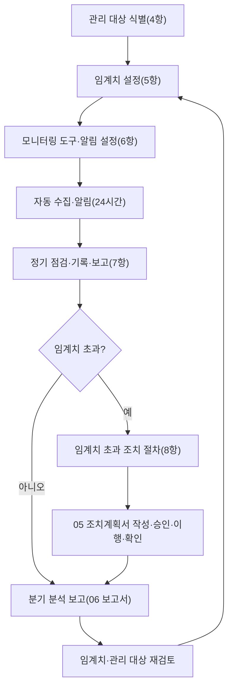

---
tags:
  - CSAP
  - 양식
  - 하등급SaaS
  - 관리적보호조치
control: 6.2.1 성능 및 용량 관리
section: 6.2 서비스 가용성
doc_type: 작성본
evidence: 모니터링 절차서
문서 양식 번호: LS-6.2.1-02
문서 양식 버전: 0.0.1
문서번호: JAS-6.2.1-02
문서 버전: 1.0
상태: 작성완료
작성일: 2026-10-20
---

> [!note] 근거
> [해설서/하등급-SaaS/6.2.1 성능 및 용량 관리](../../../../../../projects/jeju-ai/docs/CSAP/해설서/하등급-SaaS/01.%20관리적%20보호%20조치/6.2.1%20성능%20및%20용량%20관리.md)

> [!note] 현 구현과 차이
> 본 절차서는 운영 타깃(NCP 공공기관용 NKS · Cloud DB for PostgreSQL · Object Storage)의 목표 상태 절차다. 2026-10-20 현재 6항의 모니터링 도구(NCP Cloud Insight, 클러스터 metrics-server/Prometheus, NCP Cloud Log Analytics, 외부 상태 확인)는 도입 전이며, api 는 요청 로그를 표준 출력으로만 남긴다. 현재 운영 중인 성능 확인 수단은 야간 부하 시험(k6, 매일 03:00 · 04:00 KST, `nightly.yml`)뿐이다. 7항 이후의 점검·기록은 운영 환경 구축과 모니터링 도구 설정이 끝난 날부터 시행한다.

# 성능 및 용량 모니터링 절차서

| 문서번호 | 버전 | 작성일 | 작성자 | 검토자 | 승인자 | 시행일 |
| --- | --- | --- | --- | --- | --- | --- |
| JAS-6.2.1-02 | 1.0 | 2026-10-20 | {{정보보호 관리자 성명}} | {{정보보호 담당자 성명}} | {{개발 책임자 성명}}(성능·용량 관리 책임자) | {{승인일}} |

> [!info] 법령 기준
> 8.4항의 서비스 중단 기간 기준은 클라우드컴퓨팅 발전 및 이용자 보호에 관한 법률 시행령 제16조(대통령령 제35947호, 2026. 1. 2. 시행)를 기준으로 작성했다. 법령이 개정되면 국가법령정보센터에서 조문을 다시 확인한다.

## 1. 목적

본 절차서는 01. 성능 및 용량 관리 지침에서 정한 요구사항에 따라 지반침하 스마트관리 시스템(이하 "JAS") 운영환경의 성능·용량을 지속적으로 모니터링하고, 결과를 기록·보고하며, 임계치 초과 시 조치하는 방법과 순서를 정한다.

## 2. 적용 범위

- 양식 03. 모니터링 대상 및 임계치 현황에 등재된 모든 관리 대상과 지표
- 성능·용량 관리 담당자(운영(인프라) 담당자)·책임자(개발 책임자), 정보보호 관리자, 알림을 수신하는 개발·운영 담당자

## 3. 절차 개요

## 4. 관리 대상 식별 절차

### 4.1 식별 기준

| 구분 | 식별 기준 | JAS 해당 자원 | 기본 지표 |
| --- | --- | --- | --- |
| 컴퓨팅 | 서비스 요청을 처리하는 가상 서버·컨테이너 | NKS 워커 노드 풀, web · api · pipeline 파드 | 노드 CPU·메모리·디스크 사용률, NIC 대역폭, 파드 CPU·메모리(상한 대비), 파드 재시작 수 |
| DB | 서비스 데이터를 저장·처리하는 관리형 DB·자체 운영 DB | Cloud DB for PostgreSQL(PostGIS) | CPU, 메모리, 스토리지 여유, 연결 수, 느린 쿼리 수 |
| 스토리지 | 파일·객체·백업 데이터를 저장하는 자원 | Object Storage 버킷(`orgs/` · `raw/` · `datasets/` · `exports/` · `incidents/uploads/` · `backups/`), pipeline 작업 디스크(emptyDir), 로그 저장소 | 사용량, 증가율, 여유율 |
| 네트워크 | 외부·내부 트래픽이 지나는 자원 | NCP Load Balancer, NKS Ingress 컨트롤러, NAT 게이트웨이, 관리용 VPN | 처리량(대역폭), 활성 연결 수, 요청 수, 오류 응답 수 |
| PaaS 서비스·서비스 한도 | 제공자가 계정·리전 단위로 상한을 두는 항목 | 서버(노드) 수·vCPU 총량, 공인 IP 수, 블록 스토리지 총량, DB 인스턴스 수, Object Storage 버킷 수 | 한도 대비 사용률 |
| 응용 프로그램 | 이용자가 체감하는 성능 지표 | web 화면 경로, api 주요 경로, `jobs` 작업 표, 데이터셋 빌드 | 응답시간(P95), 처리량, 오류율, 작업 적체 수·최장 대기 시간, 빌드 완료 시간 |
| 이용 규모 | 성장에 따라 용량 수요를 결정하는 값 | 이용 기관 수, 활성 이용자 수, 저장 데이터량(번들·내보내기·업로드), 월 요청 수 | 월 증가율 |

### 4.2 식별 절차

1. 담당자는 인증 범위 정보자산 목록과 서비스 구성도에서 4.1의 기준에 해당하는 자원을 모두 추출한다. Helm chart values(복제 수·requests/limits)와 NCP 콘솔 자원 목록을 함께 본다.
2. 추출한 자원마다 지표, 측정 도구, 담당자를 정하여 03 현황 3항에 등재한다. 제공자 책임 계층은 03 현황 5항에 제외 사유를 기록한다.
3. 변경 관리 절차로 자원이 생성·변경·삭제되면 5영업일 이내에 03 현황을 갱신하고, 모니터링 도구에 수집·알림 규칙을 추가·삭제한다.
4. 분기 1회 NCP 콘솔의 자원 목록과 `kubectl get` 으로 조회한 워크로드 목록을 03 현황과 대조하여 누락된 자원이 없는지 확인하고 결과를 03 현황 6항에 기록한다.

## 5. 임계치 설정 절차

### 5.1 임계치 단계

| 단계 | 기본값(사용률 지표) | 의미 | 알림 대상 | 대응 시한 |
| --- | --- | --- | --- | --- |
| 주의 | 70% 이상이 10분 이상 지속 | 평시 상한 근접(공통 기준의 "경고" 70%). 추이 관찰 대상 | 담당자 | 다음 일일 점검 시 확인·기록 |
| 경고 | 85% 이상이 5분 이상 지속 | 피크 상한 도달(공통 기준의 "조치" 85%). 증설 검토 필요 | 담당자, 대체자 | 4시간 이내 초동 확인, 5영업일 이내 조치계획서 |
| 위험 | 95% 이상이 5분 이상 지속, 또는 서비스 영향 발생 | 서비스 저하·중단 임박 | 담당자, 대체자, 책임자 | 즉시 초동 조치, 책임자 즉시 보고 |

- 응답시간은 01 지침 6.2항의 요구사항(web 500ms · api 300ms)을 주의, 요구사항의 2배를 경고, 3배를 위험 임계치로 한다. 5xx 오류율은 0.5% 주의, 1%(요구사항) 경고, 5% 위험으로 한다.
- 스토리지·서비스 한도처럼 증설에 리드타임이 있는 지표는 리드타임 동안의 예상 증가량을 반영하여 임계치를 낮게 정한다.

### 5.2 설정·변경 절차

1. 담당자는 최근 3개월 사용률 추이(운영 개시 후 3개월 전까지는 운영 전 부하 시험 결과와 설계 기준값), 01 지침 6항의 요구사항, 증설 리드타임을 근거로 지표별 임계치 안을 작성하고 근거를 03 현황에 기록한다.
2. 책임자가 임계치를 승인하면 담당자는 모니터링 도구의 알림 규칙을 동일하게 설정하고 03 현황 6항의 대조 표를 갱신한다.
3. 임계치 변경은 05 조치계획서의 재발 방지 항목 또는 06 보고서의 적정성 검토 결과를 근거로 하며, 임계치를 높이는 변경은 반드시 근거 자료를 첨부하고 책임자 승인을 받는다. 야간 k6 임계값(`thresholds`)을 바꾸는 경우도 같은 절차를 따르고, 변경은 PR 리뷰를 거친다.

## 6. 모니터링 방법

### 6.1 모니터링 도구

| 도구 | 수집 대상 | 수집 주기 | 보존 기간 | 관리자 | 접근 권한자 |
| --- | --- | --- | --- | --- | --- |
| NCP Cloud Insight | NKS 노드·Cloud DB·Object Storage·Load Balancer·NAT 지표, 서비스 한도 | 1분 | 13개월(도구 보존 기간이 짧으면 월간 리포트 내보내기) | 운영(인프라) 담당자 | 운영(인프라) 담당자, 개발 책임자, 정보보호 관리자(조회) |
| 클러스터 metrics-server · Prometheus | 파드 CPU·메모리(상한 대비), 재시작 수, 노드 할당 가능량, pipeline 작업 디스크 사용량 | 1분 | 13개월 | 운영(인프라) 담당자 | 운영(인프라) 담당자, 개발 담당(조회) |
| NCP Cloud Log Analytics(또는 Object Storage 별도 버킷 + 집계) | api 요청 로그(응답시간 `responseTime`, 상태 코드, request_id), nginx 접근 로그, DB 느린 쿼리 로그 | 실시간 | 1년(애플리케이션 일반 로그, 공통 기준 §3.2) | 운영(인프라) 담당자 | 운영(인프라) 담당자, 개발 담당, 정보보호 담당자 |
| 외부 상태 확인(합성 모니터링) | 서비스 주소 `/` 와 `/api/health` 의 접속 가능 여부·응답시간(가용률 산정) | 1분 | 13개월 | 운영(인프라) 담당자 | 운영(인프라) 담당자, 개발 책임자 |
| `jobs` 표 조회(작업 적체) · 야간 k6 | 대기·실행 작업 수, 최장 대기 시간, 빌드 완료 시간 / 운영 전 응답시간·처리량 시험 | 작업 단위 · 매일 1회 | 3년(작업 표) · 30일(k6 아티팩트, 요약은 06 보고서로 옮김) | 개발 담당 | 개발 담당, 운영(인프라) 담당자 |

- 외부 상태 확인 도구는 운영 환경 구축 시 NCP 공공 리전에서 제공하는 서비스 또는 사외 합성 모니터링 중에서 선정하고, 선정 결과를 03 현황 1항에 기록한다.
- 모니터링 도구의 관리자 권한 보유자는 2.1.2 주요 직무자 목록에 등재한다.
- 원본 지표의 보존 기간이 01 지침 8.6항보다 짧으면 월간 리포트를 내보내 보관한다.

### 6.2 알림 설정

| 항목 | 설정 |
| --- | --- |
| 알림 채널 | NCP Cloud Insight 알림(이메일), 사내 업무 메신저의 운영 알림 채널, 위험 단계는 SMS 추가 |
| 수신자 | 01 지침 7.1항의 담당자(주·부), 위험 단계는 책임자 포함 |
| 알림 규칙 | 03 현황의 지표·임계치·지속 조건과 동일하게 설정한다. 규칙 이름에 03 현황의 No를 포함한다(예: `JAS03-001-cpu`). |
| 알림 억제 | 계획 점검 시간에는 억제할 수 있으나, 억제 기간과 사유를 04 점검 기록 5항에 기록한다. |
| 알림 확인 | 수신자는 알림을 확인하면 채널에 확인 표시를 남기고, 04 점검 기록 4항에 처리 결과를 기록한다. |
| 수신자 변경 | 담당자·책임자 변경일에 즉시 변경한다. |

### 6.3 대시보드

- 관리 대상 전체의 현재 값과 임계치 대비 상태를 한 화면에서 확인할 수 있는 대시보드를 NCP Cloud Insight에 `JAS-성능용량` 이름으로 구성한다. 접속 주소는 구축 후 03 현황 1항에 기록한다.
- 대시보드에는 03 현황과 같은 구분(컴퓨팅, DB, 스토리지, 네트워크, 서비스 한도, 응용 프로그램)으로 패널을 배치한다. 파드 지표와 응용 프로그램 응답시간은 클러스터 Prometheus·로그 집계 화면을 같은 대시보드에서 연결한다.

## 7. 정기 점검·기록·보고 절차

### 7.1 점검 주기와 내용

| 구분 | 주기 | 점검 내용 | 기록 | 보고 |
| --- | --- | --- | --- | --- |
| 상시 | 알림 발생 시 | 알림 확인, 오탐·일시적 초과·지속 초과 판별 | 04 점검 기록 4항 | 경고 이상은 채널에 상황 공유 |
| 일일 | 매 영업일 10:00까지 | 대시보드로 관리 대상 전체 상태 확인, 전일 알림 처리 상태, 주의 이상 지표의 값, 백업·로그 저장 공간, 데이터셋 빌드·`pg_dump` CronJob 완료 여부 | 04 점검 기록 2항 | 이상 시 책임자 보고 |
| 주간 | 매주 월요일 | 지표별 주간 추이(전주 대비), 경고 임계치의 10% 이내로 근접한 항목, 이용 규모 증가율, 진행 중인 조치계획서 상태, 직전 주 야간 k6 결과 | 04 점검 기록 3항 | 책임자 주간 공유 |
| 월간 | 매월 5영업일 이내 | 월간 추이, 임계치 초과·조치 현황, 서비스 한도 사용률 확인(공통 기준 §3.5 "월 1회 점검") | 04 점검 기록 6항(월간 요약) | 책임자 검토 |
| 분기 | 분기 종료 후 10영업일 이내 | 분기 추이 분석, 용량 예측·증설 계획, 임계치 적정성 검토, 절차 이행 점검(10항) | 06 보고서 | 책임자 검토, 정보보호 최고책임자 승인 |
| 수시 | 신규 이용 기관 온보딩, 대규모 기능 배포, 대용량 원본 자료 반입 전 | 예상 부하 대비 여유 용량 확인, 사전 증설 필요 여부 | 04 점검 기록 3항 비고 | 책임자 보고 |

### 7.2 기록 규칙

1. 점검 결과는 이상이 없어도 점검 일시, 점검자, 확인한 지표의 값과 상태를 04 점검 기록에 남긴다. "특이사항 없음"만 적지 않는다.
2. 대시보드 화면 캡처 또는 도구의 일일 리포트를 증적으로 저장하고 보관 위치를 04 점검 기록에 적는다. 파일명은 `6.2.1_<No>_JAS_<YYYYMMDD>` 로 한다.
3. 점검이 정한 시각을 넘기거나 수행되지 않으면 사유와 보완 점검 일시를 04 점검 기록 5항에 기록한다. 담당자(주) 부재 시 담당자(부)가 점검한다.
4. 임계치 초과가 확인되면 04 점검 기록에 05 조치계획서 번호를 연결한다.

### 7.3 보고 규칙

| 상황 | 보고자 | 보고 대상 | 시한 | 방법 |
| --- | --- | --- | --- | --- |
| 일일·주간 점검 이상 | 담당자 | 책임자 | 점검 당일 | 채널 또는 메일, 04 기록 첨부 |
| 위험 단계 초과, 서비스 영향 | 담당자 | 책임자 즉시, 정보보호 최고책임자 2시간 이내 | 인지 즉시 | 전화·채널, 이후 05 조치계획서 |
| 분기 분석 | 담당자 | 책임자, 정보보호 최고책임자 | 분기 종료 후 10영업일 이내 | 06 보고서 |
| 증설 예산 필요 | 책임자 | 정보보호 최고책임자, 최고경영자 | 06 보고서 확정 시 | 06 보고서 10항 |

## 8. 임계치 초과 시 조치 절차

### 8.1 단계별 절차

| 단계 | 시한 | 담당 | 내용 | 기록 |
| --- | --- | --- | --- | --- |
| 1. 인지 | 알림 수신 또는 점검 시 | 담당자 | 알림·점검으로 임계치 초과 인지, 채널에 확인 표시 | 04 기록 4항 |
| 2. 초동 확인 | 경고 4시간, 위험 즉시 | 담당자 | 오탐 여부, 지속 시간, 영향 범위(기능·이용 기관), 서비스 중단 여부 확인 | 05 조치계획서 1항 |
| 3. 분류 | 초동 확인 시 | 담당자 | 일시적 초과(해소됨) / 지속적 초과 / 급증. 비정상 트래픽·공격 의심이면 5.1.1 침해사고 대응 절차로 전환, 서비스 중단이면 6.1.2 장애 대응 절차 병행 | 05 조치계획서 1항 |
| 4. 긴급 조치 | 위험 단계 즉시 | 담당자 | 파드 복제 수 증가(`kubectl scale` 또는 values 변경), 자원 상한 조정, NKS 노드 추가, Ingress rate limit 강화, 진행 중인 데이터셋 빌드 중지, 불필요 데이터 정리 등 서비스 유지를 위한 즉시 조치 | 05 조치계획서 2항 |
| 5. 원인 검토 | 5영업일 이내 | 담당자, 개발 담당 | 이용 규모 증가, 일시적 피크, 응용 결함, 구성 오류, 제공자 이슈, 임계치 부적정 등 원인 분류와 근거 분석 | 05 조치계획서 3항 |
| 6. 조치계획 수립 | 원인 검토 후 5영업일 이내 | 담당자 | 8.2항의 표준 조치 방안 중 대안 비교, 비용·소요 시간·위험 검토, 계획 작성 | 05 조치계획서 4·5항 |
| 7. 승인 | 계획 수립 후 3영업일 이내 | 책임자, 정보보호 최고책임자 | 책임자 승인. 월 비용 증가 100만 원 이상 또는 서비스 영향이 있으면 정보보호 최고책임자 승인 | 05 조치계획서 6항 |
| 8. 이행 | 승인된 일정 | 담당자 | 변경 관리 절차(PR 리뷰, Helm values 변경, 운영 배포 수동 승인)에 따라 이행, 공공기관용 영역·국내 리전 확인, 롤백 계획 준비 | 05 조치계획서 7항, 변경 관리 기록 |
| 9. 결과 확인 | 이행 후 7일 관찰 | 담당자 | 지표가 주의 단계 이하로 안정되었는지 확인, 잔여 위험 기록 | 05 조치계획서 7항 |
| 10. 보고·종결 | 결과 확인 후 | 담당자, 책임자 | 책임자 보고, 종결 승인, 06 보고서 반영 | 05 조치계획서 9항 |
| 11. 재발 방지 | 종결 시 | 담당자 | 임계치 조정(03 현황 갱신), 용량 계획 반영, 알림 규칙 변경, 근본 원인 개선 과제 등록 | 05 조치계획서 8항 |

- 일시적 초과로 자동 해소된 건도 4항 알림 이력에 처리 결과를 기록하고, 같은 대상에서 월 3회 이상 반복되면 지속적 초과로 보아 05 조치계획서를 작성한다.
- 자동 확장(HPA 활성 후)으로 해소된 건은 자동 확장 범위(최대 복제 수)와 노드 풀 여유, 비용 상한의 적정성을 함께 검토한다.

### 8.2 표준 조치 방안

| 자원 구분 | 조치 방안 | 승인 | 제약·확인 사항 |
| --- | --- | --- | --- |
| 컴퓨팅 | 파드 requests/limits 상향, 복제 수 증가(스케일아웃), HPA 최대치·정책 조정, NKS 노드 유형 상향(스케일업)·노드 추가 | 책임자, 예산 초과 시 CISO | 공공기관용 영역·국내 리전 안에서 생성(14.2.1), 복제 수 2·PDB 유지(14.2.2), PSA `restricted` 등 보안 설정 유지, 변경 관리 |
| 네트워크 대역폭 | NCP Load Balancer 처리 용량 상향, 노드 유형 상향으로 NIC 대역폭 증설, NAT 게이트웨이 용량 확인, 정적 자원 캐시(`immutable`) 적용 확인 | 책임자 | 제공자 리드타임 확인, ACG·NetworkPolicy 규칙 변경 시 승인 |
| 스토리지 | Object Storage 사용량 정리(만료된 내보내기·임시 업로드 삭제), 번들 gzip 저장 확인, pipeline 작업 디스크 상향, 로그 보존 정책 조정 | 책임자 | 데이터 폐기는 12.1.6 절차 준수, 백업(`backups/`) 용량 함께 확인, 감사 기록은 보존 기간(3년) 이전 삭제 금지 |
| DB | Cloud DB 인스턴스 사양 상향, 스토리지 증설, 연결 풀 조정, 인덱스·쿼리 튜닝, 읽기 부하 증가 시 읽기 전용 복제본 검토 | 책임자 | 작업 시간대 서비스 영향(재시작), 관리형 백업 상태 확인 |
| 서비스 한도 | NCP에 한도 상향 요청 | 책임자 | 리드타임 5영업일, 요청·승인 기록 보관 |
| 응용 프로그램 | 캐시 헤더·ETag 적용 범위 확대, 파일 중계 스트리밍 확인, 데이터셋 사전 계산, pipeline 메모리 사용 개선, 코드 최적화 | 개발 담당, 책임자 | 13.2.1 구현 및 시험 절차(push 게이트 CI 통과)에 따라 시험 후 배포 |
| 이용 규모 | 신규 이용 기관 온보딩 일정 조정, 이용 기관과 사용량 협의 | 책임자, 서비스 담당 | 이용 기관 안내 |

### 8.3 에스컬레이션

| 조건 | 보고 대상 | 시점 |
| --- | --- | --- |
| 경고 단계 초과가 24시간 이상 지속 | 책임자 | 지속 확인 시 |
| 위험 단계 초과 | 책임자, 정보보호 최고책임자 | 즉시 / 2시간 이내 |
| 서비스 저하가 이용 기관에 인지될 수준 | 책임자, 정보보호 최고책임자, 서비스 담당 | 즉시 |
| 서비스 중단 발생 | 6.1.2 장애 대응 절차의 보고 체계(1급 즉시·30분 내 1차 보고) | 즉시 |
| 조치계획서 기한 초과 | 책임자 | 기한 도래 시 |

### 8.4 서비스 중단 연계

임계치 초과로 서비스가 중단되면 6.1.2 장애 대응 매뉴얼 및 절차를 즉시 병행한다. 다음 어느 하나에 해당하면 장애 대응 절차에 따라 이용자 통지 대상이 되므로, 담당자는 중단 시작·종료 시각을 05 조치계획서 1항에 정확히 기록한다.

1. 클라우드컴퓨팅서비스의 중단 기간이 연속해서 10분 이상인 경우
2. 중단 사고가 발생한 때부터 24시간 이내에 서비스가 2회 이상 중단된 경우로서 그 중단된 기간을 합하여 15분 이상인 경우

## 9. 기록 및 보관

| 기록 | 양식 | 작성 단위 | 보관 기간 | 보관 위치 |
| --- | --- | --- | --- | --- |
| 관리 대상·임계치 현황 | 양식 03 | 버전 | 3년(모든 버전) | `CSAP-인증준비/30 증적/6.2.1/03/` |
| 점검 기록·알림 이력 | 양식 04 | 월 | 3년 | `CSAP-인증준비/30 증적/6.2.1/04/` |
| 임계치 초과 조치계획서 | 양식 05 | 건 | 3년 | `CSAP-인증준비/30 증적/6.2.1/05/` |
| 성능·용량 분석 보고서 | 양식 06 | 분기 | 3년 | `CSAP-인증준비/30 증적/6.2.1/06/` |
| 대시보드 캡처·도구 리포트 | 이미지·PDF | 일·월 | 1년 이상 | `CSAP-인증준비/30 증적/6.2.1/캡처/` |
| 알림 규칙 설정 내보내기 | 도구 내보내기 파일 | 변경 시 | 3년 | `CSAP-인증준비/30 증적/6.2.1/알림규칙/` |

## 10. 절차 이행 점검

정보보호 관리자는 분기 1회 다음을 점검하고 결과를 06 보고서 9항에 반영한다.

| 점검 항목 | 확인 방법 | 결과 |
| --- | --- | --- |
| 03 현황의 관리 대상이 NCP 콘솔 자원 목록·클러스터 워크로드 목록과 일치한다 | 콘솔 자원 목록, `kubectl get` 결과 대조 | 06 보고서 9항에 기록(일치 / 차이 n건) |
| 03 현황의 임계치가 모니터링 도구 알림 규칙과 일치한다 | 알림 규칙 내보내기 대조 | 06 보고서 9항에 기록 |
| 일일·주간 점검이 정한 주기대로 수행·기록되었다 | 04 기록의 대상일수 대비 수행일수 | 06 보고서 9항에 기록(수행/대상) |
| 경고 이상 알림마다 처리 결과가 기록되었다 | 04 기록 4항 | 06 보고서 9항에 기록 |
| 지속적 초과 건마다 05 조치계획서가 작성되고 승인·이행·종결되었다 | 04 기록 4항과 05 문서번호 대조 | 06 보고서 9항에 기록 |
| 분기 06 보고서가 승인되었다 | 06 보고서 승인란 | 06 보고서 9항에 기록 |
| 알림 수신자가 현 담당자·책임자와 일치한다 | 도구 수신자 설정 | 06 보고서 9항에 기록 |

## 11. 관련 문서

- 양식 01. 성능 및 용량 관리 지침
- 양식 03. 모니터링 대상 및 임계치 현황
- 양식 04. 성능 및 용량 모니터링 점검 기록
- 양식 05. 임계치 초과 시 조치계획서
- 양식 06. 성능·용량 분석 보고서
- 변경 관리 절차, 5.1.1 침해사고 대응 절차, 6.1.2 장애 대응 매뉴얼 및 절차
- 야간 부하 시험: `jeju-ai-saas-be/api/test/k6/api.js`, `jeju-ai-saas-fe/e2e/k6/web.js`, 각 저장소 `.github/workflows/nightly.yml`

## 12. 승인

| 구분 | 직위 | 성명 | 서명 | 일자 |
| --- | --- | --- | --- | --- |
| 작성(성능·용량 관리 담당자) | {{직위}} | {{운영(인프라) 담당자 성명}} | | |
| 검토(정보보호 관리자) | {{직위}} | {{정보보호 관리자 성명}} | | |
| 승인(성능·용량 관리 책임자) | {{직위}} | {{개발 책임자 성명}} | | {{승인일}} |

## 13. 개정 이력

| 버전 | 일자 | 변경 내용 | 작성자 | 승인자 |
| --- | --- | --- | --- | --- |
| 1.0 | 2026-10-20 | 최초 제정 | {{정보보호 관리자 성명}} | {{개발 책임자 성명}} |
