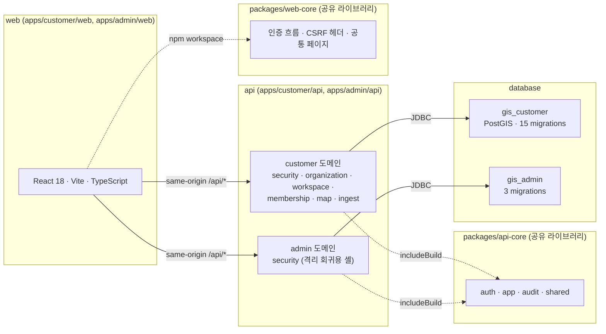
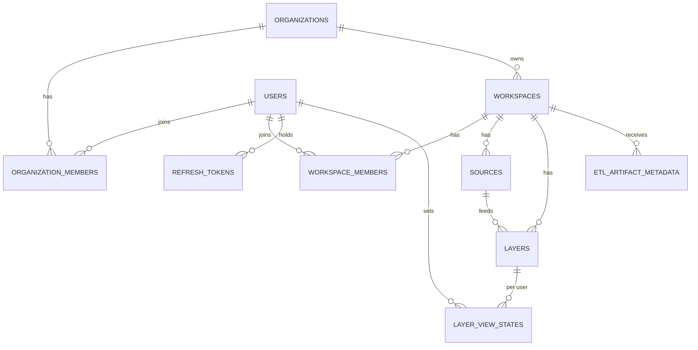

# 기술 설계 문서

| 항목 | 내용 |
| --- | --- |
| 문서번호 | JSA-PF-DS-002 |
| 시스템 | 지반침하 스마트 관리 시스템(통합플랫폼) |
| 분류 | 설계 |
| 버전 | V0.1 |
| 작성일 | 2026-10-16 |
| 작성자 | 개발팀 |
| 승인자 | 박가람 |

## 제·개정 이력

| 버전 | 날짜 | 변경 내용 | 작성자 | 승인자 |
| --- | --- | --- | --- | --- |
| 0.1 | 2026-10-16 | 최초 작성 | 개발팀 | 박가람 |

통합플랫폼 저장소(`gis-sass`) 2026-10-16 상태의 기술 설계를 한 문서로 정리했다. 구조와 근거의 단일 출처는 서버 및 인프라 아키텍처 설계서(v0.8)와 ADR 이다.

**현재 단계**: 제주 지반침하 프로토타입(`Jeju-subsidence-AI`) 분석 및 통합플랫폼과의 결합 방식 검토 중이다. 결합 방식(서비스 구성·배치·데이터 소유)은 미결정이므로 이 문서는 **현재 확정된 통합플랫폼 설계**를 적고, 결합과 관련된 결정 사항은 8절(열린 질문)에 모은다.

## 1. 배경과 목표

- 배경: 「2026년 AI기반 위성정보 활용 서비스 확산사업」 세세부3(지반침하 스마트 관리 시스템 통합플랫폼 구축) 중 개발팀 담당 범위는 WBS ID 2–8(통합 분석 엔진 서버 구축 및 인프라 설계, 2026-08-03–11-27)과 ID 32–35(CSAP 인증 신청, 2026-11-02–12-31)다. 통합플랫폼은 인증·권한·지도 소스·타일 프록시를 구현한 상태에서 클러스터로 나가는 길(컨테이너 배포·이중화), 다른 세세부의 산출물을 받는 길(ETL 수신), 이를 설명하는 설계서를 보강하는 단계다.
- 목표:
  1. customer·admin 두 제품의 인증·권한 기반을 제공한다(서명키와 데이터베이스는 제품별 분리).
  2. 워크스페이스 단위로 지도 소스와 레이어를 관리하고, 외부 타일은 서버가 대신 호출한다(SSRF 방어).
  3. 세세부1·2 산출물 수신을 위한 범용 골격(메타데이터 등록·멱등·버전 관리)을 갖춘다.
  4. 컨테이너 기반 배포(Helm), 다중 인스턴스·무중단 배포를 구성하고 검증한다.
  5. SaaS 확산을 고려한 보안·접근제어를 기본으로 하고 CSAP 인증 신청에 필요한 자료를 준비한다.
- 비목표:
  - WBS ID 9–28(인메모리 연산 엔진, HITL 분석 알고리즘, UI/UX 고도화)은 담당 조직이 AI(ID 9–24)·기획(ID 25–28)이라 개발팀 범위 밖이다. ID 29–31(분석 리포트 자동 구현: 분석보고서 PDF 생성·Excel 다운로드)은 이 문서의 설계 대상이 아니다. 프로토타입이 보여 주는 분석·화면·리포트 모듈과 통합플랫폼의 결합 범위·담당은 검토 중이다(8절).
  - 세세부1·2 의 ETL 파이프라인 자체(우리는 수신 쪽 인터페이스만 만든다).
  - 마이크로서비스 전면 분해 실행(서비스 단위 도출과 설계까지만 다루며 분해 여부와 근거는 ADR 로 확정했다).
  - ISMS-P 인증, CSAP 심사 대응과 취득(신청 자료 제출까지가 과업).

## 2. 설계 개요

web·api·database 의 경계는 코드와 모듈 의존으로 유지하고, customer·admin 두 제품이 함께 쓰는 공유 패키지는 `packages/api-core`(API)와 `packages/web-core`(web) 두 개뿐이다. 현재 구조는 **모듈러 모놀리식**이며, 부하·장애 특성이 다른 타일 프록시와 ETL 수신만 분리 후보로 결정했다(ADR-2026-08-26.01).

핵심 설계 결정:

- **제품 분리**: customer 와 admin 은 DB·JWT 서명키·호스트를 분리한다. 릴리스는 당분간 공통 `vX.Y.Z` 태그·단일 chart 로 두 제품이 같은 버전으로 나간다(2026-10-14 확정, 서버 및 인프라 아키텍처 설계서 3.1.2 결정 D. admin 이 독립 기능을 갖는 시점에 ADR 로 재결정). admin 은 customer 데이터에 API 로만 접근하도록 설계했다(ADR-2026-08-11.05).
- **코드 공유**: 인증·감사·응답 형식은 `api-core`(Gradle 컴포지트 빌드)와 `web-core`(npm 워크스페이스)로 공유한다. 결정만 공유하고 서명키·DB 는 공유하지 않는다.
- **단일 오리진**: 브라우저는 같은 오리진의 `/api/*` 만 호출한다. 외부 타일을 브라우저가 직접 부르지 않는다(SSRF 방어의 전제).
- **서버가 외부를 대신 호출**: 외부 타일은 서버의 프록시가 받아 오며, 사설 대역 차단·타임아웃·응답 크기 상한·인증키 서버 보관을 적용한다.
- **권한 모델**: 조직 + 워크스페이스 2층 멤버십. 조직 OWNER·ADMIN 은 모든 워크스페이스의 ADMIN 을 상속하고, 조직 역할은 워크스페이스 역할의 상한이 아니다. 비멤버에게는 403 이 아니라 404 를 준다.
- **게이트웨이**: Ingress 단독(별도 게이트웨이 제품을 두지 않음). Kafka·Keycloak 은 도입하지 않고, 같은 비동기 흐름을 DB 작업 테이블 + 잡 러너로 구현하는 방향이다.
- **배포**: 벤더 중립 Helm chart 하나, 환경별 values, 같은 이미지의 digest 승격(설계 원칙). 환경은 로컬 k3s → 사내 k8s(`dev0`) → NCP NKS 3단이다. 로컬은 개발자 PC 의 k3d 단일 노드 `gis-local` 이다(설계서 3.1.1).

## 3. 상세 설계

### 3.1 컴포넌트

| 구성 | 위치 | 책임 |
| --- | --- | --- |
| api-core | `packages/api-core` | 인증(JWT 필터·서비스·rate limit), 앱 설정 검증(DB TLS), 감사 로그, 응답 envelope·오류 코드·`request_id`·CSRF. 배포 단위 아님 |
| customer-api | `apps/customer/api` | 도메인 6개 — security, organization, workspace, membership, map(소스·레이어·표시 상태·타일 프록시·WMTS Capabilities), ingest(ETL 수신 골격) |
| admin-api | `apps/admin/api` | 관리자 인증(security 셸). 운영자 전용 요구가 생기면 도메인이 갈라진다 |
| customer-web·admin-web | `apps/*/web` | React SPA. TanStack Query·Zustand·MapLibre(customer), Vitest·Playwright 로 시험 |
| web-core | `packages/web-core` | web 공통(인증 흐름, CSRF 헤더, 로그인·404 페이지, 테스트 설정). 빌드 없는 소스 패키지 |
| database | `apps/*/database` | Laravel database 컴포넌트(PHP 8.4 이미지 `php:8.4-cli-bookworm`)로 마이그레이션·시드를 실행하는 독립 이미지 |
| 배포 chart | `deploy/charts/gis` | Deployment 7단위(활성 4: customer-api·web, admin-api·web / 비활성 3: tile-proxy·ingest-api·ingest-job-runner), 마이그레이션 Job 2개, Ingress, NetworkPolicy, Secret |
| CI | `.github/workflows`, `dagger/` | 테스트·배포물 검증·이미지 푸시. 단위 테스트·web·사본 감시 7개 잡(api-core·customer-api·admin-api·web-core·customer-web·admin-web·web-copies)은 본문이 Dagger 함수라 로컬과 같은 컨테이너에서 재현한다. 통합 테스트 2개·docs·deps-audit 는 러너에서 직접 실행하고, 이미지 빌드·마이그레이션 왕복·chart 검증은 `docker/build-push-action` 과 `scripts/ci/*.sh` 로, 이미지 푸시는 `build-push.yml` 로 돈다 |

### 3.2 데이터 모델

customer database(`gis_customer`, PostgreSQL + PostGIS — 로컬 compose·테스트(Testcontainers)·CI 는 `postgis/postgis:16-3.4`)와 admin database(`gis_admin`, PostGIS 확장 없음)로 분리한다. 컬럼 표기는 `snake_case`, 열거형은 varchar + CHECK 로 저장한다(네이티브 enum 미사용).

| 테이블 | 주요 컬럼 | 제약·비고 |
| --- | --- | --- |
| `users`(customer·admin 각각) | `username`(유일), `password`(해시), `failed_attempts`, `locked_until` | 이름·이메일·전화번호 컬럼 없음. 5회 연속 실패 시 15분 잠금 |
| `refresh_tokens` | `user_id`, `token_hash`(유일), `expires_at`, `revoked_at`, `replaced_by`, `ip`, `user_agent` | 불투명 토큰의 해시만 저장. 회전·재사용 감지 |
| `organizations` | `name` | — |
| `organization_members` | `organization_id`, `user_id`, `role` | 역할 CHECK `OWNER`·`ADMIN`·`EDITOR`·`VIEWER`, (조직, 사용자) 유일 |
| `workspaces` | `organization_id`, `name` | (조직, 이름) 유일 |
| `workspace_members` | `workspace_id`, `user_id`, `role` | 역할 CHECK `ADMIN`·`EDITOR`·`VIEWER`(OWNER 없음), (워크스페이스, 사용자) 유일 |
| `sources` | `workspace_id`, `name`, `type`, `url`, `auth_type`, `auth_key_name`, `auth_secret`, `options`(jsonb) | `type` 7종(`XYZ`·`TMS`·`WMTS`·`TILEJSON`·`WMS`·`ARCGIS_MAPSERVER`·`GEOJSON`) CHECK, `auth_secret` 은 암호화 저장, 종류별 파라미터는 `options` 에 두고 서버가 검증 |
| `layers` | `workspace_id`, `source_id`, `name`, `display_order`, `opacity`, `options`(jsonb) | `opacity` 0–1 CHECK, (워크스페이스, 이름) 유일. `wms_layer_name` 은 `options` 로 이관됨 |
| `layer_view_states` | `user_id`, `layer_id`, `visible` | 표시/숨김은 개인 값(순서·투명도는 공유), (사용자, 레이어) 유일 |
| `etl_artifact_metadata` | `workspace_id`, `source_system`, `artifact_type`, `analysis_date`, `version`, `payload_hash`, `is_current`, `received_at` | `source_system` CHECK(`SUBSYSTEM_LANDSLIDE`·`SUBSYSTEM_INSAR`), 식별자(`source_system`·`artifact_type`·`analysis_date`·`version`) 전역 유일, SHA-256 해시 형식 CHECK. 메타데이터만 보관 |

저장 모델 원칙: 소스는 외부 연결 정보, 레이어는 화면 표시 모델, 수신 산출물은 한 번 도착하면 바뀌지 않는 버전 자산으로 생명주기가 달라 별도 도메인으로 둔다. 수신이 성공해도 지도에 자동으로 얹지 않는다.

### 3.3 API

모든 응답에 `X-Api-Version: 1` 헤더가 붙고(요청도 같은 헤더를 보낸다), 본문은 오류와 일반 성공 응답 모두 `code`·`message`·`result` envelope 이다(예외 둘: 타일 프록시 성공 응답은 원본 바이트, 로그아웃·`DELETE`·조직 탈퇴(`POST …/leave`)의 성공 `204` 는 본문 없음). JSON 필드는 `snake_case`, 쓰기 요청은 쿠키 인증과 함께 `X-XSRF-TOKEN` 헤더(CSRF double-submit)가 필요하다(`/api/auth/login`·`refresh`·`logout` 은 CSRF 검증 면제). 아래 `{ws}` 는 `/api/organizations/{organization_id}/workspaces/{workspace_id}` 이다.

| 영역 | 엔드포인트 | 권한 |
| --- | --- | --- |
| 인증 | `POST /api/auth/login` | 자격 증명(아이디·비밀번호). CSRF 검증 면제 |
| 인증 | `POST /api/auth/refresh`, `POST /api/auth/logout` | refresh 토큰(`refresh_token` 쿠키 또는 `Authorization: Bearer`). access 토큰 불필요, CSRF 검증 면제 |
| 인증 | `GET /api/auth/me` | 인증된 사용자(access 토큰) |
| 조직 | `GET·POST /api/organizations`, `GET /api/organizations/{organization_id}` | 인증된 사용자(자기 소속) / 생성자가 OWNER / 조직 멤버 |
| 조직 | `PATCH /api/organizations/{organization_id}`, `DELETE …`, `POST …/leave` | 조직 ADMIN 이상 / OWNER / 멤버 |
| 조직 멤버 | `GET·POST …/members`, `PATCH·DELETE …/members/{user_id}` | 조회는 조직 멤버, 변경은 조직 ADMIN 이상 |
| 워크스페이스 | `GET·POST /api/organizations/{organization_id}/workspaces`, `GET·PATCH·DELETE …/workspaces/{workspace_id}` | 조회 워크스페이스 VIEWER 이상(목록은 접근 가능한 것만), 생성 조직 ADMIN 이상, 수정·삭제 워크스페이스 ADMIN |
| 워크스페이스 멤버 | `GET·POST {ws}/members`, `PATCH·DELETE {ws}/members/{user_id}` | 조회 VIEWER 이상, 변경 워크스페이스 ADMIN |
| 지도 소스 | `GET·POST {ws}/sources`, `GET·PATCH·DELETE {ws}/sources/{source_id}`, `GET {ws}/sources/wmts-capabilities` | 조회 VIEWER 이상, 등록·수정·삭제·Capabilities 조회 EDITOR 이상 |
| 레이어 | `GET·POST {ws}/layers`, `PATCH·DELETE {ws}/layers/{layer_id}`, `PUT {ws}/layers/order` | 조회 VIEWER 이상, 변경·순서 EDITOR 이상 |
| 레이어 표시 상태 | `PUT {ws}/layers/{layer_id}/visibility` | VIEWER 이상(개인 값) |
| 타일 프록시 | `GET {ws}/sources/{source_id}/{xyz\|tms\|wmts\|tilejson}/{z}/{x}/{y}`, `GET …/{wms\|arcgis\|geojson}` | 소스가 속한 워크스페이스의 VIEWER 이상(권한 없으면 404) |
| ETL 수신 | `POST /api/ingest/artifacts`, `GET /api/ingest/artifacts/{artifact_id}`, `GET /api/ingest/artifacts?workspace_id={id}[&version={n}]` | 등록 워크스페이스 EDITOR 이상, 조회 멤버 |

ETL 수신 계약의 핵심: 수신 단위는 산출물 1개(분석 시점 1회분)이고 식별자는 `source_system`+`artifact_type`+`analysis_date`+`version` 이다. 같은 식별자·같은 워크스페이스·같은 해시의 재전송은 `200`(기존 메타 반환), 첫 등록은 `201`, 해시나 워크스페이스가 다르면 `409` 다. 식별자 그룹마다 가장 높은 version 한 행만 `is_current = true` 이며 이전 버전은 삭제하지 않는다. 실데이터 적재(어댑터)는 확인 질문 5건(파일 형식·좌표계, 1회 용량·갱신 주기, 전달 방식, 격자 체계, 인증·인가 경계)의 회신을 받은 뒤 구현한다.

주요 오류 코드(앞 3자리 = HTTP 상태): `400001` 요청 검증 실패, `400002` 사설 IP 소스 등록 거부(SSRF), `401001` 미인증, `403001` 권한 부족, `403003` 부여 역할이 자기 역할 초과, `404001` 없음·비멤버, `409001` 충돌(refresh 재사용·수신 식별자), `409002` 마지막 OWNER 변경 불가, `409004` 조직 OWNER·ADMIN 을 워크스페이스 멤버로 추가 불가. 코드표는 `api-core` 의 `ApiErrorCode` 가 제품 공통으로 관리하고 API 문서가 코드표를 둔다.

## 4. 보안·권한

- **인증**: JWT(HS256)를 쿠키로 전달한다. access 토큰 TTL 기본 900초, refresh 토큰은 불투명 값이며 DB 에 해시만 저장하고 회전·재사용 감지(409)를 한다. 쿠키 4종 중 `access_token`·`refresh_token` 만 `HttpOnly` 이고, 웹이 읽어야 하는 `session_hint`·`XSRF-TOKEN` 은 `HttpOnly` 가 아니다. 4종 모두 `SameSite=Lax`(기본값)이며 `Secure` 는 `AUTH_COOKIE_SECURE`(admin 은 `ADMIN_AUTH_COOKIE_SECURE`) 값을 따른다. CSRF 는 `XSRF-TOKEN` 쿠키 값을 `X-XSRF-TOKEN` 헤더로 되돌려 보내는 double-submit 토큰이다. 5회 연속 로그인 실패 시 15분 잠금(DB 기반이라 파드와 무관), login(IP+username 조합)·refresh(IP)에 분당 20회(기본값) rate limit 이 있고 넘으면 `429001` 을 준다. 로그인 실패 응답(`401001`)은 사용자 없음·비밀번호 오류·잠김을 구분하지 않으며 잔여 시도 횟수나 잠금 해제 시각을 싣지 않는다. 다만 이미 발급된 토큰을 가진 본인은 `/api/auth/refresh`·`/api/auth/me` 응답의 `result.user.is_locked`·`locked_until` 로 자기 계정의 잠금 상태를 볼 수 있다.
- **키 관리**: JWT 서명키는 Secret 으로 주입하고 customer·admin 별도다. `kid` 로 무중단 회전을 지원한다.
- **인가**: 조직 OWNER > ADMIN > EDITOR > VIEWER, 워크스페이스 ADMIN > EDITOR > VIEWER. 조작 규칙 — 부여 역할은 자기 역할 이하, 마지막 OWNER 는 강등·제거·탈퇴 불가(조직 행 잠금으로 동시성 보장), 조직 OWNER·ADMIN 은 워크스페이스 멤버로 추가 불가. 판정은 service 계층 가드에서만 하며, 인증 4개(`/api/auth/*`)를 뺀 customer API 엔드포인트 41개를 코드 점검(설계서 9.4)으로 전수 확인해 누락 0건이었다.
- **외부 호출 방어**: 타일 프록시는 등록 URL 의 해석된 IP 가 사설·루프백·링크로컬 등이면 거부하고(SSRF), 리다이렉트 금지·응답 크기 상한·`Content-Type` 허용 목록과 `nosniff`·CSP 헤더를 적용한다. 소스 인증키는 DB 에 암호화 저장하고 응답에는 존재 여부만 노출한다.
- **런타임·네트워크**: NetworkPolicy 기본 거부 + 최소 허용, chart 의 모든 파드에 PSA `restricted` 를 통과하는 보안 컨텍스트를 기본 적용, actuator 관리 포트 분리. API 의 DB 연결은 chart 기본값 `database.<제품>.sslMode: require` 로 TLS 를 요구한다. chart 는 `sslMode` 가 `require`·`verify-ca`·`verify-full` 일 때 `DB_REQUIRE_TLS=true` 를 주입하고, 이 플래그가 켜진 상태에서 URL 의 `sslmode` 가 `require` 미만이면 `DatabaseTlsValidator` 가 기동을 막는다.
- **감사·로그**: 권한 변경·삭제와 자원 변경 중 조직 생성·이름 변경, 워크스페이스 이름 변경, 소스·레이어 생성·수정, 수신 산출물 등록을 행위자·대상·변경 필드(소스·레이어 수정은 변경된 필드명)로 `audit` 로거에 기록한다. 비밀번호·토큰·소스 인증키의 원문은 로그 필드와 응답 본문에 싣지 않는다(토큰은 `Set-Cookie` 로만 전달). 필드 구조 검사(`AuthLogPrivacyTest`·`AuditLogPrivacyTest`·`SourceResponsePrivacyTest`)와 원문 부재 검사(`AuthResponseBodyNoTokenTest`·`SourceSecretLeakTest`·`SourceAuthUpdateTest`)로 확인한다. users 에는 이름·이메일·전화번호 컬럼이 없다. 감사 로그(`audit`)는 행위자를 `actor_user_id` 로 남기고, 인증 로그(`auth`)에는 로그인 이벤트마다 `username`·`ip` 가(성공 시 `user_agent` 도) 남는다. `username` 에 식별 가능한 값을 쓰지 않는 것은 운영 정책으로 정한다(ADR-2026-09-26.02 D1 조건).
- **갭과 보완**: 보안 갭 분석(설계서 9장) 14개 항목 중 로그 보존 기간·서비스 간 TLS·KMS 등은 CSAP 기준이 확정된 뒤에 처리가 정해진다. CSAP 는 하등급 SaaS(조건부), 인증 대상 customer+admin, 운영 타깃 NCP 공공기관용으로 결정했고(2026-10-14) 일정은 WBS ID 32–35 를 따른다.

## 5. 오류 처리·성능·확장성

- **오류 처리**: 실패는 예외로 전파하고 진입 경계의 공통 핸들러가 envelope 으로 변환한다. 도메인 예외는 HTTP 상태·응답 코드·메시지를 스스로 가진다. DB 제약 위반이 `500` 으로 나가지 않도록 서비스가 같은 규칙을 먼저 검증한다(예: ETL 산출물 유형 길이).
- **성능·자원**: 자원은 chart 기본 requests/limits 로 정하고 환경별 values(local·dev·prod)가 같은 값을 쓴다 — customer-api 요청 250m·512Mi/한도 1 CPU·1Gi, admin-api 100m·256Mi/500m·512Mi, 각 web 50m·64Mi/200m·128Mi. 이 값은 참고용 기준값이다(`deploy/README.md` 7.3, 설계서 6.5).
- **가용성**: 다중 인스턴스, 롤링 업데이트(`maxUnavailable: 0`), PDB, 프로브, preStop 지연. 파드 삭제·롤링 업데이트(`kubectl rollout restart`)·DB 일시 중단 시험은 로컬 k3d(`gis-local`)에서 통과했다.
- **확장성**: HPA 는 기준선 측정 뒤 활성화(기본 꺼짐). 분해 후보(타일 프록시·ETL 수신)의 재검토 트리거는 트래픽 1k RPS 초과, ETL 어댑터 5종 초과 등이다. 사내 개발·스테이지 클러스터 `dev0` 는 호스트 3대로 구성되어 있고, Multi-AZ 는 노드 zone 라벨과 운영 타깃 실측으로 판정한다.

## 6. 테스트 계획

JSA-PF-TS-001(테스트 전략·계획서)이 단일 출처다. 요약: 단위 테스트(JUnit 5, Vitest) 중심 + 핵심 경로 통합 테스트(Testcontainers PostGIS) + smoke(Bash) + customer web e2e(Playwright) + 배포물 검증(마이그레이션 왕복, helm lint·kubeconform) + 문서 린트·링크 검사 + 의존성 점검(CI `deps-audit` 는 npm 의존성을 점검한다 — 런타임 high·critical 은 차단하고 개발 의존성은 보고만 한다). 규칙은 given-when-then, 한국어 문장 이름, mock 은 외부 경계에만, 버그 수정 시 재현 테스트 필수다.

## 7. 일정·위험

| 항목 | 내용 | 대응 |
| --- | --- | --- |
| 일정 | WBS ID 2–8 2026-08-03–11-27, 산출물 서버 및 인프라 아키텍처 설계서 1식(현재 v0.8). WBS ID 32–35 2026-11-02–12-31(사업 종료일과 같은 날 끝나 종료일 쪽 여유가 없다). ID 2–8 종료(11-27)가 밀리면 ID 32–35 도 밀릴 수 있다 | 잔여 작업 완료 후 설계서 1.0 확정, 운영 타깃 공공 콘솔 실측을 10월 중 선행 |
| "MSA 기반"이라는 WBS 문구와 현재 구조(모듈러 모놀리식)의 차이 | 전면 분해는 인증 전파·트랜잭션 경계·운영 부담을 늘려 1인 운영 전제와 충돌 | ADR-2026-08-26.01 로 분해 여부와 근거를 확정(승인됨). 해석 분쟁 방지 |
| ETL 산출물 형식 미확정 | 세세부1·2 산출물 확인 질문 5건(파일 형식·좌표계, 1회 용량·갱신 주기, 전달 방식, 격자 체계, 인증·인가 경계)의 회신 대기(타 세세부 의존) | 범용 수신 골격 + 어댑터로 설계, 회신 전 실데이터 적재 구현 보류 |
| 운영 타깃이 인증 범위 밖이면 CSAP 신청 불성립 | 인증받은 IaaS 위의 SaaS 만 인정 | NCP 공공기관용으로 결정, 공공 콘솔 실측 5건(NKS Multi Zone·PostGIS·Ingress 방식·레지스트리·마이그레이션 공지) 확인 |
| 1인 운영과 CSAP 운영 통제의 충돌 | 책임자 지정·직무 분리·정기 점검·사고 대응 | 조직 차원 결정 필요 |
| 갭 보완이 기존 동작을 깨뜨릴 위험 | `api-core` 변경은 두 제품에 동시에 영향 | 보완 작업 완료 조건에 전체 회귀 포함 |
| 통제항목 기준 개정 | 오래된 기준으로 갭 분석 시 재작업 | 기준 문서의 판·시행일을 고정(KISA 최신판 재확보) |
| 프로토타입 결합 방식 미결정 | 결합 범위·담당·구성이 정해지지 않으면 일정·설계가 확정되지 않는다 | 프로토타입 분석 후 결정하고 ADR 로 기록(8절) |

## 8. 열린 질문

아래는 **결정이 필요한 사항**이다.

- 제주 지반침하 프로토타입의 기능(데이터 표시 모듈·데이터 표현 방식. 관리자 화면 제외)을 통합플랫폼에 어떻게 결합할 것인가 — 서비스 경계, 데이터 소유, 배포 단위, 기존 서비스 분해 결정(모듈러 모놀리식 + 선택적 분해)과의 관계. 판정 기준은 장애 격리 > 데이터 소유 > 독립 배포·확장 > 팀 경계다.
- 프로토타입이 다루는 분석·화면·리포트 모듈(관리자 화면 제외)의 담당과 범위 — WBS ID 29–31(분석 리포트 자동 구현)의 담당을 정하고, 프로토타입의 보고서 자동생성(PDF·Excel 내보내기)이 ID 30·31 과 겹치는지도 함께 정한다.
- 세세부1·2 산출물 확인 질문 5건(파일 형식·좌표계, 1회 용량·갱신 주기, 전달 방식, 격자 체계, 인증·인가 경계)의 회신과, 그 회신에 걸린 결정 대기 D1(발신 인증 방식)·D2(실데이터 저장 위치), D2 에 종속된 D4(원칙 예외 ADR). 회신과 무관한 자체 결정 D3(여러 워크스페이스 공유 방식)도 남아 있으며 수신 계약 문서의 권고는 당장 현행 유지다.
- 사내 개발 클러스터 배포 값 — 통합플랫폼의 `values-dev.yaml` 이미지·Secret·DB 호스트·NetworkPolicy 대상·Ingress 클래스, 사내 개발 DB 위치.
- 운영 타깃(NCP 공공기관용) 공공 콘솔 실측 5건과 Ingress 방식·DB 대역·Multi-AZ 값.
- 배포 실행 자동화(배포용 self-hosted runner·배포 워크플로)와 개발·운영 시크릿 주입 도구 도입 조건 이행(SealedSecrets 채택).
- 로그 보존 기간·수집 경로, 서비스 간 TLS, DB `verify-full`, 키 관리(KMS) — CSAP 기준 확정 뒤 결정.
- 외부 소스 인증키 암호화 키(`MAP_SECRET_KEY`)의 chart 주입 경로.
- 운영 복구 리허설 절차·주기·담당, 운영 책임자·연락 체계.
- 쿠키 `Secure` 속성의 chart 주입(보안 갭 #14).
- `dev0`(호스트 3대) 기준의 Multi-AZ 판정(노드 zone 라벨 실측).
- 성능 목표 수치와 부하 시험 계획(WBS ID 12, AI 담당).

## 9. 근거 자료

- 서버 및 인프라 아키텍처 설계서 v0.8 장 1–9, `planning/milestones/`, 주간보고 10월 2주 (gis-sass 저장소)
- `docs/01.개발/ADRs/`(25건: 결정된 ADR 24건과 `tmp/` 검토 중 초안 1건), `docs/01.개발/APIs/customer/`, `apps/customer/database/database/migrations/`, `deploy/`
- `README.md`(프로토타입 저장소)
