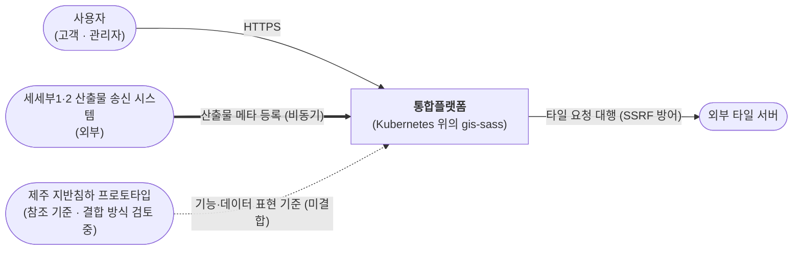
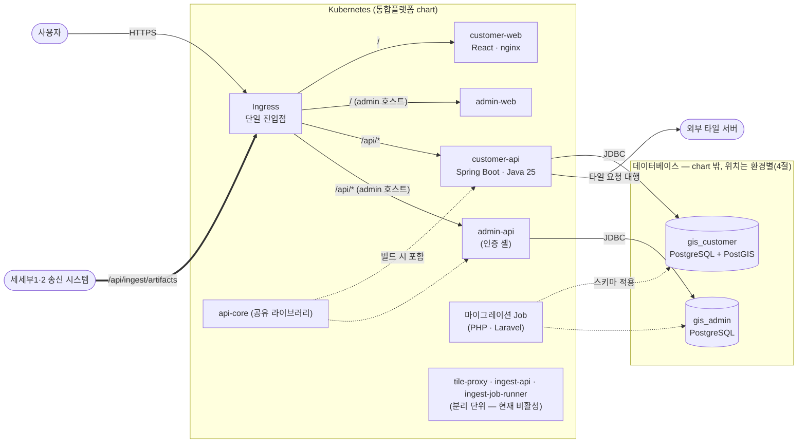
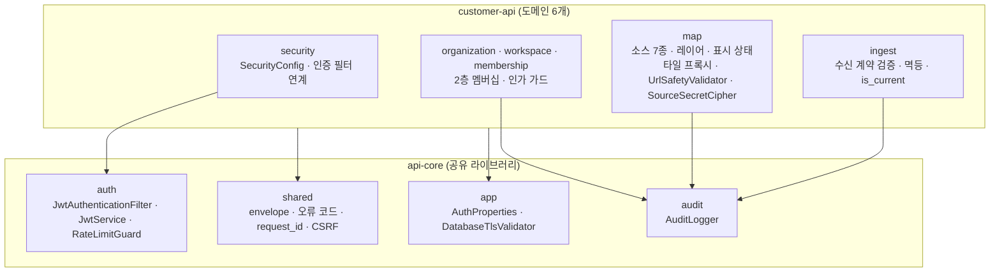

# 아키텍처 문서

| 항목 | 내용 |
| --- | --- |
| 문서번호 | JSA-PF-DS-003 |
| 시스템 | 지반침하 스마트 관리 시스템(통합플랫폼) |
| 분류 | 설계 |
| 버전 | V0.1 |
| 작성일 | 2026-10-16 |
| 작성자 | 박가람 |
| 승인자 | - |

## 제·개정 이력

| 버전 | 날짜 | 변경 내용 | 작성자 | 승인자 |
| --- | --- | --- | --- | --- |
| 0.1 | 2026-10-16 | 최초 작성 | 박가람 | - |

C4 모델(Context → Container → Component) 순서로 적었고 다이어그램은 Mermaid 로 코드화했다. 서술은 통합플랫폼 저장소(`gis-sass`)와 사내 클러스터 저장소(`dev0`)의 2026-10-16 상태를 기준으로 한다. 서버 및 인프라 아키텍처 설계서(v0.8, WBS ID 2 산출물)와 같은 사실을 다른 형식(C4)으로 정리한 문서다.

**현재 단계**: 제주 지반침하 프로토타입(`Jeju-subsidence-AI`) 분석 및 통합플랫폼과의 결합 방식 검토 중이다. 결합 방식(서비스 구성·배치)은 미결정이므로 이 문서의 그림과 표는 **현재 확정된 통합플랫폼 구조**만 그린다. 검토 중인 사항은 6절에 모았다.

## 1. 시스템 컨텍스트 (Level 1)

- 시스템 목적: 「2026년 AI기반 위성정보 활용 서비스 확산사업」 세세부3 — 지반침하 스마트 관리 시스템의 **통합플랫폼**. 웹 기반 지도 서비스(소스·레이어 관리, 타일 프록시)와 조직·워크스페이스 단위 권한 관리를 제공하고, 세세부1(지반침하 위험지도)·세세부2(SAR/InSAR 지표변위 분석)의 산출물을 받아들이는 수신 골격을 갖춘다. SaaS 확산(CSAP 인증 신청)을 고려한 보안·접근제어를 기본으로 한다.
- 사용자·외부 시스템:
  - 고객 사용자 — customer 제품(조직·워크스페이스 구성원, 역할 OWNER·ADMIN·EDITOR·VIEWER)
  - 관리자 — admin 제품(관리자 인증)
  - 세세부1·2 산출물 송신 시스템 — 외부, 비동기로 산출물 메타데이터를 등록(`SUBSYSTEM_LANDSLIDE`, `SUBSYSTEM_INSAR`)
  - 외부 타일 서버 — XYZ·TMS·WMTS·TileJSON·WMS·ArcGIS MapServer 등. 브라우저가 아니라 서버가 대신 호출한다
  - 이미지 레지스트리·CI — GHCR, GitHub Actions(조직 self-hosted runner)
  - 제주 지반침하 프로토타입 — 참조 기준 자료(결합 방식 검토 중, 현재 연결 없음)

## 2. 컨테이너 (Level 2)

| 컨테이너 | 기술 | 책임 | 통신 방식 |
| --- | --- | --- | --- |
| Ingress | Kubernetes Ingress(환경별 컨트롤러 — 로컬 Traefik, 사내 클러스터(`dev0`) Cilium 내장 컨트롤러(IngressClass `cilium`), 운영 NCP) | 단일 진입점. TLS 종단, `/` → web·`/api` → api 경로 라우팅. rate limit·요청 크기 제한은 Ingress 책임으로 정했다(ADR-2026-08-26.01 3절). 앱은 로그인·refresh 경로에 rate limit(분당 20회)을 둔다. 별도 게이트웨이 제품은 두지 않는다 | HTTPS 수신 |
| customer-web | React 18 · Vite · TypeScript, nginx 이미지 | 고객용 SPA — 로그인, 조직·워크스페이스, 지도 소스·레이어 | 같은 오리진 `/api/*` |
| admin-web | 같은 스택 | 관리자용 SPA | 같은 오리진 `/api/*` |
| customer-api | Java 25 · Spring Boot 4.1 · Gradle 9.7 | 도메인 6개 — security·organization·workspace·membership·map(소스·레이어·타일 프록시)·ingest(ETL 수신 골격). JWT 쿠키 인증, 2층 멤버십 인가 | REST(JSON envelope), JDBC |
| admin-api | 같은 스택 | 관리자 인증(security 셸). customer 와 DB·서명키 분리. 릴리스 태그는 공통 vX.Y.Z | REST, JDBC |
| customer database | PostgreSQL + PostGIS(`gis_customer`, 마이그레이션 15개). 로컬 개발 compose·CI(Testcontainers)는 `postgis/postgis:16-3.4` | 사용자·조직·워크스페이스·멤버십·소스·레이어·표시 상태·ETL 메타데이터 | JDBC(TLS 는 chart 기본값 `sslMode: require`) |
| admin database | PostgreSQL(`gis_admin`, 마이그레이션 3개, PostGIS 확장 없음) | 관리자 계정·refresh 토큰 | JDBC |
| 마이그레이션 Job | PHP 8.4(`php:8.4-cli-bookworm` 기반) · Laravel database 컴포넌트 이미지 | 제품별 스키마 마이그레이션(시드는 개발·운영에서 끔). api 파드는 `wait-for-migration` initContainer 가 `migrations` 테이블의 적용 건수가 마이그레이션 이미지의 마이그레이션 파일 수 이상이 될 때까지(기본 최대 5분) 기다린다 | DB 연결 |
| `api-core` | Java 라이브러리(Gradle 컴포지트 빌드, 배포 단위 아님) | 인증·감사 로그·응답 envelope·공통. 두 제품 API 가 빌드 때 포함 | 라이브러리 |
| `web-core` | TypeScript 소스 패키지(npm 워크스페이스, 배포 단위 아님) | web 공통(인증 흐름, CSRF, 로그인·404 페이지) | 라이브러리 |
| tile-proxy · ingest-api · ingest-job-runner | (분리 단위) Helm chart 에 정의, 현재 `enabled: false` | 서비스 분해 결정(ADR-2026-08-26.01)이 정한 분리 후보. 현재 기능은 customer-api 안에 있다 | — |
| CI·레지스트리 | GitHub Actions(self-hosted runner) · Dagger 함수 · GHCR | 테스트·이미지 빌드·게시(커밋 SHA 태그, `latest` 미사용) | HTTPS |

## 3. 컴포넌트 (Level 3)

가장 많은 로직을 가진 customer-api 의 내부 구성이다. 의존은 `controller → service → repository` 한 방향이며 다른 도메인은 service 를 거쳐서만 접근한다. 인가 판정은 service 계층의 명시적 가드에서만 한다(`@PreAuthorize` 미사용).

| 컴포넌트 | 책임 | 비고 |
| --- | --- | --- |
| security | 보안 필터 체인 구성(쿠키 인증·CSRF 면제 경로) | 두 제품이 같은 모양을 갖고, 운영자 전용 요구가 생기면 갈라진다 |
| organization · workspace · membership | 조직·워크스페이스·멤버 관리, 유효 권한 계산(조직 OWNER·ADMIN 은 모든 워크스페이스에 ADMIN 상속) | 권한 도메인은 customer 에만 있다. 비멤버는 403 이 아니라 404 로 응답(존재 은닉) |
| map | 소스(연결)와 레이어(화면에 얹히는 것) 관리, 종류별 `options` 검증(`SourceOptionsSpec`), 외부 타일 프록시, 소스 인증키 암호화 저장 | 서버가 외부를 대신 호출하므로 SSRF 방어가 필수(사설 IP 등 차단) |
| ingest | ETL 산출물 메타데이터 등록·조회, 식별자 기반 멱등 판정(`200`/`201`/`409`), 식별자 그룹별 최신 버전 `is_current` | 메타데이터만 보관. 실데이터 적재 어댑터는 확인 질문 5건 회신 뒤 구현 |
| auth(api-core) | JWT 발급·검증(`kid` 기반 키 회전 지원), 로그인 실패 잠금, rate limit, refresh 회전·재사용 감지 | 두 제품 공유. 서명키와 DB 는 제품별 분리 |
| audit(api-core) | 권한 변경·삭제와 조직 생성·이름 변경, 워크스페이스 이름 변경, 소스·레이어 생성·수정, 수신 산출물 등록의 행위자·대상·변경 필드 기록 | 소스 URL 은 값이 아니라 변경된 필드명만 기록 |
| shared(api-core) | 응답 envelope(`code`·`message`·`result`), 오류 코드표, `request_id`, `X-Api-Version`, CSRF | 도메인 지식이 없는 것만 둔다 |
| web(customer-web) | 로그인, 조직·워크스페이스 화면, MapLibre 지도(소스·레이어 동기화, 개인 표시 상태) | 외부 서버를 직접 호출하지 않고 same-origin `/api/*` 만 사용 |

## 4. 배포 구성

같은 이미지(digest)를 환경 사이에서 승격하는 것이 설계 원칙이다(ADR-2026-08-11.03). 식별자는 커밋 SHA 태그와 OCI digest 이고 chart 는 `image.digest` 로 고정할 수 있다. 배포 단위는 Helm chart(`deploy/charts/gis`) 하나이고 환경별 차이는 values 로 흡수한다.

| 환경 | 클러스터 | 데이터베이스 | 상태 |
| --- | --- | --- | --- |
| 로컬 k3s | 개발자 PC 의 k3d 단일 노드 | 같은 클러스터의 PostgreSQL 파드(chart 밖) | 배포·검증 완료. 앱 파드 6개(customer-api 2·admin-api 2·customer-web 1·admin-web 1), 마이그레이션 Job 2개 |
| 사내 k8s 개발·스테이지(`dev0`) | Proxmox 3호스트 위 Talos Kubernetes(컨트롤 플레인 3·워커 3), Cilium CNI·Ingress, 스토리지 `local-path`·Longhorn | - | 클러스터 구축 완료. TLS 는 클러스터 밖 앞단 프록시가 종단한다 |
| 운영(NCP 공공기관용 NKS) | NCP 관리형 Kubernetes | NCP Cloud DB for PostgreSQL(`gis_customer`·`gis_admin`) | 운영 타깃으로 결정(2026-10-14), 공공 콘솔 실측 5건이 승인 조건 |

- 네트워크: 외부 진입은 Ingress 단일 지점이다. actuator 는 관리 포트(8081)로 분리해 Ingress 로 노출하지 않는다. 모든 chart 파드는 NetworkPolicy 로 인바운드·아웃바운드를 기본 거부하고 필요한 경로(Ingress→web·api, DNS, 제품별 DB, 타일 상대 서버 — 상대 서버는 사용자가 등록한 임의 서버라 사설·루프백·링크로컬 6개 대역을 뺀 IPv4 전체의 80·443 을 허용한다)만 연다. customer 와 admin 은 DB·서명키·호스트를 분리하고 이미지·마이그레이션 Job 도 제품별로 따로 둔다. 릴리스는 분리하지 않는다. 릴리스 태그는 공통 vX.Y.Z 하나이고 두 제품이 같은 버전으로 함께 나간다(설계서 3.1.2 결정 D, 2026-10-14). 제품별 태그는 admin 이 독립 기능을 갖는 시점에 ADR 로 다시 정한다.
- 보안 컨텍스트: 모든 파드(마이그레이션 Job·`wait-for-migration` initContainer 포함)가 PSA `restricted` 요건(비루트·uid 10001, 권한 상승 금지, capability 전부 drop, seccomp `RuntimeDefault`)을 채우는 설정을 기본으로 갖고, 추가로 읽기 전용 루트 파일시스템(쓰기는 `/tmp` emptyDir 만)을 쓴다. 렌더 결과를 스크립트로 검사해 9개 워크로드에서 위반 0건을 확인했다(JSA-PF-TS-005 TC-052).
- 배포 실행: 배포 방식은 self-hosted runner(push)로 3환경 동일하게 확정했다(ADR-2026-09-08.01). CI 의 조직 self-hosted runner 는 테스트·이미지 빌드·GHCR 게시를 맡는다. 배포는 `helm upgrade --install` 로 실행한다(JSA-PF-RL-002).
- 사내 클러스터: 호스트 한 대가 불능이어도 남은 컨트롤 플레인 2대(etcd 3 중 2)로 유지되고, 복제 스토리지(Longhorn, 복제본 2)를 쓰는 파드는 다른 워커로 옮겨진다. 물리 노드 1대 구성에서 3대 구성으로 확장했다.
- 환경 값(예: replicas): customer-api·admin-api 는 로컬 2·2, 개발 2·1, 운영 2·2, web 은 전 환경 1.
- 마이그레이션 대기·Job: `wait-for-migration` 은 적용 수가 파일 수 '이상'이면 통과한다. `helm rollback` 으로 이전 이미지가 돌아오면 DB 의 적용 수가 더 많기 때문이다. 마이그레이션 Job 은 시드를 기본으로 끄고(`migrate.seed` 기본 `false`, `values-local.yaml` 만 `true`) Job 이름에 리비전(`-r<리비전>`)을 붙인다.
- 데이터베이스 위치: 로컬은 k3d `gis-local` 클러스터 안 `gis-postgres` 파드다(`deploy/README.md` 3.1, `values-local.yaml`). 개발·운영 DB 는 chart 밖에 둔다(ADR-2026-08-11.03).

## 5. 품질 속성·제약

| 속성 | 목표 | 설계 대응 |
| --- | --- | --- |
| 가용성 | 파드·롤링 업데이트에서 서비스 유지, DB 일시 중단에서 파드 재시작 없이 복구 | 다중 인스턴스는 customer-api(전 환경 2)와 admin-api(로컬·운영 2, 개발 1)에 적용하고 web 은 전 환경 1 이다. 롤링 업데이트(`maxUnavailable: 0`)·startup·readiness·liveness 프로브·preStop 지연은 api·web 4개 Deployment 공통이다. PDB(`minAvailable: 1`)는 api 에만 켠다(web 은 템플릿만 있고 기본 비활성). 로컬 k3s(k3d)에서 실패 주입 4개 시나리오를 실행했다. 파드 삭제 중 반복 요청 30/30, 롤링 업데이트 중 반복 요청 40/40 성공, DB 일시 중단은 readiness 만 빠지고 재시작 0건이었다. 노드 드레인은 `--dry-run=server` 로 PDB 축출 허용을 확인했다. 사내 개발 클러스터는 호스트 3대로 구성되어 호스트 단위 이중화가 가능하다. 운영 Multi-AZ 는 공공 콘솔 실측으로 판정한다 |
| 보안 | SaaS 확산을 고려한 접근통제, CSAP 하등급 SaaS 대응 | access·refresh 쿠키 HttpOnly·SameSite + CSRF double-submit, 2층 멤버십·존재 은닉, 제품 간 DB·서명키 분리, 감사 로그, SSRF 방어, 소스 인증키 AES-GCM 암호화 저장, DB TLS 요구(chart 기본 `sslMode: require`), npm 런타임 의존성 취약점 CI 게이트(`deps-audit`, high·critical 차단). 보안 갭 분석 14개 항목(설계서 9장)의 보완 작업 일부를 완료했다 |
| 확장성 | 부하 축이 다른 도메인을 독립 확장 | 분해 기준 C 장애 격리 > B 데이터 소유 > A 독립 배포·확장 > D 팀 경계. 타일 프록시·ETL 수신을 분리 후보로 결정. HPA 는 자원 기준선 측정 뒤 활성화(기본 꺼짐) |
| 운영 용이성 | 1인 운영 전제에서 구성요소를 최소화 | Ingress 단독(Kong 불채택), Kafka·Keycloak 불채택(ADR-2026-08-26.01), JSON 구조 로그 + `request_id`, 관리 포트 분리, chart 단일화 |
| 이식성 | 환경 간 같은 이미지·같은 chart | 벤더 중립 chart, 이미지 digest 고정(chart 지원), 같은 이미지의 환경 간 승격(설계 원칙), 환경별 values 추상화 |
| 데이터 | 제품별 격리, 수신 산출물 추적성 | database 제품별 분리, ETL 메타데이터(식별자·버전·해시) 보관과 이전 버전 유지. 실데이터 저장 위치는 확인 질문 회신 후 결정 |
| 테스트 용이성 | CI 와 로컬이 같은 환경 | Dagger 함수로 CI 의 단위·web 잡 7개를 로컬 컨테이너에서 재현(통합 테스트·배포물 검증은 러너·`scripts/ci` 스크립트), Testcontainers PostGIS 통합 테스트 |

제약: 운영 타깃은 CSAP 인증받은 IaaS 위에서만 유효하다(공공기관용 NCP). 서비스 간 TLS, DB 서버 신원 확인(`verify-full`), 로그 수집·보존 기간은 CSAP 판정 뒤 결정한다. 로그는 stdout 으로 낸다.

## 6. 검토 중인 사항 — 제주 지반침하 프로토타입 결합

- 현재 단계는 **프로토타입 분석 및 통합플랫폼과의 결합 방식 검토 중**이다. 결합 방식(서비스 구성·배치·데이터 소유)은 **미결정**이다.
- 프로토타입이 보여 주는 것 중 이 문서가 참조 기준으로 다루는 부분: 지도 레이어 6종(위험등급(CSI)·지반 변위·관로·굴착공사·침하 사고이력·재해위험지구)뿐 아니라 데이터를 보여 주는 모듈(순위 결과 패널, 상세 패널, 등급 분포, 분석 설정·기간 필터, 위험 징후 알림, 공간정보·보고서 내보내기)과 데이터 표현 방식의 예시(위험등급 A–E, CSI 점수와 인자별 판단 근거, 변위속도 색상 구간). 이 밖에 관리자 화면(역할(시스템 관리자·서비스 관리자·일반 사용자)별 지도 레이어·파일 내보내기 권한 설정, 사고 이력 관리, 작업 기록)이 있으나 이 문서는 참조 기준으로 다루지 않았다. 관리자 화면의 자료는 브라우저(localStorage)에 저장되고 서버 연계가 없다. 통합플랫폼의 인증·권한·감사 로그(JSA-PF-DS-001 FR-01–03·FR-09)와의 겹침, 사고 이력 자료의 소유는 결합 방식을 정할 때 판단한다. 프로토타입은 서버 없이 정적 데이터로 동작하는 화면이며 통합플랫폼 코드와 연결되어 있지 않다.
- 결합 방식을 정할 때 쓸 기준은 기존 서비스 분해 ADR 의 판정 기준(장애 격리 > 데이터 소유 > 독립 배포·확장 > 팀 경계)이다. 기존 결정(ADR-2026-08-26.01)은 현재의 모듈러 모놀리식 구조를 유지하면서 타일 프록시·ETL 수신만 분해하기로 한 것이며, "MSA 전면 분해"는 선택하지 않았다.
- 결정이 필요한 항목은 JSA-PF-DS-002 §8(열린 질문)과 JSA-PF-DS-004(ADR)에 모아 두었다.

## 7. 근거 자료

- `docs/90.관리/산출물/01. 서버-및-인프라-아키텍처-설계서`(v0.8, 2026-10-14) 장 1–9, ADR-2026-08-26.01(서비스 분해), ADR-2026-08-11.03·.04·.05(배포·단일 오리진·런타임 격리) (gis-sass 저장소)
- `deploy/README.md`, `deploy/charts/gis/`, `docs/TESTING.md` (gis-sass 저장소)
- `docs/architecture/k8s-c4.md`, `proxmox-cluster.md`, `apps/`(dev0 저장소, 2026-10-16)
- `README.md`, `app/src/data/constants.js`(지도 레이어), `app/src/components/AdminPage.jsx`(관리자 화면) (프로토타입 저장소)
