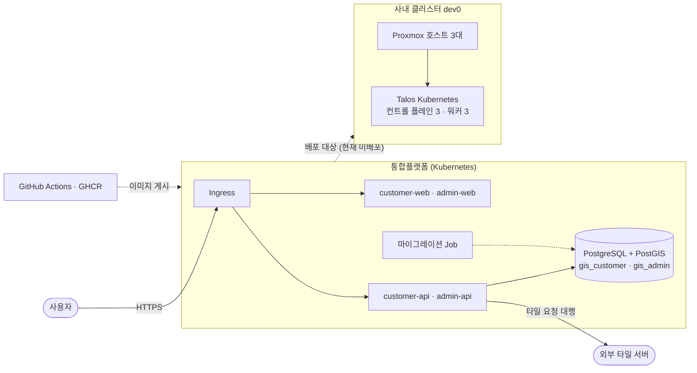

# 운영 런북

| 항목 | 내용 |
| --- | --- |
| 문서번호 | JSA-PF-OP-001 |
| 시스템 | 지반침하 스마트 관리 시스템(통합플랫폼) |
| 분류 | 운영·실증 |
| 버전 | V0.1 |
| 작성일 | 2026-10-16 |
| 작성자 / 승인자 | 개발팀 / <mark>확인 필요</mark> |

## 제·개정 이력

| 버전 | 날짜 | 변경 내용 | 작성자 | 승인자 |
| --- | --- | --- | --- | --- |
| 0.1 | 2026-10-16 | 최초 작성 | 개발팀 | <mark>확인 필요</mark> |

이 문서는 통합플랫폼과 이를 올리는 사내 개발·스테이지 클러스터(`dev0`)의 운영 절차다. **서비스 운영(고객 사용)은 아직 시작되지 않았다.** 운영 후보 환경(NCP 공공기관용)은 구축 전이고, 사내 개발 클러스터에는 통합플랫폼이 아직 배포되지 않았다. 따라서 아래 내용은 (1) 현재 존재하는 사내 클러스터의 운영 절차와 (2) 통합플랫폼 배포 후 적용할 점검·장애 대응 절차다. 내부 주소·계정·비밀값은 적지 않고, 접속 정보는 클러스터 운영 문서에서 관리한다.

## 1. 시스템 개요

| 구성요소 | 설명 | 상태 |
| --- | --- | --- |
| customer-web·admin-web | React SPA(nginx 이미지). 단일 오리진 `/api/*` 로만 호출 | 개발 완료, 로컬 k3s 실배포 검증(2026-09-10·09-16 기준) |
| customer-api·admin-api | Spring Boot API. 인증·권한·지도 소스·레이어·타일 프록시·ETL 수신(customer), 인증 셸(admin) | 로컬 k3s 실배포 검증(2026-09-10·09-16 기준, admin 포트 변경 이전 코드) |
| 데이터베이스 | 제품별 분리(`gis_customer`·`gis_admin`), PostgreSQL + PostGIS. chart 밖에서 환경별로 준비 | 로컬은 파드, 사내 개발은 위치 미정, 운영은 NCP Cloud DB(예정) |
| 마이그레이션 Job | 제품별 스키마 마이그레이션(시드는 개발·운영에서 끔) | 로컬 k3s 검증(2026-09-10·09-16 기준). T105 로 바뀐 Job 은 클러스터 미검증 |
| 사내 클러스터 `dev0` | 미니 PC 3대(Proxmox 클러스터)에 Talos Kubernetes(컨트롤 플레인 3·워커 3). CNI·Ingress 는 Cilium, 스토리지는 `local-path`(기본)와 Longhorn(복제 2). 네임스페이스 `dev`·`stage`·`prd`, 쿼터는 prd 4.5 CPU·8Gi, dev·stage 각 3 CPU·5Gi | 구축 완료(2026-10-06 구축, 10-09~10 고가용성 확장). 통합플랫폼은 미배포 |

※ 로컬 k3s(k3d) 실배포 검증은 2026-09-10(앱 파드 6개 Ready·마이그레이션 Job 2개 Complete·로그인 왕복 200)과 2026-09-16(NetworkPolicy 수정·마이그레이션 이미지 vendor 포함)에 했다. 그 뒤 admin 기본 포트 변경(09-17)과 chart 수정 T105(09-26 커밋, 09-27 PR #55 머지: admin 포트 주입·시드 기본 끔·Job 이름 개편·비루트·보안 컨텍스트)가 들어왔으나 클러스터에는 다시 올려 보지 않았다. 사내 개발 환경 실측은 T089 완료 조건 10 에서 하며 아직 착수 전이다.

## 2. 운영 환경·접속

| 환경 | 접속 방법 | 권한 | 비고 |
| --- | --- | --- | --- |
| 로컬 k3s(k3d) | 개발자 PC 에서 `k3d cluster create gis-local` 후 `kubectl`·`helm` | 개발자 본인 | 매니페스트 리허설 전용 |
| 사내 클러스터 `dev0` (Kubernetes) | 운영자 PC 에서 `talosctl`·`kubectl`·`helm` 을 실행한다. 접속 파일(`talosconfig`, `kubeconfig`)은 `TALOSCONFIG`·`KUBECONFIG` 환경 변수로 지정한다. LAN 밖에서는 Tailscale 서브넷 라우터(호스트 3대)를 거쳐 같은 주소를 쓴다 | 클러스터 관리자(접속 파일 보유자) | Talos 노드에는 ssh·셸이 없고 모든 조작은 `talosctl` 로 한다. 노드가 응답하지 않으면 Proxmox 웹에서 VM 콘솔을 본다 |
| 사내 Proxmox 호스트(3대) | 웹 UI(앞단 nginx 경유) 또는 노드 IP 로 ssh(키 인증). 접속 VIP 로는 ssh 하지 않는다(장애 시 호스트 키 경고) | Proxmox 계정·ssh 키 보유자 | VIP 는 관리 접속 경로만 보호한다. 앞단 nginx 는 저장소 밖의 단일 장비다 |
| NCP 공공기관용 NKS(운영) | 미정 | — | 운영 타깃으로 결정(2026-10-14)했으나 공공 콘솔 실측 5건이 승인 조건이다(T077) |
| GitHub · GHCR | 조직 계정 | 저장소 권한 | 이미지 게시·CI. 러너는 조직 self-hosted runner |

비밀 파일(클러스터 CA·토큰, OpenTofu 상태·토큰 파일)의 위치와 백업은 5절과 클러스터 운영 문서(`secrets-backup.md`)에 있다. 이 문서에는 값을 적지 않는다.

## 3. 일상 점검

주기가 규정된 점검은 아직 없다. 아래는 저장소 절차에서 나온 점검 항목이며, 정기 주기는 운영 개시 전 정한다(<mark>확인 필요</mark>).

| 주기 | 점검 항목 | 방법 | 정상 기준 |
| --- | --- | --- | --- |
| 상시(PR·push 마다 자동) | CI 전체 잡 | GitHub Actions `test` 워크플로 | 전 잡 success. `build-push` 잡은 develop push·`v*` 태그에서 전 잡 통과 뒤에만 자동 실행된다(수동 `workflow_dispatch` 는 테스트를 거치지 않는 예외 경로) |
| 배포 후 | 파드·Job·Ingress | `kubectl get pods,jobs,ingress` | 앱 파드 Ready, 마이그레이션 Job `Complete` |
| 배포 후 | API 상태 | 관리 포트 8081 `/actuator/health`(port-forward) | HTTP 200, 본문의 `status` 가 `UP`(본문 예: `{"groups":["liveness","readiness"],"status":"UP"}`. 문자열 전체 일치가 아니라 `"status":"UP"` 포함 여부로 판정). 서비스 포트의 `/api/actuator/health` 는 404 |
| 배포 후 | smoke 3종(시드를 켠 환경 한정) | `API_BASE=<대상>/api scripts/smoke-auth.sh`·`smoke-org-workspace.sh`·`smoke-map.sh`. 세 스크립트는 시더가 만드는 개발용 계정과 데이터(기본 조직·워크스페이스·배경지도)에 고정돼 있어 `migrate.seed=true` 인 환경에서만 통과한다. 클러스터 중에는 시드를 켠 로컬 k3s 뿐이다. 시드를 끄는 사내 개발·운영은 로그인 계정을 만드는 절차가 저장소에 없어 현재 절차로는 수행할 수 없다(JSA-PF-RL-002 4절). 대체 검증은 <mark>확인 필요</mark>. 통과시키려고 `migrate.seed` 를 켜지 않는다(알려진 비밀번호 계정이 만들어진다) | compose 스택에서 실측한 기준 수치(2026-09-27 기록): 인증 38·조직·워크스페이스 23·지도 42 PASS, 같은 DB 에서 연속 2회 돌려도 같아야 한다. 클러스터를 대상으로 돌린 기록은 찾지 못했다. 지도 smoke 는 외부 타일 서버(OpenStreetMap)와 DNS 가 필요하다 |
| 클러스터 변경 전·후 | 노드·etcd·파드 | `kubectl get nodes -o wide`, `kubectl get pods -A \| grep -v -E 'Running\|Completed'`, `talosctl etcd members`, `talosctl health` | 노드 6대 Ready, etcd 멤버 3, 비정상 파드 0 |
| 클러스터 변경 전·후 | 자원 사용량 | `kubectl top nodes`(metrics-server, 노드별 실사용량), `kubectl get resourcequota -A`(네임스페이스 쿼터 집계. 파드 requests·limits 합의 사용/한도) | `top nodes` 가 오류 없이 노드별 값을 낸다(Metrics API 동작). 쿼터는 `requests.cpu`·`requests.memory`·`limits.memory` 의 사용이 한도 이내(넘으면 새 파드가 거부된다). 노드 사용률의 정상 범위는 저장소에 정해진 값이 없다(<mark>확인 필요</mark>) |
| 비밀 파일·구성 변경 시 | 백업 생성 | `talos/backup.sh`(사람이 직접 실행) | 암호화 묶음 생성, 외부 사본 복사 줄 출력 |
| 주기 미정 | 의존성 취약점 | CI `deps-audit`(npm 런타임 의존성) | high·critical 0건 |

## 4. 장애 대응

| 증상 | 원인 후보 | 조치 | 에스컬레이션 |
| --- | --- | --- | --- |
| api 파드가 `Init:0/1` 에서 멈춤 | 마이그레이션 Job 실패·지연, NetworkPolicy 가 DB 접속을 막음(DB 대상 값 불일치) | `kubectl get jobs`, `kubectl logs job/<Job 이름>`, `database.*.host`·`networkPolicy.databaseTo` 확인. 이전 파드는 계속 서비스하므로 고친 이미지로 재배포하거나 JSA-PF-RL-003 으로 롤백 | 배포 담당 → 롤백 결정자 |
| 파드가 Ready 가 되지 않음 | DB 연결 장애(readiness 는 DB 포함), 이미지 참조 누락(`ImagePullBackOff`), 기본값 `sslMode: require` 인데 DB 가 TLS 를 받지 않아 연결 실패(chart 는 `sslMode` 한 값에서 URL 의 `sslmode` 와 `DB_REQUIRE_TLS` 를 함께 파생하므로 `sslMode` 를 낮춰도 기동 거부가 되지는 않는다. 기동 거부는 chart 밖에서 env 를 수동으로 덮어써 둘이 어긋날 때만 난다) | `kubectl describe pod`, DB 상태·TLS 지원 확인, 이미지 태그·digest 확인. DB 장애 때 readiness 는 false 로 트래픽을 빼지만 liveness 는 영향이 없어 재시작하지 않는다(실패 주입 검증 기록) | 배포 담당 |
| `/actuator/health` 가 200 인데 본문이 HTML | Ingress `/` 규칙이 SPA 폴백으로 `index.html` 을 준다 | 상태 코드가 아니라 본문으로 판정하고, 관리 포트(8081)에서 확인한다 | — |
| 로그인이 반복 실패·잠김 | 계정 락(연속 실패), rate limit(분당 20회) | 인증 로그(`auth` 로거의 `auth.login.failed`·`auth.login.locked`)에서 원인 확인. 로그인 성공·실패·잠금 로그의 `ip` 는 신뢰 프록시 설정(`global.trustedProxies`)에 따라 달라진다. 감사 로그(`audit`)에는 `ip` 가 없다 | 운영 담당 |
| 지도 타일이 표시되지 않음 | 외부 타일 서버 오류, 소스 URL 이 SSRF 차단 대상(사설 IP 등 → `400002`), 프록시 응답 정책 | 소스 종류·URL·인증키 설정 확인, 프록시 응답 코드 확인, egress NetworkPolicy 확인 | 개발팀 |
| Proxmox 호스트 한 대 불능 | 전원·네트워크·하드웨어 | k8s 는 남은 컨트롤 플레인 2대로 유지된다. 죽은 워커의 파드는 약 1분 40초 뒤 남은 워커로 옮겨진다(축출 대기를 5분에서 60초로 줄인 설정 기준이며, 변경 뒤의 강제 종료 시험은 아직 하지 않았다). `local-path` PV 파드는 PV 가 그 워커 디스크에 묶여 있어 옮겨지지 않고 호스트 복귀까지 멈출 것으로 본다(설계상 추정이며 `local-path` PV 를 쓰는 파드로 시험한 적은 없다). 호스트 복구는 클러스터 재구축 문서를 따른다 | 인프라 담당 |
| 워커·컨트롤 플레인 VM 한 대 손상 | VM 디스크 손상·삭제 | 재구축 문서의 "워커 한 대"·"컨트롤 플레인 한 대" 절차(컨트롤 플레인 절만 1단계에서 시작 전 `talos/backup.sh` 를 뜨라고 하고, 워커 절에는 백업 단계가 없다. VM 을 `tofu apply` 로 바꾸면 상태 파일이 달라지므로 끝난 뒤 백업을 다시 뜬다 — `secrets-backup.md` '언제 다시 백업하나'). 아직 깨진 노드를 교체해 본 적은 없다 | 인프라 담당 |
| 컨트롤 플레인 2대 이상 불능·etcd 손상 | 호스트 동시 불능, etcd 손상 | etcd 스냅샷 복원 절차(`secrets-backup.md`). **아직 실행해 본 적 없는 절차(미검증)** | 인프라 담당 → 운영 책임자 |
| 웹 접속(nginx 경유 Proxmox 웹 주소)이 안 됨 | 앞단 nginx(단일 장비) 장애 | 접속 VIP 의 8006 포트로 직접 접속(노드 인증서에 VIP 가 없고 발급자도 클러스터 자체 CA 라 이름 불일치·신뢰하지 않는 발급자 경고가 난다. 주소가 맞는지 확인하고 진행). 이 우회는 아직 시험하지 않았다(dev0 `access.md` 기준). Kubernetes·`tofu`·`ssh`·`talosctl` 은 nginx 와 무관하다 | 인프라 담당 |
| JWT 서명키 유출 의심 | 키 유출 | 긴급 회전 — 새 서명키만 배포한다(chart 로는 구 키 목록을 넣을 수 없어 비어 있다). 교체하면 기존 access 토큰이 모두 무효가 된다. `deploy/README.md` §5.3 은 이를 전체 사용자 재로그인이라 적었으나 같은 문서가 refresh 토큰은 서명키와 무관하다고 적고 웹은 401001 을 받으면 refresh 로 자동 갱신하므로, 실제로 다시 로그인해야 하는지는 <mark>확인 필요</mark>(JSA-PF-RL-003 4절). 키 값만 바꾼 배포가 api 파드를 재시작하는지도 <mark>확인 필요</mark>(Deployment 템플릿에 checksum 어노테이션이 없다). 정기 3단계 회전(`deploy/README.md` §5.3)은 앱이 지원하지만 chart 가 활성 키 한 값만 주입해(T088 todo) 현재 chart 로는 할 수 없다 | 운영 책임자 |

## 5. 백업과 복구

- 백업 대상·주기:
  - **사내 클러스터 비밀 파일 3종**(클러스터 CA·토큰 `secrets.yaml`, OpenTofu 상태 파일, Proxmox API 토큰 파일)과 **etcd 스냅샷** — `talos/backup.sh` 가 암호화(gpg 대칭키) 묶음으로 만들어 저장소의 `.backups/`(git 제외)와 NAS 동기화 폴더에 둔다. 최근 5개를 보관한다. **자동 주기는 없고** 사람이 실행한다. 묶음 안의 파일이 바뀐 뒤에 새로 뜬다: `tofu apply` 로 VM 을 추가·삭제하거나 사양을 바꾼 뒤(상태 파일), Proxmox API 토큰을 새로 발급한 뒤, 클러스터를 새로 만들거나 CA 를 교체한 뒤(`secrets.yaml`), 코드에 없는 리소스(손으로 만든 Secret·배포한 앱·PVC)를 만든 뒤(etcd 에만 있다). Talos·Kubernetes 업그레이드나 컨트롤 플레인 설정 변경 같은 큰 변경은 시작 전에 뜨고, Talos 업그레이드는 `tofu apply` 로 상태 파일이 바뀌므로 마무리에서도 새로 뜬다. 암호는 비밀번호 관리자에 보관한다.
  - **워크로드 데이터(PV)·VM 디스크** — 백업 수단이 없다(Longhorn 백업 대상은 미설정, 계획 중).
  - **통합플랫폼 DB** — 운영은 NCP Cloud DB 자동 백업을 기본 방침으로 하며 구성·주기는 미확정이다. 사내 개발 DB 는 위치가 정해지지 않았고 `pg_dump` CronJob 은 설계 방향일 뿐 chart 에 없다(<mark>확인 필요</mark>).
- 복구 절차:
  - 비밀 파일: 암호화 묶음을 복호화해 풀고(`gpg -d … \| tar xzf -`), `talos/gen.sh` 로 머신 설정을 다시 만들고 `talosctl kubeconfig` 로 접속 파일을 재발급한다. `secrets.yaml` 을 잃으면 기존 클러스터에 접근할 수 없어 클러스터를 새로 만들어야 한다.
  - 노드·클러스터 재구축: 워커 한 대·컨트롤 플레인 한 대·Proxmox 호스트 한 대·클러스터 전체 절차가 재구축 문서에 있다. **실제로 해 본 것**은 워커·컨트롤 플레인을 새로 붙이는 것, 호스트 재부팅, 2026-10-10 클러스터 전체 재구축 1회(VM 6대 교체 약 10분, 부트스트랩 5분 2초, 노드 6대 Ready·비정상 파드 0)다. 깨진 노드 교체·호스트 교체·etcd 스냅샷 복원은 해 보지 않았다.
  - 통합플랫폼 DB: 운영 관리형 DB 의 자동 백업에서 복원한다. 복원 절차 문서화는 T076(설계서 3.1.5), 리허설 주기·담당 결정은 T080(WBS ID 34)이며 모두 아직 미정이다.

## 6. 재기동·배포

- 호스트 재부팅: VM 은 `on_boot` 로 다시 뜨고 노드는 스스로 클러스터에 돌아온다(2026-10-09 확인). 호스트 한 대 재부팅 때 그 호스트의 VM 2대가 약 2분 내려가고 나머지 4대로 클러스터가 유지된다.
- 앱 재기동: `kubectl rollout restart deploy/<이름>` 으로 롤링 재시작한다(`maxUnavailable: 0` 이라 무중단 — 2026-08-26 로컬 측정에서 40회 요청 실패 0건, 이후 chart 변경 뒤 재측정 기록 없음).
- Talos 업그레이드: 백업 → 워커 한 대 시험 → 나머지 워커를 한 대씩 → 컨트롤 플레인을 한 대씩(etcd 3대 확인 뒤 다음) → 마무리에서 백업을 다시 뜬다(`tofu apply` 로 상태 파일이 바뀐다). 버전을 올리는 업그레이드와 컨트롤 플레인 업그레이드는 아직 해 보지 않았다.
- 통합플랫폼 배포·롤백 절차는 JSA-PF-RL-002(배포 런북), JSA-PF-RL-003(롤백 계획)을 따른다.

## 7. 연락 체계

| 역할 | 이름 | 연락처 |
| --- | --- | --- |
| 운영 책임자 | <mark>확인 필요</mark> | <mark>확인 필요</mark> |
| 인프라(사내 클러스터) 담당 | <mark>확인 필요</mark> | <mark>확인 필요</mark> |
| 개발 담당 | <mark>확인 필요</mark> | <mark>확인 필요</mark> |

운영 책임자 지정·직무 분리·사고 대응·연락 체계는 CSAP 인증 신청 과업(M011, WBS ID 34 서비스 보안 운영체계 구성)에서 정한다. 현재 운영 인력은 사실상 1인을 전제로 하고 있어 조직 차원의 결정이 필요하다. 개인 연락처는 이 문서에 적지 않는다.

## 8. 근거 자료

- `ops/dev0`: `docs/operations/access.md`, `secrets-backup.md`, `cluster-rebuild.md`, `talos-upgrade.md`, `docs/architecture/k8s-c4.md`, `proxmox-cluster.md`
- `gis-sass`: `deploy/README.md` §6·§7, 설계서 장 3·장 6, `docs/TESTING.md`, `docs/01.개발/ADRs/deployment/`
