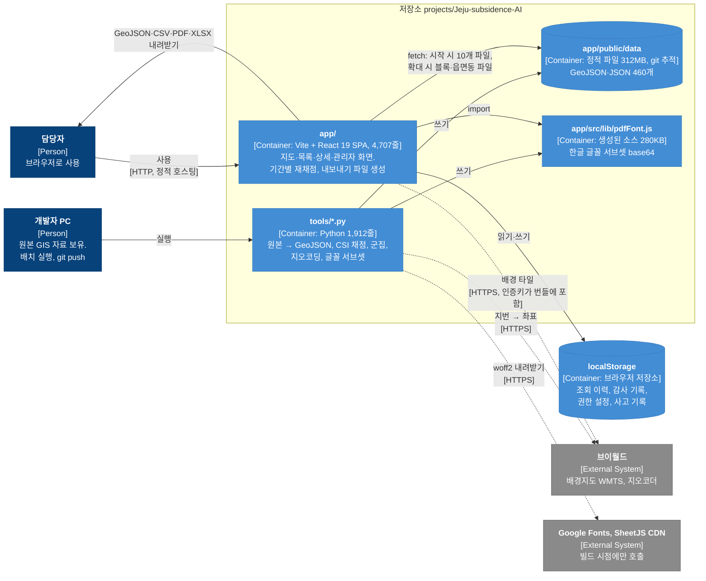

# 01. 현황 분석 — 프로토타입은 지금 어떻게 돌아가나

- 기준: `projects/Jeju-subsidence-AI` 커밋 `129d660` (2026-10-17 읽음)
- 방법: 소스 전체(`app/src`, `tools`), `README.md`, 산출 데이터 샘플, `package.json`, `.gitignore` 를 읽었다. 실행은 하지 않았다.
- 돌아가기: [README](README.md) · 다음: [02. 목표 아키텍처](02.target-architecture.md)

## 1. 한눈에 보기

백엔드가 없다. Python 배치가 개발자 PC 에서 원본 GIS 를 읽어 정적 파일을 만들고, 그 파일을 git 에 넣어 두면
Vite + React SPA 가 브라우저에서 그대로 받아 그린다. 사용자가 만드는 상태(조회 이력·감사·권한·사고 기록)는 전부
브라우저 localStorage 에만 있다.

## 2. 실행 단위와 코드 규모

| 단위 | 기술 | 크기 | 하는 일 |
|---|---|---|---|
| `tools/build_data.py` | Python, shapely·pyproj·pyshp·openpyxl | 1,372줄 | 원본 GIS(Shapefile·GeoPackage·엑셀) → 100m 격자 채점(CSI) → 후보 군집 → 레이어 파일 |
| `tools/gislib.py` | Python | 152줄 | GeoPackage·Shapefile 읽기, EPSG:5186/5179 → WGS84. **원본 경로가 상수로 박혀 있다** (`/Users/gyuyoung/Downloads/...`, `/Volumes/GeoAI2/...`) |
| `tools/geocode_excavation.py` | Python, 브이월드 API | 230줄 | 굴착 허가대장 지번 → 좌표. 결과는 `tools/.cache/`(git 제외) |
| `tools/build_pdf_font.py` | Python, fontTools | 103줄 | 자료·소스에 나오는 글자만 골라 Noto Sans KR 서브셋 → `app/src/lib/pdfFont.js` |
| `tools/build_fonts.py` | Python | 55줄 | Google Fonts woff2 133개를 `app/public/fonts/` 로 |
| `app/src/App.jsx` | React 19 (JS, TS 아님) | 682줄 | 상태 약 30개를 한 컴포넌트가 들고 있다. 자료 로딩, 채점, 필터·정렬·페이징, 알림, 관로 지연 로딩, 이력 비교 |
| `app/src/components/MapPane.jsx` | Leaflet 1.9 | 784줄 | 레이어 9종을 `useEffect` 10개로 그린다 |
| 그 외 컴포넌트 16개 | React | 2,118줄 | 패널·관리자·사고·감사 화면 |
| `app/src/lib/*.js` | JS | 904줄 | 채점(`scoring.js`), 내보내기(`exporters.js`), 감사·권한·사고·이력(localStorage) |
| `app/src/data/constants.js` | JS | 219줄 | 등급·색·역할·권한 기본값·레이어·사고 필드 정의 |

테스트, TypeScript, ESLint 설정, Dockerfile, CI 가 없다. `eslint-disable` 주석은 있으나 설정 파일은 없다.

## 3. 데이터 흐름 — 원본에서 화면까지

### 3.1 배치가 만드는 것 (`app/public/data`, 저장소에 들어 있음)

| 파일 | 크기 | 건수 | 화면에서 언제 받나 |
|---|---|---|---|
| `insar10m/{bx}_{by}.json` + `index.json` | **241MB** | 블록 404개 | 지반 변위 레이어 켜고 배율 15 이상일 때 화면에 든 블록만 (최대 24개) |
| `pipes/{읍면동}.geojson` + `index.json` | 39MB | 36개 동, 20.2만 건 | 관로 레이어 켜고 배율 13 이상일 때 화면 중심 가까운 3개 동 |
| `risk_grid.geojson` | **26MB** | 98,980 셀 | **시작 시** (배율 13 이상에서만 그리는데도 처음에 전부 받는다) |
| `insar_cells.json` | 3.4MB | 100m 셀 전량 | 시작 시 |
| `risk_areas.geojson` | 2.2MB | 위험지역 후보 (README 기준 754곳) | 시작 시. 목록·상세·내보내기의 원본 |
| `geology.geojson` `excavation.geojson` `excavation_items.json` `hazard.geojson` `sinkholes.geojson` `coast.geojson` `regions.json` `model.json` | 합계 1.2MB | — | 시작 시 (`excavation_items` 만 팝업 열 때) |

합계 약 312MB, 압축 저장 약 43MB. `.gitignore` 주석대로 "받는 즉시 실행 가능"하게 하려고 일부러 저장소에 넣었다.

### 3.2 화면이 하는 계산

| 계산 | 어디서 | 입력 | 비고 |
|---|---|---|---|
| 격자 채점, 후보 군집, 인자값 `f`, 연도별 굴착값 `excYear` | 배치 (Python) | 원본 전부 | 가중치 `WEIGHTS`, 등급 경계 `GRADE_CUTS` 는 Python 상수. `model.json` 으로 함께 내보낸다 |
| 기간을 바꿨을 때 후보 CSI·등급·판단근거 재계산 | 화면 (`scoring.js`) | `f`, `excYear`, `model.json` 의 `weights`·`excPivot`·`areaPivot` | **같은 공식이 Python 과 JS 두 벌**이다. 주석에 "두 계산이 정확히 일치"해야 한다고 적혀 있다 |
| 지역 안 순위, 등급별 집계, 고위험군(상위 5%) | 화면 (`App.jsx`) | 채점 결과 | |
| 직전 조회 대비 신규·상향·해소 | 화면 (`runHistory.js`) | localStorage 의 이전 스냅샷 | 브라우저마다 다르다. 다른 PC 에서 보면 "최초 조회" |
| 보기 필터(등급·지도 범위·칩), 정렬, 페이징 | 화면 | | |
| 내보내기 파일 생성 (GeoJSON·CSV·XLSX·PDF) | 화면 (`exporters.js`) | 채점 결과, `pdfFont.js` | SHP·GeoTIFF 는 "서버 변환 필요"로 잠겨 있다 |
| 사고 이력 엑셀 파싱·검증 | 화면 (`incidents.js`) | 올린 파일 | 5MB·5,000행 상한, 매직 바이트 검사 |

## 4. 파일을 쓰는 지점 전수 조사

"파일 쓰기를 오브젝트 스토리지로" 옮기려면 지금 어디서 무엇을 쓰는지부터 다 적어야 한다.

| # | 어디서 | 무엇을 | 어디에 | 제품에서 문제가 되는 점 |
|---|---|---|---|---|
| W1 | `build_data.py` | 레이어 파일 460개, 312MB | `app/public/data/` → git | 개발자 PC 에서만 만들 수 있다. 결과가 소스 저장소에 들어가 코드와 자료의 버전이 따로 논다 (§7-1) |
| W2 | `geocode_excavation.py` | 지오코딩 캐시·지점 JSON | `tools/.cache/` (git 제외) | 재현 불가. 캐시가 없는 PC 에서 배치를 돌리면 굴착 인자가 동 단위로 물러난다 |
| W3 | `build_pdf_font.py` | 글꼴 서브셋 base64 | `app/src/lib/pdfFont.js` (소스) | 자료가 바뀌면 소스도 다시 생성해야 한다. 안 하면 PDF 에 빈 글자 |
| W4 | `build_fonts.py` | woff2 133개 + CSS | `app/public/fonts/` | 빌드 시 외부 CDN 호출 (망분리 빌드 환경에서는 막힌다) |
| W5 | `exporters.js` 4종 | GeoJSON·CSV·XLSX·PDF | 브라우저 다운로드 | 서버에 남지 않아 "누가 무엇을 반출했나"의 증적이 파일과 연결되지 않는다. 보고서 이력·재다운로드 불가 |
| W6 | `IncidentPage.jsx` | 사고 이력 엑셀 내려받기 / **올리기** | 브라우저 다운로드 / localStorage | 부서 간 공유가 엑셀 수작업. 올린 원본 파일이 보관되지 않는다 |
| W7 | `AuditPage.jsx` | 감사 기록 엑셀 | 브라우저 다운로드 | 기록 자체가 브라우저에 있어 증적 효력 없음 (코드 주석도 그렇게 적음) |
| W8 | `runHistory.js` | 조회 스냅샷 | localStorage `subsidence.runs.v1` | 기기마다 다름 |
| W9 | `audit.js` | 감사 기록 (최근 2,000건) | localStorage `subsidence.audit.v1` | 사용자가 지울 수 있음. `setAuditSink` 접합점은 있음 |
| W10 | `perms.js` | 역할별 권한 | localStorage `subsidence.perms.v1` | "설정이지 집행이 아니다"(주석). 화면만 숨기고 자료는 막지 못함 |
| W11 | `incidents.js` | 담당자 사고 기록 | localStorage `subsidence.incidents.v1` | 이 브라우저에서만 보임 |

W1–W4 는 "산출 데이터", W5–W7 은 "사용자가 주고받는 파일", W8–W11 은 "상태"다. 합의대로 W1–W7 은 오브젝트 스토리지로,
W8–W11 은 DB 로 간다. W3·W4 는 빌드 산출물이라 스토리지가 아니라 **이미지 빌드 단계**로 흡수한다 (02 §6).

## 5. 이미 코드에 표시된 서버 접합점

프로토타입을 만든 사람이 "서버가 붙으면 여기를 바꾼다"고 적어 둔 자리다. 그대로 설계의 출발점으로 쓴다.

| 위치 | 주석 요지 | 설계에서 받는 곳 |
|---|---|---|
| `App.jsx:31` `const USER = {...}` | "접속 역할은 실서비스에서 SSO 가 내려준다" | api `auth` + `GET /api/me` (04 §9) |
| `lib/audit.js` `setAuditSink` | "서버가 붙으면 전송 함수만 갈아 끼운다. 증적으로 인정받으려면 서버 저장 필수" | api `audit` 모듈, 추가 전용 표 (04 §8) |
| `lib/perms.js` 머리말 | "실제 접근 통제는 SSO 와 보안 게이트웨이가 서버에서" | api `rbac` 가드, 파일 중계에서 레이어 권한 검사 (04 §2) |
| `lib/incidents.js` 머리말 | "실제 공용 대장은 서버 연계가 붙어야 한다" | `incidents` 표 + 엑셀 가져오기 서버 처리 (04 §8) |
| `ExportActions.jsx` SHP·GeoTIFF `soon` | "dbf·shx·prj 를 함께 만들어야 해 서버 변환 필요", "래스터를 서버에서 잘라 내려주는 방식" | exports 비동기 작업 → pipeline 워커 (04 §7) |
| `AuditPage.jsx` | "서버가 붙으면 서버 조회로 바꾼다" | `GET /api/audit` |
| `AnalysisFilter.jsx` | "채점은 배치에서 끝난 일이고 버튼은 조회다" | 조회 = `GET /api/areas` |

## 6. 지켜야 할 것

제품으로 옮기면서 깨뜨리면 안 되는 프로토타입의 좋은 결정이다.

- **망분리 전제.** 외부 타일 기본 꺼짐, 글꼴 내장, 해외 공개 타일로 조용히 대체하지 않음, 키 없으면 배경 없음. 제품도 외부 호출은 서버가 대신 하고 허용 목록으로 묶는다.
- **"관측 없음"을 0 으로 채우지 않는다.** 인자가 없으면 가중치에서 뺀다. 저신뢰 표시. 이 규칙은 Python 에 있고 그대로 둔다.
- **디자인 토큰 단일 출처** (`tokens.css`, GEO-AI 변수). 같은 계열 제품(gis-sass)과 공유 가능성이 있다.
- **큰 레이어의 분할 전략.** 10m 격자는 2km 블록, 관로는 읍면동, 100m 변위는 좌표 압축 포맷. 서버가 생겨도 "화면에 든 것만 받는다"는 원칙은 유지하되 분할 단위를 서버가 정하게 바꾼다.
- **보안 처리.** 팝업 HTML 이스케이프, 업로드 매직 바이트 검사, 신청인 개인정보 미수집. 서버에서 같은 검사를 다시 한다 (클라이언트 검사는 편의일 뿐).
- **산정 근거를 화면에 적는 태도.** 자료 한계 문구(`model.json` `notes`)가 보고서까지 따라간다. 데이터셋 버전마다 `model.json` 을 함께 보관해야 하는 이유다.

## 7. 제품화 관점에서 본 문제

### 7-1. 코드와 자료의 버전이 어긋나 있다 (실제로 발생)

- 저장소의 `risk_areas.geojson` 속성에는 `conf`, `lowConf`, 그리고 `evidence` 안에 `lowconf` 항목이 있다.
  지금 `build_data.py` 는 이 셋을 내보내지 않고 `confG` 를 내보낸다. `constants.js:83` 주석도 "산출물에는 있지만 지금 데이터에는 없다"고 인정한다.
- `model.json` 의 `generated` 는 2026-09-17 이고 `totalCells` 는 104,973 인데, README 는 분석 격자를 54,330 셀이라고 적는다. 어느 쪽이 현재인지 파일만 봐서는 모른다.
- `build_risk_grid()` 는 주석에 "C등급 이상만 내보낸다"고 쓰고 조건은 `grade in ("D","E")` 를 건너뛴다. 등급 문자 방향이 뒤집힌 뒤 조건이 따라오지 않은 것으로 **추정**된다. 저장소의 `risk_grid.geojson` 에는 B 등급 셀이 들어 있어 어느 쪽 코드로 만들어졌는지 알 수 없다.
- 원인은 하나다. 자료가 "어느 입력으로 어느 코드가 언제 만들었나"를 들고 다니지 않고, 소스 저장소에 섞여 들어가기 때문이다.
  → 설계: **데이터셋 버전 번들** (04 §2). 번들마다 `manifest.json` 과 `model.json` 을 함께 두고, 화면은 항상 같은 버전의 두 파일을 쓴다.

### 7-2. 자료 갱신이 특정 PC 에 묶여 있다

- 원본 경로 상수, 지오코딩 캐시, 글꼴 서브셋이 모두 개발자 PC 에 있다. 담당자가 새 원본을 받아도 스스로 갱신할 수 없다.
- 지오코딩은 외부(브이월드) 호출이 필요해 망분리 환경에서 재실행이 막힐 수 있다.
  → 설계: 원본 올리기 → 서버 빌드 → 검토 → 활성화 (02 §5.1). 지오코딩 캐시는 원본의 일부로 함께 올린다.

### 7-3. 권한이 집행되지 않고 감사 증적이 없다

- 관로·굴착은 "중요 시설물 정보" 로 분류해 두고도, 권한이 없는 역할도 파일 URL 을 알면 받을 수 있다.
- 감사 기록은 브라우저에 있어 사용자가 지울 수 있다.
  → 설계: 모든 자료는 api 를 거친다. 파일 중계가 레이어 권한을 검사하고, 반출·변경은 서버가 추가 전용 표에 기록한다.

### 7-4. 사용자 상태가 공유되지 않는다

- 사고 기록·권한 설정·조회 이력이 기기마다 다르다. "직전 조회 대비 신규" 같은 알림이 사람마다 다른 답을 낸다.
  → 설계: DB. "직전 대비"의 기준을 데이터셋 버전으로 바꿀지는 열린 결정 (05 §4-1).

### 7-5. 비밀값과 외부 의존이 번들·빌드에 들어 있다

- `VITE_VWORLD_KEY` 가 JS 번들에 들어가 누구나 볼 수 있다. 브이월드 키는 URL 단위 등록이라 당장 악용은 어렵지만 CSAP 관점에서는 비밀값 노출이다.
- `package.json` 의 `xlsx` 가 `https://cdn.sheetjs.com/...tgz` 를 직접 가리킨다. 사내 레지스트리 미러가 없는 빌드 환경에서는 설치가 막힌다.
  → 설계: 타일은 서버 중계(선택), 키는 서버 Secret. 엑셀 라이브러리는 npm 레지스트리에 있는 것(`exceljs`)으로 바꾸거나 미러에 올린다.

### 7-6. 클라이언트가 너무 많이 받고 너무 많이 계산한다

- 시작 시 26MB(`risk_grid`)를 포함해 약 33MB 를 받는다. 배율 13 미만에서는 그리지도 않는 격자다.
- 10m 블록은 한 번에 최대 24개(수 MB–수십 MB)를 받아 Leaflet 사각형으로 그린다.
  → 설계: 1단계는 파일 중계로 그대로 두고(캐시 immutable), 2단계에서 격자·관로를 PostGIS bbox 질의(또는 벡터 타일)로 바꾼다 (04 §6).

### 7-7. 유지보수 구조

- `App.jsx` 682줄에 상태 30개, `MapPane.jsx` 784줄에 `useEffect` 10개. 기능 하나를 고치려면 두 파일을 다 읽어야 한다.
- 채점 공식이 Python·JS 두 벌, 인자 라벨이 세 군데(`FACTOR_LABEL`, `model.json`, `DetailPanel` 의 `FACTOR_NAME`), 변위 등급 색이 두 군데(`VEL_CLASSES`, `VEL_RAMP`).
- TS·테스트·린트·CI 없음.
  → 설계: 03 모듈 분해. 상수는 `model.json` 단일 출처, 채점은 사전 계산으로 한 벌만 남긴다.

### 7-8. 파이프라인 자원 (미측정)

- `build_insar10m()` 은 10m 셀 823만 개를 블록별 리스트로 메모리에 다 올린 뒤 쓴다. 튜플 4개 값 × 823만 = **수 GB 추정**.
  서버 워커로 옮기면 메모리 상한을 정해야 하고, dev0 의 `dev` 네임스페이스 쿼터(5Gi)에 안 들어갈 수 있다.
  → 05 §5 "측정해야 할 것". SQLite 쿼리를 블록 키로 정렬해 스트리밍으로 쓰면 메모리를 상수로 줄일 수 있다.
