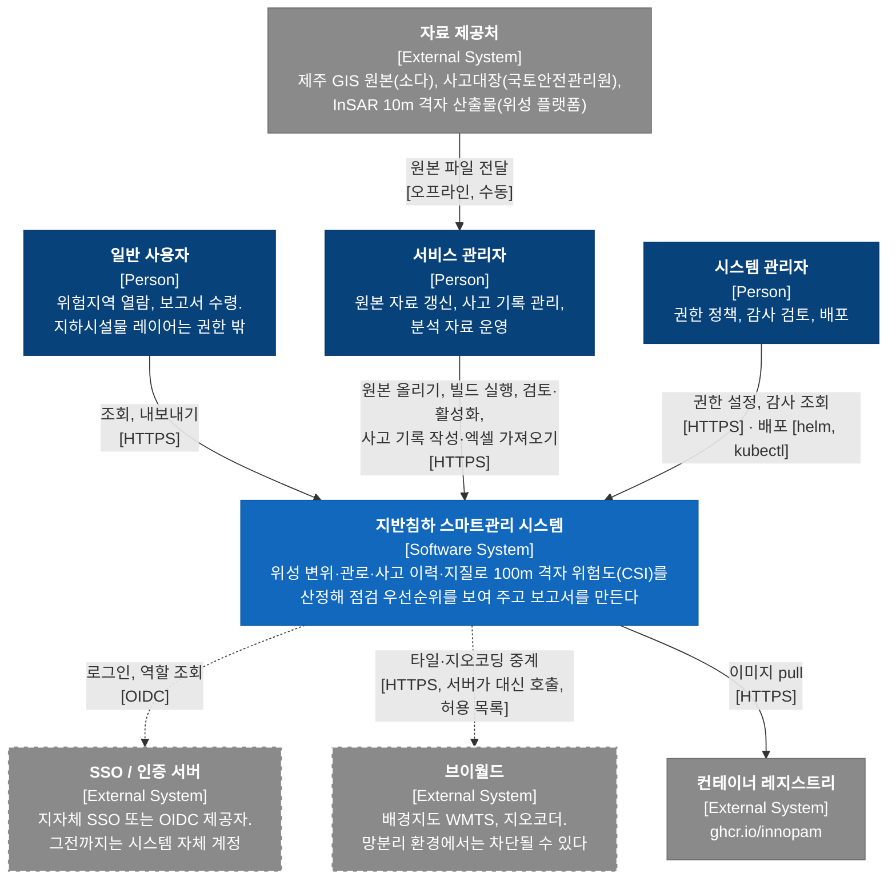
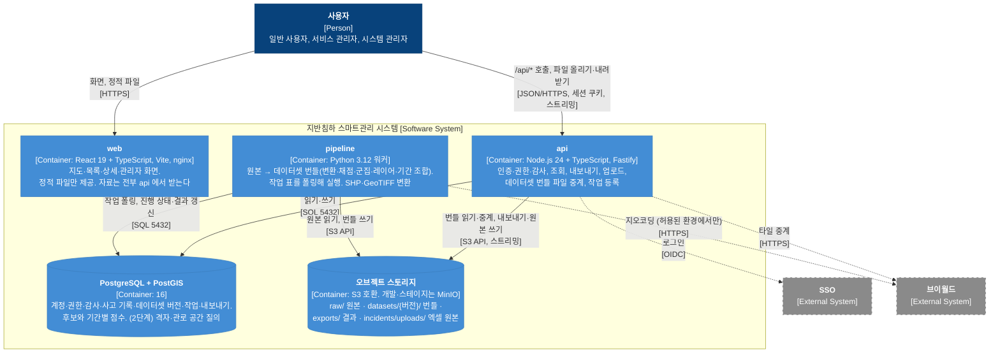
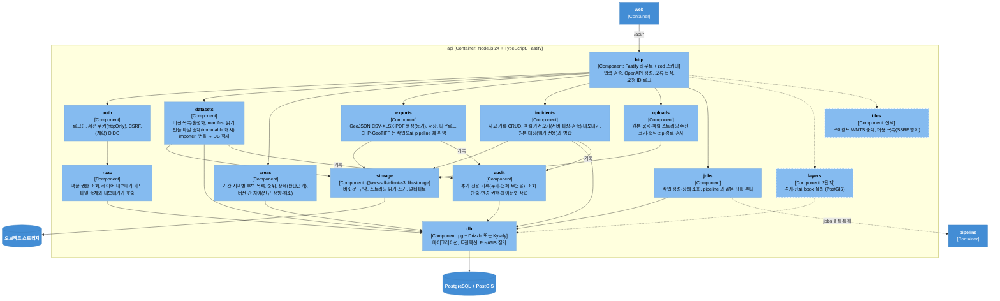
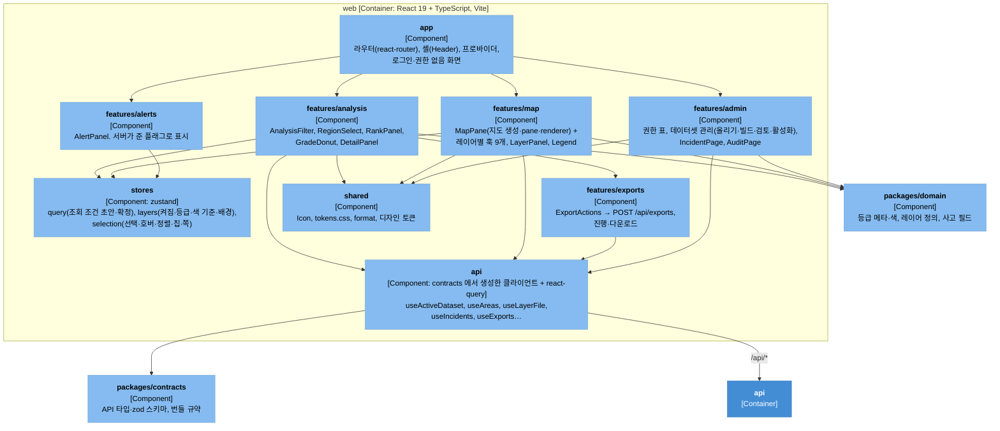
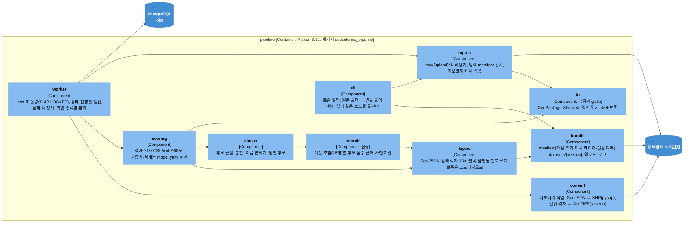
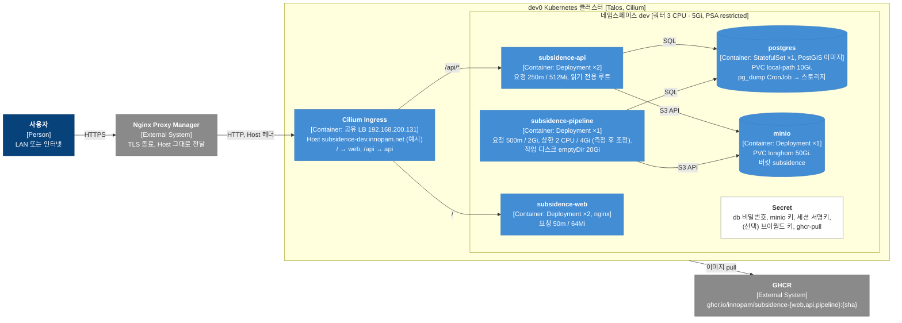
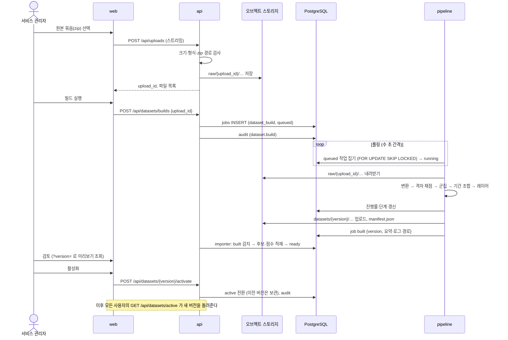
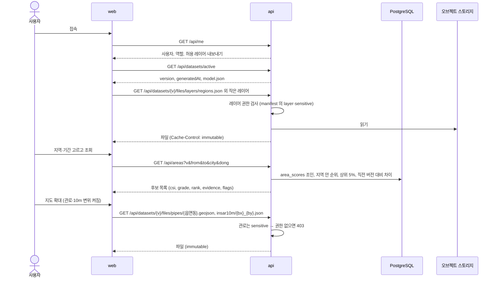
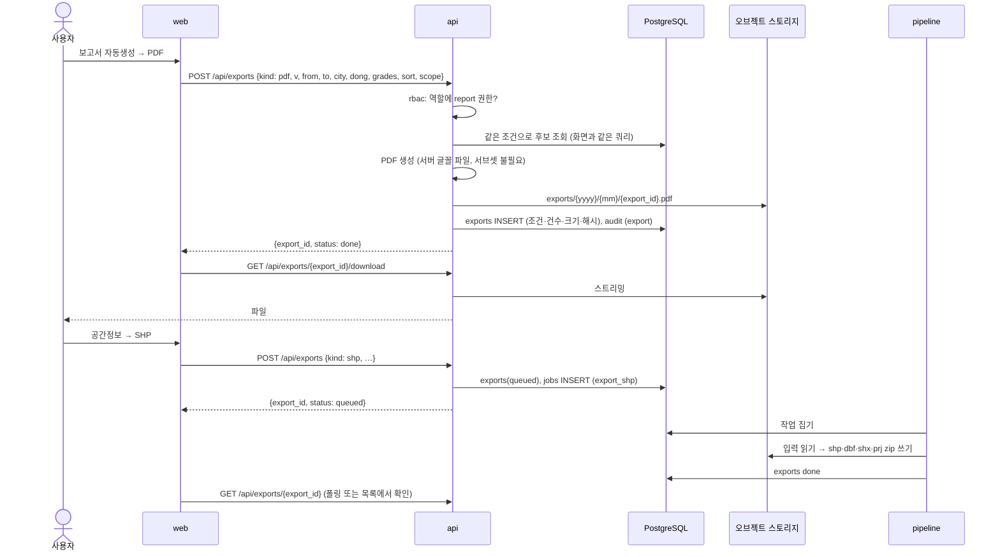
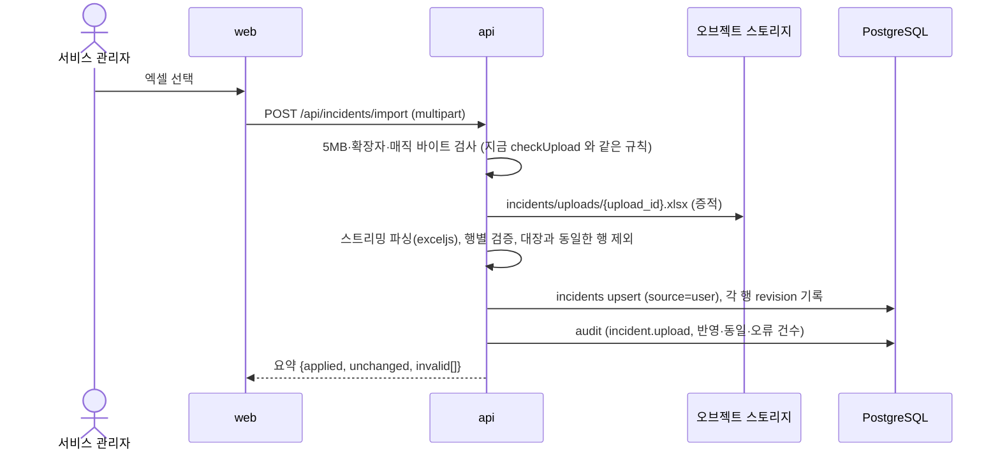

# 02. 목표 아키텍처 (C4)

- 앞: [01. 현황 분석](01.current-state.md) · 다음: [03. 모듈 분해](03.modules.md)
- 그림은 Mermaid `flowchart` 에 C4 관례(이름, `[종류: 기술]`, 설명)를 입혀 그렸다. dev0 의 [k8s-c4.md](../../../ops/dev0/docs/architecture/k8s-c4.md) 와 같은 표기다.
  Mermaid 전용 C4 문법은 선 라벨이 겹쳐 쓰지 않았다.

## 표기

| 모양 | 뜻 |
|---|---|
| 짙은 남색 | 사람(Person) |
| 파란 상자 | 이 문서가 다루는 시스템(Software System) |
| 회색 상자 | 외부 시스템(External System) |
| 하늘색 상자, 원통 | 실행 단위(Container). 원통은 저장소 |
| 옅은 하늘색 상자 | 실행 단위 안의 모듈(Component) |
| 점선 테두리, 점선 화살표 | 아직 없거나 선택인 것(계획) |
| 흰 상자 | 메모 |

## 1. System Context

- 사람은 셋이다. 프로토타입의 역할 3종(`admin`·`service`·`user`)을 그대로 쓴다.
- 원본 자료는 시스템이 직접 가져오지 않는다. 제공처가 파일로 주고 서비스 관리자가 올린다. 자동 연계(FTP·API)는 제공처와 합의된 것이 없어 그리지 않았다.
- 외부 호출은 둘뿐이고 둘 다 선택이다. 브이월드는 서버가 대신 부르고(키는 서버 Secret), 막힌 환경에서는 "배경 없음"으로 동작한다.
  SSO 가 붙기 전까지는 시스템 안의 계정과 세션으로 동작한다 (04 §8).

## 2. Container

실행 단위는 3개, 저장소는 2개다.

| 단위 | 책임 | 책임이 아닌 것 |
|---|---|---|
| **web** | 화면. 서버 상태는 react-query 로 받고, UI 상태만 스스로 가진다 | 채점, 파일 생성, 권한 판단(숨기기만 한다), 영속 저장 |
| **api** | 유일한 진입점. 인증·권한·감사를 한 곳에서. 조회 API, 내보내기 생성(동기), 업로드 수신, 번들 파일 중계, 작업 등록, 번들 가져오기(importer) | GIS 변환·채점(pipeline), 파일 보관(스토리지) |
| **pipeline** | 지금의 `tools/` 를 그대로 이어받는다. 원본 → 번들. 무거운 변환(SHP·GeoTIFF) | HTTP 노출, DB 의 사용자 데이터 |
| **PostgreSQL + PostGIS** | 질의가 필요한 것 전부. 한 행 단위로 바뀌는 것(사고 기록·권한·감사), 기간·지역으로 걸러 보는 것(후보·점수), bbox 로 보는 것(격자·관로, 2단계) | 큰 바이너리·파일 |
| **오브젝트 스토리지** | 파일 전부. 원본, 번들(불변), 내보내기 결과, 올린 엑셀 원본 | 질의 |

브라우저는 스토리지와 직접 통신하지 않는다. 업로드·다운로드 모두 api 가 스트리밍으로 중계한다.
presigned URL 로 직접 보내는 방식은 스토리지 엔드포인트를 브라우저에 노출해야 해서(망분리·CSAP 에서 설명할 항목이 늘어난다) 기본안에서 뺐다.
병목이 확인되면 그때 선택지로 연다 (04 §1).

api 와 pipeline 은 서로를 부르지 않는다. **DB 의 작업 표(`jobs`)와 스토리지의 번들**이 둘의 유일한 접점이다 (04 §3).
그래서 pipeline 은 compose·k8s·개발자 PC 어디서 돌아도 같고, api 는 pipeline 이 죽어 있어도 동작한다.

## 3. Component

### 3.1 api

- 가로 관심사는 `http` → `auth` → `rbac` → 각 모듈 순서로 흐른다. 모든 라우트가 같은 순서를 밟는다 (Fastify hook).
- `audit` 는 모듈이 직접 호출한다. 미들웨어로 자동 기록하지 않는 이유는 "무엇을"(형식·건수·대상)을 모듈만 알기 때문이다. 프로토타입의 `audit(action, {target, detail, result})` 시그니처를 그대로 쓴다.
- `datasets.importer` 는 번들의 `risk_areas.geojson` 과 `area_scores.json` 을 DB 로 적재한다. 2단계에서 `risk_grid`·`pipes` 까지 적재한다. 적재는 **버전별로 격리**(`dataset_version_id` 컬럼)해서 미리보기와 롤백이 된다.

### 3.2 web

- 지금 `App.jsx` 가 쥔 상태 30개를 세 갈래로 나눈다. **서버 상태**(자료·채점 결과·권한·사고 기록)는 react-query 캐시로, **조회 조건·보기 설정·선택**은 zustand 스토어로, 그 밖의 열림·접힘은 컴포넌트 안에 둔다. localStorage 는 보기 설정(켜진 레이어, 쪽당 건수) 같은 편의에만 쓴다 (03 §4).
- `MapPane` 은 지도 생성과 pane·renderer 만 남기고 레이어마다 훅으로 뺀다(`useRiskAreasLayer`, `useInsarLayer`…). 지금 `useEffect` 10개가 그대로 훅 10개가 된다. 각 훅은 `map` 과 자기 레이어의 자료·상태만 받는다.

### 3.3 pipeline

- 지금 `build_data.py` 하나에 있는 9단계(`main()` 의 로그 1)–9))가 그대로 `inputs`·`scoring`·`cluster`·`layers` 로 나뉜다. 알고리즘은 바꾸지 않는다. 바꾸는 것은 입출력 경로(상수 → 인자), 단일 출처 상수(`model.yaml`), 기간 조합 사전 계산, manifest 다.
- `cli` 가 있어야 하는 이유: 알고리즘을 고치는 사람은 서버 없이 원본 폴더에서 바로 돌려 봐야 한다. 워커는 `cli` 가 하는 일을 "스토리지에서 받아 → 스토리지로 올리기"로 감싼 것뿐이다.

## 4. Deployment

### 4.1 dev0 (개발·스테이지)

- 배포 단위는 gis-sass 와 같은 틀을 따른다. 제품 저장소에 Helm chart(`deploy/charts/subsidence`)를 두고, `ops/dev0/apps/subsidence/` 에는 그 chart 의 게시 버전과 values 만 둔다 (ws `AGENTS.md` 규칙). 이미지 태그는 커밋 SHA, `latest` 금지.
- 자원 요청 합계 약 1.1 CPU / 3.3Gi 로 `dev` 쿼터(3 CPU / 5Gi) 안이지만, pipeline 이 빌드 중에 2–4Gi 를 쓰면 다른 파드와 함께 쿼터에 닿을 수 있다. 측정 전까지는 빌드를 한 번에 하나만 돌리고, 넘치면 pipeline 을 별도 네임스페이스나 k8s Job 으로 뺀다 (05 §3).
- 스토리지 클래스는 dev0 관례대로 DB 는 `local-path`, 파일을 쓰는 앱(MinIO)은 `longhorn` 이다. local-path 는 노드에 묶여 그 워커가 죽으면 Postgres 가 멈춘다. 개발·스테이지에서는 받아들이고 pg_dump 로 복구한다.
- MinIO 는 단일 노드로 둔다. 운영 분산 구성(MinIO Operator)은 dev0 규모에 맞지 않다.

### 4.2 운영 환경(지자체 망분리)에서 달라지는 것

| 항목 | dev0 | 운영 (가정) |
|---|---|---|
| 오브젝트 스토리지 | MinIO 단일 | 지자체 제공 S3 호환 스토리지 또는 MinIO 자체 운영. **열린 결정 05 §4-5** |
| DB | 단일 Postgres, local-path | 지자체 DBMS 표준에 따름. PostGIS 가능 여부 확인 필요 |
| 인증 | 자체 계정 | SSO 연동. 프로토콜(OIDC·SAML) 확인 필요 (05 §4-4) |
| 외부 호출 | 브이월드 중계 켤 수 있음 | 없음. 배경지도 "없음" 고정 또는 내부 타일 서버 |
| 이미지 반입 | GHCR pull | 폐쇄망 레지스트리로 이미지 반입. 빌드 시 외부 의존(npm·pip·글꼴) 0 이어야 한다 → §6 |
| TLS | NPM 에서 종료 | 보안 게이트웨이 뒤. api 는 `X-Forwarded-*` 신뢰 대역 설정 |

## 5. 주요 흐름

### 5.1 자료 갱신 — 올리기, 빌드, 검토, 활성화

- 지금 `README.md` 의 "실행" 절(venv → `build_data.py` → `npm run dev`)이 이 흐름으로 바뀐다. 개발자 PC 가 필요 없다.
- `version` 은 작업 ID 와 같다(ULID). 번들 키 접두사가 버전이라 업로드 중에 실패해도 다른 버전과 섞이지 않고, 실패한 접두사는 워커가 지운다.
- 검토 단계가 있어야 하는 이유: 원본이 바뀌면 후보 수·등급 분포가 크게 움직일 수 있다. 활성화 전에 관리자가 이전 버전과 나란히 보고 결정한다. 활성화는 되돌릴 수 있다(이전 버전 재활성화).

### 5.2 조회

- 화면이 받는 파일 목록과 경로는 manifest 가 준다. web 에 `data/...` 경로가 하드코딩되지 않는다.
- 2단계에서 관로·격자는 파일 대신 `GET /api/layers/pipes?bbox=` 로 바뀐다. 화면 쪽은 훅 하나의 자료 출처만 바뀐다.

### 5.3 내보내기

- 내보내기 조건을 서버가 다시 조회하므로 "화면에 보이는 것과 파일이 다르다"가 구조적으로 생기지 않는다. 지금은 화면의 `filtered` 배열을 그대로 쓰므로 같지만, 서버에서는 같은 쿼리 함수를 두 곳이 쓰게 한다.
- 결과를 보관하므로 "내 내보내기" 목록, 재다운로드, 감사 기록 → 파일 연결이 된다. 보존 기간은 정책값(기본 30일 제안).

### 5.4 사고 이력 엑셀 올리기

## 6. 기술 선택

| 항목 | 선택 | 이유 | 대안 |
|---|---|---|---|
| BE 런타임 | Node.js 24 + TypeScript | 사용자 결정. gis-sass 웹과 같은 런타임·린트·mise 설정을 공유 | — |
| BE 프레임워크 | Fastify + zod(또는 TypeBox) + `@fastify/swagger` | 스키마 우선이라 `packages/contracts` 와 바로 이어진다. 스트리밍 응답·멀티파트가 1급. 가볍다 | NestJS(구조 강제, DI. 팀이 Spring 식 구조를 원하면), Hono |
| DB 접근 | Drizzle 또는 Kysely + `pg` | 타입 안전한 SQL. PostGIS 함수(`ST_Intersects`, `ST_AsGeoJSON`)를 raw 로 섞기 쉽다 | Prisma(PostGIS 지원 약함) |
| 스토리지 클라이언트 | `@aws-sdk/client-s3`, `lib-storage`(멀티파트) / Python `boto3` | S3 호환 표준. MinIO·AWS·NCP 모두 같은 코드 | MinIO SDK(종속) |
| 작업 큐 | **DB 표 폴링** (`jobs`, `FOR UPDATE SKIP LOCKED`) | 빌드는 연 몇 번, 내보내기는 수 초. Redis·RabbitMQ 를 들일 이유가 없다. compose·k8s·PC 어디서나 같다 | BullMQ+Redis(동시성 높아지면), k8s Job(격리·쿼터 분리 필요 시) |
| 파이프라인 | **Python 유지**(별도 컨테이너) | shapely STRtree·pyproj·GeoPackage 파싱 1,900줄을 TS 로 옮기면 수치 동일성 검증까지 포함해 큰 비용. Node 에 동급 라이브러리가 없다(turf 는 823만 셀에 느리다) | TS 포팅(단일 언어). 05 §4-7 |
| PDF | jsPDF + autotable 을 Node 에서 그대로 | `exporters.js` 재사용. 글꼴은 서버의 TTF 파일을 통째로 심어 서브셋 단계를 없앤다 | Puppeteer HTML→PDF(레이아웃 자유, Chrome 포함 이미지 무거움), pdfmake |
| 엑셀 | `exceljs` | npm 레지스트리에 있다(지금 `xlsx` 는 외부 CDN tgz). 스트리밍 읽기 | SheetJS 사내 미러 |
| SHP·GeoTIFF | pipeline: `pyshp`(이미 의존), `rasterio` | Node 에 GDAL 없이 되는 안정적 라이브러리가 없다 | GDAL 컨테이너 |
| FE 지도 | Leaflet 1.9 유지 | 범위 밖. 캔버스 렌더러로 지금 요구를 감당한다 | MapLibre GL + 벡터 타일(2단계 격자·관로를 MVT 로 낼 때 함께 검토) |
| FE 상태 | react-query(서버) + zustand(클라이언트) | gis-sass `web-core` 와 같은 조합. 패턴을 빌려 온다 | Redux Toolkit |
| FE 언어 | TypeScript 로 전환 | `contracts` 타입을 받으려면 필요. 파일 단위로 점진 전환 | JS + JSDoc |
| 글꼴 | 빌드 시 저장소 안의 woff2·TTF 를 이미지에 포함 | `build_fonts.py` 의 외부 호출을 빌드에서 제거. 글꼴 파일은 저장소(LFS 또는 그대로)에 둔다 | 런타임에 스토리지에서 받기(불필요) |
| 인증(임시) | 자체 계정 + Argon2 + 세션 쿠키(httpOnly, SameSite=Lax) + CSRF 토큰 | `web-core` 의 `api-client`·`csrf`·`session-restore` 패턴 재사용 | JWT 로컬스토리지(XSS 취약, 쓰지 않음) |
| 인증(제품) | OIDC 클라이언트(`openid-client`) | SSO 가 OIDC 면 바로, SAML 이면 Keycloak 을 중간에 둔다 | — |
