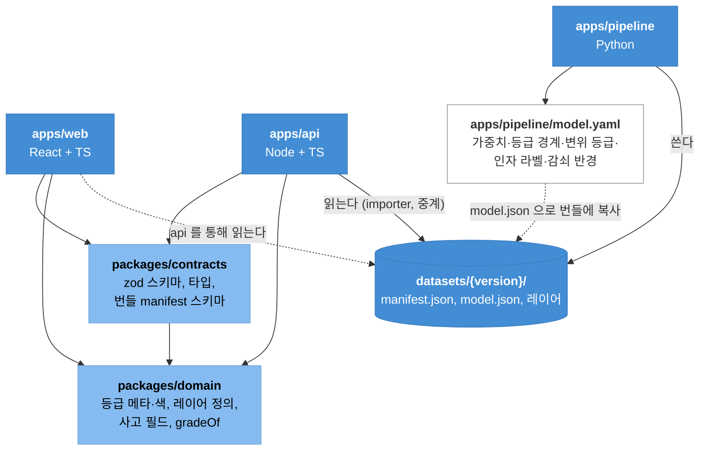

# 03. 모듈 분해 — 저장소 레이아웃, 책임, 의존 방향, 코드 이동표

- 앞: [02. 목표 아키텍처](02.target-architecture.md) · 다음: [04. 데이터·스토리지·API](04.data-and-storage.md)

## 1. 저장소 레이아웃

한 저장소(모노레포)로 둔다. gis-sass 의 `apps/*` + `packages/*` 배치를 따른다.

```text
Jeju-subsidence-AI/
├── apps/
│   ├── web/                 React 19 + TS (Vite). 지금의 app/ 가 옮겨 온다. 런타임 이미지는 nginx
│   ├── api/                 Node.js 24 + TS (Fastify). 새로 만든다
│   └── pipeline/            Python 3.12. 지금의 tools/ 가 패키지로 옮겨 온다
├── packages/
│   ├── contracts/           API 스키마(zod) + 생성 타입, 데이터셋 번들 규약(manifest 스키마, 파일 목록)
│   └── domain/              화면·API 가 함께 쓰는 도메인 상수와 순수 함수 (등급 메타·색, 레이어 정의, 사고 필드, gradeOf)
├── deploy/
│   └── charts/subsidence/   Helm chart (web·api·pipeline·postgres·minio, values-{local,dev,prod})
├── docker-compose.yml       api + web(vite) + postgres/postgis + minio + pipeline — 로컬 개발 한 벌
├── docs/                    산정 근거(CSI_산정근거), ADR, API 문서
├── fonts/                   woff2 133개, Noto Sans KR TTF — 빌드가 web·api 이미지로 복사
├── mise.toml                node 24, python 3.12, lefthook, markdownlint (gis-sass 와 같은 버전)
└── package.json             workspaces: apps/web, packages/*
```

**왜 모노레포인가.** FE/BE 를 "분리"하는 것은 실행 단위와 책임의 분리지 저장소의 분리가 아니다. API 스키마(`contracts`)를 web 과 api 가 같은 커밋에서 바꿔야
하고, 지금 팀 규모에서 저장소 두 개는 PR 짝 맞추기 비용만 늘린다. gis-sass 가 같은 결론을 ADR 로 남겼다
(`2026-08-11.06-apps-레이아웃-전환`). 저장소를 나눠야 할 이유(배포 주체가 다름, 공개 범위가 다름)가 생기면 그때 `apps/pipeline` 부터 뗀다 — 접점이 DB 표와 스토리지뿐이라 가장 떼기 쉽다.

**지금 저장소에서 사라지는 것.** `app/public/data/` 312MB(스토리지로), `app/src/lib/pdfFont.js`(서버 글꼴 파일로), `tools/.cache/`(원본의 일부로 올림), `app/.env.example` 의 브이월드 키(서버 Secret).

## 2. 의존 방향



규칙 네 가지.

1. `apps/*` 는 서로 import 하지 않는다. web ↔ api 는 HTTP 와 `contracts`, api ↔ pipeline 은 `jobs` 표와 번들로만 만난다.
2. `packages/*` 는 `apps/*` 를 모른다. `contracts` 가 `domain` 을 쓸 수는 있다(스키마에 등급 enum 이 들어가므로).
3. Python 과 TypeScript 가 **같은 숫자를 두 번 적지 않는다.** 모델 상수는 `model.yaml` 한 곳에 있고, 번들의 `model.json` 으로 나가며, TS 는 런타임에 그 파일을 읽는다 (§8).
4. 번들은 불변이다. 한 버전의 파일은 만들어진 뒤 바뀌지 않는다. 바꾸려면 새 버전을 만든다.

## 3. 공유 패키지

### 3.1 `packages/contracts`

| 내용 | 형식 | 쓰는 곳 |
|---|---|---|
| 요청·응답 스키마 (`/api/*` 전부) | zod 객체 → `z.infer` 타입 | api 라우트 검증, web 클라이언트 타입 |
| OpenAPI 문서 | api 가 zod 에서 생성 (`fastify-type-provider-zod`) | 문서, (선택) 클라이언트 생성 |
| 번들 manifest 스키마 | zod | api importer·중계가 검증. pipeline 쪽은 JSON Schema 로 내보내 `jsonschema` 로 검증 |
| 레이어 ↔ 파일 ↔ 민감 여부 표 | 상수 | api 파일 중계의 권한 검사, web 의 레이어 자료 요청 |
| 오류 코드 | enum | 양쪽 |

### 3.2 `packages/domain`

지금 `app/src/data/constants.js` 를 둘로 가른다. **도메인**(어느 화면에서도 같아야 하는 것)은 여기로, **화면 전용**(정렬 메뉴 라벨, 쪽당 건수, 브이월드 URL)은 `apps/web` 에 남긴다.

| 지금 (`constants.js`) | 목적지 | 비고 |
|---|---|---|
| `GRADES`, `GRADE_META`(색·라벨·범위) | `domain/grades.ts` | 등급 **경계** 숫자는 `model.json` 에서 읽는다. 여기엔 색·표시만 |
| `VEL_RAMP`, `velStyle` | `domain/velocity.ts` | 구간 숫자는 `model.json` `insar.classes` 로 통일 (지금은 두 벌) |
| `LAYERS`, `SENSITIVE_LAYERS` | `domain/layers.ts` | contracts 의 파일 표가 이것을 참조 |
| `ROLES`, `ADMIN_ROLES`, `canAdmin`, `EXPORT_KINDS`, `DEFAULT_PERMS` | `domain/rbac.ts` | api 의 권한 시드와 가드, web 의 숨김 판단이 같은 표를 본다 |
| `INCIDENT_FIELDS`, 검증 규칙(`validateIncident`) | `domain/incidents.ts` | api 엑셀 가져오기와 web 폼이 같은 규칙 |
| `PIPE_AGE_RAMP`, `pipeAgeStyle`, `PIPE_KIND_COLOR`, `HAZARD_KINDS` | `domain/styles.ts` | 범례·지도·PDF 가 같은 색 |
| `YEAR_MIN/MAX`, `YEAR_NOTE` | **삭제** → `model.json` `years` | 관측 연도는 자료에 딸린 사실이다 |
| `SORTS`, `PAGE_SIZES`, `PIPE_COLOR_MODES`, `BASEMAPS`, `HAS_VWORLD` | `apps/web` | 화면 전용 |

## 4. `apps/web` 내부 구조

```text
apps/web/src/
├── app/                 main.tsx, router.tsx, providers.tsx(QueryClient, 스토어), Shell(Header), guards(권한 없음·로그인)
├── api/                 client.ts(fetch 래퍼: 쿠키·CSRF·오류), hooks/ (useMe, useActiveDataset, useAreas, useLayerFile, useIncidents, useExports, useAudit, useRoles, useDatasets)
├── stores/              query.ts(draft·run), layers.ts(켜짐·visible·pipeColor·basemap), selection.ts(selectedId·hoverId·sort·quick·page·pageSize·viewportOnly·drawerOpen)
├── features/
│   ├── analysis/        AnalysisFilter, RegionSelect, RankPanel, GradeDonut, DetailPanel, 순위·필터 selector
│   ├── map/             MapPane(지도·pane·renderer·스케일바·배경 버튼), hooks/useBasemap, useCoastGeology, useRiskGridLayer, useInsarLayer, useCellLabels, usePipesLayer, useExcavationLayer, useSinkholeLayer, useHazardLayer, useRiskAreasLayer, LayerPanel, Legend
│   ├── alerts/          AlertPanel
│   ├── exports/         ExportActions, ExportList(내 내보내기·진행)
│   ├── incidents/       IncidentPage, IncidentForm, ImportResult
│   ├── admin/           AdminPage(메뉴), PermissionsTable, DatasetsPage(올리기·빌드·검토·활성화), AuditPage
│   └── auth/            LoginPage
├── shared/              Icon, format, MonthPicker, 공통 UI
└── styles/              tokens.css, app.css (그대로)
```

### 상태의 재배치

`App.jsx` 의 상태를 하나씩 어디로 보낼지 정한 표다.

| 지금 `App.jsx` | 성격 | 목적지 |
|---|---|---|
| `db`(레이어 10개) | 서버 상태 | react-query `useActiveDataset` + `useLayerFile(name)` 개별 캐시. 시작 시 10개를 `Promise.all` 로 묶지 않고 필요한 화면이 각자 요청 |
| `draft`, `run` | 조회 조건 | `stores/query` + **URL 쿼리**(`?city&dong&from&to`) 동기화. 새로고침·공유 링크가 된다 |
| `scoredAll`, `inRegion`, `gradeCounts`, `top5`, `newIds`, `alerts` | 계산 결과 | 서버 응답(`GET /api/areas`)이 `rank`·`isTop5`·`isNew`·`gradeCounts` 를 준다. 화면은 계산하지 않는다 |
| `layers`, `visible`, `pipeColor`, `basemap` | 보기 설정 | `stores/layers`. localStorage 에 저장(편의) |
| `quick`, `sort`, `page`, `pageSize`, `viewportOnly`, `selectedId`, `hoverId`, `drawerOpen`, `alertOpen` | 선택·UI | `stores/selection`. 정렬·필터는 클라이언트에서 한다(754건이라 충분) |
| `route` (hash) | 라우팅 | react-router. `/`, `/admin/perms`, `/admin/datasets`, `/admin/incidents`, `/admin/audit`, `/login` |
| `role`, `USER` | 인증 | `useMe()` |
| `perms`, `incidents` | 서버 상태 | `useRoles()`, `useIncidents()` + mutation |
| `pipes`, `pipeNote`, `pipeCache` | 지연 로딩 | `usePipesLayer` 안으로. react-query 가 캐시 |
| `view`, `bounds`, `mapApi` | 지도 | `features/map` 의 컨텍스트 |
| `busy`, `error` | 로딩 | react-query 의 `isPending`·`error` |

`lib/runHistory.js`, `lib/audit.js`, `lib/perms.js`, `lib/incidents.js` 의 localStorage 코드는 **삭제**된다. `lib/scoring.js` 는 사전 계산을 택하면 삭제, 재채점을 택하면 api 로 이동 (04 §4).

### `MapPane` 분해

지금 784줄의 `useEffect` 10개를 훅 10개로 뺀다. 각 훅의 시그니처는 `(map: L.Map | null, renderer: L.Canvas, data, options) => void` 로 통일하고, 레이어 추가·제거(`detach`)는 훅 안에서 끝낸다.
`MapPane` 에는 지도 생성(StrictMode 이중 마운트 처리, pane·renderer 생성, ResizeObserver, 스케일바)과 컨트롤 버튼만 남는다. 약 200줄.

## 5. `apps/api` 내부 구조

```text
apps/api/src/
├── server.ts            부팅, 플러그인 등록 순서, graceful shutdown
├── config.ts            env 스키마(zod): DATABASE_URL, S3_*, SESSION_SECRET, VWORLD_KEY?, EXPORT_TTL_DAYS, UPLOAD_MAX_BYTES…
├── plugins/             db(pg 풀·마이그레이션 확인), storage(S3 클라이언트), auth(세션·CSRF 훅), rbac(권한 로더·가드 데코레이터), audit(기록 함수 데코레이터), openapi
├── modules/
│   ├── me/              GET /api/me
│   ├── auth/            POST /api/auth/login|logout, (계획) oidc/
│   ├── datasets/        routes, service(active·list·activate), importer(번들 → DB), files(중계·권한·캐시 헤더), builds(작업 생성·상태)
│   ├── areas/           routes, query(기간·지역·순위·상위5%·차이)
│   ├── layers/          (2단계) grid·pipes bbox
│   ├── exports/         routes, service(동기 생성·저장·다운로드), generators/{geojson,csv,xlsx,pdf}.ts, async(shp·geotiff 작업 등록)
│   ├── incidents/       routes, service(CRUD·병합), import(exceljs 스트리밍·검증), export
│   ├── uploads/         routes(스트리밍 수신), validate(크기·매직 바이트·zip 경로)
│   ├── rbac/            routes(roles·permissions), guard.ts
│   ├── audit/           routes(조회·엑셀), record.ts
│   ├── jobs/            repo(INSERT·상태), routes(조회)
│   └── tiles/           (선택) vworld 중계
├── db/
│   ├── schema/          Drizzle 스키마 (04 §5)
│   └── migrations/
└── lib/                 errors, pagination, geojson(스트리밍 쓰기), hashing
```

- 모듈은 `routes.ts`(HTTP) + `service.ts`(규칙) + `repo.ts`(SQL) 세 파일을 기본으로 한다. 서비스는 Fastify 를 모른다 → 단위 테스트가 HTTP 없이 된다.
- 권한 가드는 선언적으로 둔다: `route({ requires: { layer: 'pipes' } })` 또는 `{ export: 'report' }`, `{ role: 'admin' }`. 가드가 `rbac` 플러그인에서 역할의 권한 표를 읽어 403 을 낸다.
- 감사 기록은 서비스가 성공·실패 양쪽에서 호출한다. 실패도 기록하는 것은 프로토타입과 같다(`result: 'fail'`).

## 6. `apps/pipeline` 내부 구조

```text
apps/pipeline/
├── pyproject.toml        subsidence_pipeline, 의존: shapely pyproj pyshp openpyxl boto3 psycopg[binary] pyyaml rasterio(선택)
├── model.yaml            WEIGHTS, GRADE_CUTS, GRADE_LABEL, VEL_CLASSES, VEL_FULL_SCALE, VEL_NOISE, CONF_QUALITY, GEO_SUSCEPT, DECAY_M, NORM_PCT, NO_YEAR_YEAR, CAUSE_RULES, FACTOR_LABEL, YEARS, CELL·GRID 원점
├── src/subsidence_pipeline/
│   ├── cli.py            build <원본폴더> <출력폴더> [--version], convert-shp, convert-geotiff
│   ├── worker.py         폴링 루프, 작업 종류 분기, 진행률·로그, 실패 정리
│   ├── inputs.py         입력 manifest(어떤 파일이 어느 역할인지), raw 내려받기, 지오코딩 캐시 적용·(허용 시) 갱신
│   ├── io.py             gislib.py 그대로 (경로 상수 제거)
│   ├── regions.py        지역 기준점, RegionIndex, Landmarks
│   ├── sources.py        load_sinkholes, build_geology, build_hazard, load_insar, build_excavation, load_excavation_points
│   ├── scoring.py        score_cells, _reweigh, grade_of
│   ├── cluster.py        cluster, split_oversized, build_risk_areas
│   ├── periods.py        신규: 후보별 기간 조합 점수·근거 (04 §4)
│   ├── layers.py         write_sinkholes, build_risk_grid, build_insar_layer, build_insar10m(스트리밍), build_pipes, regions.json, model.json
│   ├── bundle.py         manifest 작성(sha256·크기·layer·sensitive), 업로드, 로그 업로드
│   └── convert.py        GeoJSON → SHP zip, 변위 격자 → GeoTIFF
├── tests/                작은 원본 샘플 + 골든 번들. 채점 결과가 소수점까지 같은지 비교
└── Dockerfile            python:3.12-slim, 비루트, 작업 디렉터리 /work (emptyDir 마운트)
```

알고리즘 함수는 `build_data.py` 의 것을 그대로 옮긴다. 바뀌는 것:

| 지금 | 바꿈 | 이유 |
|---|---|---|
| `SRC`, `INSAR_DIR`, `HISTORY`, `SUBSIDENCE_GPKG`, `OUT` 경로 상수 | `cli`·`worker` 가 인자·env 로 넘기는 `Inputs`·`Output` 객체 | 어디서나 실행 |
| 모듈 상단의 상수 15개 | `model.yaml` 로드 → `Model` dataclass | 단일 출처 (§8) |
| `build_insar10m()` 이 823만 셀을 메모리에 모음 | SQLite 에서 블록 키로 정렬해 읽으며 블록이 바뀔 때마다 파일을 닫는다 | 메모리 상수화 (01 §7-8) |
| `write_geojson` 이 경로에 바로 씀 | 출력 폴더에 쓴 뒤 `bundle` 이 올림. manifest 에 등록 | 불변 번들 |
| `print` 로그 | 구조화 로그(JSON 한 줄) + 진행률 콜백 | 관리자 화면에 진행 표시 |
| 지오코딩이 없으면 동 단위로 "물러남" | 그대로 두되 manifest 에 `excavationMode` 를 `point` 또는 `dong` 으로 기록 | 화면이 "동 단위 집계"를 자료에서 읽어 표시 |
| `confG` 내보내기 | 유지. `risk_areas`·`risk_grid` 양쪽에 반드시 포함 | 01 §7-1 드리프트 해소 |

## 7. 현재 파일 → 목표 위치

| 지금 | 목표 | 바뀌는 것 |
|---|---|---|
| `app/src/App.jsx` | `web/src/app/*`, `stores/*`, `features/analysis/selectors.ts` | 셋으로 분해 (§4) |
| `app/src/components/MapPane.jsx` | `web/src/features/map/MapPane.tsx` + `hooks/*` | 훅 10개로 분해 |
| `AnalysisFilter`, `RegionSelect`, `MonthPicker`, `RankPanel`, `GradeDonut`, `DetailPanel` | `features/analysis/`, `shared/MonthPicker` | TS. props 대신 스토어·훅에서 읽음 |
| `LayerPanel`, `Legend` | `features/map/` | TS |
| `AlertPanel` | `features/alerts/` | 알림 계산은 서버 응답 플래그 사용 |
| `ExportActions` | `features/exports/` | 파일 생성 → API 호출. SHP·GeoTIFF 잠금 해제 |
| `AdminPage`, `AuditPage`, `IncidentPage` | `features/admin/`, `features/incidents/` | localStorage → API. DatasetsPage 추가 |
| `Header`, `Icon` | `app/Shell.tsx`, `shared/Icon.tsx` | 라우터 링크 |
| `lib/exporters.js` | `api/src/modules/exports/generators/*.ts` | 브라우저 `download()` 제거, `doc.save` → Buffer. 글꼴은 파일 |
| `lib/pdfFont.js` | **삭제** → `fonts/NotoSansKR-*.ttf` 를 api 이미지에 | 서브셋 불필요 |
| `lib/scoring.js` | **삭제**(사전 계산) 또는 `api/src/modules/areas/score.ts`(재채점) | 04 §4 |
| `lib/incidents.js` | 검증·필드: `packages/domain/incidents.ts`. 엑셀 변환: `api/.../incidents/import.ts` | 저장은 DB |
| `lib/audit.js` | `api/src/plugins/audit.ts` + `web/src/api/hooks/useAudit` | 서버 기록 |
| `lib/perms.js` | `api/src/modules/rbac/` | DB 표 |
| `lib/runHistory.js` | `api/src/modules/areas/diff.ts` | 버전 간 차이로 의미 변경 (05 §4-1) |
| `lib/insarFine.js` | `features/map/hooks/useInsarFineBlocks.ts` | 경로를 manifest 에서 |
| `lib/format.js` | `shared/format.ts` | |
| `data/constants.js` | `packages/domain/*` + `web/src/features/*/constants.ts` | §3.2 표 |
| `styles/tokens.css`, `app.css`, `public/icons/` | `web/src/styles/`, `web/public/icons/` | 그대로 |
| `public/fonts/`, `public/data/` | `fonts/`(저장소 루트) / **삭제** | 데이터는 스토리지 |
| `tools/build_data.py` | `pipeline/src/subsidence_pipeline/{regions,sources,scoring,cluster,layers}.py` | §6 |
| `tools/gislib.py` | `pipeline/.../io.py` | 경로 상수 제거 |
| `tools/geocode_excavation.py` | `pipeline/.../geocode.py` (cli 하위 명령) | 캐시를 원본 묶음에 포함 |
| `tools/build_pdf_font.py` | **삭제** | |
| `tools/build_fonts.py` | `scripts/fetch-fonts.py` (개발자가 가끔 실행, 결과는 저장소에 커밋) | 빌드에서 외부 호출 제거 |
| `app/.env.example` | `apps/web/.env.example`(API 주소만), `apps/api/.env.example` | 브이월드 키는 api |
| `.claude/launch.json` | `apps/web` 기준으로 갱신 | |
| `README.md` | 실행 절을 compose 기준으로 다시 씀. 산정 근거·데이터 절은 `docs/` 로 | |

## 8. 상수의 단일 출처

| 상수 | 지금 있는 곳 | 목표 | 읽는 쪽 |
|---|---|---|---|
| 가중치 `WEIGHTS` | `build_data.py`, `model.json` | `model.yaml` → `model.json` | pipeline(계산), api·web(표시) |
| 등급 경계 `GRADE_CUTS` | `build_data.py`, `scoring.js` | `model.yaml` → `model.json` `gradeCuts` | pipeline. web·api 의 `gradeOf(csi, model)` 는 인자로 받음 |
| 등급 라벨 | `build_data.py` `GRADE_LABEL`, `constants.js` `GRADE_META.label`, `model.json` `gradeLabels` | `model.json` | 색만 `domain/grades.ts` |
| 인자 라벨 | `build_data.py` `FACTOR_LABEL`, `model.json`, `DetailPanel.jsx` `FACTOR_NAME` | `model.json` `factorLabels` (짧은 이름 `factorShortLabels` 추가) | DetailPanel 의 별도 표 삭제 |
| 변위 등급 구간·색 | `build_data.py` `VEL_CLASSES`, `constants.js` `VEL_RAMP` | 구간: `model.json` `insar.classes`. 색: `domain/velocity.ts` | `velStyle(vel, model)` |
| 관측 연도 범위 | `constants.js` `YEAR_MIN/MAX` | `model.json` `years: {min, max, note}` | AnalysisFilter |
| 감쇠 반경 `DECAY_M`, 정규화 기준 `excPivot`·`areaPivot` | `build_data.py`, `model.json` | 그대로 `model.json` | |
| 역할·권한 기본값 | `constants.js` `DEFAULT_PERMS` | `domain/rbac.ts` → api 마이그레이션 시드 | DB 가 런타임 출처 |
| 사고 필드 | `constants.js` `INCIDENT_FIELDS` | `domain/incidents.ts` | api 가져오기, web 폼, 엑셀 열 이름 |
