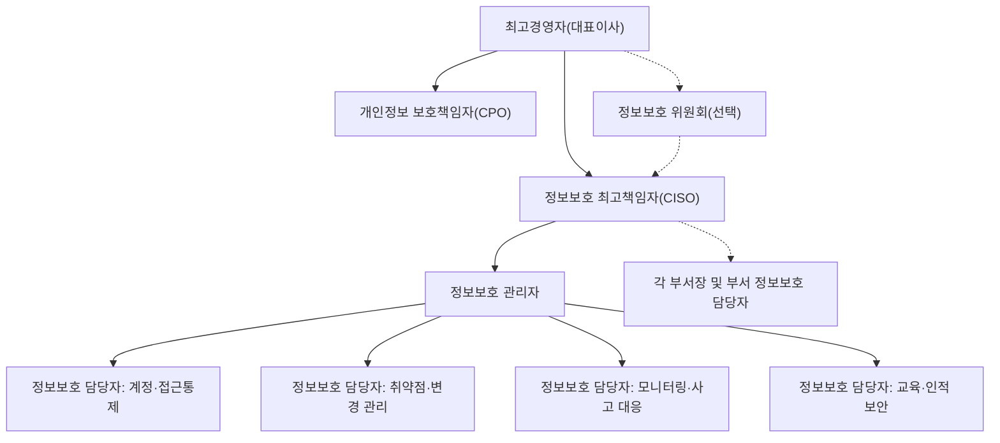

---
tags:
  - CSAP
  - 양식
  - 하등급SaaS
  - 관리적보호조치
control: 1.2.1 조직 구성
section: 1.2 정보보호 조직
doc_type: 양식
evidence: 정보보호 조직 구성도
문서 양식 번호: LS-1.2.1-02
문서 양식 버전: 0.0.1
---

> [!note] 근거
> [해설서/하등급-SaaS/1.2.1 조직 구성](../../../해설서/하등급-SaaS/01.%20관리적%20보호%20조치/1.2.1%20조직%20구성.md)

# 정보보호 조직 구성도

| 문서번호 | 버전 | 작성일 | 작성자 | 검토자 | 승인자 | 시행일 |
| --- | --- | --- | --- | --- | --- | --- |
| {{ORG-002}} | 1.0 | {{YYYY-MM-DD}} | {{성명/직위}} | {{성명/직위}} | {{CISO 성명}} | {{YYYY-MM-DD}} |

## 1. 조직 구성도

- 실선은 지휘·보고 체계, 점선은 협의·협조 체계를 뜻한다.
- 겸임 조직인 경우 각 역할 옆에 소속 부서와 본래 직위를 함께 표기한다.
- 정보보호 위원회를 두지 않으면 해당 노드를 삭제한다.

## 2. 구성원 현황

| 역할 | 소속 부서 | 직위 | 성명 | 수행 형태 | 지정 근거 | 자격요건 충족 확인 | 연락처 |
| --- | --- | --- | --- | --- | --- | --- | --- |
| 최고경영자 | | 대표이사 | | | | 해당 없음 | |
| 정보보호 최고책임자(CISO) | | | | {{전담 / 겸임}} | 임명장 {{번호}}, 인사발령 {{번호}} | {{충족, 04. 검토서 참조}} | |
| 개인정보 보호책임자(CPO) | | | | {{전담 / 겸임}} | 지정서 {{번호}} | {{충족, 07. 지정서 참조}} | |
| 정보보호 관리자 | | | | {{전담 / 겸임}} | 조직 구성 승인서 {{번호}} | {{충족, 06. 직무기술서 8항 참조}} | |
| 정보보호 담당자(계정·접근통제) | | | | {{전담 / 겸임}} | 조직 구성 승인서 {{번호}} | | |
| 정보보호 담당자(취약점·변경 관리) | | | | {{전담 / 겸임}} | 조직 구성 승인서 {{번호}} | | |
| 정보보호 담당자(모니터링·사고 대응) | | | | {{전담 / 겸임}} | 조직 구성 승인서 {{번호}} | | |
| 정보보호 담당자(교육·인적 보안) | | | | {{전담 / 겸임}} | 조직 구성 승인서 {{번호}} | | |
| 부서 정보보호 담당자({{부서명}}) | | | | 겸임 | 부서장 지정 | | |

## 3. 역할별 책임 분담

R은 수행 책임, A는 최종 승인 책임, C는 협의, I는 통보를 뜻한다.

| 업무 | 최고경영자 | CISO | CPO | 정보보호 관리자 | 정보보호 담당자 | 부서장 |
| --- | --- | --- | --- | --- | --- | --- |
| 정보보호 정책·지침 제·개정 | A | R | C | R | C | I |
| 연간 정보보호 계획 수립·예산 편성 | A | R | C | R | C | I |
| 위험평가 및 보호대책 수립 | I | A | C | R | R | C |
| 계정·접근권한 관리 및 검토 | I | A | I | R | R | C |
| 취약점 점검·조치 | I | A | I | R | R | C |
| 침해사고 대응·보고 | I | A | C | R | R | C |
| 정보보호 교육 계획·시행 | I | A | C | R | R | I |
| 개인정보 처리 실태 점검 | I | C | A | C | R | C |
| 정보보호 실태 감사 및 개선 | I | A | C | R | R | I |
| 책임공유모델에 따른 IaaS/PaaS 제공자 관리 | I | A | I | R | R | C |

## 4. 보고 및 의사결정 체계

| 구분 | 보고자 | 보고 대상 | 주기·시점 | 내용 |
| --- | --- | --- | --- | --- |
| 정기 보고 | 정보보호 최고책임자 | 최고경영자 | {{분기}} | 정보보호 활동 실적, 위험, 예산 집행 현황 |
| 정기 보고 | 정보보호 관리자 | 정보보호 최고책임자 | {{월}} | 점검 결과, 이슈, 조치 현황 |
| 긴급 보고 | 정보보호 담당자(정보보호 관리자 경유) | 정보보호 최고책임자, 최고경영자 | 침해사고·장애 인지 즉시 | 사고 개요, 영향, 초동 조치 |
| 개인정보 보고 | 개인정보 보호책임자 | 최고경영자 또는 이사회 | {{반기}} | 개인정보 보호 계획 수립·시행 결과 |

## 5. 개정 이력

| 버전 | 일자 | 변경 내용 | 작성자 | 승인자 |
| --- | --- | --- | --- | --- |
| 1.0 | {{YYYY-MM-DD}} | 최초 제정 | | |
