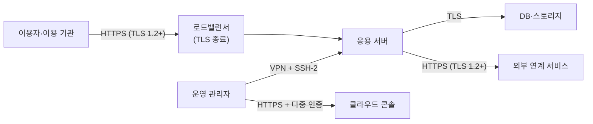

---
tags:
  - CSAP
  - 양식
  - 하등급SaaS
  - 기술적보호조치
control: 11.1.4 네트워크 암호화
section: 11.1 네트워크 보안
doc_type: 양식
evidence: 클라우드서비스 내에 암호화 통신 채널 사용 현황
문서 양식 번호: LS-11.1.4-02
문서 양식 버전: 0.0.1
---

> [!note] 근거
> [해설서/하등급-SaaS/11.1.4 네트워크 암호화](../../../해설서/하등급-SaaS/02.%20기술적%20보호%20조치/11.1.4%20네트워크%20암호화.md)

# 암호화 통신 채널 사용 현황

| 문서번호 | 버전 | 기준일 | 작성자 | 검토자 | 승인자 |
| --- | --- | --- | --- | --- | --- |
| {{NWE-002}} | {{1.0}} | {{YYYY-MM-DD}} | {{성명/직위}} | {{정보보호 관리자 성명}} | {{CISO 성명}} |

## 1. 통신 구성 요약

{{서비스명}}에서 중요정보가 이동하는 구간과 적용된 암호화 통신 채널을 표시한다. 실제 구성에 맞게 수정한다.

- 로드밸런서에서 TLS를 종료하는 경우 로드밸런서와 응용 서버 사이 구간의 중요정보 보호 방식(내부 TLS 재암호화 또는 제공자 관리 네트워크 범위)을 2항 현황의 비고에 기록한다.

## 2. 암호화 통신 채널 현황

양식 01. 네트워크 암호화 지침 5항의 대상 구간을 빠짐없이 등재하고, 실제 설정과 일치하게 적는다. 알고리즘·키 길이는 보안강도 2^112 이상(예: AES 128bit 이상, RSA 2048bit 이상, SHA-256 이상)을 만족해야 한다.

| No | 통신 구간(출발지 → 목적지) | 용도·중요정보 | 암호화 방법(프로토콜·버전) | 알고리즘·키 길이(암호/키 교환/해시) | 인증서·키(발급기관, 만료일) | 설정 위치(시스템·설정 키) | 책임 | 지침 기준 충족 | 확인일 | 담당 | 비고 |
| --- | --- | --- | --- | --- | --- | --- | --- | --- | --- | --- | --- |
| 1 | {{이용자 → 로드밸런서}} | {{서비스 이용, 개인정보·인증정보}} | {{HTTPS, TLS 1.2/1.3}} | {{AES-256-GCM / ECDHE / SHA-256}} | {{CA명, YYYY-MM-DD}} | {{LB명, TLS 정책명}} | 당사 | {{충족 / 미충족}} | {{YYYY-MM-DD}} | {{성명}} | |
| 2 | {{운영 관리자 → 운영 서버}} | {{서버 원격 관리}} | {{VPN(IPsec) + SSH-2}} | {{AES-128 이상 / ECDHE / SHA-256}} | {{SSH 키, VPN 인증서}} | {{VPN 장비·sshd_config}} | 당사 | | | | |
| 3 | {{응용 서버 → 운영 DB}} | {{개인정보 조회·저장}} | {{TLS 1.2}} | | {{내부 인증서, YYYY-MM-DD}} | {{DB 파라미터명}} | 당사 | | | | |
| 4 | {{응용 서버 → 외부 API}} | {{알림 발송 등}} | {{HTTPS, TLS 1.2}} | | {{상대측 인증서 검증}} | {{연동 모듈 설정}} | 당사 | | | | |
| 5 | {{데이터 이관 구간}} | {{이용자 데이터 이관}} | {{VPN / SFTP}} | | | {{이관 절차서 번호}} | 당사 | | | | |

- 구간이 추가·변경·폐지되면 행을 갱신하고 버전을 올린다.
- 인증서 만료일이 {{30}}일 이내로 남은 행은 비고에 갱신 계획을 적는다.

## 3. 미암호화 구간·예외 현황

양식 01 지침 10항에 따라 예외 승인을 받은 구간만 기록한다. 예외 없이 미암호화 상태인 구간이 발견되면 즉시 조치하고 양식 03. 암호화 통신 채널 점검 결과서에 부적합으로 기록한다.

| No | 통신 구간 | 중요정보 이동 여부 | 예외 사유 | 예외 승인(승인자·일자) | 보완 통제 | 적용 기한 | 재검토 예정일 |
| --- | --- | --- | --- | --- | --- | --- | --- |
| 1 | | {{○ / X}} | | | | {{YYYY-MM-DD}} | |

## 4. 제공자 책임 구간 확인

책임공유모델에 따라 IaaS/PaaS 제공자가 책임지는 구간은 제공자의 인증·계약·공개 문서로 보호 수준을 확인하고 그 근거를 기록한다.

| 구간 | 제공자 | 확인 방법 | 확인 자료 | 확인일 | 담당 |
| --- | --- | --- | --- | --- | --- |
| 데이터센터 내 물리 네트워크 | {{제공자명}} | {{CSAP 인증서, 이용 계약, 공개 백서}} | {{자료명·보관 위치}} | {{YYYY-MM-DD}} | |
| 하이퍼바이저 내부 통신 | {{제공자명}} | | | | |
| 제공자 관리형 서비스 구간({{예: 관리형 DB 연결}}) | {{제공자명}} | | | | |

## 5. 현행화 규칙

- 신규 구간 오픈, 구성 변경, 인증서 교체, 예외 승인·만료 시 {{n}}영업일 이내에 본 현황을 갱신하고 버전을 올린다.
- {{반기}} 1회 이상 양식 03. 암호화 통신 채널 점검 결과서의 점검 결과를 반영하고, 반영한 점검 문서번호를 개정 이력에 적는다.
- 본 현황의 각 행을 뒷받침하는 설정 화면·인증서 사본 등 증적은 양식 04. 증적 수집 점검표에 따라 수집한다.

## 6. 승인

| 구분 | 직위 | 성명 | 서명 | 일자 |
| --- | --- | --- | --- | --- |
| 작성(인프라 운영 담당) | | | | |
| 검토(정보보호 관리자) | | | | |
| 승인(정보보호 최고책임자) | | | | |

## 7. 개정 이력

| 버전 | 기준일 | 변경 내용 | 작성자 | 승인자 |
| --- | --- | --- | --- | --- |
| 1.0 | {{YYYY-MM-DD}} | 최초 작성 | | |
