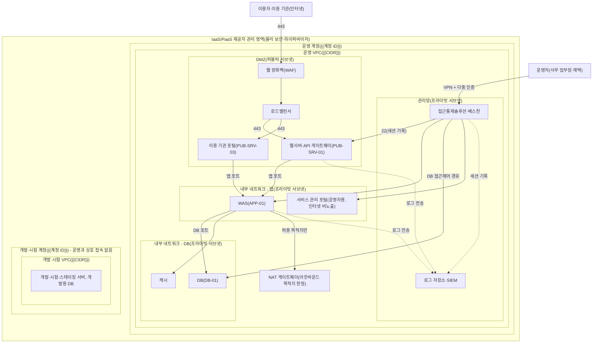

---
tags:
  - CSAP
  - 양식
  - 하등급SaaS
  - 기술적보호조치
control: 11.1.5 네트워크 분리
section: 11.1 네트워크 보안
doc_type: 양식
evidence: 네트워크 구성도 (네트워크 분리 및 연계 방법)
문서 양식 번호: LS-11.1.5-03
문서 양식 버전: 0.0.1
---

> [!note] 근거
> [해설서/하등급-SaaS/11.1.5 네트워크 분리](../../../해설서/하등급-SaaS/02.%20기술적%20보호%20조치/11.1.5%20네트워크%20분리.md)

# 네트워크 분리 구성도

| 문서번호 | 버전 | 기준일 | 작성자 | 검토자 | 승인자 |
| --- | --- | --- | --- | --- | --- |
| {{NSP-003}} | {{1.0}} | {{YYYY-MM-DD}} | {{네트워크 관리자 성명}} | {{정보보호 관리자 성명}} | {{CISO 성명}} |

## 1. 구성 개요

| 항목 | 내용 |
| --- | --- |
| 서비스 | {{서비스명}}(하등급 SaaS) |
| IaaS/PaaS 제공자 | {{제공자명}}, CSAP 인증 {{인증번호 / 유효기간}} |
| 리전·가용영역 | {{국내 리전명}}, {{가용영역}} (공공기관 데이터는 국내에 위치) |
| 운영 계정·VPC | 운영 {{계정 ID}}, {{VPC 이름 / CIDR}} |
| 개발·시험 계정·VPC | 개발·시험 {{계정 ID}}(운영과 분리), {{VPC 이름 / CIDR}} |
| 인터넷 진입점 | {{웹 방화벽/CDN}} → {{로드밸런서}} → DMZ 공개서버 |
| 관리자 진입점 | {{VPN}} → {{배스천 / 세션 관리 서비스}}(다중 인증) → 각 서버 |
| 구성도 원본 | {{다이어그램 파일 경로, 클라우드 콘솔 구성 내보내기 위치}} |

- 서버·보안 그룹 단위의 상세 구성과 공개서버 목록은 9.1.5 공개서버 네트워크 및 시스템 구성도를 따르고, 본 문서는 영역(존) 단위의 분리·연계를 기준으로 관리한다. 두 문서의 영역 명칭과 대역은 동일하게 유지한다.

## 2. 네트워크 분리 구성도

- 실선은 서비스·관리 통신, 점선은 로그 전송을 뜻한다. 화살표 방향은 통신을 개시하는 방향이다.
- DMZ에서 내부 네트워크 - DB로 직접 향하는 경로는 두지 않는다. 개발·시험 계정과 운영 계정 사이에는 피어링·라우팅 등 네트워크 연계가 없다.
- 제공자 관리 영역(물리 시설, 하이퍼바이저, 계정 간 기반 격리)은 제공자 인증·계약으로 확인하며, 당사는 계정·VPC 내부의 분리 구성을 책임진다.
- 실제 구성과 다르면 노드·연결을 수정하고, 관리형 서비스를 쓰면 해당 노드를 서비스명으로 바꾼다.

## 3. 네트워크 영역 정의 및 연계 방법

영역 명칭·대역은 9.1.5 공개서버 네트워크 및 시스템 구성도 3항과 동일하다.

| 영역 | 서브넷·CIDR | 인터넷 직접 노출 | 배치 자산 | 분리 수단 | 다른 영역과의 연계 방법 |
| --- | --- | --- | --- | --- | --- |
| DMZ | {{10.0.1.0/24}} | 있음(인바운드는 로드밸런서·웹 방화벽 경유) | 웹서버·API 게이트웨이, 이용 기관 포털, 배포 서버, 로드밸런서 | 퍼블릭 서브넷, 보안 그룹({{sg-lb}}, {{sg-web}}), 네트워크 ACL | 내부 - 앱으로만 허용 규칙 연계, DB 직접 경로 없음 |
| 내부 - 앱 | {{10.0.11.0/24}} | 없음 | WAS, 배치 서버, 서비스 관리 포털(운영자용) | 프라이빗 서브넷, 보안 그룹({{sg-app}}) | DMZ 특정 출발지 수신, 내부 - DB로 송신, NAT 경유 아웃바운드 |
| 내부 - DB | {{10.0.21.0/24}} | 없음 | DB, 캐시, 백업 | 프라이빗 서브넷, 보안 그룹({{sg-db}}), 저장 암호화 | 내부 - 앱 계층 수신만, 아웃바운드 원칙 차단 |
| 관리망 | {{10.0.31.0/24}} | 없음(VPN 경유) | 배스천, 로그 저장소·SIEM, 모니터링 | 프라이빗 서브넷, 보안 그룹({{sg-bastion}}, {{sg-log}}), 다중 인증 | 배스천에서 각 영역 관리 포트 송신, 각 영역에서 로그 수신 |
| 개발·시험 | {{별도 계정·VPC}} | 없음 | 개발·시험·스테이징 서버, 개발용 DB | 계정·VPC 분리 | 운영과 네트워크 연계 없음, 배포는 CI/CD·이미지 저장소 경유 |

### 3.1 영역 간 연계 구성 목록

VPC 피어링, 전용 연결, VPC 엔드포인트 등 연계 구성을 모두 등재한다. 등재되지 않은 연계는 우회 경로로 보고 차단한다.

| No | 연계 구성 | 연결 대상(출발 ↔ 도착) | 목적 | 통신 범위 | 승인자·승인일 | 최근 필요성 검토일 |
| --- | --- | --- | --- | --- | --- | --- |
| 1 | {{VPC 엔드포인트}} | {{운영 VPC ↔ 객체 스토리지}} | {{백업 저장}} | {{443, 특정 버킷}} | {{CISO / YYYY-MM-DD}} | {{YYYY-MM-DD}} |
| 2 | {{VPN}} | {{사무 업무망 ↔ 관리망}} | 운영자 진입 | {{배스천 접속 포트}} | | |
| 3 | | | | | | |

## 4. 영역 간 접근통제 요약

영역 단위의 허용·차단 원칙이다. 서버·보안 그룹 단위 상세 규칙은 9.1.5 공개서버 네트워크 및 시스템 구성도 5항의 통신 허용 매트릭스로 관리하며, 본 표와 어긋나지 않게 유지한다.

| No | 출발지 영역 | 목적지 영역 | 허용 여부 | 허용 범위·통제 수단 |
| --- | --- | --- | --- | --- |
| 1 | 인터넷 | DMZ | 제한 허용 | 웹 방화벽·로드밸런서 경유 TCP 443만 |
| 2 | 인터넷 | 내부 - 앱, 내부 - DB, 관리망, 개발·시험 | 차단 | 인터넷 게이트웨이 라우팅·공인 IP 없음 |
| 3 | DMZ | 내부 - 앱 | 제한 허용 | 출발지 {{sg-web}} 한정, 앱 포트만 |
| 4 | DMZ | 내부 - DB | 차단 | {{sg-db}} 인바운드에 DMZ 출발지 없음 |
| 5 | 내부 - 앱 | 내부 - DB | 제한 허용 | 출발지 {{sg-app}} 한정, DB 포트만 |
| 6 | 내부 - 앱, DMZ | 인터넷 | 제한 허용 | NAT·프록시 경유, 허용 목적지(패치 저장소·외부 API)만 |
| 7 | 내부 - DB | 인터넷 | 차단 | 예외 시 사유·승인 기록: {{ }} |
| 8 | 관리망(배스천) | DMZ, 내부 - 앱, 내부 - DB | 제한 허용 | VPN·다중 인증 후 배스천 경유, 세션 기록 |
| 9 | DMZ, 내부 - 앱, 내부 - DB | 관리망 | 제한 허용 | 로그 전송({{sg-log}})만, 관리 포트 차단 |
| 10 | 개발·시험 | 운영 전 영역 | 차단 | 피어링·라우팅 없음, 운영 보안 그룹에 개발 출발지 없음 |
| 11 | 운영 전 영역 | 개발·시험 | 차단 | 자료 이동은 망간 자료전송 절차(01 지침 8항)로만 |

- 위 원칙에 없는 영역 간 통신은 모두 차단한다. 원칙 변경은 01. 네트워크 분리 관리 지침 11항의 변경 절차를 따른다.

## 5. 이용자(테넌트) 간 분리 구성

| 항목 | 내용 |
| --- | --- |
| 분리 방식 | {{테넌트 식별자 기반 응용·DB 논리 분리 / 테넌트별 스키마 / 전용 자원}} (02. 네트워크 영역별 분리 기준 5항) |
| 적용 위치 | {{응용 인가 모듈, DB 접근 계층, 스토리지 키 규칙}} |
| 격리 검증 | 최근 테넌트 격리 시험일 {{YYYY-MM-DD}}, 결과 {{이상 없음 / 조치 n건}} |
| 강화 분리 제공 이용 기관 | {{없음 / 기관명(전용 자원 구성: )}} |

## 6. 현행화 및 검토

- 영역·서브넷·연계 구성·접근통제 원칙이 변경되면 {{n}}영업일 이내에 본 문서를 갱신하고 버전을 올린다.
- 분기 1회 이상, 그리고 네트워크 구조 변경 시 04. 네트워크 분리 정책 준수 검토서로 실제 구성(서브넷·라우팅·보안 그룹·피어링 내보내기)과 대조하고 결과를 아래에 기록한다.

| 검토일 | 검토 구분 | 대조 자료(기준일) | 결과 | 검토서 문서번호 |
| --- | --- | --- | --- | --- |
| {{YYYY-MM-DD}} | {{정기(분기) / 구조 변경}} | {{VPC·서브넷·보안 그룹 내보내기}} | {{일치 / 차이 n건 조치}} | {{NSP-REV-YYYY-NN}} |

## 7. 승인

| 구분 | 직위 | 성명 | 서명 | 일자 |
| --- | --- | --- | --- | --- |
| 작성(네트워크 관리자) | | | | |
| 검토(정보보호 관리자) | | | | |
| 승인(정보보호 최고책임자) | | | | |

## 8. 개정 이력

| 버전 | 기준일 | 변경 내용 | 작성자 | 승인자 |
| --- | --- | --- | --- | --- |
| 1.0 | {{YYYY-MM-DD}} | 최초 작성 | | |
