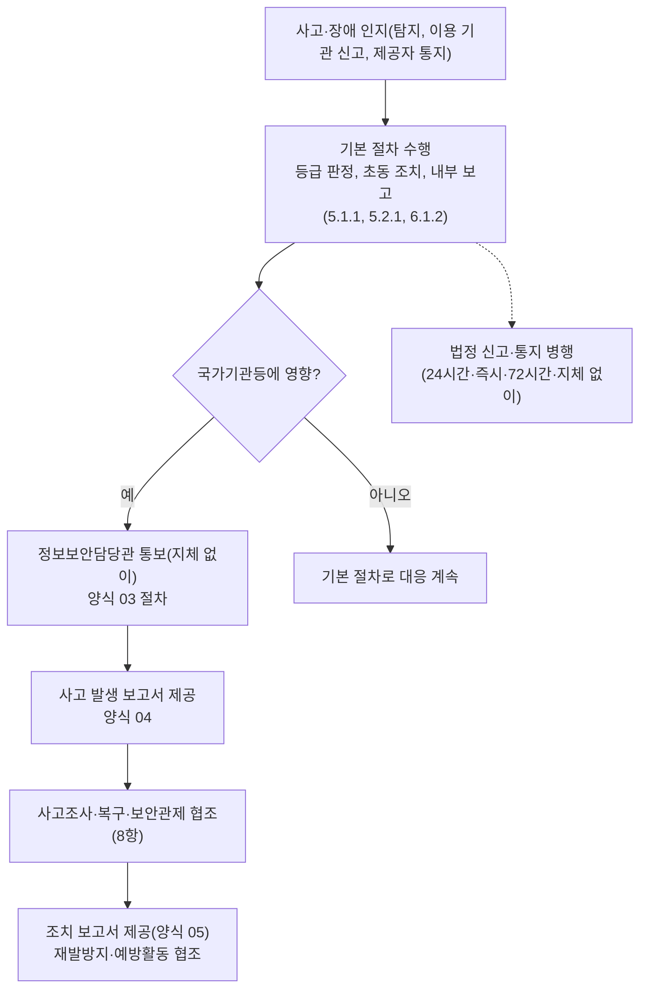

---
tags:
  - CSAP
  - 양식
  - 하등급SaaS
  - 공공기관보호조치
control: 14.1.4 사고 및 장애 대응
section: 14.1 관리적 보호조치
doc_type: 양식
evidence: 침해사고/장애 대응 절차
문서 양식 번호: LS-14.1.4-01
문서 양식 버전: 0.0.1
---

> [!note] 근거
> [해설서/하등급-SaaS/14.1.4 사고 및 장애 대응](../../../해설서/하등급-SaaS/03.%20공공기관%20보호%20조치/14.1.4%20사고%20및%20장애%20대응.md)

# 국가기관등 사고 및 장애 대응 절차

| 문서번호 | 버전 | 작성일 | 작성자 | 검토자 | 승인자 | 시행일 |
| --- | --- | --- | --- | --- | --- | --- |
| {{GIR-001}} | 1.0 | {{YYYY-MM-DD}} | {{정보보호 관리자 성명}} | {{CPO 성명}} | {{CISO 성명}} | {{YYYY-MM-DD}} |

> [!info] 법령 기준
> 클라우드컴퓨팅 발전 및 이용자 보호에 관한 법률 제25조(법률 제21066호, 2025. 10. 1. 시행)와 같은 법 시행령 제16조·제17조(대통령령 제35947호, 2026. 1. 2. 시행), 정보통신망법 제48조의3(법률 제21305호, 2026. 7. 7. 시행)과 같은 법 시행령 제58조의2·제41조(대통령령 제36502호, 2026. 7. 7. 시행), 개인정보 보호법 제34조(법률 제20897호, 2025. 10. 2. 시행)를 기준으로 작성했다. 국가 사이버보안 기본지침 제41조(클라우드컴퓨팅 보안)·제135조(초동 조치)·제140조(사이버 공격·위협으로 인한 사고)·제145조(기관간 정보공유 협력)는 비공개 행정지침이므로 문서명과 조문만 적고, 세부 요구는 이용 기관을 통해 확인한다. 법령이 개정되면 국가법령정보센터에서 조문을 다시 확인한다.

## 1. 목적

{{회사명}}은(는) 클라우드컴퓨팅서비스 {{서비스명}}을 이용하는 국가기관등(공공기관 이용 기관)에서 사고 또는 장애가 발생했을 때, 국가기관등의 사고 및 장애 대응절차를 반영하여 대응하고, 해당 국가기관등·대내외 관련기관·전문가와 협조체계를 구성하며, 피해확산 및 재발방지와 복구에 필요한 조치를 위해 국가정보원과 이용 기관의 보안관제·사고조사·예방보안활동에 적극 협조하기 위하여 본 절차를 정한다.

## 2. 적용 범위

- {{서비스명}}(하등급 SaaS)을 이용하는 국가기관등에 영향을 주거나 줄 수 있는 침해사고, 침해사고 징후, 장애(서비스 중단), 이용자 정보 유출에 적용한다.
- {{회사명}}의 임직원 전원, 인증 범위 내 정보자산에 접근하는 외부인력, 침해사고·장애 대응조직에 적용한다.
- 책임공유모델에 따라 IaaS/PaaS 제공자 책임 영역(물리 시설, 네트워크 인프라, 하이퍼바이저 등)에서 발생한 사고·장애라도 국가기관등에 영향이 있으면 당사가 클라우드컴퓨팅서비스 제공자로서 본 절차의 통보·보고·협조를 수행한다. 제공자 영역의 사실관계는 제공자의 통지·계약으로 확인한다.
- 집적정보통신시설 관련 보고 의무 해당 여부와 절차는 6.1.2 양식 01. 장애 대응 및 보고 절차 8.7항을 따른다.

## 3. 용어 정의

침해사고, 침해사고 징후, 장애, 서비스 중단, 이용자 정보, 인지 시점의 정의는 5.1.1 양식 02. 침해사고 대응지침 3항, 5.2.1 양식 01. 침해사고 보고 및 신고 통지 절차 3항, 6.1.2 양식 01. 장애 대응 및 보고 절차 3항의 정의를 그대로 사용한다. 본 절차에서 추가로 정의하는 용어는 다음과 같다.

| 용어 | 정의 |
| --- | --- |
| 국가기관등 | 「클라우드컴퓨팅 발전 및 이용자 보호에 관한 법률」 제2조제4호의 국가기관, 지방자치단체, 공공기관 등으로서 {{서비스명}}을 이용하는 기관 |
| 정보보안담당관 | 국가기관등에서 정보보안 업무를 총괄하는 담당자(기관에 따라 정보보호담당관, 사이버보안 담당자 등 명칭이 다를 수 있다) |
| 사고 및 장애 | 침해사고(징후 포함), 이용자 정보 유출, 장애(서비스 중단)를 통칭하는 말 |
| 사이버공격 관련 정보 | 대규모 사이버공격의 발생, 사이버공격으로 인한 피해의 발생·예상, 사이버공격의 확산 우려, 사이버공격 계획 등 사이버안전에 위협을 초래할 수 있는 정보 |
| 보안관제 | 사이버공격 정보를 탐지·분석하여 즉시 대응 조치를 할 수 있는 체계의 운영. 당사의 보안관제 지원 체계는 14.3.2 산출물을 따른다 |
| 예방보안활동 | 국가정보원 또는 국가기관등이 수행하는 보안 점검, 취약점 확인, 모의 훈련 등 사고 예방 목적의 활동 |
| 사고 발생 보고서 | 국가기관등에 제공하는 사고·장애 발생 보고서(양식 04). 조치 완료 후에는 조치 보고서(양식 05)를 제공한다 |

## 4. 기본 대응 절차와의 관계

본 절차는 당사의 사고·장애 대응 체계에 국가기관등 특화 요구를 추가하는 문서다. 사고·장애의 정의, 유형, 등급, 내부 보고 체계와 시한, 법령별 신고·통지 세부는 아래 기본 문서를 따르고 본 절차에서 반복하지 않는다. 기준이 서로 다르면 기본 문서를 우선하고 본 절차를 맞춘다.

| 영역 | 기본 문서 | 본 절차가 추가하는 것 |
| --- | --- | --- |
| 침해사고 정의·범위, 대응조직, 탐지·대응·복구 | 5.1.1 양식 02. 침해사고 대응지침 | 국가기관등 대응절차 반영 확인(5항), 사고조사·예방활동 협조(8항) |
| 침해사고 유형(T-01~T-09)·등급(1 심각/2 중대/3 보통/4 징후), 내부 보고 시한, 법령별 신고·통지 | 5.2.1 양식 01. 침해사고 보고 및 신고 통지 절차 | 정보보안담당관 통보·보고서 제공 단계(6항, 양식 03·04·05) |
| 장애 등급(1급 중대/2급 주요/3급 경미), 장애 대응·보고, 이용자 통지 기준(연속 10분, 24시간 이내 2회 합계 15분, 계약 기준) | 6.1.2 양식 01. 장애 대응 및 보고 절차 | 장애 시 정보보안담당관 통보와 보고서 제공(6항) |
| 대응조직 명단·내부 비상연락망 | 5.1.1 양식 03. 침해사고 대응조직 및 비상연락망 | 국가기관등 협조체계와 정보보안담당관 연락망(양식 02) |
| 이용 기관 신고 채널·통지 방법 안내 | 5.1.1 양식 04. 이용 기관 침해사고 대응 안내 | 국가기관등 요구사항 수집·반영(5항) |
| 계약·SLA상 보고 의무 | 14.1.1 양식 02. 보안서비스 수준 협약서 | 기관별 사고·장애 보고 요구의 절차 반영(5항) |

## 5. 국가기관등 대응절차의 반영

### 5.1 요구사항 수집

국가기관등과 이용 계약(보안서비스 수준 협약 포함)을 체결하거나 변경할 때 다음 항목을 수집하여 14.1.1 양식 01. 국가기관등 보안요구사항 정의서와 본 절차 5.2항에 기록한다.

| 수집 항목 | 내용 |
| --- | --- |
| 보고 대상·연락처 | 정보보안담당관 성명·직위, 전화·팩스·이메일, 기관 지정 보고 채널 |
| 보고 시한 | 기관이 요구하는 사고·장애 통보 시한(예: 인지 후 즉시, {{n}}시간 이내) |
| 보고 서식 | 기관 지정 사고 발생 보고서·조치 보고서 서식 유무. 지정 서식이 없으면 양식 04·05를 사용한다 |
| 대응절차 연계 | 기관의 사고·장애 대응절차 중 당사가 수행할 사항(초동 조치 요구, 증적 보전, 보안관제 정보 공유 등) |
| 보안관제 체계 | 기관 또는 국가정보원 보안관제와의 정보 공유·연계 방식(14.3.2 산출물과 연계) |

### 5.2 기관별 요구사항 현황

| No | 국가기관등 | 요구 출처(계약·SLA·기관 지침) | 사고·장애 통보 시한 | 지정 보고 서식 | 보고 채널 | 당사 절차 반영 확인일 | 확인자 |
| --- | --- | --- | --- | --- | --- | --- | --- |
| 1 | {{기관명}} | {{계약번호, SLA 조항}} | {{지체 없이 / n시간 이내}} | {{없음(양식 04·05 사용) / 기관 서식명}} | {{정보보안담당관 이메일 + 전화}} | {{YYYY-MM-DD}} | |
| 2 | | | | | | | |
| 3 | | | | | | | |

### 5.3 반영 확인

1. 정보보호 관리자는 연 1회 이상, 그리고 계약 체결·변경 시마다 5.2항의 기관 요구와 당사 대응 절차(등급, 보고 시한, 통보·보고서 제공 절차)의 차이를 검토한다.
2. 기관 요구가 당사 내부 기준보다 엄격하면(더 짧은 시한, 추가 보고 항목 등) 해당 기관에는 기관 요구를 적용하고, 여러 기관에 공통되는 요구는 기본 문서 개정으로 반영한다.
3. 국가 사이버보안 기본지침 등 비공개 지침에 따른 기관 요구(초동 조치, 정보공유 협력 등)는 이용 기관 정보보안담당관을 통해 확인하고 확인 결과를 5.2항에 기록한다.
4. 검토 결과와 개정 사항은 본 문서 개정 이력과 5.1.1 양식 06. 침해사고 대응지침 적정성 검토서에 기록한다.

## 6. 사고 및 장애 대응 절차

| 단계 | 활동 | 담당 | 시한 | 기록 |
| --- | --- | --- | --- | --- |
| 1. 인지·기본 절차 수행 | 탐지·신고·제공자 통지로 사고·장애를 인지하고 기본 문서에 따라 등급 판정, 초동 조치, 내부 보고를 수행하면서 발생내용, 원인, 조치현황을 신속히 파악한다 | 대응팀장(정보보호 관리자) | 기본 문서의 등급별 시한 | 5.2.1 양식 02, 6.1.2 양식 02·03 |
| 2. 국가기관등 영향 확인 | 영향받는 이용 기관 중 국가기관등을 식별하고 기관별 영향(기능, 데이터, 계정)을 확인한다 | 대응팀장 | 초동 조치와 병행, 인지 후 {{2시간}} 이내 1차 확인 | 사고 기록 |
| 3. 정보보안담당관 통보 | 양식 03의 기준·절차에 따라 해당 국가기관등의 정보보안담당관에게 전화·팩스·이메일 등으로 지체 없이 통보한다 | 대외 커뮤니케이션 담당(정보보호 최고책임자 승인) | 지체 없이(내부 기준: 영향 확인 후 {{1시간}} 이내 1차 통보) | 양식 03 6항 이력 |
| 4. 발생 보고서 제공 | 양식 04. 사고 및 장애 발생 보고서를 작성하여 제공한다. 기관 지정 서식이 있으면 그 서식에 맞춘다 | 대외 커뮤니케이션 담당 | 1차 통보 후 {{24시간}} 이내(기관 요구 시한 우선) | 양식 04 |
| 5. 법정 신고·통지 병행 | 관계기관 신고와 이용자 통지를 법정 시한 내에 병행한다. 정보보안담당관 통보로 갈음하지 않는다 | 정보보호 관리자, 개인정보 보호책임자 | 5.2.1 양식 01 7항, 6.1.2 양식 01 8항의 시한 | 5.2.1 양식 03·04, 6.1.2 양식 05 |
| 6. 사고조사·복구 협조 | 국가정보원·국가기관등의 사고조사와 이용 기관의 자체 대응에 협조하고, 복구를 수행한다(8항) | 정보보호 최고책임자, 기술 대응 | 요청 접수 후 지체 없이 | 양식 03 6항 이력 |
| 7. 조치 보고서 제공 | 대응 종료 후 양식 05. 사고 및 장애 조치 보고서를 제공하고, 기관 확인 사항을 안내한다 | 대외 커뮤니케이션 담당 | 대응 종료 후 {{5}}영업일 이내(기관 요구 시한 우선) | 양식 05 |
| 8. 재발방지·예방활동 | 재발방지 대책을 이행하고 국가정보원·국가기관등의 예방보안활동에 협조한다(8항) | 정보보호 관리자 | 대책별 기한 | 5.2.1 양식 02 7항, 양식 03 6항 이력 |

- 국가기관등의 데이터에 영향이 확인되거나 유력한 침해사고는 5.1.1 양식 02 4.3항에 따라 1등급(심각)으로 분류하고, 등급별 시한을 적용한다.
- 장애 등급과 이용자 통지 기준(사전 예고 없이 연속 10분 이상, 24시간 이내 2회 이상 합계 15분 이상, 계약으로 정한 기간)은 6.1.2 양식 01 4항·8.1항을 따른다.
- 원인을 바로 알기 어려우면 확인된 발생내용·조치현황을 먼저 통보·보고하고, 원인 확인 후 지체 없이 추가 통보한다.

## 7. 이용 기관 신고 절차의 포함 확인

이용 기관(정보보안담당관) 신고·통보 절차가 당사 사고·장애 대응절차에서 누락되지 않도록, 다음 매핑을 연 1회 이상(절차 개정 시 즉시) 확인하고 확인 결과를 개정 이력에 기록한다.

| 상황 | 이용 기관 신고(통보) 절차 위치 | 확인 |
| --- | --- | --- |
| 침해사고 발생·이용자 정보 유출 | 5.1.1 양식 02 9.2항(사고전파)·11.2항(이용 기관 통지), 5.2.1 양식 01 8항, 본 절차 6항과 양식 03 | {{○ / X}} |
| 장애(서비스 중단) | 6.1.2 양식 01 8.3항·8.6항, 본 절차 6항과 양식 03 | {{○ / X}} |
| 사이버공격 관련 정보 확인 | 양식 03 2항의 통보 기준 | {{○ / X}} |
| 훈련 시나리오 | 5.1.1 양식 05, 6.1.2 양식 01 12항(국가기관등 통보 포함 여부) | {{○ / X}} |

## 8. 사고조사 및 예방보안활동 협조

### 8.1 협조 원칙

1. 당사는 피해확산·재발방지·복구를 위하여 국가정보원과 이용 기관(국가기관등)의 보안관제, 사고조사, 예방보안활동에 적극 협조한다.
2. 협조 요청의 접수 창구는 대외 커뮤니케이션 담당으로 단일화하고, 협조 이행은 정보보호 최고책임자가 승인한다.
3. 제공하는 자료에는 다른 이용 기관의 정보와 미조치 취약점의 기술 상세를 포함하지 않으며, 사고 정보의 취급은 5.1.1 양식 02 12항(유출 금지 대상 및 공개 통제)을 따른다.
4. 협조 과정에서 알게 된 국가기관등의 정보는 협조 목적 외로 사용하지 않고 제3자에게 공개하지 않는다.

### 8.2 협조 활동

| 구분 | 내용 | 당사 조치 | 담당 |
| --- | --- | --- | --- |
| 보안관제 협조 | 국가정보원·국가기관등 보안관제에 필요한 탐지 정보·로그의 공유, 관제 연계 환경 지원 | 14.3.2 산출물의 보안관제 지원 체계에 따라 제공 | 정보보호 관리자 |
| 사고조사 협조 | 국가정보원·국가기관등의 사고조사에 대한 증적(로그, 이미지, 분석 자료) 제공, 관계자 면담, 현장 조사 협조 | 증적은 5.1.1 양식 02 10.2항의 보존 절차로 관리하고, 제공 시 인수인계 기록을 남긴다 | 정보보호 최고책임자, 기록·증적 관리 담당 |
| 예방보안활동 협조 | 보안 점검, 취약점 확인, 모의 훈련 등 사고 예방 활동 협조와 결과에 따른 보완 조치 | 일정·범위를 협의하고, 지적 사항은 담당·기한을 정해 조치한다 | 정보보호 관리자 |
| 정보공유 협력 | 사이버공격 관련 정보의 상호 공유(양식 03 2항의 통보 포함) | 수신한 위협 정보는 탐지 체계(5.1.1 양식 02 7항)에 반영한다 | 정보보호 담당자 |
| 복구 협조 | 이용 기관의 데이터 검증·재접속 확인 등 기관 측 복구 활동 지원 | 5.1.1 양식 04 6항의 협조 사항에 따라 지원 | 기술 대응 |

### 8.3 협조 요청 처리 절차

| 단계 | 활동 | 담당 | 기록 |
| --- | --- | --- | --- |
| 1. 접수 | 협조 요청을 접수하고 요청 기관·근거·범위·기한을 확인한다. 요청자의 소속·신원을 기관 대표 연락처로 확인한다 | 대외 커뮤니케이션 담당 | 양식 03 6항 이력 |
| 2. 검토·승인 | 제공 범위(다른 이용 기관 정보 제외)와 방법을 검토하고 승인한다. 개인정보가 포함되면 개인정보 보호책임자가 함께 검토한다 | 정보보호 최고책임자 | 승인 기록 |
| 3. 이행 | 승인된 범위의 자료 제공·조사 협조·점검 수행 | 담당 부서 | 제공 자료 목록, 인수인계 기록 |
| 4. 기록·후속 | 협조 내용을 이력에 기록하고, 지적·권고 사항의 조치를 추적한다 | 정보보호 관리자 | 양식 03 6항 이력, 조치 기록 |

## 9. 훈련 및 검토

- 연 1회 이상 실시하는 침해사고 대응 훈련(5.1.1 양식 05)과 장애 모의훈련(6.1.2 양식 01 12항)에 국가기관등 정보보안담당관 통보와 사고 발생 보고서 작성·제공 시나리오를 포함한다.
- 본 절차는 연 1회 이상, 그리고 관련 법령·지침 개정, 국가기관등 계약 체결·변경, 사고·훈련 결과 발생 시 검토·개정한다.
- 대응조직 구성원과 고객지원 인력에게 연 1회 이상 본 절차와 통보 의무를 교육한다(2.3.2 교육 시행).

## 10. 관련 문서

- 양식 02. 국가기관등 협조체계 및 비상연락망
- 양식 03. 국가기관등 신고 및 통지 절차
- 양식 04. 사고 및 장애 발생 보고서
- 양식 05. 사고 및 장애 조치 보고서
- 5.1.1 침해사고 대응 절차 수립 산출물(침해사고 대응지침, 대응조직 및 비상연락망, 이용 기관 침해사고 대응 안내, 훈련 계획 및 결과서)
- 5.2.1 침해사고 보고 산출물(침해사고 보고 및 신고 통지 절차, 침해사고 보고서, 신고·통지 관리대장)
- 6.1.2 장애 보고 산출물(장애 대응 및 보고 절차, 장애 관리대장, 장애 보고서)
- 14.1.1 보안서비스 수준 협약 산출물(국가기관등 보안요구사항 정의서, 보안서비스 수준 협약서)
- 14.3.2 보안관제 제반환경 지원 산출물

## 11. 승인

| 구분 | 직위 | 성명 | 서명 | 일자 |
| --- | --- | --- | --- | --- |
| 작성(정보보호 관리자) | | | | |
| 검토(개인정보 보호책임자) | | | | |
| 승인(정보보호 최고책임자) | | | | |

## 12. 개정 이력

| 버전 | 일자 | 변경 내용 | 작성자 | 승인자 |
| --- | --- | --- | --- | --- |
| 1.0 | {{YYYY-MM-DD}} | 최초 제정 | | |
