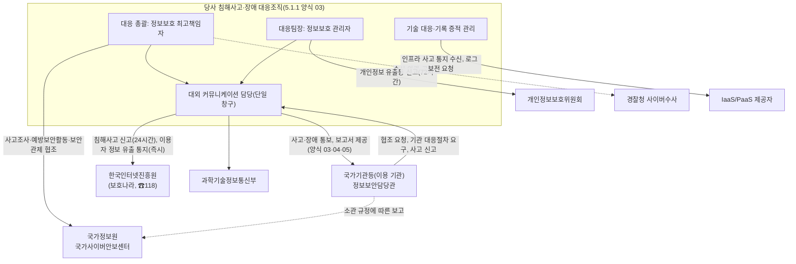

---
tags:
  - CSAP
  - 양식
  - 하등급SaaS
  - 공공기관보호조치
control: 14.1.4 사고 및 장애 대응
section: 14.1 관리적 보호조치
doc_type: 양식
evidence: 침해사고/장애 대응조직도 및 비상연락망
문서 양식 번호: LS-14.1.4-02
문서 양식 버전: 0.0.1
---

> [!note] 근거
> [해설서/하등급-SaaS/14.1.4 사고 및 장애 대응](../../../해설서/하등급-SaaS/03.%20공공기관%20보호%20조치/14.1.4%20사고%20및%20장애%20대응.md)

# 국가기관등 협조체계 및 비상연락망

| 문서번호 | 버전 | 기준일 | 작성자 | 검토자 | 승인자 |
| --- | --- | --- | --- | --- | --- |
| {{GIR-002}} | {{1.0}} | {{YYYY-MM-DD}} | {{정보보호 관리자 성명}} | {{대외 커뮤니케이션 담당 성명}} | {{CISO 성명}} |

> [!warning] 취급 주의
> 본 문서는 개인 연락처를 포함한다. 대응조직 구성원과 승인된 인원에게만 배포하고, 6항의 보관·접근 통제 규칙을 따른다. 인증 심사에는 연락처를 가린 사본을 제출할 수 있다.

당사 내부 대응조직의 명단·대행자·호출 순서는 5.1.1 양식 03. 침해사고 대응조직 및 비상연락망을 따르고, 장애 대응 역할은 6.1.2 양식 01 5항을 따른다. 본 문서는 국가기관등(공공기관 이용 기관)과 관계기관에 대한 협조체계와 연락망을 정한다.

## 1. 협조체계도

- 실선은 당사가 수행하는 통보·신고·협조, 점선은 결정에 따라 수행하거나 국가기관등이 수행하는 경로다.
- 대외 연락 창구는 대외 커뮤니케이션 담당으로 단일화하고, 관계기관 신고·이용 기관 통보는 정보보호 최고책임자의 승인을 받아 수행한다(양식 01 8.1항).

## 2. 당사 창구 및 담당

| 역할 | 담당(성명·직위) | 임무 | 대행자 | 근무 외 시간 연락 |
| --- | --- | --- | --- | --- |
| 대응 총괄(정보보호 최고책임자) | | 통보·협조 승인, 국가정보원 협조 창구, 최고경영자 보고 | | {{가능}} |
| 대응팀장(정보보호 관리자) | | 국가기관등 영향 확인, 통보 대상 판정, 보고서 작성 총괄 | | {{가능}} |
| 대외 커뮤니케이션 담당 | | 정보보안담당관 통보 실무, 양식 04·05 제공, 협조 요청 접수, 관계기관 신고 실무 | | |
| 개인정보 대응(개인정보 보호책임자) | | 개인정보 유출 관련 통보 내용 확인, 유출등 신고 | | |
| 기록·증적 관리 담당 | | 조사 협조용 증적 제공·인수인계 기록 | | |

- 명단은 5.1.1 양식 03 2항의 대응조직 명단과 일치해야 한다.

## 3. 국가기관등 정보보안담당관 연락망

이용 계약 체결·변경 시 갱신하고, 5.1.1 양식 04 9항의 이용 기관 담당자 확인서로 수집한 연락처를 반영한다. 계약상 통지 기준은 6.1.2 양식 01 9항과 일치시킨다.

| No | 국가기관등 | 정보보안담당관(성명·직위) | 전화 | 팩스 | 이메일 | 기관 지정 보고 채널·서식 | 통보 방법(계약) | 개인정보 처리 위탁 | 최근 확인일 |
| --- | --- | --- | --- | --- | --- | --- | --- | --- | --- |
| 1 | {{기관명}} | | | | | {{없음 / 기관 시스템·서식명}} | {{전화 + 이메일}} | {{○ / X}} | {{YYYY-MM-DD}} |
| 2 | | | | | | | | | |
| 3 | | | | | | | | | |

- 정보보안담당관의 부재에 대비하여 기관별 대체 연락처(당직실, 정보보안 부서 대표번호)를 확보한다: {{ }}
- 국가기관등 전체에 대한 일괄 통지 수단(서비스 접속화면 게시, 이메일 일괄 발송)과 담당자: {{ }}

## 4. 관계기관 연락처

연락처는 작성 시점에 각 기관의 공식 안내로 확인하고, 분기 점검 시 변경 여부를 확인한다. 5.1.1 양식 03 5항의 관계기관 연락처와 일치시킨다.

| 기관 | 용도 | 연락처 | 근거·시한 | 담당 |
| --- | --- | --- | --- | --- |
| 국가정보원 국가사이버안보센터 | 사고조사·예방보안활동·보안관제 협조, 사이버공격 관련 정보 공유 | {{☎111, <www.ncsc.go.kr> 확인 후 기재}} | 본 항목 협조 체계, 이용 기관 요청 시 | 정보보호 최고책임자 |
| 한국인터넷진흥원 인터넷침해대응센터 | 침해사고 신고, 기술 지원 | ☎118, 보호나라 <www.boho.or.kr> | 정보통신망법 제48조의3, 시행령 제58조의2(24시간 이내) | 대외 커뮤니케이션 담당 |
| 과학기술정보통신부 | 침해사고 신고, 이용자 정보 유출 통지, 통지 갈음 공고 통보 | {{확인 후 기재}} | 정보통신망법 제48조의3, 클라우드컴퓨팅법 제25조제2항(즉시)·시행령 제17조제4항 | 대외 커뮤니케이션 담당 |
| 개인정보보호위원회 / 한국인터넷진흥원 개인정보침해신고센터 | 개인정보 유출등 신고 | 개인정보 유출등 신고 시스템 brss.pipc.go.kr, ☎118 | 개인정보 보호법 제34조제3항, 시행령 제40조(72시간 이내) | 개인정보 보호책임자 |
| 경찰청 사이버수사 | 수사 의뢰, 공조 | {{ecrm.police.go.kr, ☎182 확인 후 기재}} | 정보보호 최고책임자 결정 시 | 대외 커뮤니케이션 담당 |
| 이용 기관 소관 상위 기관(해당 시) | 이용 기관 요청에 따른 협조 | {{이용 기관 안내에 따라 기재}} | 이용 기관 계약·요청 | 대외 커뮤니케이션 담당 |

## 5. 현행화 점검

| 점검 | 내용 | 주기 | 담당 |
| --- | --- | --- | --- |
| 당사 창구 대조 | 2항 담당과 5.1.1 양식 03 명단·인사 현황 대조 | 분기 1회, 인사 변동 시 즉시 | 정보보호 관리자 |
| 정보보안담당관 확인 | 3항 연락처의 담당자 변경·연락 가능 여부 확인(전화 또는 이메일) | 분기 1회, 계약 체결·변경 시 | 대외 커뮤니케이션 담당 |
| 관계기관 확인 | 4항 연락처·신고 채널 변경 확인 | 분기 1회 | 대외 커뮤니케이션 담당 |
| 훈련 연계 확인 | 연 1회 훈련에서 정보보안담당관 통보 경로의 실제 동작 확인(훈련 시 기관에는 사전 협의된 범위로만 연락) | 연 1회 | 정보보호 관리자 |

### 5.1 점검 기록

| 점검일 | 점검 유형 | 대상 | 결과(변경 건수·응답 여부) | 조치 | 점검자 | 반영 버전 |
| --- | --- | --- | --- | --- | --- | --- |
| {{YYYY-MM-DD}} | {{담당관 확인 / 관계기관 확인 / 창구 대조}} | | {{변경 n건}} | | | |
| | | | | | | |

## 6. 배포 및 보관

| 항목 | 내용 |
| --- | --- |
| 배포 대상 | 대응조직 구성원, 대외 커뮤니케이션 담당, 최고경영자, 당직 담당 |
| 전자 사본 | {{사내 보안 저장소 경로}}(접근 권한: 대응조직) |
| 오프라인 사본 | 사내 시스템 침해 시 사용할 인쇄본을 {{보관 장소}}에 봉인 보관하고 버전 갱신 시 교체(5.1.1 양식 03 8항과 함께 관리) |
| 갱신 | 변경 사항 발생 후 {{5}}영업일 이내 버전 갱신, 배포본 교체 |

## 7. 승인

| 구분 | 직위 | 성명 | 서명 | 일자 |
| --- | --- | --- | --- | --- |
| 작성(정보보호 관리자) | | | | |
| 검토(대외 커뮤니케이션 담당) | | | | |
| 승인(정보보호 최고책임자) | | | | |

## 8. 개정 이력

| 버전 | 기준일 | 변경 내용 | 작성자 | 승인자 |
| --- | --- | --- | --- | --- |
| 1.0 | {{YYYY-MM-DD}} | 최초 작성 | | |
