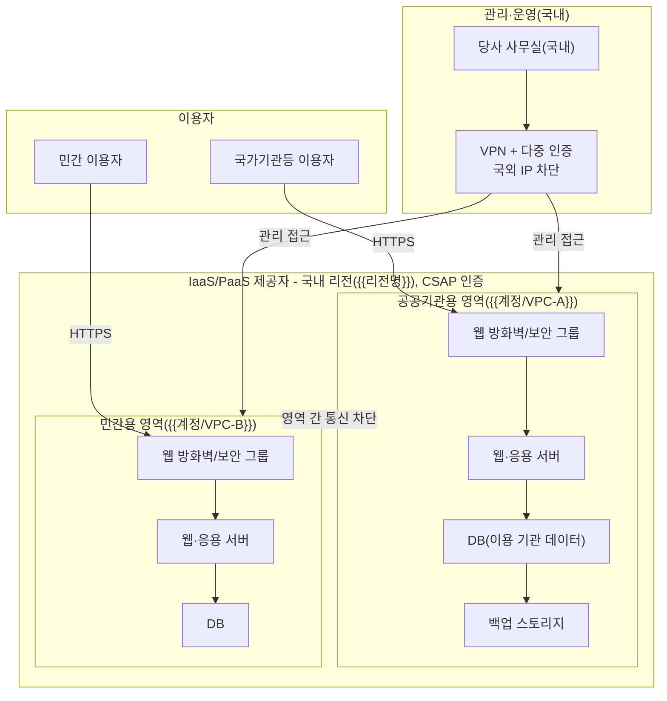

---
tags:
  - CSAP
  - 양식
  - 하등급SaaS
  - 공공기관보호조치
control: 14.2.1 물리적 위치 및 영역분리
section: 14.2 물리적 보호조치
doc_type: 양식
evidence: 네트워크 구성도
문서 양식 번호: LS-14.2.1-02
문서 양식 버전: 0.0.1
---

> [!note] 근거
> [해설서/하등급-SaaS/14.2.1 물리적 위치 및 영역분리](../../../해설서/하등급-SaaS/03.%20공공기관%20보호%20조치/14.2.1%20물리적%20위치%20및%20영역분리.md)

# 네트워크 구성도

| 문서번호 | 버전 | 작성일 | 작성자 | 검토자 | 승인자 | 시행일 |
| --- | --- | --- | --- | --- | --- | --- |
| {{LOC-002}} | 1.0 | {{YYYY-MM-DD}} | {{성명/직위}} | {{정보보호 관리자 성명}} | {{CISO 성명}} | {{YYYY-MM-DD}} |

## 1. 목적과 표현 범위

- 국가기관용 클라우드컴퓨팅서비스 영역과 일반 이용자용(민간) 서비스 영역이 물리적 또는 논리적으로 분리되어 있고, 모든 자원이 국내 리전에 위치하며, 관리자 접근이 국내에서 통제된 경로로만 이루어짐을 네트워크 관점에서 보여준다.
- 구성도에는 리전(국내), 영역(계정·VPC) 분리, 인터넷 경계, 관리자 접근 경로, 국외 접속 차단 지점을 반드시 표기한다.
- 구성도는 실제 클라우드 설정(계정, VPC, 보안 그룹)과 일치해야 하며, 일치 확인 증적은 양식 05. 증적 수집 점검표로 수집한다.

## 2. 전체 네트워크 구성도

아래 구성도는 예시이다. 실제 구성(계정·VPC·서브넷 이름, 장비, 연동)에 맞게 수정하고, 민간용 서비스를 제공하지 않으면 민간 영역을 삭제하고 3항에 그 사실을 적는다.

## 3. 영역분리 방식

하등급은 물리적 또는 논리적 분리를 선택할 수 있다. 당사가 적용한 방식과 분리를 구현하는 설정을 기록한다.

| 항목 | 내용 |
| --- | --- |
| 민간용 서비스 제공 여부 | {{제공(분리 구성 적용) / 미제공(전체가 공공기관용, 아래 분리 설정은 해당 없음)}} |
| 분리 방식 | {{물리적(별도 인프라) / 논리적(계정·VPC 분리)}} |
| 선정 사유 | {{예: 하등급 논리적 분리 허용, 제공자 공공기관용 영역 이용}} |

| 분리 계층 | 적용 설정 | 설정 위치·값 | 확인 증적(05 점검표 No) |
| --- | --- | --- | --- |
| 인프라 영역 | 공공기관용 영역(공공 클라우드 존 등) 이용 | {{제공자 영역명}} | |
| 계정 | 공공용·민간용 클라우드 계정(프로젝트) 분리 | {{계정 ID}} | |
| 네트워크 | VPC(가상 네트워크) 분리, 영역 간 피어링·라우팅 없음 | {{VPC 이름·CIDR}} | |
| 트래픽 통제 | 보안 그룹·네트워크 ACL로 영역 간 통신 차단 | {{규칙 요약}} | |
| 데이터 | DB·스토리지 인스턴스 분리, 공용 저장소 없음 | {{인스턴스명}} | |
| 응용 | 서비스 도메인·인증 체계 분리 | {{도메인}} | |

- 영역 간에 불가피한 공용 구성요소(예: 배포 파이프라인, 로그 수집)가 있으면 목록으로 적고, 데이터·프로세스 간섭이 없도록 적용한 통제를 기록한다: {{ }}

## 4. 관리자 접근 경로와 국외 접속 차단

| 접근 구분 | 출발지 | 경로·통제 | 국외 접속 차단 방법 |
| --- | --- | --- | --- |
| 운영 콘솔(클라우드 콘솔) | 당사 사무실·국내 원격 근무지 | VPN 접속 후 허용 IP에서만 접근, 다중 인증 | {{콘솔 접근 허용 IP 국내 한정, 국외 IP 차단 정책}} |
| 서버 원격 접속(SSH 등) | 위와 동일 | {{배스천 호스트 경유, 보안 그룹 허용 IP 제한}} | {{배스천 접근 IP 국내 한정}} |
| 서비스 관리자 기능 | 위와 동일 | {{관리자 페이지 IP 제한, 다중 인증}} | {{국외 IP 차단}} |

- 국외에서의 운영·관리 접속은 허용하지 않는다. 차단 설정과 접속 기록의 국내 IP 확인은 양식 04. 관리 운영 인력 국내 위치 확인서와 05. 증적 수집 점검표를 따른다.

## 5. 구성도 관리 규칙

- 네트워크 구성(계정, VPC, 서브넷, 보안 그룹, 연동)이 변경되면 {{n}}영업일 이내에 구성도를 갱신하고 버전을 올린다.
- 반기 1회 이상 실제 클라우드 설정과 구성도의 일치 여부를 확인하고 확인일을 기록한다: 최근 확인일 {{YYYY-MM-DD}}, 확인자 {{성명}}
- 구성도에는 실제 IP 대역·자격증명 등 민감 정보를 필요 이상으로 적지 않으며, 심사 제출본과 내부 상세본을 구분해 관리할 수 있다.

## 6. 승인

| 구분 | 직위 | 성명 | 서명 | 일자 |
| --- | --- | --- | --- | --- |
| 작성(인프라 담당) | | | | |
| 검토(정보보호 관리자) | | | | |
| 승인(정보보호 최고책임자) | | | | |

## 7. 개정 이력

| 버전 | 일자 | 변경 내용 | 작성자 | 승인자 |
| --- | --- | --- | --- | --- |
| 1.0 | {{YYYY-MM-DD}} | 최초 작성 | | |
