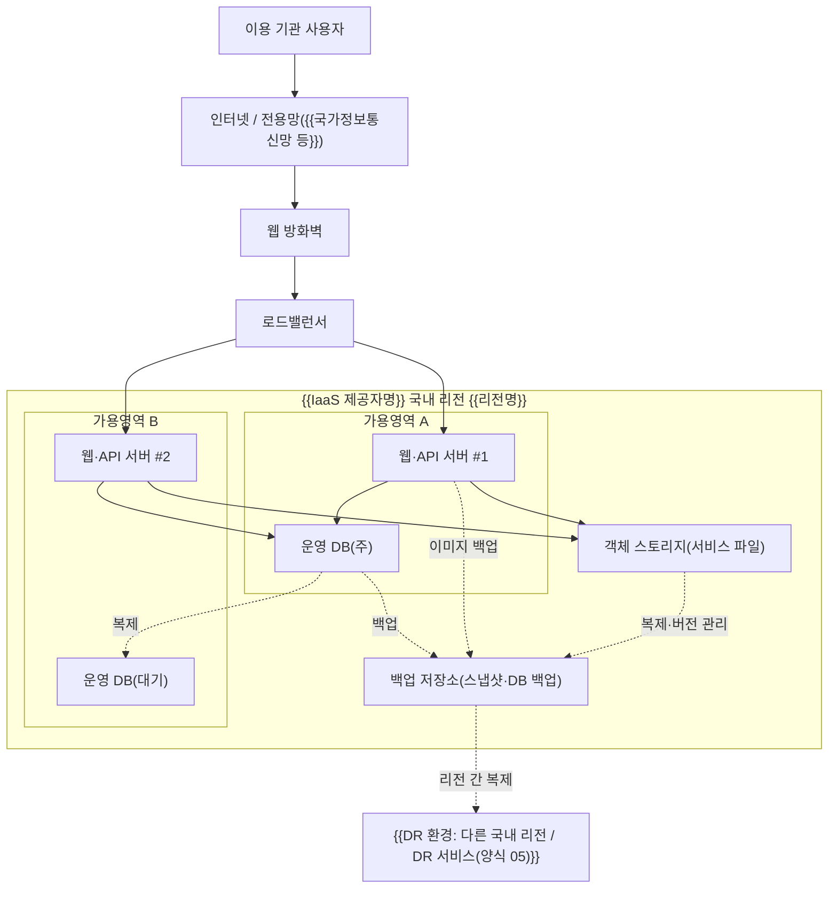

---
tags:
  - CSAP
  - 양식
  - 하등급SaaS
  - 공공기관보호조치
control: 14.2.2 중요장비 이중화 및 백업체계 구축
section: 14.2 물리적 보호조치
doc_type: 양식
evidence: 네트워크 구성도
문서 양식 번호: LS-14.2.2-03
문서 양식 버전: 0.0.1
---

> [!note] 근거
> [해설서/하등급-SaaS/14.2.2 중요장비 이중화 및 백업체계 구축](../../../해설서/하등급-SaaS/03.%20공공기관%20보호%20조치/14.2.2%20중요장비%20이중화%20및%20백업체계%20구축.md)

# 네트워크 구성도

| 문서번호 | 버전 | 기준일 | 작성자 | 검토자 | 승인자 |
| --- | --- | --- | --- | --- | --- |
| {{BAK-003}} | {{1.0}} | {{YYYY-MM-DD}} | {{인프라 담당 성명}} | {{정보보호 관리자 성명}} | {{CISO 성명}} |

## 1. 서비스 네트워크 구성도

{{서비스명}}의 현행 구성을 그린다. 예시 다이어그램의 노드·연결을 실제 구성으로 바꾸고, 백업 저장소와 백업 흐름이 드러나게 그린다.

- 실선은 서비스 트래픽, 점선은 복제·백업 흐름을 뜻한다.
- 관리용 접근 경로(VPN, 접근제어 시스템)와 정보보호시스템은 {{별도 구성도 문서번호}}에 상세를 두고, 본 구성도에는 복구·백업과 관련된 요소를 빠짐없이 표기한다.

## 2. 구성요소 목록

구성도의 모든 구성요소를 등재하고 양식 02. 정보자산 및 백업 대상 목록의 No와 연결한다. 복구 시 구성요소가 누락되지 않도록 본 표를 양식 04. 복구 시스템 상세 복구절차서의 복구 범위와 대조한다.

| No | 구성요소 | 역할 | 위치(리전·가용영역) | 가용성 확보 방식 | 장애 시 동작 | 02 목록 No | 04 절차서 절 |
| --- | --- | --- | --- | --- | --- | --- | --- |
| 1 | {{로드밸런서}} | {{트래픽 분산}} | {{리전-AZ}} | {{제공자 관리형(다중 AZ)}} | {{정상 서버로 자동 전환}} | {{n}} | {{6.n}} |
| 2 | {{웹·API 서버}} | | | {{다중 가용영역 {{n}}대 / 자동 확장}} | | | |
| 3 | {{운영 DB}} | | | {{주-대기 복제}} | {{자동 / 수동 전환}} | | |
| 4 | {{객체 스토리지}} | | | {{제공자 관리형 내구성}} | | | |
| 5 | {{백업 저장소}} | | | {{다른 가용영역 / 리전}} | | | |
| 6 | {{웹 방화벽·정보보호시스템}} | | | | | | |

## 3. 백업 데이터 흐름

| No | 원본 | 백업 방식 | 백업 저장 위치 | 국내 저장 | 암호화 | 주기 |
| --- | --- | --- | --- | --- | --- | --- |
| 1 | {{운영 DB(주)}} | {{자동 백업 + 스냅샷}} | {{같은 리전 다른 AZ + 다른 국내 리전}} | ○ | ○ | {{일 1회}} |
| 2 | {{웹·API 서버}} | {{서버 이미지}} | {{백업 저장소}} | ○ | ○ | {{일 1회}} |
| 3 | {{객체 스토리지}} | {{버전 관리 + 리전 간 복제}} | {{다른 국내 리전}} | ○ | ○ | {{상시}} |
| 4 | {{인프라·보안 설정}} | {{설정 내보내기 + IaC}} | {{형상관리 저장소}} | ○ | ○ | {{변경 시}} |

## 4. 물리 계층 확인(제공자 책임)

데이터센터의 네트워크 스위치, 스토리지 등 물리 중요장비의 이중화는 IaaS/PaaS 제공자의 책임 범위이며 다음으로 확인한다.

| 확인 항목 | 확인 방법 | 확인 결과 | 확인일 |
| --- | --- | --- | --- |
| 제공자의 물리 인프라 이중화·가용성 확보 | 제공자 CSAP 인증서, SLA, 서비스 명세 | {{확인}} | {{YYYY-MM-DD}} |
| 이용 리전·가용영역의 국내 위치 | 제공자 리전 정보, 계약서 | {{확인}} | {{YYYY-MM-DD}} |

## 5. 현행화 규칙

- 인프라 구성 변경(자원 추가·삭제, 네트워크 변경, 백업 경로 변경) 시 변경관리 절차에 따라 {{n}}영업일 이내에 본 구성도를 갱신한다.
- {{반기 1회}} 이상 클라우드 콘솔의 실제 구성과 대조하여 구성도가 현행과 일치하는지 확인하고 확인일을 기록한다: {{YYYY-MM-DD}}
- 구성도 갱신 시 양식 02 목록, 양식 04 절차서의 복구 범위와 함께 대조하여 복구 대상에서 빠지는 구성요소가 없게 한다.

## 6. 승인

| 구분 | 직위 | 성명 | 서명 | 일자 |
| --- | --- | --- | --- | --- |
| 작성(인프라 담당) | | | | |
| 검토(정보보호 관리자) | | | | |
| 승인(정보보호 최고책임자) | | | | |

## 7. 개정 이력

| 버전 | 기준일 | 변경 내용 | 작성자 | 승인자 |
| --- | --- | --- | --- | --- |
| 1.0 | {{YYYY-MM-DD}} | 최초 작성 | | |
