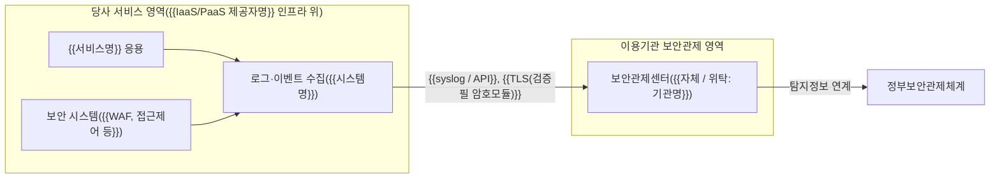

---
tags:
  - CSAP
  - 양식
  - 하등급SaaS
  - 공공기관보호조치
control: 14.3.2 보안관제 제반환경 지원
section: 14.3 기술적 보호조치
doc_type: 양식
evidence: 보안관제 수행을 위해 제공되는 환경
문서 양식 번호: LS-14.3.2-02
문서 양식 버전: 0.0.1
---

> [!note] 근거
> [해설서/하등급-SaaS/14.3.2 보안관제 제반환경 지원](../../../해설서/하등급-SaaS/03.%20공공기관%20보호%20조치/14.3.2%20보안관제%20제반환경%20지원.md)

# 보안관제 연계 환경 구성 내역서

> [!warning] 적용 조건
> 국가기관등 이용기관·계약 단위로 사본을 만들어 작성한다. 하나의 위탁 보안관제센터가 여러 기관을 관제하면 연계 구성이 같은 기관을 묶어 작성할 수 있으며, 이 경우 1항에 대상 기관을 모두 적는다.

| 문서번호 | 버전 | 기준일 | 작성자 | 검토자 | 승인자 |
| --- | --- | --- | --- | --- | --- |
| {{SOC-ENV-YYYY-NN}} | {{1.0}} | {{YYYY-MM-DD}} | {{시스템 담당자 성명}} | {{정보보호 관리자 성명}} | {{CISO 성명}} |

## 1. 이용기관 및 보안관제 체계 현황

| 항목 | 내용 |
| --- | --- |
| 이용기관 | {{기관명}}(계약번호 {{ }}, 계약 기간 {{YYYY-MM-DD}}~{{YYYY-MM-DD}}) |
| 이용 서비스 | {{서비스명}}(하등급 SaaS) |
| 보안관제 주체 | {{자체 보안관제센터 / 다른 기관 보안관제센터 위탁: 기관명}} |
| 보안관제센터 담당 연락처 | {{담당자, 연락처, 이메일}} |
| 정부보안관제체계 연계 | 이용기관 보안관제 영역에서 탐지정보를 정부보안관제체계와 연계 {{함 / 예정: YYYY-MM-DD}} |
| 계약 전 사전 검토 | 양식 01 7항 체크리스트 수행일 {{YYYY-MM-DD}}, 지원 불가 판정 {{없음 / 있음(2항에 대안 기록)}} |
| 협약 근거 | 14.1.1 보안서비스 수준 협약서 {{문서번호}} 제{{n}}조(보안관제 연계), 제{{n}}조(기술 지원) |

## 2. 기관 요구사항 및 협의 내역

이용기관(또는 위탁 관제센터)이 요구한 보안관제 지원 요구사항과 협의·이행 결과를 기록한다. 상태가 "지원 불가"로 남는 요구가 없도록 대안 협의까지 기록한다.

| No | 요구 일자 | 요구 주체 | 요구사항 | 협의 결과·지원 방법(항목 코드) | 이행 완료일 | 상태 | 비고 |
| --- | --- | --- | --- | --- | --- | --- | --- |
| 1 | {{YYYY-MM-DD}} | {{기관 / 관제센터}} | {{예: 접근기록·보안이벤트를 syslog로 실시간 전송}} | {{ENV-01·ENV-02, syslog over TLS}} | {{YYYY-MM-DD}} | {{이행 완료 / 이행 중 / 대안 합의}} | |
| 2 | | | | | | | |
| 3 | | | | | | | |

## 3. 제공 제반환경 구성 내역

양식 01 5항의 항목 코드 기준으로 이 기관에 제공하는 구성을 기록한다. 실제 설정·화면 증적은 양식 04. 증적 수집 점검표에 따라 수집한다.

| 항목 코드 | 항목 | 제공 여부 | 구성 내용(시스템·전송 방식·형식) | 전송 구간 보호 | 제공 시작일 | 비고 |
| --- | --- | --- | --- | --- | --- | --- |
| ENV-01 | 서비스 로그 제공 | {{○ / X}} | {{제공 로그 종류, 전송 방식, 형식(JSON/CEF 등), 전송 주기}} | {{TLS 1.3 / VPN}} | {{YYYY-MM-DD}} | |
| ENV-02 | 보안이벤트·탐지정보 제공 | {{○ / X}} | {{대상 보안 시스템, 이벤트 종류, 전송 방식}} | | | |
| ENV-03 | 보안관제용 접근 수단 | {{○ / X}} | {{관제용 조회 계정 수, 대시보드 URL, 다중 인증 적용}} | | | 계정 목록은 5항 아래 표에 기록 |
| ENV-04 | 정부보안관제체계 연계 기반 | {{○ / X}} | {{기관 요구 연계 형식·전송 구성}} | | | 부적합 사례 1·2 예방 |
| ENV-05 | 연계 구간 구성 | {{○ / X}} | {{연계 구간 구성(출발지·목적지·프로토콜·포트), 암호화 방식}} | {{검증필 암호모듈 탑재 제품명·검증번호}} | | 14.3.1 연계 |
| ENV-06 | 연계 시험 지원 | {{○ / X}} | 5항 시험 결과 참조 | | | |
| ENV-07 | 침해사고 협조 | ○ | 협조 창구 {{정보보호 관리자, 연락처}}, 사고 통지 절차는 14.1.4를 따름 | | | |

## 4. 연계 구성도

- 실제 구성(전송 구간, IP·포트, 중계 장비)이 다르면 구성도를 이 기관 기준으로 수정한다.
- 관제용 접근 수단(ENV-03)을 제공하면 관제 요원의 접근 경로도 구성도에 표기한다.

### 4.1 관제용 계정 현황(ENV-03 제공 시)

| No | 계정 ID | 사용 주체(소속·성명) | 권한 | 다중 인증 | 발급일 | 만료일 | 최근 접근기록 검토일 |
| --- | --- | --- | --- | --- | --- | --- | --- |
| 1 | | {{관제센터명, 성명}} | 조회 전용 | {{○}} | | | |
| 2 | | | | | | | |

## 5. 연계 시험 결과

연계 구성 완료 시와 구성 변경 시 이용기관(또는 위탁 관제센터)과 상호 확인한다.

| No | 시험 항목 | 시험 방법 | 시험일 | 결과 | 당사 확인자 | 기관 확인자 |
| --- | --- | --- | --- | --- | --- | --- |
| 1 | 로그·이벤트 수신 확인 | {{시험 이벤트 발생 후 관제센터 수신 확인}} | {{YYYY-MM-DD}} | {{정상 / 보완 필요}} | | |
| 2 | 탐지정보 정부보안관제체계 연계 확인 | {{기관 보안관제 영역에서 연계 전송 확인}} | | | | |
| 3 | 전송 구간 암호화 적용 확인 | {{프로토콜·암호 스위트 확인}} | | | | |
| 4 | 관제용 계정 접근·권한 확인(해당 시) | {{조회 전용 권한, 다중 인증 동작 확인}} | | | | |

- 보완 필요 항목은 조치 후 재시험하고 결과를 갱신한다: 조치 내역 {{ }}

## 6. 운영·변경 이력

연계 구성 변경, 전송 중단·장애, 기관 통보 내역을 기록한다.

| No | 일자 | 구분 | 내용 | 기관 통보(일시·방법) | 조치 결과 | 담당 |
| --- | --- | --- | --- | --- | --- | --- |
| 1 | {{YYYY-MM-DD}} | {{구성 변경 / 전송 장애 / 중단·재개}} | | | | |
| 2 | | | | | | |

## 7. 이용기관 확인

이용기관(또는 위탁 관제센터)은 본 내역서의 제반환경 구성이 보안관제 수행과 정부보안관제체계 연계 요구에 부합함을 확인한다.

| 구분 | 소속 | 직위 | 성명 | 서명 | 일자 |
| --- | --- | --- | --- | --- | --- |
| 이용기관 담당자 | | | | | |
| 보안관제센터 담당자(위탁 시) | | | | | |

- 서명본 보관 위치: {{ }}. 공문·전자 확인으로 갈음하면 접수 번호를 적는다: {{ }}

## 8. 승인

| 구분 | 직위 | 성명 | 서명 | 일자 |
| --- | --- | --- | --- | --- |
| 작성(시스템 담당자) | | | | |
| 검토(정보보호 관리자) | | | | |
| 승인(정보보호 최고책임자) | | | | |

## 9. 개정 이력

| 버전 | 일자 | 변경 내용 | 작성자 | 승인자 |
| --- | --- | --- | --- | --- |
| 1.0 | {{YYYY-MM-DD}} | 최초 작성 | | |
