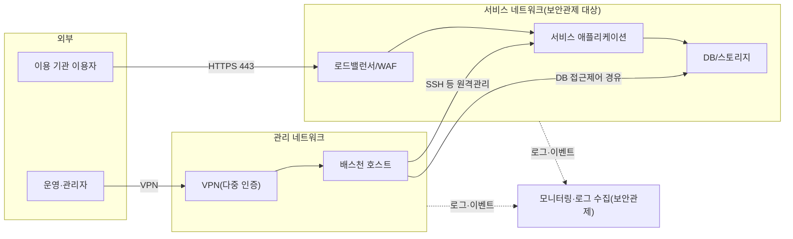

---
tags:
  - CSAP
  - 양식
  - 하등급SaaS
  - 공공기관보호조치
control: 14.3.4 시스템 격리
section: 14.3 기술적 보호조치
doc_type: 양식
evidence: 비정상 통신경로 점검 결과 및 검토 결과(보조)
문서 양식 번호: LS-14.3.4-02
문서 양식 버전: 0.0.1
---

> [!note] 근거
> [해설서/하등급-SaaS/14.3.4 시스템 격리](../../../해설서/하등급-SaaS/03.%20공공기관%20보호%20조치/14.3.4%20시스템%20격리.md)

# 정상 통신경로 목록

| 문서번호 | 버전 | 기준일 | 작성자 | 검토자 | 승인자 |
| --- | --- | --- | --- | --- | --- |
| {{ISOL-002}} | {{1.0}} | {{YYYY-MM-DD}} | {{정보보호 관리자 성명}} | {{네트워크·인프라 담당 성명}} | {{CISO 성명}} |

본 목록은 {{서비스명}}의 승인된 통신경로 기준선이다. 양식 03. 비정상 통신경로 점검 및 검토 결과서는 본 목록과 대조하여 비정상 통신경로를 판정하며, 목록에 없는 경로는 모두 비정상 통신경로로 본다. 경로의 추가·변경·삭제는 양식 01. 시스템 격리 및 통신경로 관리 지침 6.3항의 절차를 따른다.

## 1. 네트워크 구성 개요

- 실제 구성에 맞게 노드·구간을 수정하고, 서비스 구성도({{문서번호}})와 일치하게 유지한다.
- 무선망은 서비스 네트워크·관리 네트워크와 분리되어 있으며, 운영 자원 접근은 VPN 경유만 허용한다.

## 2. 정상 통신경로 목록

| No | 구간(출발지 → 목적지) | 프로토콜/포트 | 용도 | 통제 수단(보안 그룹·방화벽·NetworkPolicy 규칙명) | 보안관제 경유 | 승인 근거 | 등록일 | 종료일 |
| --- | --- | --- | --- | --- | --- | --- | --- | --- |
| 1 | {{인터넷 → 로드밸런서}} | {{TCP/443}} | 서비스 제공(HTTPS) | {{sg-web-inbound}} | ○ | {{승인 문서번호}} | {{YYYY-MM-DD}} | 상시 |
| 2 | {{로드밸런서 → 애플리케이션}} | {{TCP/{{n}}}} | 서비스 트래픽 전달 | {{sg-app-inbound}} | ○ | | | 상시 |
| 3 | {{애플리케이션 → DB}} | {{TCP/{{n}}}} | 데이터 저장·조회 | {{sg-db-inbound}} | ○ | | | 상시 |
| 4 | {{관리자 → VPN 게이트웨이}} | {{UDP/{{n}}}} | 관리 네트워크 진입(다중 인증) | {{VPN 정책명}} | ○ | | | 상시 |
| 5 | {{배스천 호스트 → 운영 서버}} | {{TCP/22}} | 원격관리(SSH) | {{sg-bastion-out, sshd 설정}} | ○ | | | 상시 |
| 6 | {{운영 자원 → 로그 수집기}} | {{TCP/{{n}}}} | 로그·이벤트 전송 | {{sg-log}} | ○ | | | 상시 |
| 7 | {{애플리케이션 → 외부 연동 서비스}} | {{TCP/443}} | {{외부 API 연동(대상: )}} | {{sg-egress, 목적지 제한}} | ○ | | | {{상시 / YYYY-MM-DD}} |
| 8 | | | | | | | | |

- 아웃바운드(내부 → 외부) 통신도 목적지·포트를 제한하여 등재한다. 전체 허용(any) 규칙은 두지 않는다.
- 한시 경로는 종료일을 지정하고, 종료일이 지나면 규칙 삭제를 확인한 뒤 목록에서 제거한다.

## 3. 원격관리 경로 상세

원격관리서버(SSH 등) 설정은 양식 01. 시스템 격리 및 통신경로 관리 지침 6.1항의 기준을 따르며, 현재 적용 값을 기록한다.

| No | 대상 시스템 | 접근 경로 | 허용 IP 대역 | 인증 방식 | 루트 직접 로그인 | 다중 인증 | 설정 확인일 | 확인자 |
| --- | --- | --- | --- | --- | --- | --- | --- | --- |
| 1 | {{운영 서버}} | 배스천 호스트 경유 | {{관리 대역 CIDR}} | 키 기반(패스워드 비활성) | 금지 | VPN 진입 시 적용 | {{YYYY-MM-DD}} | |
| 2 | {{컨테이너 클러스터 API}} | {{VPN 경유}} | {{관리 대역 CIDR}} | {{인증서/토큰}} | 해당 없음 | | | |
| 3 | {{DB(접근제어 솔루션 경유)}} | 배스천·접근제어 경유 | {{관리 대역 CIDR}} | {{개인 계정}} | 해당 없음 | | | |

## 4. 무선망 분리 현황

| 확인 항목 | 현황 | 확인일 | 확인자 |
| --- | --- | --- | --- |
| 서비스 네트워크·관리 네트워크에 무선 접점(무선 AP 연결)이 없다 | {{확인}} | {{YYYY-MM-DD}} | |
| 사무실 무선망에서 운영 자원으로 직접 접속이 차단되어 있다 | {{확인, 차단 규칙: }} | | |
| 무선망 이용자의 운영 자원 접근은 VPN·다중 인증 경유만 허용한다 | {{확인}} | | |

## 5. 테넌트 간 격리 통제 현황

이용자(이용 기관)가 본인에게 할당된 자원 이외의 자원과 통신할 수 없도록 적용한 통제를 기록한다.

| No | 격리 계층 | 통제 내용 | 적용 대상·설정 | 확인일 | 확인자 |
| --- | --- | --- | --- | --- | --- |
| 1 | 네트워크(네임스페이스 간) | 테넌트 네임스페이스 간 통신 기본 차단(default deny) 후 필요 통신만 허용 | {{NetworkPolicy 이름, 적용 네임스페이스 목록}} | {{YYYY-MM-DD}} | |
| 2 | 워크로드(컨테이너) | 이용자별 컨테이너를 혼용하지 않도록 격리 단위 분리 | {{네임스페이스/노드풀 분리 방식}} | | |
| 3 | 응용(테넌트 식별) | 요청별 테넌트 식별자 검증으로 타 기관 데이터 접근 차단 | {{인가 모듈·미들웨어명}} | | |
| 4 | 데이터 | 테넌트별 {{스키마/버킷/암호화 키}} 분리 | {{분리 방식}} | | |
| 5 | 관리자 접근 | 관리자의 이용 기관 자원·데이터 임의 접근 차단(승인 기반 접근, 접근 기록) | {{접근통제 수단}} | | |

- 격리를 새 테넌트에 적용하는 작업(네임스페이스 생성 시 NetworkPolicy 자동 적용 등)은 {{자동화 / 체크리스트}}로 수행하고, 누락 여부를 양식 03. 점검 및 검토 결과서에서 확인한다.

## 6. 현행화 규칙

- 통신경로 변경이 승인되면 {{n}}영업일 이내에 본 목록을 갱신하고 버전을 올린다.
- {{분기}} 1회 이상 실제 보안 그룹·방화벽·NetworkPolicy 설정을 내려받아 본 목록과 대조하고, 결과를 양식 03. 점검 및 검토 결과서에 기록한다.
- 본 목록의 모든 버전은 {{3}}년 이상 보관하여 특정 시점의 승인된 통신경로를 확인할 수 있게 한다.

## 7. 승인

| 구분 | 직위 | 성명 | 서명 | 일자 |
| --- | --- | --- | --- | --- |
| 작성(정보보호 관리자) | | | | |
| 검토(네트워크·인프라 담당) | | | | |
| 승인(정보보호 최고책임자) | | | | |

## 8. 개정 이력

| 버전 | 기준일 | 변경 내용(추가/변경/삭제 경로) | 작성자 | 승인자 |
| --- | --- | --- | --- | --- |
| 1.0 | {{YYYY-MM-DD}} | 최초 작성 | | |
