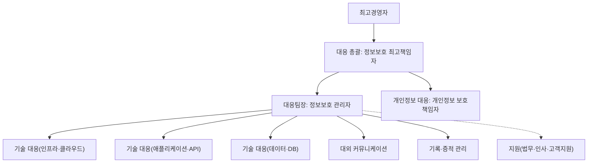

---
tags:
  - CSAP
  - 양식
  - 하등급SaaS
  - 관리적보호조치
control: 5.1.1 침해사고 대응 절차 수립
section: 5.1 침해사고 대응 절차 및 체계
doc_type: 양식
evidence: 침해사고 대응지침(보조)
문서 양식 번호: LS-5.1.1-03
문서 양식 버전: 0.0.1
---

> [!note] 근거
> [해설서/하등급-SaaS/5.1.1 침해사고 대응 절차 수립](../../../해설서/하등급-SaaS/01.%20관리적%20보호%20조치/5.1.1%20침해사고%20대응%20절차%20수립.md)

# 침해사고 대응조직 및 비상연락망

| 문서번호 | 버전 | 기준일 | 작성자 | 검토자 | 승인자 |
| --- | --- | --- | --- | --- | --- |
| {{IRP-003}} | {{1.0}} | {{YYYY-MM-DD}} | {{정보보호 관리자 성명}} | {{CPO 성명}} | {{CISO 성명}} |

> [!warning] 취급 주의
> 본 문서는 개인 연락처를 포함한다. 대응조직 구성원과 승인된 인원에게만 배포하고, 8항의 보관·접근 통제 규칙을 따른다. 인증 심사에는 연락처를 가린 사본을 제출할 수 있다.

본 문서는 5.2.1 양식 01. 침해사고 보고 및 신고 통지 절차 5.3항이 참조하는 연락처 문서다. 그 절차의 비상연락망 역할과 본 문서의 명단을 일치시키고, 실제 연락처는 본 문서에만 기록한다.

## 1. 대응조직 구성도

역할별 책임과 권한은 양식 02. 침해사고 대응지침 5항을 따른다.

## 2. 대응조직 명단

| 역할 | 주 담당(성명·직위·부서) | 사내 전화 | 휴대전화 | 이메일 | 대행자(성명·직위) | 대행자 휴대전화 | 근무 외 시간 연락 |
| --- | --- | --- | --- | --- | --- | --- | --- |
| 대응 총괄(정보보호 최고책임자) | | | | | | | {{가능}} |
| 대응팀장(정보보호 관리자) | | | | | | | {{가능}} |
| 인지 보고 접수(정보보호 담당자, 모니터링·사고 대응) | | | | | | | {{가능}} |
| 개인정보 대응(개인정보 보호책임자) | | | | | | | |
| 기술 대응(인프라·클라우드) | | | | | | | {{가능}} |
| 기술 대응(애플리케이션·API) | | | | | | | |
| 기술 대응(데이터·DB) | | | | | | | |
| 대외 커뮤니케이션 | | | | | | | |
| 기록·증적 관리 | | | | | | | |
| 지원(법무) | | | | | | | |
| 지원(인사) | | | | | | | |
| 지원(고객지원) | | | | | | | |
| 최고경영자(보고 대상) | | | | | | | |

- 한 사람이 여러 역할을 맡으면 각 행에 같은 이름을 적고 대행자를 다르게 지정한다. 대응 총괄과 기록·증적 관리는 같은 사람이 겸하지 않는다.
- 명단의 인원은 2.1.2 주요 직무자 목록의 정보보호 관리·담당 직무자와 일치해야 한다.

## 3. 내부 비상연락 순서

### 3.1 호출 체계

| 단계 | 상황 | 연락 주체 | 연락 대상 | 연락 수단(순서) | 미응답 시 |
| --- | --- | --- | --- | --- | --- |
| 1 | 침해사고·징후 인지 | 인지자 | 정보보호 담당자(모니터링·사고 대응) → 대응팀장 | 휴대전화 → 사고 접수 채널 {{이메일·메신저}} | {{10분}} 내 재시도 후 대행자 → 대응팀장 → 정보보호 최고책임자(보고를 미루지 않고 다음 단계로) |
| 2 | 잠정 등급 판정 | 대응팀장 | 정보보호 최고책임자 | 휴대전화 → 보안 채널 | 대행자 → 최고경영자(1등급) |
| 3 | 대응조직 소집 | 대응팀장 | 등급별 소집 대상(3.2항) | 보안 채널 일괄 공지 + 휴대전화 | 대행자 호출 |
| 4 | 개인정보 관련 가능성 | 대응팀장 | 개인정보 보호책임자 | 휴대전화 | 대행자 |
| 5 | 경영진 보고 | 정보보호 최고책임자 | 최고경영자 | 대면·휴대전화 | 대행자({{직위}}) |
| 6 | 인프라 계층 관련 | 기술 대응(인프라) | IaaS/PaaS 제공자(4항) | 제공자 지원 채널 | 계약상 긴급 연락처 |

### 3.2 등급별 소집 대상

| 등급 | 소집 대상 | 소집 시한 | 소집 방식 |
| --- | --- | --- | --- |
| 1등급 | 대응조직 전원, 필요 시 지원 부서 | 연락 후 {{1시간}} 이내 | 상황실 {{장소}} 또는 원격 회의 {{URL}} |
| 2등급 | 대응 총괄, 대응팀장, 관련 기술 대응, 대외 커뮤니케이션, 기록·증적 관리 | 연락 후 {{2시간}} 이내 | 원격 회의 |
| 3등급 | 대응팀장 판단 | 당일 | 보안 채널 |
| 4등급(징후) | 소집 없음. 정보보호 담당자가 확인 후 대응팀장에게 결과 보고 | 당일 | 보안 채널 |

### 3.3 근무 외 시간·휴일 체계

| 항목 | 내용 |
| --- | --- |
| 탐지 알림 수신자 | {{당직 담당 또는 기술 대응(인프라) 주·부 담당}} 휴대전화·알림 앱 |
| 1차 대응 | 알림 수신자가 {{30분}} 이내 확인 후 대응팀장에게 보고 |
| 당직 순번 | {{주 단위 순번표 위치}} |
| 상황실 원격 접속 | {{원격 회의·보안 채널 URL}} |

## 4. 외부 협력사 연락처

| 구분 | 기관·회사 | 담당·창구 | 연락처(전화 / 이메일 / 포털) | 지원 범위 | 계약·SLA 근거 | 연락 시점 |
| --- | --- | --- | --- | --- | --- | --- |
| IaaS/PaaS 제공자(보안 사고 접수) | {{제공자명}} | {{보안 사고 접수 창구}} | | 인프라 계층 침해사고 통지·조사 협조, 로그 보전 | {{계약서 조항, 지원 플랜}} | 인프라 관련 가능성 확인 시 |
| IaaS/PaaS 제공자(기술 지원) | {{제공자명}} | {{지원 포털·긴급 전화}} | | 자원 격리·복구 기술 지원 | | 봉쇄·복구 단계 |
| 보안관제·SOC(해당 시) | {{업체명}} | | | 이벤트 분석, 탐지 규칙 조정 | | 탐지·분석 단계 |
| 보안 솔루션 벤더(웹 방화벽, EDR, 로그 관리) | {{업체명}} | | | 탐지 정보 제공, 긴급 정책 지원 | | 분석 단계 |
| 침해사고 분석·포렌식 전문업체 | {{업체명}} | | | 증적 분석, 원인 규명 | {{비밀유지 계약}} | 정보보호 최고책임자 결정 시 |
| 법률 자문 | {{법무법인}} | | | 법정 신고·통지 판단, 계약 검토 | | 신고·통지 판단 시 |
| 개발·운영 위탁사(해당 시) | {{업체명}} | | | 위탁 범위 시스템 대응 협조 | {{위탁 계약}} | 관련 시스템 영향 시 |

## 5. 관계기관 연락처

연락처는 작성 시점에 각 기관의 공식 안내로 확인하고, 분기 점검 시 변경 여부를 확인한다.

| 기관 | 용도 | 연락처 | 근거·시한 | 담당 |
| --- | --- | --- | --- | --- |
| 한국인터넷진흥원 인터넷침해대응센터 | 침해사고 신고, 기술 지원 | ☎118, 보호나라 <www.boho.or.kr> | 정보통신망법 제48조의3, 시행령 제58조의2(24시간 이내) | 대외 커뮤니케이션 |
| 과학기술정보통신부(사이버침해대응과) | 침해사고 신고, 이용자 정보 유출 통지 | {{확인 후 기재}} | 정보통신망법 제48조의3, 클라우드컴퓨팅법 제25조제2항(즉시) | 대외 커뮤니케이션 |
| 개인정보보호위원회 / 한국인터넷진흥원 개인정보침해신고센터 | 개인정보 유출등 신고 | 개인정보 유출등 신고 시스템 brss.pipc.go.kr, ☎118, <privacyclean@kisa.or.kr> | 개인정보 보호법 제34조제3항, 시행령 제40조(72시간 이내) | 개인정보 보호책임자 |
| 경찰청 사이버수사(사이버범죄 신고시스템) | 수사 의뢰, 공조 | {{ecrm.police.go.kr, ☎182 확인 후 기재}} | 정보보호 최고책임자 결정 시 | 대외 커뮤니케이션 |
| 국가정보원 국가사이버안보센터 | 공공기관 이용 기관 관련 사고 협조, 사고조사 협조 | {{☎111, <www.ncsc.go.kr> 확인 후 기재}} | 14.1.4 사고 및 장애 대응, 이용 기관 요청 시 | 정보보호 최고책임자 |
| 이용 기관 소관 상위 기관(해당 시) | 이용 기관 요청에 따른 협조 | {{이용 기관 안내에 따라 기재}} | 이용 기관 계약·요청 | 대외 커뮤니케이션 |

## 6. 이용 기관 연락처

이용 계약 체결·변경 시 갱신하고, 양식 04. 이용 기관 침해사고 대응 안내 9항의 확인서로 수집한 연락처를 반영한다.

| No | 이용 기관 | 구분 | 정보보안담당관·보안 담당자(성명·직위) | 전화 | 이메일 | 통지 방법(계약) | 계약상 통지 기준 | 개인정보 처리 위탁 | 최근 확인일 |
| --- | --- | --- | --- | --- | --- | --- | --- | --- | --- |
| 1 | {{기관명}} | {{공공 / 민간}} | | | | {{이메일 + 전화}} | {{서비스 중단 n분 이상 등}} | {{○ / X}} | {{YYYY-MM-DD}} |
| 2 | | | | | | | | | |
| 3 | | | | | | | | | |

- 공공기관은 정보보안담당관 연락처를 반드시 확보한다.
- 이용 기관 전체에 대한 일괄 통지 수단(서비스 접속화면 게시, 이메일 일괄 발송 기능)과 담당자를 기록한다: {{ }}

## 7. 연락망 현행화 점검

### 7.1 점검 기준

| 점검 | 내용 | 주기 | 담당 |
| --- | --- | --- | --- |
| 명단 대조 | 인사 현황(입·퇴직, 인사이동)과 2항 명단·대행자 대조 | 분기 1회, 인사 변동 시 즉시 | 정보보호 관리자 |
| 연락 가능 확인 | 2항 전원에게 실제 연락(전화·메시지)하여 응답 확인, 응답 시간 기록 | 반기 1회, 훈련 시 | 정보보호 담당자 |
| 외부 협력사 확인 | 계약 유효 여부, 창구·연락처 변경 확인 | 분기 1회 | 정보보호 관리자 |
| 관계기관 확인 | 각 기관 공식 안내로 연락처·신고 채널 변경 확인 | 분기 1회 | 대외 커뮤니케이션 |
| 이용 기관 확인 | 계약 현황과 6항 대조, 담당자 변경 확인 | 분기 1회, 계약 체결·변경 시 | 대외 커뮤니케이션 |

### 7.2 점검 기록

| 점검일 | 점검 유형 | 대상 | 결과(응답률·변경 건수) | 미응답·변경 조치 | 점검자 | 반영 버전 |
| --- | --- | --- | --- | --- | --- | --- |
| {{YYYY-MM-DD}} | {{명단 대조 / 연락 가능 확인 / 외부 확인}} | | {{n/n명 응답, 변경 n건}} | | | |
| | | | | | | |

## 8. 배포 및 보관

| 항목 | 내용 |
| --- | --- |
| 배포 대상 | 대응조직 구성원, 최고경영자, 당직 담당 |
| 전자 사본 | {{사내 보안 저장소 경로}}(접근 권한: 대응조직) |
| 오프라인 사본 | 사내 시스템 침해 시 사용할 인쇄본·별도 매체를 {{보관 장소}}에 봉인 보관, 버전 갱신 시 교체 |
| 접근 통제 | 열람 기록 유지, 배포본 회수 규칙 |
| 갱신 | 변경 사항 발생 후 {{5}}영업일 이내 버전 갱신, 배포본 교체 |

## 9. 승인

| 구분 | 직위 | 성명 | 서명 | 일자 |
| --- | --- | --- | --- | --- |
| 작성(정보보호 관리자) | | | | |
| 검토(개인정보 보호책임자) | | | | |
| 승인(정보보호 최고책임자) | | | | |

## 10. 개정 이력

| 버전 | 기준일 | 변경 내용 | 작성자 | 승인자 |
| --- | --- | --- | --- | --- |
| 1.0 | {{YYYY-MM-DD}} | 최초 작성 | | |
