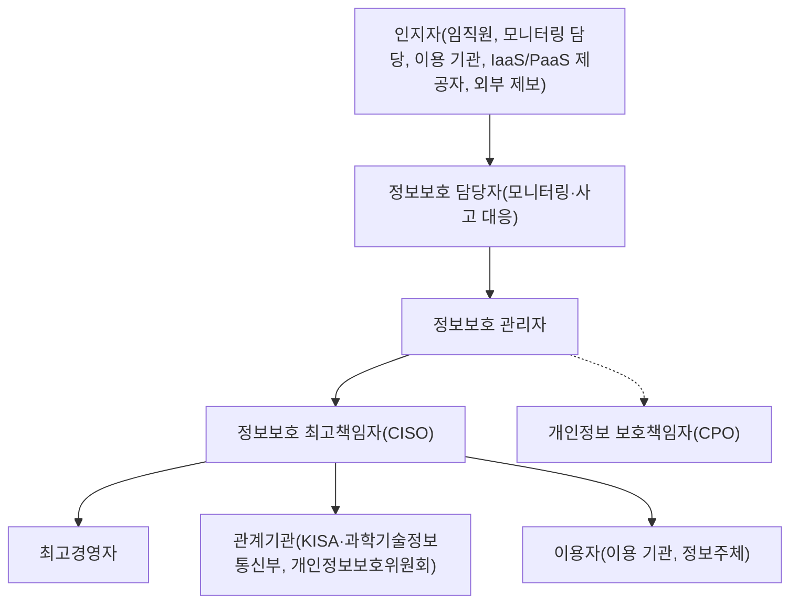

---
tags:
  - CSAP
  - 양식
  - 하등급SaaS
  - 관리적보호조치
control: 5.2.1 침해사고 보고
section: 5.2 침해사고 대응
doc_type: 양식
evidence: 침해사고 대응지침
문서 양식 번호: LS-5.2.1-01
문서 양식 버전: 0.0.1
---

> [!note] 근거
> [해설서/하등급-SaaS/5.2.1 침해사고 보고](../../../해설서/하등급-SaaS/01.%20관리적%20보호%20조치/5.2.1%20침해사고%20보고.md)

# 침해사고 보고 및 신고 통지 절차

| 문서번호 | 버전 | 작성일 | 작성자 | 검토자 | 승인자 | 시행일 |
| --- | --- | --- | --- | --- | --- | --- |
| {{INC-001}} | 1.0 | {{YYYY-MM-DD}} | {{성명/직위}} | {{성명/직위}} | {{CISO 성명}} | {{YYYY-MM-DD}} |

> [!info] 법령 기준
> 클라우드컴퓨팅 발전 및 이용자 보호에 관한 법률 제25조(법률 제21066호, 2025. 10. 1. 시행)와 같은 법 시행령 제16조·제17조(대통령령 제35947호, 2026. 1. 2. 시행), 정보통신망 이용촉진 및 정보보호 등에 관한 법률 제48조의3(법률 제21305호, 2026. 7. 7. 시행)과 같은 법 시행령 제58조의2(대통령령 제36502호, 2026. 7. 7. 시행), 개인정보 보호법 제34조(법률 제20897호, 2025. 10. 2. 시행)와 같은 법 시행령 제39조·제40조(대통령령 제36121호, 2026. 8. 20. 시행)를 기준으로 작성했다. 법령이 개정되면 국가법령정보센터에서 조문을 다시 확인한다.

## 1. 목적

본 절차는 {{회사명}}의 침해사고 대응지침 중 침해사고의 내부 보고, 관계기관 신고, 이용자 통지에 관한 절을 정한 것이다. 침해사고의 징후 또는 발생을 인지한 사람이 정해진 보고체계에 따라 신속하게 보고하고, 침해사고보고서에 필요한 내용을 모두 기록하며, 관련 법령이 정한 신고·통지 의무를 기한 안에 빠짐없이 이행하도록 한다.

## 2. 적용 범위

- {{회사명}}이 제공하는 클라우드컴퓨팅서비스 {{서비스명}}(하등급 SaaS)의 인증 범위 내 정보시스템, 데이터, 운영 환경에서 발생한 침해사고와 그 징후
- {{회사명}}의 임직원과 인증 범위 업무를 수행하는 외부인력
- 책임공유모델에 따라 IaaS/PaaS 제공자 책임 영역(물리 시설, 하이퍼바이저, 관리형 서비스 기반)에서 발생한 사고라도, 그 결과가 {{서비스명}}의 이용자에게 영향을 주면 당사는 클라우드컴퓨팅서비스 제공자로서 본 절차에 따라 보고·신고·통지한다. 제공자 영역의 사고 사실과 원인은 제공자의 통지·계약에 따라 확인한다.
- 서비스 중단(장애)의 원인 분석과 복구는 장애 대응 절차(6.1.2)를 따르되, 이용자 통지 의무의 판단과 이행은 본 절차 7항을 따른다.

## 3. 용어 정의

| 용어 | 정의 |
| --- | --- |
| 침해사고 | 해킹, 컴퓨터바이러스, 논리폭탄, 메일폭탄, 서비스거부, 고출력 전자기파 등의 방법이나 보호·인증 절차를 우회하는 프로그램·장치의 설치로 정보통신망 또는 관련 정보시스템을 공격하는 행위로 발생한 사태(정보통신망법 제2조제7호) |
| 침해사고 징후 | 침해사고로 확정되지 않았으나 비인가 접근, 악성코드, 비정상 트래픽·계정 활동 등 침해사고 가능성이 있는 이상 징후 |
| 이용자 | {{서비스명}}을 이용하는 이용 기관(공공기관 등)과 그 소속 사용자 |
| 이용자 정보 | 이용자의 개인정보를 포함하여 {{서비스명}}에서 생산·저장·관리되는 이용자의 정보 |
| 정보주체 | 처리되는 개인정보로 알아볼 수 있는 사람으로서 그 정보의 주체가 되는 사람 |
| 개인정보 유출등 | 개인정보의 분실·도난·유출(개인정보 보호법 제34조) |
| 인지 시점 | 당사가 침해사고 또는 유출 사실을 알게 된 때. 모니터링 탐지 확인, 이용 기관 신고 접수, IaaS/PaaS 제공자 통지 수신, 외부 제보 접수 중 가장 이른 시점으로 하고 분 단위로 기록한다. 법정 기한은 이 시점부터 계산한다. |
| 관계기관 | 과학기술정보통신부, 한국인터넷진흥원(KISA), 개인정보보호위원회, 수사기관 등 법령에 따라 신고·통지해야 하는 기관 |

## 4. 침해사고 유형 및 중요도

### 4.1 침해사고 유형

| 유형 코드 | 유형 | 예시 | 법적 신고·통지 검토 대상 |
| --- | --- | --- | --- |
| T-01 | 비인가 접근·해킹 | 관리자 계정 탈취, 웹 취약점 악용, 클라우드 콘솔·API 키 노출을 통한 침입 | ○ |
| T-02 | 악성코드 감염 | 랜섬웨어, 웹셸, 백도어, 크립토마이너 | ○ |
| T-03 | 서비스거부 공격 | DDoS로 인한 서비스 지연·중단 | ○(서비스 중단 기준 충족 시) |
| T-04 | 이용자 정보 유출 | 이용 기관 데이터·설정 정보의 외부 유출, 다른 이용 기관에 노출 | ○ |
| T-05 | 개인정보 유출등 | 개인정보의 분실·도난·유출(민감정보·고유식별정보 포함 여부 확인) | ○ |
| T-06 | 데이터 위·변조·파괴 | 이용 기관 데이터의 무단 변경·삭제 | ○ |
| T-07 | 내부자·외부인력 부정행위 | 권한 오남용에 의한 정보 열람·반출 | ○ |
| T-08 | 공급망·IaaS/PaaS 제공자 사고 | 제공자 인프라 침해, 제공자 측 유출로 당사 서비스 영향 | ○ |
| T-09 | 침해 징후 | 차단된 공격 시도, 비정상 트래픽·로그인, 취약점 스캔 | 징후 확인 결과에 따라 판단 |

### 4.2 중요도 등급

| 등급 | 명칭 | 판단 기준 | 최초 보고 시한(인지 후) | 보고 범위 | 법적 의무 판단서(05) 작성 |
| --- | --- | --- | --- | --- | --- |
| 1 | 심각 | 이용자 정보 또는 개인정보의 유출이 확인되거나 유력함, 다수 이용 기관 영향, 서비스 전면 중단, 관리자 권한 탈취 | 즉시(내부 기준 {{n}}분 이내) | 최고경영자까지, 관계기관·이용자 | 필수 |
| 2 | 중대 | 단일 이용 기관 영향, 일부 기능 중단, 유출 가능성이 있어 조사 중, 악성코드 실행 확인 | {{n}}시간 이내 | 정보보호 최고책임자까지 | 필수 |
| 3 | 보통 | 피해 없이 차단·격리된 공격, 취약점 악용 시도, 유출 가능성 없음 | {{n}}시간 이내 | 정보보호 관리자 | 유출 가능성이 확인되면 작성 |
| 4 | 징후 | 확인이 필요한 이상 징후 | 당일 | 정보보호 담당자 | 해당 없음 |

- 등급은 최초 보고 시 잠정 부여하고, 조사 결과에 따라 상향·하향한다. 상향되면 상향된 등급의 보고 시한과 범위를 즉시 적용한다.
- 이용자 정보 또는 개인정보의 유출 가능성이 있는 사고는 규모가 작아도 2등급 이상으로 분류한다.

## 5. 보고 체계

### 5.1 보고 경로

- 실선은 보고·결정 경로, 점선은 개인정보 관련 사고의 협의 경로다.
- 인지자는 담당자에게 연락이 닿지 않으면 다음 단계(정보보호 관리자, 정보보호 최고책임자)에 직접 보고한다. 보고를 미루는 것보다 단계를 건너뛰는 것이 우선한다.
- 관계기관 신고와 이용자 통지는 정보보호 최고책임자가 결정하고, 개인정보 관련 사항은 개인정보 보호책임자와 협의한다. 정보보호 최고책임자에게 연락이 닿지 않으면 정보보호 관리자가 결정하고 사후 보고한다.

### 5.2 단계별 보고 시한

| 단계 | 보고자 | 보고 대상 | 시한 | 수단 | 기록 |
| --- | --- | --- | --- | --- | --- |
| 인지 보고 | 인지자 | 정보보호 담당자 | 인지 즉시 | 전화, 비상 메신저 채널 | 접수 기록 |
| 최초 보고 | 정보보호 담당자 | 정보보호 관리자, 정보보호 최고책임자 | 4.2의 등급별 시한 | 전화 후 양식 02 침해사고 보고서(최초) | 양식 02 |
| 경영진 보고 | 정보보호 최고책임자 | 최고경영자 | 1등급은 즉시, 2등급은 {{n}}시간 이내 | 전화, 대면, 전자우편 | 양식 02 |
| 개인정보 보고 | 정보보호 관리자 | 개인정보 보호책임자 | 개인정보 관련 가능성 인지 즉시 | 전화, 비상 메신저 채널 | 양식 02 |
| 중간 보고 | 정보보호 관리자 | 정보보호 최고책임자, 최고경영자 | 1등급은 {{n}}시간마다, 2등급은 1일 1회 이상, 중요 사실 확인 시 즉시 | 양식 02(중간) | 양식 02 |
| 최종 보고 | 정보보호 관리자 | 정보보호 최고책임자, 최고경영자 | 대응 종료 후 {{n}}영업일 이내 | 양식 02(최종) | 양식 02 |

### 5.3 비상연락망

비상연락망은 24시간 연락이 가능하도록 유지하고, 분기 1회 이상과 인사 변동 시 현행화한다. 실제 연락처는 접근이 통제되는 별도 문서 {{문서번호}}에 기록하고 본 절차에는 역할만 둔다.

| 구분 | 역할 | 성명 | 주 연락처 | 보조 연락처 | 부재 시 대행자 |
| --- | --- | --- | --- | --- | --- |
| 내부 | 정보보호 담당자(모니터링·사고 대응) | | | | |
| 내부 | 정보보호 관리자 | | | | |
| 내부 | 정보보호 최고책임자 | | | | |
| 내부 | 개인정보 보호책임자 | | | | |
| 내부 | 최고경영자 | | | | |
| 내부 | 서비스 운영·개발 책임자 | | | | |
| 내부 | 법무·대외 커뮤니케이션 담당 | | | | |
| 외부 | IaaS/PaaS 제공자 보안 사고 창구 | {{제공자명}} | | | |
| 외부 | 한국인터넷진흥원 침해사고 신고(보호나라) | | ☎ 118, <www.boho.or.kr> | | |
| 외부 | 개인정보 유출 신고 창구 | 개인정보보호위원회 / 한국인터넷진흥원 | {{해설서 기준: brss.pipc.go.kr, <privacyclean@kisa.or.kr>, ☎ 118}} | | |
| 외부 | 과학기술정보통신부(이용자 정보 유출 통지) | | {{담당 부서 연락처}} | | |
| 외부 | 수사기관 | {{사이버수사대}} | | | |
| 외부 | 보안관제·포렌식 협력사(있는 경우) | | | | |
| 이용자 | 이용 기관별 보안 담당자 | 양식 04 침해사고 이용자 통지 관리대장 1항 | | | |

- 이용 기관이 사고를 신고할 수 있는 당사 접수 창구를 계약서와 서비스 접속화면에 공개한다: {{접수 전화, 전자우편, 포털 메뉴}}. 접수 담당은 정보보호 담당자이며, 접수 시점을 인지 시점으로 기록한다.

### 5.4 최초 보고 필수 내용

최초 보고는 확인된 사실만 간결하게 전달하고, 미확인 사항은 "확인 중"으로 표시한다. 다음 항목을 포함한다.

1. 인지 일시와 인지 경로, 발생(추정) 일시
2. 사고 유형(4.1)과 잠정 등급(4.2)
3. 영향을 받은 시스템·서비스 구성요소와 이용 기관·이용자 범위(추정)
4. 이용자 정보 또는 개인정보의 유출 가능성
5. 수행한 초동 조치(격리, 차단, 계정 잠금, 증적 보전)
6. 보고자 성명·직위·연락처

## 6. 침해사고보고서 작성

- 모든 1~3등급 사고는 양식 02 침해사고 보고서로 기록한다. 4등급 징후는 모니터링 기록으로 갈음할 수 있으나, 징후가 사고로 확인되면 보고서를 작성한다.
- 보고서는 최초, 중간, 최종으로 구분하여 작성하고 같은 사고 번호를 사용한다.
- 보고서에는 다음 내용을 반드시 포함한다.
  - 침해사고 발생일시(추정 시 근거)
  - 보고자와 보고일시(단계별)
  - 사고 내용: 발견사항, 피해 내용(영향 시스템, 이용 기관·이용자 수, 유출 정보의 항목·건수, 서비스 중단 시간)
  - 사고대응 경과(시각순 타임라인)
  - 사고대응까지의 소요시간(발생·인지·보고·조치·신고·통지·복구 사이의 시간)
  - 원인, 재발 방지 대책, 법적 신고·통지 이행 현황
- 최종 보고서는 대응 종료 후 {{n}}영업일 이내에 작성하여 정보보호 최고책임자의 승인을 받고 최고경영자에게 보고한다.

## 7. 법적 신고 및 통지 절차

### 7.1 의무 판단 원칙

1. 1·2등급 사고와 유출 가능성이 있는 모든 사고는 인지 후 {{n}}시간 이내에 양식 05 법적 신고 통지 의무 판단서를 작성하여 적용되는 법령별 의무를 판단한다. 판단은 정보보호 관리자가 하고 개인정보 보호책임자가 확인하며 정보보호 최고책임자가 승인한다.
2. 하나의 사고에 여러 법령의 의무가 동시에 적용될 수 있다. 관계기관 신고와 이용자·정보주체 통지는 서로를 대체하지 않으므로 각각 별도로 판단하고 각각 이행한다.
3. 개인정보 유출 신고 대상 여부는 건수만으로 판단하지 않는다. 민감정보 또는 고유식별정보(주민등록번호, 여권번호, 운전면허번호, 외국인등록번호)가 1건이라도 포함되거나 외부 불법 접근에 의한 유출이면 신고 대상이다.
4. 개인정보가 아닌 이용자 정보(이용 기관의 업무 데이터, 설정 정보 등)의 유출도 클라우드컴퓨팅법에 따른 이용자 통지와 과학기술정보통신부장관 통지 대상이다.
5. 사실관계가 모두 확인되지 않았더라도 기한 안에 확인된 내용으로 먼저 신고·통지하고, 추가로 확인되는 사실은 7.5에 따라 추가 신고·통지한다. 기한을 넘겨서 완전한 내용을 보고하는 것보다 기한 안에 확인된 내용을 보고하는 것이 우선한다.
6. 신고·통지를 하지 않기로 판단하는 경우(예: 개인정보 보호법 시행령 제40조제1항 단서)에는 그 근거와 판단자를 양식 05와 양식 03에 기록하고 정보보호 최고책임자가 승인한다.

### 7.2 법령별 신고·통지 요건

| 구분 | 근거 | 발동 요건 | 대상 | 시기·기한 | 필수 내용 | 방법 |
| --- | --- | --- | --- | --- | --- | --- |
| A. 침해사고 신고 | 정보통신망법 제48조의3제1항, 시행령 제58조의2 | 침해사고 발생 | 과학기술정보통신부장관 또는 한국인터넷진흥원(보호나라 <www.boho.or.kr>, ☎ 118) | 발생을 알게 된 때부터 24시간 이내. 추가 확인 사실은 확인한 때부터 24시간 이내 추가 신고 | 발생 일시·원인·피해내용, 조치사항 등 대응 현황, 대응업무 담당 부서·연락처 | 서면, 전자우편, 전화, 인터넷 홈페이지 입력 |
| B. 이용자 통지(침해사고) | 클라우드컴퓨팅법 제25조제1항제1호, 시행령 제17조 | 침해사고 발생 | 해당 이용자(이용 기관) | 지체 없이. 원인을 바로 알기 어려우면 나머지 사항을 먼저 알리고 원인 확인 시 지체 없이 추가 통지 | 발생 내용, 발생 원인, 당사의 피해 확산 방지 조치 현황, 이용자의 피해 예방·확산 방지 방법, 담당부서·연락처 | 전화, 휴대전화, 우편, 전자우편, 문자메시지, 접속화면 게시(15일 이상) 중 하나 이상 |
| C. 이용자 통지(이용자 정보 유출) | 클라우드컴퓨팅법 제25조제1항제2호, 시행령 제17조 | 이용자 정보 유출 | 해당 이용자 | 지체 없이 | B와 같음 | B와 같음 |
| D. 과학기술정보통신부장관 통지(이용자 정보 유출) | 클라우드컴퓨팅법 제25조제2항, 시행령 제17조제5항 | 이용자 정보 유출 | 과학기술정보통신부장관 | 즉시 | 유출된 이용자 정보의 개요(파악된 경우), 유출 시점·경위, 당사의 피해 확산 방지 조치 현황 | 문서(전자문서 포함) |
| E. 이용자 통지(서비스 중단) | 클라우드컴퓨팅법 제25조제1항제3호, 시행령 제16조·제17조 | 사전예고 없이 연속 10분 이상 중단, 또는 중단 발생 후 24시간 이내 2회 이상 중단으로 합계 15분 이상(계약으로 기간을 정한 경우 그 기간 이상) | 해당 이용자 | 지체 없이 | B와 같음 | B와 같음 |
| F. 정보주체 통지 | 개인정보 보호법 제34조제1항, 시행령 제39조 | 개인정보 유출등(당사가 개인정보처리자인 정보) | 정보주체 | 알게 된 때부터 72시간 이내. 긴급 조치가 필요하거나 부득이한 사유가 있으면 해소 후 지체 없이. 항목·경위 미확인 시 확인된 내용을 우선 통지하고 확인 즉시 추가 통지 | 유출 항목, 유출 시점·경위, 정보주체의 피해 최소화 방법, 당사의 대응조치·피해 구제절차, 피해 신고 접수 담당부서·연락처 | 서면등. 연락처를 알 수 없는 등 정당한 사유가 있으면 홈페이지 30일 이상 게시로 갈음 |
| G. 개인정보 유출등 신고 | 개인정보 보호법 제34조제3항, 시행령 제40조 | 1천명 이상 유출, 민감정보·고유식별정보 유출, 외부 불법 접근에 의한 유출 중 하나 이상 | 개인정보보호위원회 또는 한국인터넷진흥원 | 72시간 이내. 부득이한 사유 시 해소 후 지체 없이. 우선 신고 후 확인 즉시 추가 신고 | F와 같은 5개 항목 | 서면등(개인정보 유출 신고 창구) |

- 정보통신망법 제48조의3제1항 후단은 다른 법률에 따른 침해사고 통지·신고를 했으면 신고한 것으로 보지만, 당사는 해석상 다툼을 피하기 위해 A의 보호나라 신고를 항상 별도로 수행한다.
- 관계기관 연락 창구와 서식은 신고 직전에 현행 안내를 다시 확인하고, 변경되면 5.3의 비상연락망을 갱신한다.

### 7.3 개인정보 처리 위탁 관계에서의 역할

| 구분 | 당사가 개인정보처리자인 정보 | 이용 기관이 개인정보처리자이고 당사가 수탁자인 정보 |
| --- | --- | --- |
| 예 | 이용 기관 담당자 계정·연락처, 당사가 직접 수집한 이용자 정보 | 이용 기관이 {{서비스명}}에 저장·처리하는 소속 직원·민원인 등의 개인정보 |
| 정보주체 통지·관계기관 신고 주체 | 당사(7.2의 F·G) | 이용 기관(위탁자). 당사는 위탁 계약에 따라 이용 기관에 즉시 통보하고 신고·통지에 필요한 정보를 제공한다. |
| 당사가 이행할 사항 | F·G 이행, 이용 기관 통지(B·C) | 이용 기관 통보(B·C의 이용자 통지와 함께 수행), 유출 항목·규모·경위·조치 현황 제공, 이용 기관의 신고·통지에 필요한 협조 |
| 기록 | 양식 03·04 | 양식 04(이용 기관 통보), 이용 기관의 신고·통지 결과 확인 기록 |

- 위탁 계약서에 유출 사고 통보 시한(내부 기준: 인지 후 {{n}}시간 이내)과 통보 창구를 명시하고, 통보 시한은 이용 기관이 72시간 기한을 지킬 수 있도록 정한다.

### 7.4 신고·통지 수행 절차

| 단계 | 담당 | 내용 | 시한 | 기록 |
| --- | --- | --- | --- | --- |
| 1. 의무 판단 | 정보보호 관리자, 개인정보 보호책임자 | 양식 05로 7.2의 A~G 각 항목 해당 여부와 기한을 판단 | 인지 후 {{n}}시간 이내 | 양식 05 |
| 2. 승인 | 정보보호 최고책임자 | 신고·통지 실행, 통지 대상 범위, 통지문 내용 승인 | 판단 후 즉시 | 양식 05, 양식 06 |
| 3. 관계기관 신고 | 정보보호 관리자 | A·D·G 신고 수행, 접수번호·접수증 확보 | 7.2의 기한 | 양식 03 |
| 4. 이용자·정보주체 통지 | 정보보호 관리자, 서비스 운영 담당 | 양식 06 통지문으로 B·C·E·F 통지 수행, 발송·게시 증적 확보 | 7.2의 기한 | 양식 04, 양식 06 |
| 5. 이용 기관(위탁자) 통보 | 정보보호 관리자 | 7.3에 해당하면 이용 기관에 통보하고 협조 | 계약상 시한 | 양식 04 |
| 6. 교차 확인 | 개인정보 보호책임자 | 신고를 했으면 통지가, 통지를 했으면 신고가 각각 이행되었는지 양식 05의 3항으로 확인 | 3·4단계 후 즉시 | 양식 05 |
| 7. 추가 신고·통지 | 정보보호 관리자 | 7.5에 따른 추가 신고·통지 | 7.5의 기한 | 양식 03·04 |
| 8. 기록·보관 | 정보보호 담당자 | 접수증, 통지문, 발송·게시 증적을 사고 번호별로 보관 | 수행 즉시 | 양식 03·04 |

### 7.5 추가 신고·통지

| 상황 | 조치 | 기한 |
| --- | --- | --- |
| 정보통신망법 신고 후 원인·피해 범위 등 추가 사실 확인 | 보호나라에 추가 신고 | 확인한 때부터 24시간 이내(시행령 제58조의2제2항) |
| 클라우드컴퓨팅법 이용자 통지 시 발생 원인 미확인 | 원인을 제외한 항목을 먼저 통지하고 원인 확인 시 추가 통지 | 지체 없이(시행령 제17조제1항 단서) |
| 개인정보 유출 항목·경위 미확인 | 유출 사실, 확인된 내용, 정보주체 조치 방법·구제절차·연락처를 우선 통지·신고하고 추가 확인 즉시 통지·신고 | 확인되는 즉시(시행령 제39조제2항, 제40조제2항) |
| 조사 결과 등급 상향 또는 유출 범위 확대 | 양식 05 재판단, 추가 대상에 신고·통지 | 재판단 후 7.2의 기한 |

### 7.6 통지 문안과 방법

- 통지문은 양식 06 침해사고 통지문으로 작성하고, 법령이 정한 5개 항목이 모두 포함되었는지 발송 전에 확인한다.
- 이용 기관에는 계약서에 등록된 보안 담당자에게 전화로 먼저 알리고 전자우편 등 기록이 남는 방법으로 다시 통지한다.
- 서비스 접속화면에 게시하는 경우 15일 이상 게시하고 게시 시작·종료 화면을 증적으로 보관한다. 정보주체 연락처를 알 수 없어 홈페이지 게시로 갈음하는 경우 30일 이상 게시한다.
- 천재지변 등 불가피한 사유로 이용자 통지가 곤란하면 전국 일반일간신문 둘 이상에 1회 이상 공고하고, 사유와 공고 내용을 지체 없이 문서로 과학기술정보통신부장관에게 통보한다(클라우드컴퓨팅법 시행령 제17조제3항·제4항).

### 7.7 IaaS/PaaS 제공자 관련 사고

1. 제공자로부터 침해사고·유출·중단 통지를 받으면 수신 시점을 인지 시점으로 기록하고 5항의 보고 체계를 시작한다.
2. 제공자 영역의 사고라도 당사 이용자에게 영향이 있으면 당사가 클라우드컴퓨팅서비스 제공자로서 7.2의 B~E를 이행한다. 제공자가 당사에 통지한 사실만으로 당사 이용자에 대한 통지 의무가 이행되는 것은 아니다.
3. 제공자에게 발생 내용, 원인, 영향 범위, 조치 현황을 요청하고 회신을 사고 기록에 첨부한다. 제공자 계약서에 사고 통지 시한과 정보 제공 의무를 명시한다.

## 8. 공공기관 이용 기관에 대한 통지

- 이용 기관인 공공기관은 자체 보안 규정에 따라 소관 기관에 사고를 보고할 의무가 있으므로, 당사는 법정 기한과 별도로 이용 기관과 보안서비스 수준 협약(14.1.1)에서 정한 통지 시한(내부 기준: 1·2등급 사고 인지 후 {{n}}시간 이내)을 지킨다.
- 이용 기관 보안 담당자 연락처는 양식 04의 1항에 등록하고 분기 1회 이상 현행화한다.
- 이용 기관이 요청하는 사고 관련 정보(영향 범위, 접근기록, 조치 현황)는 정보보호 최고책임자 승인 후 제공하며, 다른 이용 기관의 정보가 포함되지 않도록 한다.
- 공공 데이터가 관련된 사고는 14.1.4 사고 및 장애 대응 절차의 요구사항을 함께 적용한다.

## 9. 기록 및 보관

| 기록 | 양식 | 보관 책임 | 보관 기간 |
| --- | --- | --- | --- |
| 침해사고 보고서(최초·중간·최종) | 양식 02 | 정보보호 관리자 | {{3}}년 이상 |
| 법적 신고 통지 의무 판단서 | 양식 05 | 정보보호 관리자 | 보고서와 같음 |
| 신고 내역과 접수증 | 양식 03 | 정보보호 관리자 | 보고서와 같음 |
| 이용자 통지 내역과 발송·게시 증적 | 양식 04 | 정보보호 관리자 | 보고서와 같음 |
| 통지문 | 양식 06 | 정보보호 관리자 | 보고서와 같음 |
| 사고 관련 로그·증적 | 증적 보전 절차 | 정보보호 담당자 | 보고서와 같음, 수사 협조 시 종료까지 |

- 기록은 사고 번호로 연결하여 한 사고의 보고·신고·통지 이행 여부를 한 번에 확인할 수 있게 한다.

## 10. 역할과 책임

| 역할 | 책임 |
| --- | --- |
| 최고경영자 | 1·2등급 사고 보고 수령, 중대 결정(서비스 중단, 대외 발표) 승인 |
| 정보보호 최고책임자 | 보고 체계 총괄, 관계기관 신고·이용자 통지 결정과 승인, 최종 보고서 승인, 최고경영자 보고 |
| 개인정보 보호책임자 | 개인정보 유출등의 판단 확인, 정보주체 통지·신고 내용 검토, 신고·통지 교차 확인 |
| 정보보호 관리자 | 의무 판단서 작성, 신고·통지 수행, 보고서 작성, 대장 관리 |
| 정보보호 담당자(모니터링·사고 대응) | 사고 접수·인지 시점 기록, 최초 보고, 초동 조치, 증적 보전과 보관 |
| 서비스 운영·개발 책임자 | 영향 범위·원인 분석 지원, 이용 기관 통지 발송 지원, 접속화면 게시 |
| 법무·대외 커뮤니케이션 담당 | 통지문 문안 검토, 언론·외부 문의 대응 |
| 임직원·외부인력 | 침해사고 징후 인지 시 즉시 보고, 사고 정보의 외부 유출 금지 |

## 11. 교육 및 훈련

- 임직원에게 연 1회 이상 침해사고 징후 인지 시 보고 방법과 보고 창구를 교육한다.
- 사고 대응 담당자와 개인정보 보호책임자를 대상으로 연 1회 이상 신고·통지 절차를 포함한 모의훈련을 실시하고, 훈련에서 7.2의 기한 계산과 양식 05·06 작성을 연습한다. 훈련 결과는 2.3.2 교육 시행 기록으로 보관한다.
- 훈련 결과 발견된 절차 미비는 본 절차 개정에 반영한다.

## 12. 관련 문서

- 침해사고 대응지침(5.1.1): 침해사고 정의·범위, 대응 조직, 탐지·분석·복구 절차
- 장애 대응 절차(6.1.2): 서비스 중단의 장애 관리와 통지
- 양식 02 침해사고 보고서
- 양식 03 침해사고 신고 관리대장
- 양식 04 침해사고 이용자 통지 관리대장
- 양식 05 법적 신고 통지 의무 판단서
- 양식 06 침해사고 통지문
- 개인정보 내부 관리계획, 개인정보 처리 위탁 계약서
- 보안서비스 수준 협약(14.1.1), IaaS/PaaS 제공자 이용 계약서

## 13. 승인

| 구분 | 직위 | 성명 | 서명 | 일자 |
| --- | --- | --- | --- | --- |
| 작성(정보보호 관리자) | | | | |
| 검토(개인정보 보호책임자) | | | | |
| 승인(정보보호 최고책임자) | | | | |

## 14. 개정 이력

| 버전 | 일자 | 변경 내용 | 작성자 | 승인자 |
| --- | --- | --- | --- | --- |
| 1.0 | {{YYYY-MM-DD}} | 최초 제정 | | |
