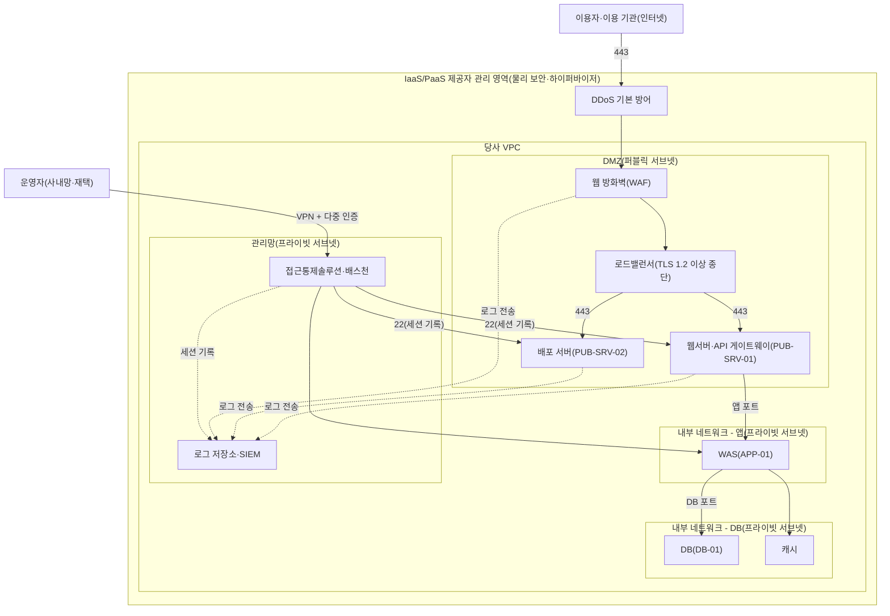

---
tags:
  - CSAP
  - 양식
  - 하등급SaaS
  - 기술적보호조치
control: 9.1.5 공개서버 보안
section: 9.1 공개서버 보안
doc_type: 양식
evidence: 네트워크 및 시스템 구성도
문서 양식 번호: LS-9.1.5-03
문서 양식 버전: 0.0.1
---

> [!note] 근거
> [해설서/하등급-SaaS/9.1.5 공개서버 보안](../../../해설서/하등급-SaaS/02.%20기술적%20보호%20조치/9.1.5%20공개서버%20보안.md)

# 공개서버 네트워크 및 시스템 구성도

| 문서번호 | 버전 | 기준일 | 작성자 | 검토자 | 승인자 |
| --- | --- | --- | --- | --- | --- |
| {{PUB-003}} | {{1.0}} | {{YYYY-MM-DD}} | {{인프라 운영 담당자 성명}} | {{정보보호 관리자 성명}} | {{CISO 성명}} |

## 1. 구성 개요

| 항목 | 내용 |
| --- | --- |
| 서비스 | {{서비스명}}(하등급 SaaS) |
| IaaS/PaaS 제공자 | {{제공자명}}, CSAP 인증 {{인증번호 / 유효기간}} |
| 리전·가용영역 | {{국내 리전명}}, {{가용영역}} (공공기관 데이터는 국내에 위치) |
| 계정·프로젝트 | 운영 {{계정 ID}}, 개발·시험 {{계정 ID}}(운영과 분리) |
| VPC | {{VPC 이름 / CIDR}} |
| 인터넷 진입점 | {{웹 방화벽/CDN}} → {{로드밸런서}} → DMZ 공개서버 |
| 관리자 진입점 | {{VPN}} → {{배스천 / 세션 관리 서비스}}(다중 인증) → 각 서버 |
| 구성도 원본 | {{다이어그램 파일 경로, 클라우드 콘솔 구성 내보내기 위치}} |

## 2. 네트워크 구성도

- 실선은 서비스·관리 통신, 점선은 로그 전송을 뜻한다. 화살표 방향은 통신을 개시하는 방향이다.
- DMZ에서 DB로 직접 향하는 경로는 두지 않는다. 불가피하게 존재하면 5항 매트릭스에 사유와 보완 통제를 기록한다.
- 제공자 관리 영역(물리 시설, 하이퍼바이저, DDoS 기본 방어)은 제공자 인증·계약으로 확인하며, 당사는 VPC 내부 구성을 책임진다.
- 실제 구성과 다르면 노드·연결을 수정하고, PaaS 실행 환경을 쓰면 해당 노드를 관리형 서비스명으로 바꾼다.

## 3. 네트워크 영역 정의

| 영역 | 서브넷·CIDR | 인터넷 직접 노출 | 배치 자산 | 보호 수단 | 비고 |
| --- | --- | --- | --- | --- | --- |
| DMZ | {{10.0.1.0/24}} | 있음(인바운드는 로드밸런서·웹 방화벽 경유) | 웹서버, API 게이트웨이, 배포 서버, 로드밸런서 | 웹 방화벽, 보안 그룹, 네트워크 ACL, 호스트 방화벽 | 개인정보·고유식별정보 저장 금지 |
| 내부 - 앱 | {{10.0.11.0/24}} | 없음 | WAS, 배치 서버 | 보안 그룹(DMZ의 특정 출발지만 허용) | |
| 내부 - DB | {{10.0.21.0/24}} | 없음 | DB, 캐시, 백업 | 보안 그룹(WAS 계층만 허용), 저장 암호화 | |
| 관리망 | {{10.0.31.0/24}} | 없음(VPN 경유) | 접근통제솔루션·배스천, 로그 저장소, 모니터링 | 다중 인증, 세션 기록, VPN 허용 IP 제한 | |
| 개발·시험 | {{별도 계정·VPC}} | 없음 | 개발·시험 서버 | 운영과 계정·VPC 분리 | 시험 엔드포인트 인터넷 비노출 |

## 4. 공개서버 목록

| ID | 명칭 | 유형 | 실행 형태 | 제공 서비스 | 전용 여부 | 공인 IP·도메인 | 노출 포트 | 위치 영역 | 운영 담당 | 접속이력 저장 | 최근 설정 점검(02) | 최근 취약점 점검(05) |
| --- | --- | --- | --- | --- | --- | --- | --- | --- | --- | --- | --- | --- |
| PUB-SRV-01 | {{웹서버·API 게이트웨이}} | {{웹 / API}} | {{VM / CT / PaaS}} | {{서비스명 웹·API}} | {{○}} | {{도메인, 공인 IP}} | {{443}} | DMZ | {{성명}} | {{○(로그 저장소명)}} | {{YYYY-MM-DD}} | {{YYYY-MM-DD}} |
| PUB-SRV-02 | {{배포 서버}} | 배포 | | {{앱·에이전트 배포}} | | | {{443}} | DMZ | | | | |
| PUB-SRV-03 | {{이용 기관 포털}} | 포털 | | | | | | DMZ | | | | |
| {{LB-01}} | {{로드밸런서}} | 관리형 | 관리형 | 인터넷 진입점 | 해당 없음 | | 443 | DMZ | | {{접근 로그 ○}} | 해당 없음 | |

- 로드밸런서·웹 방화벽·CDN 등 인터넷에 노출된 관리형 구성요소도 목록에 포함하고 실행 형태를 "관리형"으로 적는다.
- {{분기}}마다 클라우드 콘솔의 공인 IP·로드밸런서·DNS 레코드를 조회하여 목록에 없는 공개서버가 없는지 대조하고 대조 결과를 8항에 기록한다.

## 5. 영역 간 통신 허용 매트릭스

| No | 출발지 | 목적지 | 프로토콜·포트 | 업무 목적 | 통제 수단(보안 그룹·ACL·정책 ID) | 등록일 | 승인 근거 | 최근 검토일 |
| --- | --- | --- | --- | --- | --- | --- | --- | --- |
| 1 | 인터넷(0.0.0.0/0) | 웹 방화벽·로드밸런서 | TCP 443 | 이용자 서비스 접속 | {{sg-lb}} | | | |
| 2 | 로드밸런서 | PUB-SRV-01 | TCP {{443}} | 웹·API 서비스 | {{sg-web}}(출발지 sg-lb 한정) | | | |
| 3 | 로드밸런서 | PUB-SRV-02 | TCP {{443}} | 배포 파일 제공 | {{sg-dist}}(출발지 sg-lb 한정) | | | |
| 4 | PUB-SRV-01 | WAS(APP-01) | TCP {{8080}} | 응용 호출 | {{sg-app}}(출발지 sg-web 한정) | | | |
| 5 | WAS(APP-01) | DB(DB-01) | TCP {{3306}} | 데이터 처리 | {{sg-db}}(출발지 sg-app 한정) | | | |
| 6 | 배스천 | PUB-SRV-01, PUB-SRV-02 | TCP 22 | 관리자 접속(세션 기록) | {{sg-web, sg-dist}}(출발지 sg-bastion 한정) | | | |
| 7 | PUB-SRV-01, PUB-SRV-02 | 로그 저장소 | TCP {{443}} | 로그 전송 | {{sg-log}} | | | |
| 8 | PUB-SRV-01, PUB-SRV-02 | 인터넷(패치 저장소·외부 API) | TCP 443 | 패치·외부 연계 | {{이그레스 규칙, 목적지 한정}} | | | |
| 9 | DMZ 전체 | 내부 - DB | 전체 | 차단(기본 거부) | {{sg-db}} 인바운드에 DMZ 출발지 없음 | | | |

- 위 표에 없는 통신은 모두 차단한다. 매트릭스와 실제 보안 그룹·ACL 규칙의 일치 여부는 04. 공개서버 보안시스템 운영 현황의 정책 검토 시 확인한다.
- DMZ에서 DB로 직접 연결이 불가피한 경우: 사유 {{ }}, 보완 통제 {{DB 계정 최소 권한, 접속 IP 한정, 쿼리 로그 점검}}, 승인자 {{ }}, 승인일 {{YYYY-MM-DD}}

## 6. 보안시스템 배치

| 보안시스템 | 배치 위치 | 보호 대상 | 상세 |
| --- | --- | --- | --- |
| 웹 방화벽 | DMZ 앞단(로드밸런서 연동) | PUB-SRV-01, PUB-SRV-03 | 04 양식 3항 |
| 보안 그룹·네트워크 ACL | 각 서브넷·인스턴스 | 전체 | 04 양식 2항 |
| 호스트 방화벽(iptables)·네트워크 정책 | 각 공개서버·컨테이너 네임스페이스 | 전체 | 02 양식 3.3항 |
| 백신·EDR | 각 공개서버 | 전체 | 04 양식 4항 |
| 접근통제솔루션·배스천 | 관리망 | 전체 관리자 접속 | 04 양식 5항 |
| 로그 저장소·SIEM | 관리망 | 전체 | 04 양식 6항 |
| DDoS 방어 | 제공자 경계 | 전체 | 제공자 제공 범위 확인 |

## 7. 시스템 구성 정보

| ID | 호스트명 | 실행 형태 | OS·베이스 이미지 | 웹서버·런타임 | 사설 IP | 관리 접근 경로 | 백신·EDR | 로그 전송 |
| --- | --- | --- | --- | --- | --- | --- | --- | --- |
| PUB-SRV-01 | | | {{OS 및 버전}} | {{웹서버 및 버전}} | | 배스천 → 22 | {{제품명}} | {{에이전트명}} |
| PUB-SRV-02 | | | | | | | | |
| APP-01 | | | | | | | | |
| DB-01 | | | | | | | | |

## 8. 현행화 및 검토

- 공개서버·서브넷·통신 규칙이 변경되면 {{n}}영업일 이내에 본 문서를 갱신하고 버전을 올린다.
- {{분기}}마다 실제 구성(콘솔 조회, 규칙 내보내기)과 대조하여 일치 여부를 확인하고 아래에 기록한다.

| 검토일 | 검토 범위 | 대조 자료(기준일) | 결과 | 검토자 | 확인자 |
| --- | --- | --- | --- | --- | --- |
| {{YYYY-MM-DD}} | 공개서버 목록, 통신 매트릭스 | {{공인 IP 목록, 보안 그룹 내보내기}} | {{일치 / 차이 n건 조치}} | | |

## 9. 승인

| 구분 | 직위 | 성명 | 서명 | 일자 |
| --- | --- | --- | --- | --- |
| 작성(인프라 운영 담당자) | | | | |
| 검토(정보보호 관리자) | | | | |
| 승인(정보보호 최고책임자) | | | | |

## 10. 개정 이력

| 버전 | 기준일 | 변경 내용 | 작성자 | 승인자 |
| --- | --- | --- | --- | --- |
| 1.0 | {{YYYY-MM-DD}} | 최초 작성 | | |
